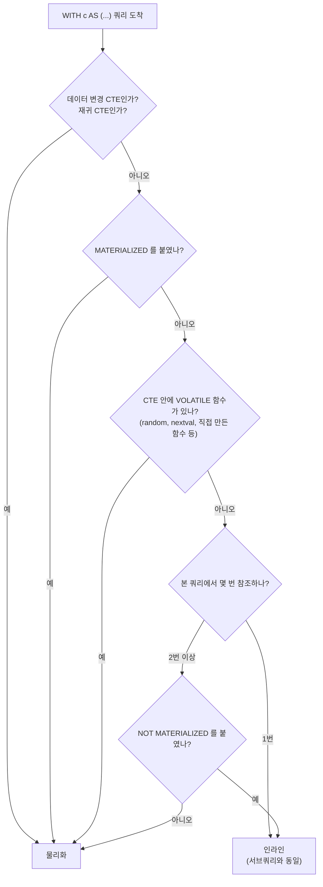

# CTE (WITH 절) — 이론

관련 문서: [실습](./CTE-실습.md)

> 전제: PostgreSQL 16, 수십만~수백만 행 테이블 기준.

---

## 1. 한 줄 요약 + 쉬운 설명

CTE(Common Table Expression)는 `WITH 이름 AS (쿼리)`로 정의하는, **그 SQL 문 안에서만 쓰는 이름 붙은 임시 결과**다.

자바로 치면 긴 식을 지역 변수로 빼 두는 것과 비슷하다. `WITH` 안에서 중간 결과에 이름을 붙이고, 아래 본 쿼리에서 그 이름을 테이블처럼 쓴다. 문장이 끝나면 사라진다.

CTE로 할 수 있는 일은 크게 세 가지다.

| 용도 | 형태 |
|---|---|
| 복잡한 쿼리를 단계별로 나눠 읽기 쉽게 | `WITH a AS (...), b AS (... FROM a) SELECT ... FROM b` |
| 트리·계층 구조 탐색 (조직도, 카테고리) | `WITH RECURSIVE` |
| 여러 데이터 변경을 한 문장으로 | `WITH d AS (DELETE ... RETURNING *) INSERT ... SELECT * FROM d` |

---

## 2. 왜 필요한가

### 2.1 중첩 서브쿼리는 안쪽부터 거꾸로 읽어야 한다

**Before** — "2025년 고객별 주문 합계 중 상위 10% 고객"

```sql
SELECT *
FROM (
    SELECT customer_id, total,
           ntile(10) OVER (ORDER BY total DESC) AS bucket
    FROM (
        SELECT customer_id, sum(amount) AS total
        FROM orders
        WHERE created_at >= '2025-01-01'
        GROUP BY customer_id
    ) t
) r
WHERE bucket = 1;
```

**After** — 위에서 아래로 읽힌다

```sql
WITH yearly AS (                       -- 1단계: 고객별 합계
    SELECT customer_id, sum(amount) AS total
    FROM orders
    WHERE created_at >= '2025-01-01'
    GROUP BY customer_id
),
ranked AS (                            -- 2단계: 10등분
    SELECT customer_id, total,
           ntile(10) OVER (ORDER BY total DESC) AS bucket
    FROM yearly
)
SELECT * FROM ranked WHERE bucket = 1; -- 3단계: 상위 10%
```

### 2.2 계층 구조를 애플리케이션에서 반복 조회하면 N+1이 된다

조직도에서 "부서장 아래 모든 직원"을 구할 때, JPA 자기 참조(`@ManyToOne manager`)로 자식을 하나씩 따라가면 노드 수만큼 쿼리가 나간다. `WITH RECURSIVE`는 **쿼리 1번**으로 끝난다.

### 2.3 "지우고 그 행을 다른 테이블에 넣기"가 한 문장이 된다

애플리케이션에서 `SELECT → DELETE → INSERT`를 따로 하면 중간에 실패할 때를 따로 처리해야 한다. 데이터 변경 CTE(Data-Modifying CTE)는 **한 문장이라 전부 성공하거나 전부 실패**한다. 이건 PostgreSQL의 강점이다. Oracle·MySQL은 `WITH` 안에 DML을 넣을 수 없다.

---

## 3. 기본 사용법

### 3.1 여러 CTE 이어 쓰기

```sql
WITH paid AS (
    SELECT * FROM orders WHERE status = 'PAID'
),
by_customer AS (
    SELECT customer_id, count(*) AS cnt FROM paid GROUP BY customer_id
)
SELECT c.name, b.cnt
FROM by_customer b
JOIN customer c ON c.id = b.customer_id;
```

- 쉼표로 여러 개를 정의하고, 뒤의 CTE는 앞의 CTE를 참조할 수 있다.
- CTE 안의 `ORDER BY`는 최종 결과 순서를 보장하지 않는다. **정렬은 마지막 SELECT에** 쓴다.

### 3.2 재귀 CTE — 하위 조직 전체

```sql
WITH RECURSIVE sub AS (
    -- ① 시작점 (1번 실행)
    SELECT id, manager_id, name, 1 AS depth
    FROM employee
    WHERE id = 2
  UNION ALL
    -- ② 반복 부분: 직전 단계에서 찾은 사람들의 부하 직원
    SELECT e.id, e.manager_id, e.name, s.depth + 1
    FROM employee e
    JOIN sub s ON e.manager_id = s.id
)
SELECT * FROM sub ORDER BY depth, id;
```

- `UNION ALL` 왼쪽은 **시작점**(비재귀 항, Non-recursive Term), 오른쪽은 **반복 부분**(재귀 항, Recursive Term)이다.
- 반복 부분의 `sub`는 전체 결과가 아니라 **"직전 단계에서 새로 찾은 행"만** 가리킨다. 그래서 한 번 돌 때마다 한 단계씩 내려간다.
- 새로 찾은 행이 0개가 되면 멈춘다.
- Oracle의 `CONNECT BY`와 달리 `LEVEL` 같은 자동 컬럼이 없다. 위의 `depth`처럼 직접 만든다.

### 3.3 데이터 변경 CTE — 아카이빙

```sql
WITH moved AS (
    DELETE FROM orders
    WHERE created_at < '2024-01-01'
    RETURNING *                     -- 지운 행을 결과로 돌려준다
)
INSERT INTO orders_archive
SELECT * FROM moved;
```

- `RETURNING`이 핵심이다. CTE 안의 DML이 바꾼 행은 **`RETURNING` 결과로만** 다음 단계에 전달된다.

### 3.4 MATERIALIZED / NOT MATERIALIZED (12+)

```sql
WITH c AS MATERIALIZED (SELECT ...)      -- 반드시 한 번 계산해서 저장
WITH c AS NOT MATERIALIZED (SELECT ...)  -- 저장하지 말고 서브쿼리처럼 펼쳐라
```

언제 쓰는지는 4장과 5장에서 설명한다. 대부분은 **안 쓰는 게 기본**이다.

---

## 4. 동작 원리

PostgreSQL은 CTE를 받으면 **두 방식 중 하나**로 실행한다. 이 차이가 CTE 성능의 거의 전부다.

| 방식 | 하는 일 | 결과 |
|---|---|---|
| **인라인 (Inlining)** | CTE를 서브쿼리처럼 본 쿼리에 펼친다 | 바깥 `WHERE`가 안으로 들어가고, 인덱스를 쓴다. CTE를 안 쓴 쿼리와 성능이 같다 |
| **물리화 (Materialization)** | CTE를 먼저 한 번 실행해 결과를 메모리에 저장하고, 본 쿼리는 그 저장본을 읽는다 | 여러 번 참조해도 한 번만 계산한다. 대신 저장본에는 **인덱스가 없고**, 바깥 `WHERE`는 **다 만든 뒤에** 걸린다 |

### 어느 쪽이 되는가



1. 쿼리가 오면 PostgreSQL은 실행계획을 짜기 전에 각 CTE를 펼칠지 저장할지 먼저 정한다.
2. **한 번만 참조하는 평범한 SELECT CTE는 펼친다.** 그래서 2장의 "Before/After" 두 쿼리는 실행계획이 같다. 가독성 목적의 CTE는 성능 걱정 없이 써도 된다.
3. **두 번 이상 참조하면 저장한다.** 같은 계산을 두 번 하지 않으려는 것이다.
4. 저장본을 읽는 단계는 실행계획에 `CTE Scan`으로 나타난다. 이게 보이면 물리화된 것이다.
5. 저장본이 `work_mem`(정렬·해시 등에 쓰는 메모리 한도, 기본 4MB)보다 크면 임시 파일로 넘어간다.

> **PostgreSQL 11 이하는 항상 물리화**한다. 그래서 예전 글에는 "CTE는 최적화를 막는 벽(Optimization Fence)이니 조심하라"는 말이 많다. 12부터는 위 규칙대로 동작한다.

### 재귀 CTE가 도는 방식

```
① 시작점 실행 → 결과 {2}                  ← "직전 단계 행" = {2}
② 반복 부분 실행 → 2의 부하 10명            ← "직전 단계 행" = 10명
③ 반복 부분 실행 → 그 10명의 부하 100명     ← "직전 단계 행" = 100명
...
⑥ 반복 부분 실행 → 0명 → 종료
최종 결과 = 각 단계 결과를 모두 합친 것
```

**새로 찾은 행이 0이 될 때까지** 돈다. 데이터에 순환(A의 상사가 B, B의 상사가 A)이 있으면 영원히 끝나지 않는다. PostgreSQL에는 MySQL(기본 1000단계)이나 SQL Server(기본 100단계) 같은 **재귀 깊이 제한이 없다.**

### 데이터 변경 CTE의 규칙

- 문장 전체가 **같은 시점의 데이터(스냅숏, Snapshot)** 를 본다. CTE에서 UPDATE한 결과를 본 쿼리에서 테이블로 다시 읽어도 **바꾸기 전 값**이 보인다.
- 본 쿼리에서 참조하지 않아도 **반드시 끝까지 실행된다.** (반대로 참조 안 한 SELECT CTE는 아예 실행되지 않는다.)

---

## 5. 실무 함정

### 함정 1 — CTE를 한 번 더 참조했더니 갑자기 느려졌다

- **증상**: 목록 조회 CTE에 "전체 건수"를 붙이려고 CTE를 한 번 더 참조했더니 응답이 10ms → 수백 ms.

```sql
WITH c AS (SELECT * FROM orders)
SELECT (SELECT count(*)    FROM c WHERE customer_id = 42),
       (SELECT sum(amount) FROM c WHERE customer_id = 42);
```

- **원인**: 참조가 1번 → 2번이 되면서 인라인에서 **물리화**로 바뀌었다. `orders` 전체(100만 행)를 먼저 저장한 뒤 `customer_id = 42`로 거른다. `customer_id` 인덱스는 쓰이지 않는다.
- **해결**:
  - 바깥 조건이 대부분을 걸러내는 경우 → `AS NOT MATERIALIZED`
  - 더 좋은 방법은 **조건을 CTE 안으로 옮기는 것**: `WITH c AS (SELECT * FROM orders WHERE customer_id = 42)`
  - 목록 + 전체 건수는 `count(*) OVER ()` 윈도 함수로 대신할 수 있는지 먼저 본다.

### 함정 2 — 반대로, NOT MATERIALIZED를 붙였더니 느려졌다

- **증상**: 함정 1을 보고 습관적으로 `NOT MATERIALIZED`를 붙였는데 더 느려졌다.

```sql
WITH agg AS NOT MATERIALIZED (
    SELECT customer_id, sum(amount) AS s FROM orders GROUP BY customer_id
)
SELECT count(*) FROM agg WHERE s > (SELECT avg(s) FROM agg);
```

- **원인**: 비싼 집계(100만 행 GROUP BY)를 두 번 참조한다. 펼치면 **집계가 두 번** 돈다. 이 경우는 저장(물리화)이 이득이다.
- **해결**: 키워드를 빼고 기본 동작(물리화)에 맡긴다. **"바깥 조건이 많이 걸러내면 NOT MATERIALIZED, 중간 결과가 작고 비싸면 기본"** 이 기준이다. 실행계획으로 확인하고 고른다.

### 함정 3 — 한 번만 참조했는데 인덱스를 안 탄다

- **증상**: `WITH c AS (SELECT *, mask_phone(phone) FROM member) SELECT * FROM c WHERE id = 1`이 전체 스캔.
- **원인**: CTE 안에 **VOLATILE 함수**가 있으면 물리화된다. VOLATILE은 "호출할 때마다 결과가 달라질 수 있는 함수"라는 뜻이다. `CREATE FUNCTION`할 때 따로 지정하지 않으면 **기본값이 VOLATILE**이라 직접 만든 함수에서 자주 생긴다.
- **확인**:

```sql
SELECT proname, provolatile FROM pg_proc WHERE proname = 'mask_phone';  -- 'v'면 VOLATILE
```

- **해결**: 입력이 같으면 결과도 같은 함수라면 `ALTER FUNCTION mask_phone(text) IMMUTABLE;` 처럼 바꾼다. 바꿀 수 없으면 `WHERE` 조건을 CTE 안으로 옮긴다.

### 함정 4 — 재귀 CTE가 끝나지 않는다

- **증상**: 조직도 조회 API가 타임아웃, DB 디스크 사용량 급증.
- **원인**: 데이터에 순환이 생겼다 (잘못된 UPDATE로 A의 상사 = B, B의 상사 = A). `UNION ALL`은 같은 행이 다시 나와도 계속 돈다. `UNION`으로 바꿔도 `depth`처럼 매번 바뀌는 컬럼이 있으면 "같은 행"으로 안 보여서 소용없다.
- **해결** (하나 이상 적용):

```sql
-- PG14+: CYCLE 절로 순환 감지
WITH RECURSIVE sub AS (...)
CYCLE id SET is_cycle USING path
SELECT * FROM sub WHERE NOT is_cycle;

-- PG12~13: 지나온 경로를 배열로 들고 다니며 직접 막기
... SELECT e.id, s.path || e.id
    FROM employee e JOIN sub s ON e.manager_id = s.id
    WHERE NOT e.id = ANY (s.path)   -- 이미 지나온 노드면 중단
      AND s.depth < 50              -- 깊이 상한
```

- 추가로 API용 커넥션에는 `statement_timeout`을 걸어 둔다. 가상 스레드로 동시 요청이 많아도 커넥션 수는 그대로라, 끝나지 않는 쿼리 몇 개가 **커넥션 풀을 고갈**시킨다.

### 함정 5 — 재귀 CTE가 트리 크기에 비례해 느리다

- **증상**: 깊이 5짜리 조직도 조회가 테이블이 커질수록 느려진다.
- **원인**: 반복 부분은 단계마다 다시 실행된다. `e.manager_id = s.id`의 `manager_id`에 인덱스가 없으면 **단계마다 테이블 전체를 읽는다.** (5단계면 전체 스캔 5번)
- **해결**: `CREATE INDEX ON employee (manager_id);` — 재귀 CTE에서 조인하는 컬럼에는 인덱스가 거의 필수다.

### 함정 6 — CTE에서 UPDATE했는데 같은 쿼리에서 옛날 값이 나온다

- **증상**:

```sql
WITH u AS (UPDATE orders SET status = 'PAID' WHERE id = 1 RETURNING *)
SELECT status FROM orders WHERE id = 1;     -- 'PAID'가 아니라 'PENDING'
```

- **원인**: 문장 전체가 같은 스냅숏을 본다(4장). 테이블을 다시 읽으면 바꾸기 전 값이 보인다.
- **해결**: 바뀐 값은 `SELECT status FROM u`처럼 **`RETURNING` 결과로 읽는다.** 다음 문장부터는 테이블에서도 바뀐 값이 보인다.

---

## 6. 실행계획에서 확인하기

`EXPLAIN (ANALYZE, BUFFERS)`로 볼 것은 이 정도면 충분하다.

| 보이는 것 | 뜻 | 볼 숫자 |
|---|---|---|
| CTE라는 단어가 **없음** | 인라인됨. 서브쿼리와 똑같이 처리 | 원본 테이블에 `Index Scan` / `Index Cond`가 있는지 |
| `CTE c` 블록 + `CTE Scan on c` | 물리화됨 | `CTE Scan`의 **`Rows Removed by Filter`** — 크면 저장해 놓고 대부분 버리는 중 |
| `CTE Scan`이 같은 이름으로 여러 개 | 저장본 하나를 여러 번 읽음 | `CTE c` 아래 노드가 한 번만 실행됐는지 (`loops=1`) |
| `Recursive Union` | 재귀 CTE | `actual rows` = 최종 결과 행 수 |
| 반복 부분 아래 `Seq Scan ... loops=5` | 단계마다 테이블 전체를 읽음 (함정 5) | `loops`와 `Buffers` |
| `Buffers: temp read/written` | 저장본이 메모리를 넘어 임시 파일로 감 | 값이 크면 CTE 결과가 너무 큼 |

예 — 함정 1의 실행계획 (핵심 줄만):

```
CTE Scan on c  (rows=5000) (actual rows=10)
  Filter: (customer_id = 42)
  Rows Removed by Filter: 999990          ← 100만 행 만들고 10행만 씀
  CTE c
    ->  Seq Scan on orders  (actual rows=1000000)   ← 인덱스 없이 전체 읽기
```

`rows=5000`(추정)과 `actual rows=10`(실제)이 크게 다른 것도 눈여겨본다. 물리화된 CTE에 조건을 걸면 PostgreSQL이 통계를 쓰지 못해 대충 추정한다(16 이하). 이 오차가 그 위의 조인 방식 선택을 망칠 수 있다.

---

## 7. 비교·선택 기준

| 방식 | 인덱스 | 여러 번 쓰면 | 수명 | 이럴 때 |
|---|---|---|---|---|
| CTE (1회 참조) | 원본 인덱스 사용 | — | 한 문장 | **가독성** 목적. 고민 없이 써도 됨 |
| CTE (2회+ 참조) | 저장본엔 없음 | 한 번 계산 후 공유 | 한 문장 | 중간 결과가 **작고 계산이 비쌀 때** |
| 서브쿼리 | 원본 인덱스 사용 | 매번 계산 | 한 문장 | 한 번만 쓰는 짧은 조건 |
| 임시 테이블 (`CREATE TEMP TABLE`) | **만들 수 있음** | 공유 | 세션 | 중간 결과가 **크고** 여러 쿼리에서 조건 조회할 때 (만든 뒤 `ANALYZE`) |
| 뷰 (`VIEW`) | 원본 인덱스 사용 | 매번 계산 | 영구 | 여러 쿼리가 **같은 정의를 공유**할 때 |

재귀 CTE의 대안:

| 방식 | 이럴 때 |
|---|---|
| `WITH RECURSIVE` + `parent_id` | 트리가 자주 바뀌고 깊이가 수십 이하 (대부분의 경우) |
| `ltree` 확장 (경로 문자열 저장) | 조회가 압도적으로 많고 트리가 깊을 때 |
| 애플리케이션에서 반복 조회 | 쓰지 않는다 (N+1) |

---

## 8. 백엔드 코드와의 연결

- **JPA/HQL**: Hibernate **6.2+**(Spring Boot 3.1+)부터 HQL에서 `WITH` 절과 재귀 CTE를 지원한다. 그 이전(Spring Boot 3.0, 2.x)이나 QueryDSL에서는 **네이티브 쿼리**로 쓴다.
- **JPA 자기 참조 트리**: `@ManyToOne parent` + 지연 로딩으로 트리를 그리면 N+1. 재귀 CTE 네이티브 쿼리로 id와 depth를 한 번에 가져오는 것이 일반적인 해법이다.
- **네이티브 DML은 영속성 컨텍스트를 모른다**: 데이터 변경 CTE로 지운 행이 같은 트랜잭션의 1차 캐시에는 남아 있을 수 있다. 필요하면 실행 후 `em.clear()`.
- **배치는 트랜잭션을 나눠서**: 수십만 행 아카이빙을 `@Transactional` 메서드 하나에서 반복하면 전부 한 트랜잭션이 되어 락이 오래 잡힌다. 묶음(예: 1만 행)마다 커밋한다.
- **MyBatis**: `<if>`로 바깥 WHERE를 동적으로 붙일 때, CTE를 2번 이상 참조하면 그 조건이 CTE 안으로 안 들어간다(함정 1). 동적 조건은 **CTE 안쪽**에 넣는다.

코드 예시는 [실습 4장](./CTE-실습.md#4-애플리케이션-연동)에 있다.

---

## 9. 자가 점검 질문

**Q1.** PostgreSQL 16에서 한 번만 참조하는 CTE와 같은 내용의 서브쿼리는 성능이 다를까?

<details><summary>답</summary>

같다. 한 번만 참조하는 평범한 SELECT CTE는 인라인되어 서브쿼리와 똑같이 처리된다. 실행계획에 CTE라는 단어도 나오지 않는다. 단 CTE 안에 VOLATILE 함수가 있거나 `MATERIALIZED`를 붙였거나, PostgreSQL 11 이하라면 물리화된다.
</details>

**Q2.** CTE를 두 번 참조하는 쿼리가 느리다. `NOT MATERIALIZED`를 붙이기 전에 무엇을 확인해야 하나?

<details><summary>답</summary>

실행계획에서 `CTE Scan`의 `Rows Removed by Filter`를 본다. 크면(저장해 놓고 대부분 버림) `NOT MATERIALIZED`나 조건을 CTE 안으로 옮기는 게 유리하다. 반대로 CTE가 비싼 집계이고 결과가 작으면, 펼쳤을 때 집계가 두 번 돌아 더 느려진다. 두 경우의 실행 시간을 직접 비교하고 고른다.
</details>

**Q3.** 재귀 CTE에서 `UNION ALL`을 `UNION`으로 바꿨는데도 순환 데이터에서 끝나지 않는다. 왜인가?

<details><summary>답</summary>

`UNION`은 행 전체가 같을 때만 중복으로 버린다. `depth + 1`처럼 단계마다 값이 바뀌는 컬럼이 있으면 같은 노드로 돌아와도 행이 달라서 계속 돈다. PG14+는 `CYCLE` 절, 그 이하는 경로 배열 + `NOT id = ANY(path)`로 막고, 깊이 상한과 `statement_timeout`도 함께 둔다.
</details>

---

## 10. 용어 정리

| 용어 | 영문 | 한 줄 설명 |
|---|---|---|
| CTE | Common Table Expression | `WITH`로 정의한, 한 문장 안에서만 쓰는 이름 붙은 임시 결과 |
| 재귀 CTE | Recursive CTE | `WITH RECURSIVE`로 자기 자신을 참조해 계층을 따라가는 CTE |
| 데이터 변경 CTE | Data-Modifying CTE | `WITH` 안에 `INSERT/UPDATE/DELETE ... RETURNING`을 넣은 것 |
| `RETURNING` | — | DML이 바꾼 행을 결과로 돌려주는 PostgreSQL 구문 |
| 비재귀 항 | Non-recursive Term | 재귀 CTE의 `UNION ALL` 왼쪽, 한 번 실행되는 시작점 |
| 재귀 항 | Recursive Term | `UNION ALL` 오른쪽, 새 행이 없을 때까지 반복되는 부분 |
| 인라인 | Inlining | CTE를 서브쿼리처럼 본 쿼리에 펼쳐 함께 최적화하는 것 |
| 물리화 | Materialization | CTE를 먼저 실행해 결과를 저장해 두고 읽는 것 |
| `work_mem` | — | 정렬·해시·CTE 저장본 등에 쓰는 메모리 한도, 기본 4MB |
| 최적화 펜스 | Optimization Fence | 바깥 조건이 CTE 안으로 들어가지 못하는 상태. 11 이하 CTE의 별명 |
| 스냅숏 | Snapshot | 쿼리가 보는 "특정 시점의 데이터 상태" |
| VOLATILE 함수 | Volatile Function | 호출마다 결과가 달라질 수 있는 함수. 직접 만든 함수의 기본값 |
| `CTE Scan` | — | 실행계획에서 물리화된 CTE 저장본을 읽는 단계 |
| `Recursive Union` | — | 실행계획에서 재귀 CTE의 반복을 수행하는 단계 |
| `CYCLE` 절 | CYCLE Clause | 재귀 중 순환을 감지해 표시해 주는 구문 (14+) |
| `statement_timeout` | — | 한 문장의 최대 실행 시간, 기본 0(무제한) |

참고: [PostgreSQL 공식 문서 7.8 WITH Queries](https://www.postgresql.org/docs/current/queries-with.html)
