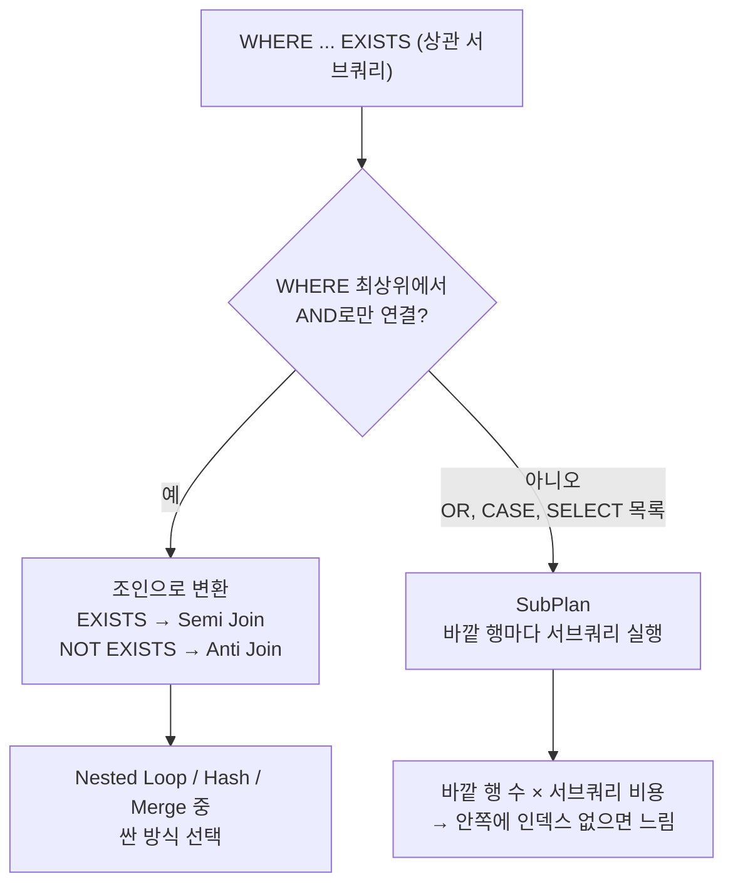

# EXISTS / NOT EXISTS — 이론

관련 문서: [실습](./EXISTS-실습.md) · [LEFT조인 이론](../LEFT조인/LEFT조인-이론.md) · [매퍼 함수 빈도 통계](../매퍼함수빈도통계.md)

> 전제: PostgreSQL 16, 수십만~수백만 행 테이블 기준. 예제의 "매퍼 n회"는 AplusIDE4Gaplus `com/aplus/sqlmap` 414개 파일 기준.

| 패턴 | 매퍼 등장 | 파일 수 |
|---|---:|---:|
| `EXISTS (` (NOT 포함) | 254 | 63 |
| `NOT EXISTS (` | 107 | 48 |
| `IN (SELECT` | 988 | 110 |
| **`NOT IN (SELECT`** | **191** | **24** ← 함정 1·2 후보 |

---

## 1. 한 줄 요약 + 쉬운 설명

**`EXISTS (서브쿼리)`는 서브쿼리가 한 행이라도 돌려주면 참, 하나도 없으면 거짓인 조건이다. `NOT EXISTS`는 그 반대다.**

- "이 고객에게 주문이 **있나**?"처럼 **있다/없다만** 궁금할 때 쓴다.
- 몇 건인지, 어떤 값인지는 보지 않는다. 그래서 첫 행을 찾는 순간 멈춘다.
- 서브쿼리의 `SELECT` 목록(`SELECT 1`, `SELECT *`, `SELECT 'X'`)은 무시된다. 무엇을 써도 같다.

비유: 출석부에 이름이 **있는지만** 확인하는 것. 몇 번 나왔는지 세지 않고, 찾으면 바로 덮는다.

---

## 2. 왜 필요한가

"주문이 한 번이라도 있는 고객"을 JOIN으로 구하면 **주문 수만큼 고객이 중복**된다.

```sql
-- Before: JOIN → 주문 10건인 고객은 10번 나옴 → DISTINCT로 다시 지움 (정렬·해시 비용)
SELECT DISTINCT c.*
FROM customer c
JOIN orders o ON o.customer_id = c.id;

-- After: EXISTS → 고객당 1번. 주문을 찾으면 그 고객은 더 안 봄
SELECT c.*
FROM customer c
WHERE EXISTS (SELECT 1 FROM orders o WHERE o.customer_id = c.id);
```

"주문이 **없는** 고객"은 JOIN만으로는 바로 못 쓴다. `NOT EXISTS`가 가장 직접적인 표현이다.

```sql
SELECT c.*
FROM customer c
WHERE NOT EXISTS (SELECT 1 FROM orders o WHERE o.customer_id = c.id);
```

---

## 3. 기본 사용법

### 3.1 있으면 / 없으면 거르기 (상관 서브쿼리)

```sql
-- 최근 30일 내 주문이 있는 고객
SELECT c.id, c.name
FROM customer c
WHERE EXISTS (
    SELECT 1 FROM orders o
    WHERE o.customer_id = c.id              -- ← 바깥 행과 연결하는 조건 (상관 조건)
      AND o.ordered_at >= now() - INTERVAL '30 days'
);
```

**상관 서브쿼리**(correlated subquery)는 바깥 쿼리의 컬럼(`c.id`)을 참조하는 서브쿼리다. 개념상 바깥 행마다 다시 평가된다.

### 3.2 예외 목록 빼기 (NOT EXISTS)

```sql
-- 매퍼에 실제로 있는 형태: (회사코드, 상품코드)가 예외 상품 테이블에 없는 계약
SELECT a.*
FROM sn_cont a
WHERE NOT EXISTS (
    SELECT 1 FROM sn_excpt_prdt_cd e
    WHERE e.coal_co_cd = a.coal_co_cd
      AND e.prdt_cd    = a.mcont_pitem
);
-- 매퍼 원문은 (a.coal_co_cd, a.mcont_pitem) NOT IN (SELECT coal_co_cd, prdt_cd FROM sn_excpt_prdt_cd)
```

### 3.3 존재 여부를 값으로 받기

```sql
-- 애플리케이션에서 boolean으로 받는다
SELECT EXISTS (SELECT 1 FROM orders WHERE customer_id = 42) AS has_order;   -- true / false
```

> Oracle에는 boolean 타입이 없어서 `SELECT CASE WHEN EXISTS(...) THEN 'Y' ELSE 'N' END FROM DUAL`로 쓴다.
> MySQL은 `SELECT EXISTS(...)`가 1/0을 돌려준다.

### 3.4 UPDATE / DELETE 대상 거르기

```sql
-- 주문이 없는 휴면 고객 삭제 (실습에서는 BEGIN ... ROLLBACK으로)
DELETE FROM customer c
WHERE c.status = 'DORMANT'
  AND NOT EXISTS (SELECT 1 FROM orders o WHERE o.customer_id = c.id);
```

---

## 4. 동작 원리

"바깥 행마다 서브쿼리를 다시 돈다"는 **개념상의 설명**이다. 실제로 PostgreSQL은 가능하면 이걸 **조인으로 바꿔서** 한꺼번에 처리한다.

1. **바꿀 수 있는지 본다** — `EXISTS`가 WHERE 절 맨 바깥에서 `AND`로만 연결돼 있으면 조인으로 바꿀 수 있다.
2. **세미 조인 / 안티 조인으로 바꾼다** — `EXISTS` → **세미 조인**(semi join: 짝이 하나라도 있으면 바깥 행을 한 번만 내보내는 조인). `NOT EXISTS` → **안티 조인**(anti join: 짝이 하나도 없을 때만 내보내는 조인).
3. **조인 방식을 고른다** — 일반 조인처럼 Nested Loop / Hash / Merge 중 비용이 싼 것을 고른다. 안쪽 테이블에 인덱스가 있고 바깥 행이 적으면 Nested Loop, 둘 다 크면 Hash가 흔하다.
4. **바꿀 수 없으면 SubPlan으로 남긴다** — `OR`로 엮였거나 `SELECT` 목록·`CASE` 안에 있으면 조인으로 못 바꾼다. 이때는 **바깥 행마다 서브쿼리를 실제로 실행**한다 (함정 3).
5. **상관 조건이 없으면 한 번만 실행한다** — `EXISTS (SELECT 1 FROM config WHERE use_yn='Y')`처럼 바깥과 무관하면 처음에 한 번 계산해서 참/거짓을 정한다 (`InitPlan`).



**`IN (SELECT ...)`도 같은 길을 탄다.** PostgreSQL은 `IN (서브쿼리)`도 세미 조인으로 바꾼다. 그래서 "EXISTS가 IN보다 빠르다"는 PG에서는 대부분 **사실이 아니다** — 실행계획이 같다. 다만 **`NOT IN`은 안티 조인으로 바뀌지 않는다.** 이 차이가 함정 1·2의 뿌리다.

---

## 5. 실무 함정

### 함정 1 — `NOT IN` 서브쿼리에 NULL이 하나라도 있으면 결과가 0건

**증상**: 어제까지 잘 나오던 "주문 없는 고객" 목록이 갑자기 0건이 된다. 에러는 없다.

**원인**: `x NOT IN (1, 2, NULL)`은 `x <> 1 AND x <> 2 AND x <> NULL`이다. `x <> NULL`은 참도 거짓도 아닌 **UNKNOWN**이고, `AND`에 UNKNOWN이 섞이면 전체가 참이 될 수 없다. 그래서 어떤 행도 통과하지 못한다. 비회원 주문처럼 `customer_id`가 NULL인 행이 **딱 한 건** 들어오면 터진다.

```sql
SELECT 3 NOT IN (1, 2, NULL);                 -- NULL (참이 아님 → WHERE에서 걸러짐)
SELECT NOT EXISTS (SELECT 1 FROM (VALUES (1),(2),(NULL)) t(v) WHERE t.v = 3);  -- true
```

**해결**: `NOT EXISTS`로 바꾼다. `NOT EXISTS`는 "같은 값이 있는가"만 보므로 NULL 행은 그냥 짝이 안 되는 행일 뿐이다. 꼭 `NOT IN`을 쓰려면 서브쿼리에 `WHERE col IS NOT NULL`을 붙인다. 매퍼의 `NOT IN (SELECT` 191회는 서브쿼리 컬럼이 `NOT NULL`인지 하나씩 확인할 가치가 있다.

### 함정 2 — `NOT IN` 서브쿼리가 크면 바깥 행마다 전체를 훑는다

**증상**: 개발 DB에서는 1초 걸리던 `NOT IN` 쿼리가 운영에서 몇십 분 돌다가 타임아웃난다.

**원인**: 함정 1의 NULL 규칙 때문에 PostgreSQL은 `NOT IN`을 안티 조인으로 바꾸지 못한다 (PG 17 기준. 이후 버전은 `확인 필요`). 대신 두 가지 중 하나로 실행한다.
- 서브쿼리 결과가 **`work_mem`**(정렬·해시용 메모리 한도)에 들어가면 → 해시 테이블을 한 번 만들고 조회 (`hashed SubPlan`). 빠르다.
- **안 들어가면** → 바깥 행마다 서브쿼리 결과를 처음부터 훑는다 (`SubPlan`). 바깥 10만 × 안쪽 100만 = 최악 1,000억 번 비교.

데이터가 늘어 해시가 메모리 한도를 넘는 순간 **같은 쿼리의 계획이 갑자기 바뀐다.** 그래서 "어느 날 갑자기 느려짐"으로 나타난다.

```sql
EXPLAIN SELECT * FROM customer WHERE id NOT IN (SELECT customer_id FROM orders);
-- Filter: (NOT (hashed SubPlan 1))   ← 지금은 괜찮음
-- Filter: (NOT (SubPlan 1))          ← 이게 보이면 위험
```

**해결**: `NOT EXISTS`로 바꾸면 `Hash Anti Join`이 되고, 메모리가 모자라도 디스크로 나눠 처리할 뿐 행마다 재스캔하지 않는다.

### 함정 3 — `OR EXISTS`, `CASE WHEN EXISTS`는 조인으로 안 바뀐다

**증상**: `EXISTS` 하나 추가했을 뿐인데 쿼리가 수십 배 느려진다. 실행계획에 `SubPlan`과 `loops=100000` 같은 큰 숫자가 보인다.

**원인**: 4장 1단계. `OR`로 엮이면 "EXISTS가 거짓이어도 다른 조건으로 통과할 수 있는 행"이 있어서 세미 조인으로 바꿀 수 없다. 그래서 바깥 행마다 서브쿼리를 실행한다. iBatis 동적 SQL(`<isNotEmpty>` 12,780회)로 조건을 조립하다 보면 `OR EXISTS`가 쉽게 생긴다.

```sql
WHERE c.grade = 'VIP'
   OR EXISTS (SELECT 1 FROM orders o WHERE o.customer_id = c.id AND o.amount > 1000000)
```

**해결**:
- 서브쿼리의 상관 컬럼(`orders.customer_id`)에 **인덱스**가 있으면 행마다 실행해도 인덱스 한 번 찍고 끝나서 견딜 만하다. 최소한 이것부터.
- 그래도 느리면 `UNION`으로 쪼갠다: `... WHERE grade='VIP' UNION SELECT ... WHERE EXISTS(...)`.

### 함정 4 — 상관 조건에 별칭을 빼먹어서 항상 참

**증상**: "주문 있는 고객"을 뽑았는데 **모든 고객**이 나온다.

**원인**: 서브쿼리 안에서 별칭 없이 쓴 컬럼은 **안쪽 테이블부터** 찾는다. `orders`에도 `id` 컬럼이 있으면 `id = id`가 `o.id = o.id`가 되어 항상 참이다. 바깥과의 연결이 끊긴 상태라 `orders`에 행이 하나라도 있으면 모든 고객이 통과한다. 에러는 나지 않는다.

```sql
WHERE EXISTS (SELECT 1 FROM orders o WHERE o.customer_id = id)    -- id → o.id 로 해석됨!
WHERE EXISTS (SELECT 1 FROM orders o WHERE o.customer_id = c.id)  -- 올바름
```

**해결**: 서브쿼리 안에서는 **모든 컬럼에 별칭**을 붙인다. 실행계획에 `InitPlan`(한 번만 실행)이 나왔다면 상관 조건이 끊겼다는 신호다.

### 함정 5 — 존재 확인을 `COUNT(*)`로 하고, 확인 후 INSERT한다

**증상 A**: "이미 등록됐는지" 확인 쿼리가 느리다. 등록 건수가 많은 사용자일수록 더 느리다.
**증상 B**: 중복 체크를 했는데도 가끔 중복 데이터가 들어간다.

**원인 A**: `SELECT COUNT(*) ... > 0`은 조건에 맞는 행을 **전부** 센다. 있는지만 알면 되는데 끝까지 읽는다. `EXISTS`는 첫 행에서 멈춘다. (매퍼에 `SELECT COUNT(*) AS ...CNT` 형태가 158회 — 전부가 존재 확인은 아니지만 후보다.)

**원인 B**: `NOT EXISTS`로 확인 → `INSERT`는 두 단계라서, 두 요청이 동시에 "없음"을 보고 둘 다 넣을 수 있다. 같은 트랜잭션 안에 넣어도 기본 격리 수준(READ COMMITTED)에서는 막히지 않는다.

**해결**: A는 `SELECT EXISTS (...)`로. B는 **유니크 제약**을 걸고 `INSERT ... ON CONFLICT DO NOTHING`, 또는 제약 위반 예외(`DuplicateKeyException`)를 잡는다. 존재 확인은 사용자에게 친절한 메시지를 위한 것이고, 중복 방지는 DB 제약이 한다.

---

## 6. 실행계획에서 확인하기

| 보이는 것 | 뜻 |
|---|---|
| `Hash Semi Join` / `Nested Loop Semi Join` | `EXISTS`·`IN`이 세미 조인으로 바뀌었다. 정상 |
| `Hash Anti Join` / `Merge Anti Join` | `NOT EXISTS`가 안티 조인으로 바뀌었다. 정상 |
| `Filter: (NOT (hashed SubPlan 1))` | `NOT IN`이 해시로 처리됨. 지금은 괜찮지만 데이터가 늘면 아래로 바뀔 수 있음 |
| `Filter: (NOT (SubPlan 1))` / `SubPlan 1` + 큰 `loops=` | 바깥 행마다 서브쿼리 실행. `loops` × 서브쿼리 1회 시간이 전체 시간 |
| `InitPlan 1` + `One-Time Filter` | 상관 조건 없는 EXISTS. 한 번만 실행. 의도와 다르면 함정 4 |
| `Rows Removed by Join Filter` | Nested Loop에서 짝 찾다 버린 행. 크면 안쪽 인덱스 확인 |

> PG 17부터 `NOT IN` 표기가 `Filter: (NOT (ANY (c.id = (hashed SubPlan 1).col1)))`처럼 길어졌다. `hashed`가 있는지, `SubPlan`의 `loops`가 몇인지만 보면 된다.

---

## 7. 비교·선택 기준

| 쓰고 싶은 것 | `EXISTS` / `NOT EXISTS` | `IN` / `NOT IN` (서브쿼리) | `JOIN` / `LEFT JOIN ... IS NULL` |
|---|---|---|---|
| PG가 조인으로 바꾸나 | ○ 세미/안티 조인 | `IN` ○ / **`NOT IN` ✗** | 원래 조인 |
| NULL 안전 | ○ | `IN` ○ / **`NOT IN` ✗** | ○ |
| 결과 중복 | 없음 | 없음 | `JOIN`은 1:N이면 중복 |
| 안쪽 컬럼을 SELECT에 쓸 수 있나 | ✗ | ✗ | ○ |
| 여러 컬럼 비교 | 조건을 AND로 | `(a,b) IN (SELECT x,y ...)` | ON 절에 AND |

**이럴 땐 이것**

- **있는 것만**: `EXISTS`나 `IN` 아무거나. PG에서는 계획이 거의 같다. 읽기 편한 쪽으로.
- **없는 것만**: **`NOT EXISTS`**. `NOT IN (SELECT ...)`은 쓰지 않는다.
- **안쪽 테이블 값도 가져와야 함**: `JOIN`. 1:N이면 중복 처리를 생각한다.
- **`LEFT JOIN ... WHERE o.id IS NULL`**: `NOT EXISTS`와 같은 안티 조인이 된다. 결과도 같다. 의도가 더 잘 보이는 `NOT EXISTS`를 권장 ([LEFT조인 이론](../LEFT조인/LEFT조인-이론.md) 참고).
- **값 목록이 상수**(`NOT IN ('A','B')`): 서브쿼리가 아니므로 함정 2는 없다. 다만 목록에 NULL을 넣으면 함정 1은 똑같다.

---

## 8. 백엔드 코드와의 연결

- **MyBatis/iBatis 존재 확인**: `SELECT EXISTS(...)`를 `resultType="boolean"`으로 받는다. `COUNT(*)` 받아서 `> 0` 비교하는 코드를 대체한다.
- **동적 SQL**: `<isNotEmpty>` / `<if>`로 `OR EXISTS`를 덧붙이는 패턴은 함정 3. 조건이 붙을 때와 안 붙을 때 실행계획이 완전히 달라지므로 둘 다 EXPLAIN 해 본다.
- **`foreach`로 만든 `NOT IN (#{a}, #{b}, ...)`**: Java 리스트에 `null`이 섞이면 함정 1과 같은 이유로 0건이 된다. 리스트에서 null을 먼저 제거한다.
- **JPA**: Spring Data의 `existsByCustomerId()`는 `SELECT ... LIMIT 1` 형태로 실행된다(구현에 따라 다름 — `확인 필요`). `countBy...() > 0`보다 낫다. JPQL에서도 `WHERE NOT EXISTS (SELECT 1 FROM Order o WHERE o.customer = c)`를 그대로 쓸 수 있다.
- **`@Transactional` + 중복 체크**: 함정 5-B. 트랜잭션으로 감싸도 READ COMMITTED에서는 중복을 못 막는다. 유니크 제약이 최종 방어선이다.

---

## 9. 자가 점검 질문

1. `SELECT * FROM customer WHERE id NOT IN (SELECT customer_id FROM orders)`가 0건을 돌려줬다. 고객 중 주문 없는 사람이 분명히 있다. 가장 먼저 확인할 것은?
2. PostgreSQL에서 `IN (SELECT ...)`을 `EXISTS`로 바꾸면 빨라지는가?
3. `WHERE a = 1 OR EXISTS (...)`가 느리다. 실행계획에서 무엇을 보고, 어떻게 고치나?

<details>
<summary>답 보기</summary>

1. `orders.customer_id`에 NULL이 있는지 (`SELECT count(*) FROM orders WHERE customer_id IS NULL`). 하나라도 있으면 `NOT IN`은 아무 행도 통과시키지 않는다. `NOT EXISTS`로 바꾼다.
2. 대부분 아니다. PG는 둘 다 세미 조인으로 바꾸므로 실행계획이 같다. 차이가 나는 건 `NOT IN` vs `NOT EXISTS`다.
3. `SubPlan`과 그 `loops` 값(바깥 행 수만큼)을 본다. `OR` 때문에 세미 조인으로 못 바뀐 것이다. 먼저 서브쿼리 상관 컬럼에 인덱스를 확인하고, 그래도 느리면 `UNION`으로 두 쿼리로 쪼갠다.

</details>

---

## 10. 용어 정리

| 용어 | 영문 | 한 줄 설명 |
|---|---|---|
| 상관 서브쿼리 | Correlated subquery | 바깥 쿼리의 컬럼을 참조하는 서브쿼리 |
| 상관 조건 | Correlation predicate | 서브쿼리와 바깥 행을 연결하는 조건 (`o.customer_id = c.id`) |
| 세미 조인 | Semi join | 짝이 하나라도 있으면 바깥 행을 한 번만 내보내는 조인 |
| 안티 조인 | Anti join | 짝이 하나도 없을 때만 바깥 행을 내보내는 조인 |
| SubPlan | SubPlan | 조인으로 못 바뀐 서브쿼리. 바깥 행마다 실행됨 |
| InitPlan | InitPlan | 바깥과 무관한 서브쿼리. 처음에 한 번만 실행됨 |
| 3값 논리 | Three-valued logic | 참·거짓·UNKNOWN. NULL 비교 결과는 UNKNOWN |
| work_mem | work_mem | 정렬·해시 작업 하나가 쓸 수 있는 메모리 한도 |
| 유니크 제약 | Unique constraint | 같은 값이 두 번 들어가지 못하게 DB가 막는 규칙 |

---

참고: [PostgreSQL 공식 문서 — 서브쿼리 표현식(EXISTS, IN, NOT IN)](https://www.postgresql.org/docs/current/functions-subquery.html) · [EXPLAIN 사용법](https://www.postgresql.org/docs/current/using-explain.html)
