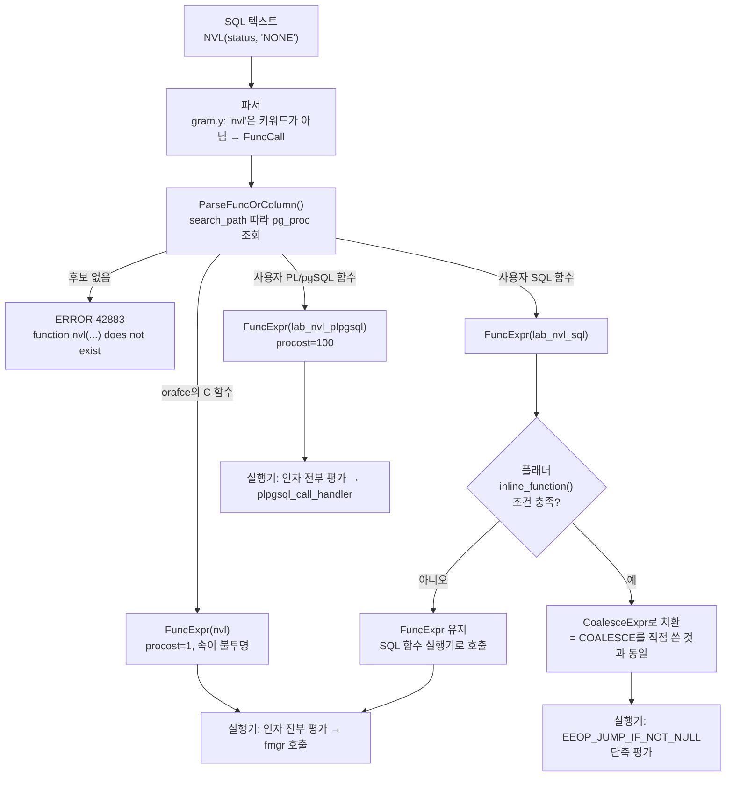

# NVL() — 이론

관련 문서: [실습](./NVL함수-실습.md) · [COALESCE 이론](../COALESCE함수/COALESCE함수-이론.md) · [COALESCE 실습](../COALESCE함수/COALESCE함수-실습.md)

> 전제: PostgreSQL 16, Oracle에서 넘어온(또는 Oracle 습관으로 작성된) SQL을 PostgreSQL에서 돌리는 상황 기준.
>
> `COALESCE` 자체의 파싱·상수 접힘·선택도 추정·외부 조인 축소는 [COALESCE 이론](../COALESCE함수/COALESCE함수-이론.md) 4~5장에서 이미 다뤘다. 이 문서는 **"PostgreSQL에는 NVL이 없다"에서 출발해, NVL을 흉내 내는 방법마다 파서·플래너·실행기에서 무엇이 달라지는가**에 집중한다.

---

## 1. 한 줄 요약

`NVL(expr1, expr2)`는 `expr1`이 NULL이면 `expr2`를, 아니면 `expr1`을 반환하는 **Oracle 전용 2인자 함수**이며, PostgreSQL 코어에는 존재하지 않아 `COALESCE`로 옮기거나 `orafce` 확장·사용자 정의 함수로 구현해야 하고, 그 구현 방식에 따라 단축 평가·인덱스 사용·선택도 추정이 달라진다.

---

## 2. 왜 필요한가

### 2.1 NVL이 해결하는 문제

NULL은 연산에 섞이면 결과 전체를 NULL로 만든다(`NULL + 1 = NULL`, `'a' || NULL = NULL`). "NULL이면 기본값"이라는 분기는 SQL에서 가장 흔한 패턴이고, Oracle은 표준 `COALESCE`(Oracle 9i에서 추가)보다 훨씬 이전부터 `NVL`로 이를 제공했다. 그래서 **Oracle 코드베이스에는 `NVL`이 `COALESCE`보다 압도적으로 많다.**

### 2.2 PostgreSQL에서 생기는 문제

PostgreSQL 코어에는 `NVL`이 없다. Oracle SQL을 그대로 실행하면:

```sql
SELECT NVL(nickname, '익명') FROM lab_member;
-- ERROR:  function nvl(character varying, unknown) does not exist
-- HINT:  No function matches the given name and argument types. You might need to add explicit type casts.
```

이 에러를 없애는 방법은 세 가지이고, **셋은 "같은 결과를 내는 것처럼 보이지만" 내부 경로가 전부 다르다.**

| 방법 | 파서가 만드는 노드 | 단축 평가 | 플래너가 속을 들여다보는가 |
|---|---|---|---|
| ① `COALESCE`로 재작성 | `CoalesceExpr` | O | O |
| ② `orafce` 확장 설치 | `FuncExpr` (C 함수) | X | X |
| ③ 사용자 정의 `nvl()` 함수 | `FuncExpr` → (조건 충족 시) 인라인되어 `CoalesceExpr` | 인라인되면 O | 인라인되면 O |

### 2.3 다른 DB의 선택

| DB | 2인자 NULL 대체 | 가변 인자 | 비고 |
|---|---|---|---|
| Oracle | `NVL` | `COALESCE` | `NVL`은 두 인자를 모두 평가하는 것으로 알려짐, `COALESCE`는 단축 평가(Oracle 공식 문서 COALESCE 항목에 명시). **`''`을 NULL로 취급** |
| PostgreSQL | 없음 | `COALESCE` | 필요하면 확장이나 함수로 만든다 |
| MySQL | `IFNULL` | `COALESCE` | |
| SQL Server | `ISNULL` | `COALESCE` | `ISNULL`은 첫 인자 타입으로 결과 타입 고정 |

PostgreSQL은 **표준 구문 하나(`COALESCE`)만 두고, 벤더 호환은 확장에 맡긴다**는 입장이다. 그래서 NVL 문제는 "함수 하나 모르는 문제"가 아니라 **마이그레이션 전략의 문제**가 된다.

---

## 3. 핵심 개념

| 용어 | 설명 |
|---|---|
| NVL (Null VaLue) | Oracle의 2인자 NULL 대체 함수. 결과 타입은 원칙적으로 첫 인자 타입을 따른다 |
| NVL2 | `NVL2(e, a, b)`: `e`가 NOT NULL이면 `a`, NULL이면 `b`. PostgreSQL에서는 `CASE` |
| 구문 구조(syntax construct) vs 함수(function) | `COALESCE`는 문법 키워드로 파서가 전용 노드를 만든다. `nvl`은 이름 그대로 `pg_proc`에서 찾는 일반 함수 호출이다 |
| orafce | Oracle 호환 함수·타입을 제공하는 PostgreSQL 확장. `nvl`, `nvl2`, `decode`, `DUAL` 등 포함 |
| 다형 타입(polymorphic type) | `anyelement`, `anycompatible` 등. 호출 시점에 실제 타입이 결정되는 의사 타입 |
| 함수 인라인(SQL function inlining) | 플래너가 `LANGUAGE sql` 함수 호출을 함수 본문 표현식으로 치환하는 최적화 |
| 휘발성(volatility) | `IMMUTABLE` / `STABLE` / `VOLATILE`. 상수 접힘·인덱스 사용 가능 여부를 결정 |
| STRICT (RETURNS NULL ON NULL INPUT) | 인자 중 하나라도 NULL이면 함수를 호출하지 않고 NULL을 반환한다는 선언 |
| 단축 평가(short-circuit evaluation) | 결과가 결정되면 나머지 인자를 평가하지 않는 것 |
| 함수 비용(procost) | 플래너가 함수 1회 호출에 매기는 비용(`cpu_operator_cost` 배수) |

---

## 4. 동작 원리와 흐름

### 4.1 같은 의도, 네 가지 경로

```sql
SELECT id, NVL(status, 'NONE') FROM lab_order WHERE id = 42;
```

이 한 줄이 PostgreSQL에서 어떤 구현을 만나느냐에 따라 다음처럼 갈린다.



### 4.2 단계별 서술 (백엔드 프로세스 내부)

1. **클라이언트 → 백엔드**: 쿼리 문자열 도착. JDBC라면 `NVL(status, ?)`처럼 바인드가 섞여 올 수 있다.
2. **파서**: `COALESCE`는 `gram.y`에 키워드로 등록되어 있어 `CoalesceExpr`가 되지만, `nvl`은 일반 식별자다. `FuncCall` 노드가 되고 `ParseFuncOrColumn()` → `func_get_detail()`이 `search_path` 순서대로 `pg_proc`을 뒤진다.
3. **함수 해석(overload resolution)**: 후보가 다형 함수면 `enforce_generic_type_consistency()`(`parse_coerce.c`)가 실제 타입을 정한다. 여기서 `anyelement`와 `anycompatible`의 차이가 드러난다(5.2절). 실패하면 실행 전에 에러.
4. **재작성기**: 관여하지 않는다.
5. **플래너 — 표현식 전처리**: `eval_const_expressions()` → `simplify_function()`이 먼저 **인자를 재귀적으로 상수 접힘**하고, 그 다음
   - 함수가 `IMMUTABLE`(또는 계획 시점 평가가 허용되는 `STABLE`)이고 인자가 전부 상수면 `evaluate_function()`으로 **계획 시점에 실행해 상수로 바꾼다**.
   - 그렇지 않고 `LANGUAGE sql`이면 `inline_function()`으로 **본문을 끼워 넣는다**.
6. **플래너 — 경로 선택**: 인라인되어 `CoalesceExpr`가 되었다면 이후는 [COALESCE 이론 5.3~5.5](../COALESCE함수/COALESCE함수-이론.md#5-내부-구현)와 완전히 같다. `FuncExpr`로 남았다면 선택도는 기본값(`DEFAULT_EQ_SEL = 0.005`), 비용은 `procost × cpu_operator_cost`가 행마다 더해진다.
7. **실행기**: `FuncExpr`는 인자를 **모두** 평가해 `FunctionCallInfo`에 채운 뒤 함수를 호출한다. 따라서 두 번째 인자가 서브쿼리·무거운 함수라면 첫 인자가 NOT NULL이어도 **매 행 실행된다.** `CoalesceExpr`는 첫 인자가 NOT NULL이면 두 번째를 건너뛴다.
8. **버퍼 캐시 / 스토리지**: `NVL` 자체는 페이지를 읽지 않는다. 다만 두 번째 인자가 서브쿼리이면 (7)의 차이가 그대로 **버퍼 접근 횟수 차이**로 나타난다.

### 4.3 실행기 스텝 비교

인라인된 경우(= `COALESCE`)와 PL/pgSQL 함수의 스텝 배열은 대략 이렇다. (`확인 필요` — opcode 이름은 `src/backend/executor/execExpr.c` / `execExprInterp.c`의 버전별 정의로 확인)

```
[인라인 → CoalesceExpr]                [PL/pgSQL nvl → FuncExpr]
step 0 : SCAN_FETCHSOME                step 0 : SCAN_FETCHSOME
step 1 : SCAN_VAR status               step 1 : SCAN_VAR status   -> fcinfo.args[0]
step 2 : JUMP_IF_NOT_NULL -> 5         step 2 : CONST 'NONE'      -> fcinfo.args[1]
step 3 : CONST 'NONE'                  step 3 : FUNCEXPR  (plpgsql_call_handler)
step 4 : JUMP_IF_NOT_NULL -> 5                  └ PL/pgSQL 실행기 진입
step 5 : DONE                                     └ RETURN 문의 표현식 평가
                                                  └ 결과 복사 후 복귀
                                       step 4 : DONE
```

오른쪽의 `FUNCEXPR`는 한 스텝처럼 보이지만 내부에서 PL/pgSQL 함수 컨텍스트 설정, 변수 할당, `RETURN` 표현식 평가가 매 행 일어난다. 100만 행이면 100만 번이다.

---

## 5. 내부 구현

### 5.1 `nvl`은 `pg_proc`에 있어야 존재한다

`COALESCE`는 `pg_proc`에 없다(`\df coalesce` → 0 rows). 반대로 `nvl`은 **`pg_proc`에 행이 있어야만** 호출 가능하다. 그래서 진단의 출발점은 항상 카탈로그다.

```sql
SELECT p.oid::regprocedure            AS signature,
       n.nspname                      AS schema,
       l.lanname                      AS language,
       p.provolatile                  AS volatility,   -- i / s / v
       p.proisstrict                  AS is_strict,
       p.procost                      AS cost,
       p.prosrc                       AS source_or_symbol
FROM   pg_proc p
JOIN   pg_namespace n ON n.oid = p.pronamespace
JOIN   pg_language  l ON l.oid = p.prolang
WHERE  p.proname = 'nvl';
```

- `lanname = 'c'`면 C 구현(orafce). 플래너가 속을 볼 수 없다.
- `lanname = 'sql'`이면 인라인 후보.
- `lanname = 'plpgsql'`이면 인라인 불가.
- `procost`: `CREATE FUNCTION`에서 `COST`를 생략하면 **C/internal 함수는 1, 그 외 언어는 100**이 기본값이다.

### 5.2 다형 타입 해석: `anyelement` vs `anycompatible`

- `src/backend/parser/parse_coerce.c` → `enforce_generic_type_consistency()`, `check_generic_type_consistency()`

| 선언 | 규칙 | `nvl(int_col, 0.5)` | `nvl(varchar_col, 'x'::text)` | `nvl(text_col, 'x')` |
|---|---|---|---|---|
| `nvl(anyelement, anyelement)` | 모든 `anyelement` 인자의 실제 타입이 **정확히 같아야** 함. `unknown` 리터럴은 나머지 타입으로 맞춰짐 | ERROR (`integer`, `numeric` 불일치 → 후보 없음) | ERROR (`varchar` ≠ `text`) | OK |
| `nvl(anycompatible, anycompatible)` (PG13+) | `UNION`/`CASE`와 같은 공통 타입 규칙으로 승격 | OK → `numeric` | OK → `text` | OK |
| `COALESCE` | `select_common_type()` | OK → `numeric` | OK → `text` | OK |

즉 `anyelement`로 만든 `nvl`은 **`COALESCE`보다 타입이 엄격하다.** Oracle의 `NVL`은 두 번째 인자를 첫 인자 타입으로 암묵 변환하므로 오히려 느슨하다. `anyelement` 버전으로 마이그레이션하면 Oracle에서 되던 쿼리가 PostgreSQL에서 "함수가 없다"는 에러로 터진다(8장 함정 3). 에러 문구가 "타입 불일치"가 아니라 "함수 없음"이라 원인을 찾기 어렵다.

### 5.3 SQL 함수 인라인의 조건

- `src/backend/optimizer/util/clauses.c` → `simplify_function()` → `inline_function()`

`inline_function()`이 **인라인을 포기하는** 주요 조건(PG16 기준, 세부는 `확인 필요`):

| 조건 | NVL 구현에서의 의미 |
|---|---|
| 언어가 `sql`이 아님 | PL/pgSQL·C 구현은 절대 인라인되지 않음 |
| `SECURITY DEFINER` / `proconfig`(함수별 `SET`)가 있음 | `ALTER FUNCTION nvl ... SET search_path = ...`를 붙이면 인라인이 꺼짐 |
| 본문이 단일 `SELECT 표현식`이 아님 | `SELECT COALESCE($1,$2)` 또는 `RETURN COALESCE(a,b)`여야 함 |
| **함수가 `STRICT`인데 본문에 non-strict 구조가 있음** | `COALESCE`는 non-strict이므로 **STRICT nvl은 인라인 불가** (게다가 의미도 틀림, 8장 함정 1) |
| 선언 휘발성보다 본문이 더 휘발적 | `IMMUTABLE`로 선언했는데 본문이 `now()`를 쓰는 경우 등 |
| 파라미터가 본문에서 2회 이상 쓰이는데 실제 인자가 volatile이거나 비쌈 | `CASE WHEN $1 IS NULL THEN $2 ELSE $1 END`로 쓰면 `$1`이 두 번 등장 → 인자가 비싸면 포기. `COALESCE($1,$2)`는 각 1회라 안전 |
| 파라미터가 0회 쓰이는데 인자에 서브플랜이 있음 | NVL에는 해당 없음 |

인라인되면 `EXPLAIN VERBOSE`의 `Output`/`Filter`에 함수 이름이 사라지고 `COALESCE(...)`가 찍힌다. 이것이 **인라인 여부의 유일한 직접 증거**다.

PG14의 SQL 표준 본문(`RETURN COALESCE(a, b)` / `BEGIN ATOMIC ... END`)은 `pg_proc.prosqlbody`에 파싱된 트리로 저장된다. 인라인 대상 여부는 `확인 필요` — PG14+ `inline_function()`이 `prosqlbody`를 읽는 분기가 있는 것으로 알고 있으나 직접 `EXPLAIN VERBOSE`로 확인할 것(실습 변형 11-3).

### 5.4 계획 시점 상수 접힘의 함정

`simplify_function()`은 **인라인이나 계획 시점 평가를 하기 전에 인자부터 접는다.** 그래서:

```sql
SELECT COALESCE(1, 1/0);        -- 1        (CoalesceExpr 분기가 첫 상수에서 멈춤, 1/0은 접히지 않음)
SELECT lab_nvl_sql(1, 1/0);     -- ERROR: division by zero  (인자 1/0이 먼저 접힘)
SELECT lab_nvl_plpgsql(1, 1/0); -- ERROR: division by zero
```

"인라인되면 `COALESCE`와 같다"는 말은 **런타임 인자(컬럼 참조 등)에 한해서만** 참이다. 상수 인자는 인라인 이전에 이미 평가된다.

### 5.5 휘발성이 인덱스 사용을 막는 경로

`CREATE FUNCTION`의 휘발성 기본값은 **`VOLATILE`**이다. 사용자가 `nvl`을 급히 만들면서 휘발성을 생략하면:

1. `WHERE customer_id = lab_nvl_plpgsql($1, 0)` — 우변이 volatile이면 "스캔 중 값이 바뀔 수 있다"로 간주되어 **인덱스 조건(`Index Cond`)이 될 수 없다**(`match_clause_to_indexcol()` 계열에서 volatile 비교값 배제). → Seq Scan + `Filter`.
2. `CREATE INDEX ... (lab_nvl_plpgsql(status,'NONE'))` → `ERROR: functions in index expression must be marked IMMUTABLE`.
3. 인자가 상수여도 계획 시점 평가(`evaluate_function()`)를 하지 않으므로 상수 접힘이 안 된다.

단, **SQL 함수가 인라인되면 선언된 휘발성은 사라지고 본문(`COALESCE`)의 휘발성만 남는다.** 그래서 VOLATILE로 잘못 선언한 SQL `nvl`은 WHERE에서는 멀쩡해 보이다가, 인덱스를 만들 때 처음 에러가 난다. PL/pgSQL `nvl`은 WHERE에서 바로 성능 문제가 난다.

### 5.6 orafce의 `nvl`

- 저장소: `github.com/orafce/orafce`. 함수 정의는 확장 SQL 스크립트(`orafce--X.Y.sql`)에 있다.
- `nvl(anyelement, anyelement)`이 C 함수로 정의되어 있고, 최근 버전에는 `anycompatible` 오버로드도 있는 것으로 알고 있다. **C 심볼명(`ora_nvl` 등), 설치 스키마(`public` vs `oracle`), 휘발성 선언은 `확인 필요`** — 설치 후 5.1절 카탈로그 쿼리로 직접 확인하는 것이 정답이다.
- C 함수이므로 인라인되지 않는다 → **단축 평가 없음, 선택도는 기본값, 표현식 인덱스는 `nvl(...)`을 정확히 같은 형태로 써야만 매칭.**
- orafce는 `varchar2`, `oracle.date` 등 **Oracle 의미론을 흉내 내는 타입**도 제공하지만, 코어 `text`의 `''` ≠ NULL 동작까지 바꾸지는 않는다(8장 함정 2).

### 5.7 Oracle `NVL`과의 의미론 차이 요약

| 항목 | Oracle `NVL` | PostgreSQL `COALESCE` | 사용자 정의 `nvl(anyelement,…)` |
|---|---|---|---|
| `''` 처리 | `''`이 곧 NULL → 대체됨 | `''` 유지 | `''` 유지 |
| 결과 타입 | 첫 인자 기준, 두 번째를 변환 | 공통 타입 | 두 인자 동일 타입 강제 |
| 인자 평가 | 둘 다 평가(일반적으로 알려진 동작) | 단축 평가 | 구현 방식에 따라 다름 |
| 인자 개수 | 정확히 2 | 가변 | 정의한 만큼 |

---

## 6. 유사 개념과의 비교

### 6.1 NVL 계열 이식표

| Oracle | PostgreSQL 권장 | 주의 |
|---|---|---|
| `NVL(a, b)` | `COALESCE(a, b)` | `a`가 `''`일 수 있으면 `COALESCE(NULLIF(a, ''), b)` |
| `NVL2(e, a, b)` | `CASE WHEN e IS NOT NULL THEN a ELSE b END` | `e`가 문자열이고 `''` 가능성 있으면 `NULLIF` 병행 |
| `NVL(SUM(x), 0)` | `COALESCE(SUM(x), 0)` | `GROUP BY` 시 0건 그룹은 행 자체가 없음 → [COALESCE 이론 6.2](../COALESCE함수/COALESCE함수-이론.md#62-집계에서-위치에-따른-차이) |
| `DECODE(a, NULL, 'x', a)` | `COALESCE(a, 'x')` 또는 `CASE` | `DECODE`는 NULL=NULL을 참으로 본다. `CASE a WHEN NULL`은 **절대 참이 안 됨** |
| `NVL(a, b) = NVL(c, b)` (NULL끼리 같다고 보려는 의도) | `a IS NOT DISTINCT FROM c` | 센티널 값 `b`가 실제 데이터와 충돌하는 버그 제거 |

### 6.2 NVL 구현 방식 선택

| 방식 | 단축 평가 | 선택도 추정 | 표현식 인덱스 | 이식 비용 | 언제 고르나 |
|---|---|---|---|---|---|
| `COALESCE`로 재작성 | O | 표현식 인덱스/확장 통계 있으면 정확 | `COALESCE(...)` 인덱스 | SQL 전수 수정 | **기본값.** 신규 코드·수정 가능한 코드 |
| SQL 함수 `nvl(anycompatible, anycompatible) IMMUTABLE` | 런타임 인자에 한해 O | `COALESCE`와 동일(인라인 후) | `nvl(...)`로 만들어도 `COALESCE` 쿼리와 매칭 기대 (`확인 필요`, 실습 6-3) | 함수 1개 | 수정 못 하는 SQL이 많을 때의 **과도기 브리지** |
| PL/pgSQL 함수 | X | 기본값 0.005 | 정확히 같은 호출식일 때만 | 함수 1개 | 쓰지 않는다 |
| orafce `nvl` | X | 기본값 0.005 | 정확히 같은 호출식일 때만 | 확장 설치 | `DECODE`·`ADD_MONTHS` 등 다른 Oracle 함수도 대량으로 필요할 때 |

판단 기준 한 줄: **"플래너가 `COALESCE`를 볼 수 있게 만드는가"**. 볼 수 있으면 [COALESCE](../COALESCE함수/COALESCE함수-이론.md)에서 배운 최적화가 전부 적용되고, 못 보면 전부 사라진다.

---

## 7. 버전별 차이

`NVL`은 코어에 한 번도 들어온 적이 없다. 변화는 **사용자 정의 함수로 흉내 낼 때의 도구** 쪽이다.

| 버전 | 변화 | NVL 구현에 주는 영향 |
|---|---|---|
| 12 | 생성 컬럼(`GENERATED ALWAYS AS ... STORED`) | `nvl` 결과를 물질화 가능. 단 생성식에 쓰는 함수는 `IMMUTABLE`이어야 함 |
| 13 | **`anycompatible` 계열 다형 타입 추가** | `nvl(int, numeric)`, `nvl(varchar, text)`가 되는 함수 작성 가능. 13 미만은 `anyelement`뿐이라 타입별 오버로드를 여러 개 만들어야 했음 |
| 14 | **SQL 표준 함수 본문**(`RETURN expr` / `BEGIN ATOMIC`) | 함수 생성 시점에 본문이 파싱·의존성 기록됨. 인라인 동작은 `확인 필요` |
| 14 | 표현식 확장 통계(`CREATE STATISTICS ... ON (expr)`) | 인라인되지 않는 `nvl(...)`에도 선택도 통계를 붙일 수 있음 (`확인 필요` — 함수 호출 표현식 매칭은 식이 정확히 같아야 함) |
| 15 | `public` 스키마의 `CREATE` 권한이 기본적으로 `PUBLIC`에서 회수됨 | 일반 계정으로 `public.nvl` 생성 시 `permission denied for schema public`. 전용 스키마 + `search_path` 권장 |
| 16 / 17 | `확인 필요` — NVL 구현에 직접 영향 주는 변경은 확인하지 못했다 | — |

관련 파라미터:

- `track_functions = none` (기본값, 값: `none`/`pl`/`all`, 슈퍼유저만 변경 가능, 세션 단위 `SET` 가능) — `pl`이면 PL/pgSQL 함수, `all`이면 SQL·C 함수 호출 횟수까지 `pg_stat_user_functions`에 쌓인다. **인라인된 SQL 함수는 호출 자체가 없으므로 집계되지 않는다** → 인라인 여부 판별 도구.
- `search_path = '"$user", public'` (기본값, 세션/DB/롤 단위) — `nvl`을 어느 스키마에 두었는지와 함께 해석 결과를 바꾼다.

---

## 8. 함정과 안티패턴

### 함정 1 — `STRICT`로 선언한 `nvl`이 NULL을 그대로 돌려준다

**증상**
`nvl(discount, 0)`의 결과가 여전히 NULL이다. 합계 쿼리에서 NULL이 섞여 금액이 틀린다.

**원인**
"NULL 입력이면 NULL" 최적화라고 착각해 `STRICT`(= `RETURNS NULL ON NULL INPUT`)를 붙였다. STRICT 함수는 인자 중 하나라도 NULL이면 **본문을 실행하지 않고** NULL을 반환한다. `nvl`의 존재 이유를 정면으로 부정한다. 추가로 5.3절 조건에 따라 인라인도 되지 않는다.

**진단**

```sql
SELECT oid::regprocedure, proisstrict FROM pg_proc WHERE proname LIKE '%nvl%';
SELECT lab_nvl_strict(NULL::int, 0);   -- NULL이 나오면 이 함정
```

**해결**

```sql
ALTER FUNCTION lab_nvl_strict(anycompatible, anycompatible) CALLED ON NULL INPUT;
-- 또는 DROP 후 STRICT 없이 재생성
```

---

### 함정 2 — Oracle의 `''` = NULL 전제가 깨진다

**증상**
Oracle에서 `NVL(memo, '-')`로 `'-'`이 찍히던 행이 PostgreSQL에서는 빈 칸으로 나온다. `WHERE NVL(memo, 'X') = 'X'`로 "메모 없음"을 찾던 쿼리의 결과 건수가 줄었다.

**원인**
Oracle은 길이 0 문자열을 NULL로 저장한다. 마이그레이션 도구(ora2pg 등)가 데이터를 옮길 때 원본에 `''`이 없었더라도, **PostgreSQL로 넘어온 뒤 애플리케이션이 `''`을 INSERT하기 시작하면** NULL과 `''`이 공존하게 된다. `COALESCE`/`nvl`은 `''`을 대체하지 않는다.

**진단**

```sql
SELECT count(*) FILTER (WHERE memo IS NULL) AS null_cnt,
       count(*) FILTER (WHERE memo = '')    AS empty_cnt
FROM   lab_order;
```

`empty_cnt > 0`이면 Oracle 시절과 결과가 다를 수 있다.

**해결**

- 읽기 쪽: `COALESCE(NULLIF(memo, ''), '-')`
- 근본: 쓰기 쪽에서 막는다. `UPDATE lab_order SET memo = NULL WHERE memo = '';` 후 `ALTER TABLE lab_order ADD CONSTRAINT lab_order_memo_not_empty CHECK (memo <> '');`
  (`ADD CONSTRAINT ... CHECK`는 `ACCESS EXCLUSIVE` 락 + 전체 스캔. 운영에서는 `NOT VALID`로 추가 후 `VALIDATE CONSTRAINT`(`SHARE UPDATE EXCLUSIVE`)로 분리)

---

### 함정 3 — `anyelement` nvl이 "함수가 없다"며 터진다

**증상**
`nvl(price, 0.5)`, `nvl(name_varchar, some_text_col)`에서 `ERROR: function nvl(integer, numeric) does not exist`. 같은 함수가 `nvl(price, 0)`에서는 된다.

**원인**
`anyelement`는 모든 인자의 실제 타입이 같아야 한다(5.2절). `0`은 `integer` 리터럴이라 통과, `0.5`는 `numeric`이라 탈락. `varchar`와 `text`도 다른 타입이다.

**진단**

```sql
SELECT pg_get_function_arguments(oid) FROM pg_proc WHERE proname = 'nvl';
-- anyelement, anyelement 이면 이 함정의 후보
SELECT pg_typeof(price), pg_typeof(0.5) FROM lab_order LIMIT 1;
```

**해결**
PG13+라면 `anycompatible`로 재정의. PG12 이하라면 쿼리 쪽에 명시적 캐스트(`nvl(price::numeric, 0.5)`)를 넣거나 `COALESCE`로 교체.

---

### 함정 4 — PL/pgSQL(또는 VOLATILE) nvl 때문에 인덱스가 안 탄다

**증상**
`WHERE customer_id = nvl(#{customerId}, 0)` 쿼리가 PK/인덱스가 있는데도 Seq Scan. psql에서 같은 조건을 `customer_id = 777`로 치면 Index Scan.

**원인**
- `nvl`이 VOLATILE(기본값)이면 비교값이 스캔 중 바뀔 수 있다고 간주되어 `Index Cond`가 될 수 없다(5.5절).
- PL/pgSQL이면 인라인도 안 되어 행마다 함수가 호출된다.

**진단**

```sql
EXPLAIN (ANALYZE, BUFFERS)
SELECT * FROM lab_order WHERE customer_id = lab_nvl_plpgsql(NULL::int, 777);
-- 볼 것: Seq Scan, "Filter: (customer_id = lab_nvl_plpgsql(NULL::integer, 777))", Rows Removed by Filter

SELECT provolatile, prolang::regproc FROM pg_proc WHERE proname = 'lab_nvl_plpgsql';
```

**해결**
1순위: `COALESCE`로 교체하거나 애플리케이션에서 파라미터 기본값을 채워 넘긴다(MyBatis `<if>`, 10장 실습 참조).
2순위: 함수를 SQL 언어 + `IMMUTABLE`로 재정의 → 인라인 → `COALESCE($1, 777)` → 바인드가 확정되면 상수로 접혀 `Index Cond`.

---

### 함정 5 — 두 번째 인자가 매 행 실행된다 (단축 평가 상실)

**증상**
`NVL(o.nickname, (SELECT name FROM lab_customer c WHERE c.id = o.customer_id))`가 Oracle 이관 후 느리다. `EXPLAIN ANALYZE`에서 `SubPlan`의 `loops`가 전체 행 수와 같다.

**원인**
orafce/PL/pgSQL `nvl`은 `FuncExpr`라 인자를 모두 평가한 뒤 호출된다. `COALESCE`였다면 `nickname IS NULL`인 행에서만 서브쿼리가 돈다([COALESCE 실습 4-6](../COALESCE함수/COALESCE함수-실습.md)에서 `loops = NULL 행 수`를 확인).

**진단**

```sql
EXPLAIN (ANALYZE, BUFFERS)
SELECT lab_nvl_plpgsql(o.memo, (SELECT c.name FROM lab_customer c WHERE c.id = o.customer_id))
FROM   lab_order o;
-- SubPlan 1 ... loops=<전체 행 수> 이면 단축 평가 없음
```

**해결**
`COALESCE`로 교체. 서브쿼리가 대부분의 행에서 필요하다면 스칼라 서브쿼리 대신 `LEFT JOIN`으로 바꾸는 것이 더 근본적이다.

---

### 함정 6 — `nvl`이 선택도 통계를 잃는다

**증상**
`WHERE nvl(status, 'NONE') = 'NONE'`의 추정 행수가 실제 20만 행인데 5,000으로 나온다. 조인이 붙으면 Nested Loop를 골라 폭발한다.

**원인**
인라인되지 않는 `nvl(...)`은 `Var`가 아니라 불투명 함수 호출이므로 `pg_statistic`에 매칭될 통계가 없다 → `DEFAULT_EQ_SEL = 0.005`. 인라인되더라도 `COALESCE(...)` 표현식 통계가 없으면 같은 결과다([COALESCE 이론 5.4](../COALESCE함수/COALESCE함수-이론.md#54-선택도-추정-경로)).

**진단**

```sql
EXPLAIN SELECT * FROM lab_order WHERE lab_nvl_plpgsql(status, 'NONE') = 'NONE';
-- rows=5000 (= reltuples × 0.005) 이면 기본 선택도
SELECT reltuples FROM pg_class WHERE relname = 'lab_order';
```

**해결**
`COALESCE(status, 'NONE')` 표현식 인덱스 또는 PG14+ `CREATE STATISTICS ... ON (COALESCE(status, 'NONE'))` 후 `ANALYZE`. 인라인되지 않는 `nvl`에 대해서는 **쿼리에 쓴 것과 글자 그대로 같은 식**으로 인덱스·통계를 만들어야 한다.

---

### 함정 7 — `NVL(a,x) = NVL(b,x)`로 NULL 동등 비교

**증상**
`WHERE NVL(a.dept, '0') = NVL(b.dept, '0')`로 "둘 다 NULL이면 같다"를 표현했는데, 실제 부서 코드 `'0'`인 데이터와 NULL이 같은 것으로 매칭된다. 조인은 Hash/Merge를 못 타고 Nested Loop + Filter.

**원인**
센티널 값이 실제 도메인과 충돌. 그리고 양변이 표현식이라 조인 키 통계·인덱스가 모두 무력화.

**진단**

```sql
SELECT count(*) FROM lab_order WHERE status = 'NONE';   -- 센티널과 같은 실제 값이 있는지
```

**해결**
`a.dept IS NOT DISTINCT FROM b.dept`. 단 이것도 인덱스 조건으로는 내려가지 않는다([COALESCE 이론 6.1](../COALESCE함수/COALESCE함수-이론.md#61-null-대체-표현식)). 조인 키에 NULL 매칭이 정말 필요한지부터 재검토한다.

---

## 9. 실행계획에서 이 개념이 드러나는 지점

`EXPLAIN (ANALYZE, BUFFERS, VERBOSE)`에서 본다. **`VERBOSE`가 있어야 인라인 여부가 보인다.**

| 관찰 지점 | 인라인됨 / `COALESCE` | 인라인 안 됨 (`plpgsql`, orafce) |
|---|---|---|
| `Output:` / `Filter:` 텍스트 | `COALESCE(status, 'NONE'::text)` | `lab_nvl_plpgsql(status, 'NONE'::text)` / `nvl(...)` |
| 상수 인자일 때 | `Index Cond: (customer_id = 777)` 처럼 접혀서 사라짐 | VOLATILE이면 `Filter:`에 호출식 그대로 |
| 추정 `rows` | 표현식 통계 있으면 실제값 근처 | `reltuples × 0.005` |
| `cost=` 상한 | 스캔 비용 + 작은 표현식 비용 | 행당 `procost(100) × cpu_operator_cost(0.0025)` = 0.25씩 추가 → 100만 행이면 +250,000 |
| `SubPlan N ... loops=` | NULL인 행 수 | 전체 행 수 |
| `Execution Time` | 기준 | 함수 호출 오버헤드만큼 증가 (수치는 실습에서 측정) |
| `JIT:` 블록 | 비용 증가로 `jit_above_cost = 100000`을 넘으면 PL/pgSQL 버전만 JIT가 켜질 수 있음 → 측정 시 `SET jit = off` | |

---

## 10. 관측 지표

| 지표 | 뷰/쿼리 | 무엇과 비교해서 판단하나 |
|---|---|---|
| `nvl` 구현 종류 | `pg_proc` + `pg_language` (5.1절 쿼리) | `lanname`이 `sql`인지. 아니면 6.2절 표의 오른쪽 열 문제가 전부 해당 |
| 함수 호출 횟수·총 시간 | `pg_stat_user_functions.calls`, `total_time`, `self_time` (`track_functions` 필요) | `calls`를 해당 쿼리가 스캔한 행 수와 비교. 같으면 행마다 호출 중(인라인 안 됨). **행 자체가 없으면 인라인됨** |
| 쿼리별 누적 시간 | `pg_stat_statements.total_exec_time`, `calls`, `query` | `query` 텍스트에 `nvl(`이 들어간 항목을 `COALESCE` 버전으로 바꾼 뒤 `mean_exec_time`과 전후 비교 |
| 추정 vs 실제 행수 | `EXPLAIN ANALYZE`의 `rows=` 두 값 | 비율이 10배 이상 벌어지고 추정값이 `reltuples × 0.005`와 같으면 함정 6 |
| `''` 공존 여부 | `count(*) FILTER (WHERE col = '')` | Oracle 원본의 NULL 건수와 비교. 합이 같고 PG쪽 NULL이 적으면 `''`로 새고 있는 것 |
| 함수 의존 객체 | `pg_depend`에서 `nvl` 함수를 참조하는 인덱스·뷰 | `DROP FUNCTION` 전에 확인. 개수가 0이 아니면 `CASCADE` 금지 |

```sql
-- nvl을 참조하는 인덱스·뷰 찾기
SELECT classid::regclass, objid, deptype
FROM   pg_depend
WHERE  refobjid = 'lab_nvl_sql(anycompatible, anycompatible)'::regprocedure;
```

---

## 11. 실무 적용 시나리오

| 시나리오 | 문제 지점 | 권고 |
|---|---|---|
| Oracle → PostgreSQL 이관, MyBatis XML 수천 개 | `NVL` 전수 수정 불가 | 1단계: SQL `nvl(anycompatible, anycompatible) IMMUTABLE`을 전용 스키마(예: `compat`)에 만들고 `search_path`에 추가. 2단계: `pg_stat_statements`에서 비싼 쿼리부터 `COALESCE`로 교체. 3단계: 호출이 사라지면 함수 제거 |
| 검색 화면 `WHERE col = NVL(#{param}, col)` | 파라미터 NULL 시 col이 NULL인 행 누락 + 인덱스 무력화 | [COALESCE 이론 함정 2](../COALESCE함수/COALESCE함수-이론.md#8-함정과-안티패턴)와 동일. MyBatis `<if>`로 조건 자체를 제거 |
| 금액 합계 `NVL(SUM(amt), 0)` | 행 없음 그룹 누락 | 기준 테이블 `LEFT JOIN` 후 `COALESCE` |
| orafce 설치 요청 | 관리형 DB(RDS/Aurora/Cloud SQL)에서 지원 여부가 다름 | `SELECT * FROM pg_available_extensions WHERE name = 'orafce';`로 먼저 확인. 없으면 SQL 함수 방식 |
| JPA/Hibernate 네이티브 쿼리에 `NVL` | Hibernate 6은 HQL에 모르는 함수를 그대로 넘길 수 있어 **런타임에야** 에러 | JPQL 표준 `COALESCE` 사용. 실습 10장 |
| RAG 메타데이터 필터 `WHERE nvl(tenant_id, 0) = :t` + 벡터 검색 | 필터 선택도 오추정 → 플래너가 벡터 인덱스 대신 Seq Scan 선택 가능 | NULL 테넌트를 0으로 백필하고 `NOT NULL` 제약. 필터식을 순수 컬럼 비교로 |

---

## 12. 락·동시성 영향

`NVL`/`COALESCE` 평가 자체는 락을 잡지 않는다. 락이 문제되는 것은 **NVL을 없애거나 대체하는 DDL**이다.

| 작업 | 락 레벨 | 막히는 것 |
|---|---|---|
| `CREATE FUNCTION` / `CREATE OR REPLACE FUNCTION` | 테이블 락 없음 (`pg_proc` 행 갱신) | 없음. 단 **실행 중인 세션의 캐시된 계획**은 무효화 후 재계획 |
| `ALTER FUNCTION ... IMMUTABLE` | 테이블 락 없음 | 이미 그 함수로 만든 인덱스가 있으면 **휘발성을 거짓으로 바꾸는 순간 인덱스 결과가 틀려질 수 있다**(PostgreSQL이 막지 않음) |
| `DROP FUNCTION nvl ... CASCADE` | 의존 인덱스/뷰 삭제 → 해당 테이블 `ACCESS EXCLUSIVE` | 그 테이블의 모든 SELECT까지 대기 |
| `CREATE INDEX ON t (COALESCE(col, 'x'))` | `SHARE` | INSERT/UPDATE/DELETE 대기 |
| `CREATE INDEX CONCURRENTLY ...` | `SHARE UPDATE EXCLUSIVE` | DML은 통과, 다른 DDL·VACUUM 대기. 트랜잭션 블록 안에서 실행 불가 |
| `UPDATE t SET col = NULL WHERE col = ''` (함정 2 정리) | 행 락 + `ROW EXCLUSIVE` | 같은 행 갱신 세션. 대량이면 dead tuple 급증 → 배치 분할 |
| `ALTER TABLE ... ADD CONSTRAINT CHECK` | `ACCESS EXCLUSIVE` (검증 스캔 동안 유지) | 전부. `NOT VALID` + `VALIDATE CONSTRAINT`(`SHARE UPDATE EXCLUSIVE`)로 분리 |

---

## 13. 자가 점검 질문

1. `SELECT NVL(a, b)`가 PostgreSQL에서 에러가 나는데 `SELECT COALESCE(a, b)`는 되는 이유를, 파서 단계에서 만들어지는 노드 이름으로 설명하라.

<details><summary>답</summary>

`COALESCE`는 `gram.y`의 키워드라 파서가 `CoalesceExpr` 노드를 직접 만든다. `nvl`은 일반 식별자라 `FuncCall` → `ParseFuncOrColumn()`이 `pg_proc`에서 `nvl` 이름의 함수를 찾는데, 코어에는 없으므로 `function nvl(...) does not exist`가 난다.

</details>

2. `CREATE FUNCTION nvl(a anyelement, b anyelement) RETURNS anyelement LANGUAGE sql IMMUTABLE STRICT AS 'SELECT COALESCE(a, b)';` 의 문제점 두 가지는?

<details><summary>답</summary>

(1) `STRICT`라서 인자 중 하나라도 NULL이면 본문을 실행하지 않고 NULL을 반환한다 → `nvl(NULL, 0) = NULL`로 의미가 틀림. 또한 STRICT + non-strict 본문이라 인라인도 안 된다.
(2) `anyelement`라서 `nvl(int, numeric)`, `nvl(varchar, text)`처럼 타입이 다르면 "함수 없음" 에러. PG13+에서는 `anycompatible`을 써야 한다.

</details>

3. SQL 함수 `lab_nvl_sql`이 인라인되는 환경에서도 `SELECT lab_nvl_sql(1, 1/0)`은 에러가 나고 `SELECT COALESCE(1, 1/0)`은 1을 반환한다. 왜인가?

<details><summary>답</summary>

`simplify_function()`은 인라인 전에 인자부터 상수 접힘을 한다. `1/0`이 이 단계에서 계산되어 에러. `CoalesceExpr`의 상수 접힘은 앞에서부터 순회하다 NOT NULL 상수(1)를 만나면 뒤를 **접지 않고** 버린다.

</details>

4. `pg_stat_user_functions`로 어떤 `nvl` 함수가 인라인되는지 판별하는 방법은?

<details><summary>답</summary>

`SET track_functions = 'all'`(슈퍼유저) 후 쿼리를 실행하고 `pg_stat_user_functions`를 본다. 인라인되지 않은 함수는 `calls`가 스캔 행 수만큼 증가한다. 인라인된 SQL 함수는 실제로 호출되지 않으므로 행이 생기지 않거나 `calls`가 늘지 않는다. `EXPLAIN VERBOSE`의 `Output`에 함수명 대신 `COALESCE`가 찍히는지로 교차 확인한다.

</details>

5. Oracle에서 `WHERE NVL(memo, 'X') = 'X'`로 1,000건이 나오던 쿼리를 PostgreSQL에서 `COALESCE`로 옮겼더니 700건이 나온다. 가능한 원인과 확인 쿼리는?

<details><summary>답</summary>

Oracle은 `''`을 NULL로 저장하지만 PostgreSQL에서는 `''`이 별도 값이다. 이관 후 애플리케이션이 `''`을 저장했다면 그 300건은 `COALESCE(memo,'X') = ''`가 되어 빠진다.
확인: `SELECT count(*) FILTER (WHERE memo IS NULL), count(*) FILTER (WHERE memo = '') FROM t;`
수정: `COALESCE(NULLIF(memo, ''), 'X') = 'X'` 또는 데이터 정리 + CHECK 제약.

</details>

---

## 14. 참고 자료

- PostgreSQL 16 공식 문서
  - 9.18 Conditional Expressions — 9.18.2 `COALESCE` (NVL/IFNULL 언급 및 단축 평가 명시)
  - 38.2.5 Polymorphic Types — `anyelement` vs `anycompatible` 해석 규칙
  - 38.7 Function Volatility Categories
  - 10.5 UNION, CASE, and Related Constructs — 공통 타입 결정 규칙
  - `CREATE FUNCTION` 레퍼런스 — `STRICT`, `COST`, `RETURN`/`BEGIN ATOMIC` 본문
  - 28.2 The Cumulative Statistics System — `pg_stat_user_functions`, `track_functions`
- PostgreSQL Wiki — "Inlining of SQL functions" (인라인 조건 목록)
- 소스 (PG16 기준, 경로는 `확인 필요` 수준으로 안정적이나 함수 시그니처는 버전별 확인)
  - `src/backend/parser/gram.y` — `COALESCE` 키워드 규칙
  - `src/backend/parser/parse_func.c` — `ParseFuncOrColumn()`, `func_get_detail()`
  - `src/backend/parser/parse_coerce.c` — `enforce_generic_type_consistency()`, `select_common_type()`
  - `src/backend/optimizer/util/clauses.c` — `eval_const_expressions_mutator()`, `simplify_function()`, `inline_function()`, `evaluate_function()`
  - `src/backend/executor/execExpr.c`, `execExprInterp.c` — `FuncExpr`/`CoalesceExpr` 스텝 생성·실행
  - `src/pl/plpgsql/src/pl_handler.c` — `plpgsql_call_handler()`
- PostgreSQL 13 릴리스 노트 — `anycompatible` 추가 / 14 릴리스 노트 — SQL 표준 함수 본문 / 15 릴리스 노트 — `public` 스키마 권한 변경
- orafce 저장소 README (`github.com/orafce/orafce`) — 제공 함수 목록
- Oracle Database SQL Language Reference — `NVL`, `NVL2`, `COALESCE` 항목

---

## 부록: 용어 정리

| 용어 | 영문 | 설명 |
|---|---|---|
| NVL | Null VaLue | `expr1`이 NULL이면 `expr2`를 반환하는 Oracle 전용 2인자 함수 |
| orafce | Oracle Functions Compatibility Extension | Oracle 호환 함수(`nvl`, `nvl2`, `decode` 등)와 타입을 제공하는 PostgreSQL 확장 |
| 단축 평가 | Short-circuit Evaluation | 결과가 정해지면 남은 인자를 평가하지 않는 방식. `COALESCE`는 하고 일반 함수 호출은 안 함 |
| 선택도 추정 | Selectivity Estimation | 조건을 통과할 행 비율을 통계로 예측하는 플래너 단계 |
| NVL2 | NVL2 | `e`가 NOT NULL이면 `a`, NULL이면 `b`를 반환하는 Oracle 3인자 함수 |
| 구문 구조 | Syntax Construct | 파서가 문법 키워드로 인식해 전용 노드로 바꾸는 표현식(`COALESCE`, `CASE`) |
| 다형 타입 | Polymorphic Type | 호출 시점에 실제 타입이 정해지는 의사 타입(`anyelement`, `anycompatible`) |
| 함수 인라인 | SQL Function Inlining | 플래너가 SQL 함수 호출을 본문 표현식으로 치환하는 최적화 |
| 휘발성 | Volatility | 함수 결과의 안정성 선언(`IMMUTABLE`/`STABLE`/`VOLATILE`). 상수 접힘·인덱스 사용 가능성 결정 |
| STRICT | RETURNS NULL ON NULL INPUT | NULL 인자가 하나라도 있으면 함수 본문 없이 NULL을 반환하는 선언 |
| procost | Procedure Cost | 함수 1회 호출 비용(`cpu_operator_cost` 배수). C 함수 1, 그 외 100이 기본 |
| `CoalesceExpr` | Coalesce Expression Node | 파서가 `COALESCE`에 대해 만드는 전용 표현식 노드 |
| `FuncExpr` | Function Expression Node | 일반 함수 호출을 나타내는 표현식 노드. 인자를 모두 평가한 뒤 호출 |
| `FuncCall` | Function Call (raw parse node) | 파서가 이름 해석 전에 만드는 원시 함수 호출 노드 |
| `pg_proc` | pg_proc catalog | 함수·프로시저 정의를 저장하는 시스템 카탈로그 |
| `search_path` | Schema Search Path | 한정되지 않은 이름을 해석할 스키마 순서. 기본 `"$user", public` |
| `enforce_generic_type_consistency()` | — | 다형 인자들의 실제 타입을 결정·검증하는 파서 함수 |
| `eval_const_expressions()` | — | 플래너의 상수 접힘·함수 인라인 진입점 |
| `simplify_function()` | — | 인자 접힘 후 계획 시점 평가 또는 인라인을 시도하는 플래너 함수 |
| `inline_function()` | — | SQL 함수 본문을 호출 위치에 치환하는 플래너 함수 |
| `evaluate_function()` | — | IMMUTABLE 함수를 상수 인자로 계획 시점에 실행해 상수로 바꾸는 함수 |
| `DEFAULT_EQ_SEL` | Default Equality Selectivity | 통계가 없는 `=` 조건의 기본 선택도 0.005 |
| 상수 접힘 | Constant Folding | 계획 시점에 상수 표현식을 미리 계산해 값으로 치환하는 것 |
| `select_common_type()` | — | `COALESCE`/`CASE`/`UNION` 인자의 공통 타입을 고르는 파서 함수 |
| `anycompatible` | anycompatible pseudo-type | PG13+ 다형 타입. 인자들을 공통 타입으로 승격해 받는다 |
| `anyelement` | anyelement pseudo-type | 모든 해당 인자의 실제 타입이 동일해야 하는 다형 타입 |
| `prosqlbody` | pg_proc.prosqlbody | PG14+ SQL 표준 함수 본문을 파싱된 트리로 저장하는 컬럼 |
| `track_functions` | track_functions GUC | 함수 호출 통계 수집 범위(`none`/`pl`/`all`). 기본 `none` |
| `pg_stat_user_functions` | — | 사용자 함수별 호출 횟수·시간 통계 뷰 |
| `IS NOT DISTINCT FROM` | — | NULL끼리도 같다고 판정하는 비교 연산 |
| `pg_stat_statements` | — | 정규화된 쿼리별 누적 실행 통계 확장 |
| `pg_depend` | pg_depend catalog | 객체 간 의존 관계 카탈로그. 함수 삭제 전 참조 객체 확인에 사용 |
| `ACCESS EXCLUSIVE` | Access Exclusive Lock | SELECT까지 막는 최상위 테이블 락 |
| `SHARE UPDATE EXCLUSIVE` | Share Update Exclusive Lock | DML은 허용하고 DDL·VACUUM과 충돌하는 락 |
