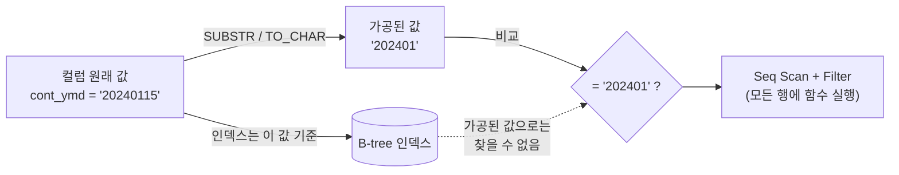

# TO_CHAR와 SUBSTR — 이론

관련 문서: [실습](./TO_CHAR와SUBSTR-실습.md) · [매퍼 함수 빈도 통계](../매퍼함수빈도통계.md) · [NVL 이론](../NVL함수/NVL함수-이론.md)

> 전제: PostgreSQL 16 + orafce 확장, 날짜를 `VARCHAR(8)` `'YYYYMMDD'` 문자열로 저장하는 테이블이 섞인 프로젝트 (AplusIDE4Gaplus 매퍼 기준)

**왜 한 묶음인가**: 매퍼에서 이 둘은 거의 항상 같이 나온다. `TO_CHAR`로 날짜를 `'YYYYMMDD'` 문자열로 만들고, `SUBSTR`로 그 문자열에서 연월(`1,6`)이나 연도(`1,4`)를 잘라 낸다.

| 함수 | 매퍼 호출 수 | 파일 수 | 가장 많은 형태 |
|---|---:|---:|---|
| `TO_CHAR` | 7,727 | 226 | `TO_CHAR(SYSDATE,'YYYYMMDD')` (500회+) |
| `SUBSTR` | 6,685 | 171 | `SUBSTR(CONT_YMD,0,6)` (484회) ← **시작 위치 0** |

---

## 1. 한 줄 요약 + 쉬운 설명

- **`TO_CHAR(값, 포맷)`**: 날짜·시각·숫자를 **포맷 문자열 모양대로 찍어 낸 텍스트**로 바꾼다.
- **`SUBSTR(문자열, 시작, 길이)`**: 문자열에서 `시작` 위치부터 `길이`만큼 잘라 낸다. 위치는 **1부터** 센다.

`TO_CHAR`는 도장이다. 날짜라는 값에 `'YYYY-MM-DD'`라는 도장을 찍으면 그 모양의 글자가 나온다.
나온 결과는 더 이상 날짜가 아니라 **그냥 글자**다. 그래서 날짜 연산·날짜 인덱스와는 연결이 끊긴다.
`SUBSTR`도 마찬가지로, 컬럼을 잘라 낸 순간 그 컬럼의 인덱스와는 연결이 끊긴다.
이 "연결이 끊긴다"가 이 문서에서 다루는 사고 대부분의 원인이다.

---

## 2. 왜 필요한가

이 프로젝트는 날짜를 두 가지 방식으로 저장한다.

- `timestamp` 타입 컬럼 (`REG_DT`, `SIGN_DATE` …)
- `VARCHAR(8)` 문자열 컬럼 (`CONT_YMD`, `RENT_YMD_FROM` …, 값은 `'20240115'`)

둘을 비교하거나, 화면에 "2024-01" 같은 형태로 보여 주려면 변환이 필요하다.

```sql
-- Before: 문자열 컬럼과 날짜를 그대로 비교 → 타입이 달라 에러 또는 의도와 다른 비교
SELECT * FROM contract WHERE cont_ymd = CURRENT_DATE;
-- ERROR: operator does not exist: character varying = date

-- After: 오늘 날짜를 같은 모양의 문자열로 만들어 비교
SELECT * FROM contract WHERE cont_ymd = TO_CHAR(CURRENT_DATE, 'YYYYMMDD');

-- 월별 집계: 'YYYYMMDD'에서 앞 6자리(YYYYMM)만 잘라 그룹핑
SELECT SUBSTR(cont_ymd, 1, 6) AS ym, COUNT(*)
FROM contract
GROUP BY SUBSTR(cont_ymd, 1, 6);
```

`TO_CHAR`는 **날짜 → 문자열 세계로 건너가는 다리**, `SUBSTR`는 **문자열 세계 안에서 부분을 꺼내는 칼**이다.

---

## 3. 기본 사용법

### 3.1 TO_CHAR — 날짜·시각

```sql
SELECT TO_CHAR(TIMESTAMP '2024-01-05 14:07:09', 'YYYYMMDD');            -- 20240105
SELECT TO_CHAR(TIMESTAMP '2024-01-05 14:07:09', 'YYYY-MM-DD HH24:MI:SS'); -- 2024-01-05 14:07:09
SELECT TO_CHAR(TIMESTAMP '2024-01-05 14:07:09', 'YYYYMMDDHH24MISS');     -- 20240105140709
SELECT TO_CHAR(CURRENT_DATE - INTERVAL '3 months', 'YYYYMM');           -- 3개월 전 연월
```

자주 쓰는 포맷 문자만 외우면 된다.

| 포맷 | 의미 | 예 | 주의 |
|---|---|---|---|
| `YYYY` / `YY` | 연도 4자리 / 2자리 | 2024 / 24 | |
| `MM` | **월** (01~12) | 01 | 분이 아니다 |
| `DD` | 일 | 05 | |
| `HH24` | 시 (00~23) | 14 | |
| `HH` (=`HH12`) | 시 **(01~12)** | 02 | 오후 2시도 `02` |
| `MI` | **분** | 07 | Java의 `mm`과 다르다 |
| `SS` | 초 | 09 | |
| `FF3` / `FF6` | 밀리초 / 마이크로초 | 123 | PG 13+ |
| `D` | 요일 번호 (일=1) | 6 | |
| `TMDay` | 요일 이름 (로케일 따름) | 금요일 | `lc_time` 설정에 따름 |

> Oracle: 포맷 문자는 거의 같다. MySQL은 `DATE_FORMAT(d, '%Y%m%d')`로 문법이 완전히 다르다.

### 3.2 TO_CHAR — 숫자 (천 단위 콤마)

```sql
SELECT TO_CHAR(1234567, 'FM9,999,999,999');   -- 1,234,567
SELECT TO_CHAR(0.5,     'FM999,990.00');      -- 0.50
SELECT TO_CHAR(1234,    '000000');            --  001234  (앞에 부호 자리 공백 1칸)
```

| 포맷 | 의미 |
|---|---|
| `9` | 숫자 자리. 앞쪽 0은 공백으로 |
| `0` | 숫자 자리. 앞쪽 0도 그대로 찍음 |
| `,` / `.` | 천 단위 구분 / 소수점 |
| `FM` | Fill Mode. **앞뒤 공백·불필요한 0 제거**. 거의 항상 붙인다 |

### 3.3 SUBSTR

```sql
SELECT SUBSTR('20240115', 1, 6);   -- 202401  (연월)
SELECT SUBSTR('20240115', 1, 4);   -- 2024    (연도)
SELECT SUBSTR('20240115', 5);      -- 0115    (길이 생략 = 끝까지)
SELECT SUBSTR('20240115', 7, 2);   -- 15      (일)
```

같은 일을 하는 다른 표기:

```sql
SELECT LEFT('20240115', 6);                    -- 202401 (PG, MySQL. Oracle에는 없음)
SELECT SUBSTRING('20240115' FROM 1 FOR 6);     -- 202401 (SQL 표준)
```

### 3.4 매퍼에서 자주 보이는 조합

```sql
-- 오늘 연월
TO_CHAR(SYSDATE, 'YYYYMM')
-- 문자열 날짜 → 날짜 → 다시 연월 문자열 (사실 SUBSTR(x,1,6)과 결과가 같다)
TO_CHAR(TO_DATE(cont_ymd, 'YYYYMMDD'), 'YYYYMM')
-- 숫자 파라미터를 문자열로 바꿔 자르기
SUBSTR(#baseYm#::varchar, 1, 6)
```

---

## 4. 동작 원리

PostgreSQL이 `WHERE SUBSTR(cont_ymd, 1, 6) = '202401'`을 받으면:

1. **함수를 찾는다** — `substr(text, int, int)`. 이때 `search_path` 순서로 찾으므로 orafce의 `oracle.substr`이 잡힐 수도 있다 (함정 1).
2. **인덱스를 쓸 수 있는지 본다** — 인덱스는 `cont_ymd` **원래 값**으로 정렬돼 있다. `SUBSTR(cont_ymd,1,6)`이라는 **가공된 값**으로 만든 인덱스는 없으므로 쓸 수 없다.
3. **행 수를 추정한다** — 가공된 값에는 통계가 없어서 "대충 전체의 0.5%"처럼 고정 비율로 추정한다. 그래서 조인 순서가 엉뚱해질 수 있다.
4. **모든 행을 읽으며 함수를 실행한다** — 행마다 `SUBSTR`을 호출하고 결과를 `'202401'`과 비교한다 (Seq Scan + Filter).
5. **결과는 text** — `TO_CHAR`·`SUBSTR`의 결과는 항상 text다. 이후 정렬·비교도 **문자열 규칙**으로 한다.



**핵심**: 함수는 **컬럼 쪽이 아니라 상수 쪽**에 씌워야 인덱스를 탄다.

```sql
WHERE TO_CHAR(reg_dt, 'YYYYMMDD') = '20240115'           -- 컬럼에 함수 → 인덱스 X
WHERE reg_dt >= TO_DATE('20240115','YYYYMMDD')            -- 상수에 함수 → 인덱스 O
  AND reg_dt <  TO_DATE('20240115','YYYYMMDD') + 1
```

---

## 5. 실무 함정

### 함정 1 — `SUBSTR(x, 0, 6)`: 시작 위치 0 (매퍼 3,083회 / 115파일)

**증상**: Oracle에서는 `'202401'`(6자)이 나오던 쿼리가 PostgreSQL 기본 함수로는 `'20240'`(5자)을 돌려준다. 월별 조건이 한 건도 안 맞거나 집계가 깨진다.

**원인**: Oracle은 시작 위치 0을 1로 **고쳐서** 처리한다. PostgreSQL 기본 `substr`은 0을 "첫 글자 바로 앞 위치"로 그대로 센다. 0번 자리는 비어 있으므로 6칸을 세도 실제 글자는 5개만 나온다.

```sql
SELECT pg_catalog.substr('20240115', 0, 6);   -- '20240'  (PG 기본)
-- Oracle: SUBSTR('20240115', 0, 6) = '202401'
```

이 프로젝트가 지금 정상 동작한다면, orafce의 `oracle.substr`(Oracle 방식)이 먼저 잡히도록 `search_path`가 설정돼 있을 가능성이 높다 — `확인 필요`.

```sql
SHOW search_path;                       -- oracle 스키마가 pg_catalog보다 앞에 있는지
SELECT substr('20240115', 0, 6);        -- 실제 접속 계정으로 실행해 6자가 나오는지
```

**해결**: 새로 쓰는 쿼리는 **항상 1부터** 쓴다. `search_path`는 접속 계정·풀 설정마다 다를 수 있어서, 같은 쿼리가 배치 계정에서만 깨지는 식의 사고가 난다. 음수 시작 위치(`SUBSTR(x, -2)` = 뒤에서 2글자)도 Oracle 방식이라 PG 기본 함수에서는 다르게 동작한다. PG에서는 `RIGHT(x, 2)`를 쓴다.

### 함정 2 — 포맷 문자 `HH`, `MM`, `mm` 혼동 (매퍼에서 실제 발견)

**증상**: 오후에 만든 데이터의 시각 문자열이 `'02'`로 나온다. 또는 `14:01:30`이어야 할 값이 `14:11:30`처럼 엉뚱한 "분"이 찍힌다.

**원인**:
- `HH`는 **12시간제**다. `'YYYYMMDDHHMISS'`는 오전 2시와 오후 2시를 구분하지 못한다. 이 형태가 매퍼에 40건 넘게 있다 (`TO_CHAR(SYSTIMESTAMP, 'YYYYMMDDHHMISSFF6')` 25건 등).
- `MM`과 `mm`은 둘 다 **월**이다. Java `SimpleDateFormat`의 `HH:mm`(분) 습관으로 `'HH24:MM:SS'`나 `'HH:mm:ss'`를 쓰면 분 자리에 월이 찍힌다. 매퍼에 `'YYYYMMDD HH24:MM:SS'` 13건, `'YYYY-MM-DD HH:mm:ss'` 등이 있다.

```sql
SELECT TO_CHAR(TIMESTAMP '2024-11-05 14:07:09', 'HH24:MM:SS');  -- 14:11:09  ← 분 자리에 11월
SELECT TO_CHAR(TIMESTAMP '2024-11-05 14:07:09', 'HHMISS');      -- 020709    ← 오후가 사라짐
```

**해결**: 시는 `HH24`, 분은 `MI`. 정렬·비교에 쓰는 키 문자열이라면 특히 `HH`를 쓰면 안 된다 (오후 데이터가 오전 데이터보다 앞에 정렬됨).

### 함정 3 — WHERE 절 컬럼에 함수를 씌워 인덱스를 못 탄다 (매퍼 `WHERE/AND SUBSTR|TO_CHAR(` 2,465회)

**증상**: `cont_ymd`에 인덱스가 있는데도 월 조회가 수 초씩 걸린다. 데이터가 늘수록 선형으로 느려진다.

**원인**: 4장 그대로다. 인덱스는 원래 값으로 정렬돼 있고, 가공된 값으로는 위치를 찾을 수 없다. 추가로 가공된 값에는 통계가 없어 행 수 추정까지 틀린다.

```sql
EXPLAIN SELECT * FROM contract WHERE SUBSTR(cont_ymd, 1, 6) = '202401';
-- Seq Scan ... Filter: (substr((cont_ymd)::text, 1, 6) = '202401'::text)
```

**해결**: 조건을 **범위 비교**로 바꾼다. `'YYYYMMDD'`처럼 숫자만 있는 고정 길이 문자열은 사전순 = 날짜순이라 범위 비교가 그대로 성립한다.

```sql
-- 문자열 날짜 컬럼
WHERE cont_ymd >= '20240101' AND cont_ymd < '20240201'
-- timestamp 컬럼
WHERE reg_dt >= DATE '2024-01-15' AND reg_dt < DATE '2024-01-16'
```

`LIKE '202401%'`도 가능하지만, DB 정렬 규칙(collation)이 `C`가 아니면 일반 인덱스로는 안 되고 `varchar_pattern_ops` 인덱스가 따로 필요하다. 범위 비교가 더 단순하다.

범위로 못 바꾸는 경우엔 **표현식 인덱스**(expression index, 함수 결과로 만든 인덱스)를 쓴다. 단 `SUBSTR`은 되고 `TO_CHAR`는 **안 된다**.

```sql
CREATE INDEX ON contract (SUBSTR(cont_ymd, 1, 6));        -- OK
CREATE INDEX ON contract (TO_CHAR(reg_dt, 'YYYYMMDD'));
-- ERROR: functions in index expression must be marked IMMUTABLE
```

`TO_CHAR`는 결과가 세션의 시간대·로케일 설정에 따라 달라질 수 있어서 "같은 입력이면 항상 같은 결과"(IMMUTABLE)가 보장되지 않는다. 인덱스에 저장한 값과 나중에 계산한 값이 달라질 수 있으니 PG가 막는다.

### 함정 4 — 숫자 포맷: `.5`, `###`, 그리고 문자열 정렬

**증상**:
- `0.5`가 화면에 `.5`로 나온다.
- 큰 금액이 `#########`으로 나온다.
- `ORDER BY` 금액 정렬이 `1,000` → `200` → `30` 순서로 뒤죽박죽이다.

**원인**:
- `9`는 앞자리 0을 지운다. `'FM999.99'`로 0.5를 찍으면 정수부 0이 사라진다.
- 값이 포맷 자릿수보다 크면 PG는 잘라 내지 않고 `#`으로 채운다.
- `TO_CHAR` 결과는 text라서 `ORDER BY`가 **문자 순서**로 정렬한다.

```sql
SELECT TO_CHAR(0.5, 'FM999.99');      -- .5
SELECT TO_CHAR(12345, 'FM999');       -- ###
```

**해결**: 소수 앞 자리는 `0`으로 (`'FM999,990.00'` — 매퍼의 `'FM999,990.0000'`은 올바른 형태). 자릿수는 넉넉히. 정렬은 **원래 숫자 컬럼으로** 하고, `TO_CHAR`는 SELECT 표시용으로만 쓴다. 가능하면 포맷은 Java·React 쪽에서 하고 DB는 숫자로 돌려주는 편이 안전하다.

### 함정 5 — 같은 쿼리인데 날짜가 하루 밀린다 (시간대)

**증상**: 자정 직후(00:00~09:00)에 실행한 배치에서 `TO_CHAR(NOW(),'YYYYMMDD')`가 **어제 날짜**를 돌려준다. 로컬 PC에선 정상인데 서버에서만 그렇다.

**원인**: `timestamptz`(시간대 포함 시각)를 `TO_CHAR`로 바꿀 때는 **세션의 `TimeZone` 설정** 기준으로 찍는다. PgJDBC는 접속할 때 **JVM 기본 시간대**를 세션 `TimeZone`으로 보낸다. 서버 JVM이 UTC면 한국 시각 오전 8시는 UTC로 전날 23시다.

orafce의 `SYSDATE`는 세션 `TimeZone`이 아니라 별도 설정(`orafce.timezone`)을 따른다고 알려져 있다 — 이 프로젝트 DB에서 `확인 필요`.

```sql
SHOW TimeZone;
SELECT NOW(), SYSDATE, TO_CHAR(NOW(),'YYYYMMDD'), TO_CHAR(SYSDATE,'YYYYMMDD');
```

**해결**: 애플리케이션 서버 JVM 시간대를 `-Duser.timezone=Asia/Seoul`로 고정하거나, 쿼리에서 `TO_CHAR(NOW() AT TIME ZONE 'Asia/Seoul', 'YYYYMMDD')`로 명시한다. `NOW()`는 **트랜잭션 시작 시각**으로 고정된다는 점도 함께 기억한다 (긴 배치 안에서 계속 같은 값).

> 보너스 함정: PG에서 `SUBSTR('abc', 5, 2)`는 **빈 문자열 `''`** 이다. Oracle은 `''`를 NULL로 취급하므로 `IS NULL`이 참이었지만, PG에서는 거짓이다. orafce를 써도 이 차이는 그대로다 ([NVL 이론 함정 2](../NVL함수/NVL함수-이론.md) 참고).

---

## 6. 실행계획에서 확인하기

`EXPLAIN (ANALYZE, BUFFERS)`에서 볼 곳:

| 보이는 것 | 뜻 |
|---|---|
| `Seq Scan` + `Filter: (substr(...) = ...)` 또는 `Filter: (to_char(...) = ...)` | 컬럼에 함수를 씌워서 인덱스를 못 탔다. 함정 3 |
| `Rows Removed by Filter: 990000` | 읽고 버린 행 수. 크면 클수록 낭비 |
| `rows=5000` (추정) vs `actual rows=83000` | 함수 결과에 통계가 없어 추정이 크게 틀렸다 |
| `Index Scan` / `Bitmap Index Scan` + `Index Cond: (cont_ymd >= ... AND cont_ymd < ...)` | 범위 비교로 바꿔 인덱스를 탔다 |
| `Index Cond: (substr((cont_ymd)::text, 1, 6) = ...)` | 표현식 인덱스를 탔다 |
| `Buffers: shared hit=... read=...` | 읽은 페이지 수. 개선 전후로 비교 |

---

## 7. 비교·선택 기준

### 문자열 날짜 컬럼(`'YYYYMMDD'`)에서 월 조회

| 방식 | 인덱스 | 가독성 | 비고 |
|---|---|---|---|
| `SUBSTR(col,1,6) = '202401'` | ✗ | 좋음 | 가장 흔하지만 느림 |
| `col LIKE '202401%'` | △ | 좋음 | collation이 C이거나 `varchar_pattern_ops` 인덱스 필요 |
| `col >= '20240101' AND col < '20240201'` | ○ | 보통 | **권장**. 끝값은 Java에서 계산해 넘김 |
| `SUBSTR(...)` + 표현식 인덱스 | ○ | 좋음 | 쿼리를 못 고칠 때. 인덱스 하나 더 늘어남 |

### 자르기 함수

| 함수 | 시작 0·음수 | 이식성 | 권장 |
|---|---|---|---|
| `SUBSTR(x, 1, n)` | DB마다 다름 | Oracle·PG·MySQL 모두 | 시작은 항상 1 |
| `LEFT(x, n)` / `RIGHT(x, n)` | 해당 없음 | PG·MySQL (Oracle ✗) | PG 전용 쿼리면 가장 명확 |
| `SUBSTRING(x FROM s FOR n)` | PG 규칙 | 표준 | |

### 이럴 땐 이것

- **화면 표시용**: `TO_CHAR` OK. 단 정렬은 원본 컬럼으로.
- **WHERE 조건**: 컬럼에 함수 금지. 상수 쪽을 변환하거나 범위로.
- **`TO_CHAR(TO_DATE(x,'YYYYMMDD'),'YYYYMM')`**: 그냥 `SUBSTR(x,1,6)`. 변환 두 번은 낭비고, 잘못된 날짜(`'20240231'`)가 있으면 에러까지 난다.
- **숫자 콤마**: 가능하면 프론트(`Intl.NumberFormat`)나 Java(`DecimalFormat`)에서.

---

## 8. 백엔드 코드와의 연결

- **MyBatis/iBatis 파라미터 타입**: `SUBSTR(#baseYm#::varchar, 1, 6)` 같은 형태가 많다. Java에서 `Integer`로 넘기면 PG가 `substr(integer, ...)`을 못 찾아 에러가 나서 `::varchar`를 붙인 것이다. 처음부터 `String`으로 넘기면 캐스트가 필요 없다.
- **범위 끝값은 Java에서 계산**: `LocalDate`로 `from = 2024-01-01`, `to = from.plusMonths(1)`을 만들어 `'YYYYMMDD'` 문자열로 넘기면 SQL에 함수가 사라진다. 월말(28/29/30/31일) 계산도 Java가 처리한다.
- **시간대**: JDBC 세션 `TimeZone` = JVM 기본 시간대. 함정 5의 원인은 SQL이 아니라 서버 JVM 옵션인 경우가 많다.
- **JPA와 비교**: JPA에서 `@Column String contYmd`로 받는 엔티티도 똑같은 문제가 있다. JPQL `SUBSTRING(e.contYmd, 1, 6) = :ym`은 SQL `substring(...)`으로 바뀌어 인덱스를 못 탄다.
- **결과 타입**: `TO_CHAR` 결과는 항상 `String`으로 매핑된다. `UpperCaseMap`으로 받은 금액을 Java에서 다시 숫자로 파싱하고 있다면, SQL에서 포맷하지 말고 숫자로 받는 것이 낫다.

---

## 9. 자가 점검 질문

1. `SUBSTR('20240115', 0, 6)`의 결과가 환경에 따라 `'20240'`이 되기도 하고 `'202401'`이 되기도 한다. 왜인가?
2. `WHERE TO_CHAR(reg_dt,'YYYYMMDD') = '20240115'`를 인덱스를 타게 고치려면? 표현식 인덱스로는 왜 안 되나?
3. `TO_CHAR(SYSTIMESTAMP, 'YYYYMMDDHHMISSFF6')`로 만든 값을 정렬 키로 쓰면 무슨 일이 생기나?

<details>
<summary>답 보기</summary>

1. PG 기본 `substr`은 0을 "첫 글자 앞"으로 세서 5글자만 나온다. orafce의 `oracle.substr`은 Oracle처럼 0을 1로 바꿔 6글자를 낸다. `search_path`에 따라 어느 쪽이 호출될지 정해진다. 새 쿼리는 시작을 1로 쓰면 어느 환경에서든 같다.
2. `reg_dt >= DATE '2024-01-15' AND reg_dt < DATE '2024-01-16'`처럼 컬럼은 그대로 두고 범위로 비교한다. `TO_CHAR`는 시간대·로케일 설정에 따라 결과가 달라질 수 있어 IMMUTABLE이 아니므로 표현식 인덱스에 쓸 수 없다.
3. `HH`는 12시간제라서 오후 2시가 `02`로 찍힌다. 같은 날 오후 데이터가 오전 데이터보다 앞에 정렬되고, 오전 2시와 오후 2시의 키가 겹칠 수 있다. `HH24`를 써야 한다.

</details>

---

## 10. 용어 정리

| 용어 | 영문 | 한 줄 설명 |
|---|---|---|
| 포맷 문자열 | Format template | `'YYYYMMDD'`처럼 결과 모양을 지정하는 문자열 |
| 채움 모드 | Fill Mode (`FM`) | 숫자·날짜 포맷 결과의 앞뒤 공백과 불필요한 0을 제거 |
| 검색 경로 | search_path | 스키마 이름 없이 함수·테이블을 찾을 때 뒤지는 스키마 순서 |
| orafce | orafce | PostgreSQL에 Oracle 호환 함수를 추가하는 확장 |
| 순차 스캔 | Seq Scan | 테이블 전체를 처음부터 끝까지 읽는 방식 |
| 표현식 인덱스 | Expression index | 컬럼 값이 아니라 함수 결과로 만든 인덱스 |
| 불변 함수 | IMMUTABLE | 같은 입력이면 언제나 같은 결과를 내는 함수. 인덱스에 쓸 수 있는 조건 |
| 정렬 규칙 | Collation | 문자열의 크기 비교·정렬 순서 규칙. `LIKE` 인덱스 사용 여부에 영향 |
| 시간대 포함 시각 | timestamptz | 절대 시각을 저장하고 출력 시 세션 시간대로 변환되는 타입 |

---

참고: [PostgreSQL 공식 문서 — 데이터 타입 포맷 함수](https://www.postgresql.org/docs/current/functions-formatting.html) · [문자열 함수](https://www.postgresql.org/docs/current/functions-string.html) · [표현식 인덱스](https://www.postgresql.org/docs/current/indexes-expressional.html)
