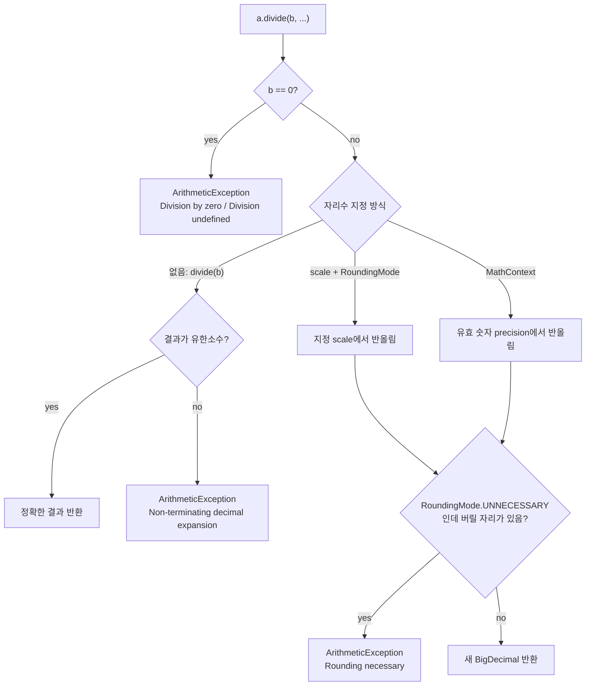

# BigDecimal

관련 문서: [예제](./BigDecimal-예제.md) · [Comparable](../Comparable/Comparable.md)

---

## 1. 한 줄 요약

BigDecimal은 돈처럼 소수점 아래가 한 자리도 틀리면 안 되는 숫자를 **10진수 그대로** 계산하게 해주는 클래스다.
정확히는 `임의 정밀도 정수(unscaledValue) × 10^(-scale)`로 값을 표현하는 **불변(immutable) 부호 있는 10진 소수** 타입이다.

---

## 2. 왜 필요한가

`double`/`float`는 IEEE 754 **2진** 부동소수점이다. 2진수로는 0.1, 0.2 같은 10진 소수를 정확히 표현할 수 없어서 가장 가까운 근사값이 저장된다.

```java
System.out.println(1.03 - 0.42);      // 0.6100000000000001
System.out.println(1.00 - 9 * 0.10);  // 0.09999999999999998
```

이 오차는 금액 합산·할인·세금 계산에서 누적되고, `Math.round`로 반올림하는 순간 1원 차이로 드러난다.

기존 해법과 한계:

| 해법 | 한계 |
|---|---|
| `double` + 마지막에 반올림 | 중간 오차가 반올림 경계(x.5)를 넘으면 결과가 틀린다. 언제 틀릴지 예측 불가 |
| `long`으로 최소 단위(원, 센트) 저장 | 빠르고 정확하지만, 이율·할인율처럼 소수가 끼는 연산과 반올림 정책을 직접 구현해야 한다. 통화마다 소수 자리수가 달라 관리가 번거롭다 |
| `BigDecimal` | 정확하고 반올림 규칙을 명시할 수 있다. 대신 느리고, API 함정이 많다 (8장) |

Effective Java 아이템 60의 결론도 같다: **정확한 답이 필요하면 float/double을 피하고 BigDecimal, int, long을 쓴다.**

---

## 3. 최소 예제로 보기

```java
BigDecimal a = new BigDecimal("1.03");
BigDecimal b = new BigDecimal("0.42");
System.out.println(a.subtract(b));                    // 0.61  ← 정확

System.out.println(new BigDecimal(0.1));              // 0.1000000000000000055511151231257827021181583404541015625
System.out.println(BigDecimal.valueOf(0.1));          // 0.1

BigDecimal x = new BigDecimal("2.0");
BigDecimal y = new BigDecimal("2.00");
System.out.println(x.equals(y));                      // false ← scale이 다르다
System.out.println(x.compareTo(y) == 0);              // true  ← 값은 같다

BigDecimal total = BigDecimal.ZERO;
total.add(new BigDecimal("100"));                     // 반환값을 버림
System.out.println(total);                            // 0     ← 불변 객체

BigDecimal.ONE.divide(new BigDecimal("3"));           // ArithmeticException: Non-terminating decimal expansion...
System.out.println(BigDecimal.ONE.divide(new BigDecimal("3"), 4, RoundingMode.HALF_UP)); // 0.3333
```

이 10여 줄에 BigDecimal의 핵심이 다 들어 있다.
- 문자열로 만들면 정확하다. `double`로 만들면 **double이 이미 가진 오차까지 정확하게** 복사된다.
- 값이 같아도 scale이 다르면 `equals`는 false다.
- 연산 결과는 새 객체로 반환된다.
- 나누기는 결과가 무한소수면 예외를 던진다. **자리수와 반올림 규칙을 정해줘야** 한다.

---

## 4. 핵심 개념

| 용어 | 영문 | 의미 |
|---|---|---|
| 비스케일 값 | unscaled value | 소수점을 뗀 정수 부분. `123.45`라면 `12345` |
| 스케일 | scale | 소수점 아래 자리수. `123.45`의 scale은 2. 음수면 10의 거듭제곱만큼 큰 수 (`1E+2`는 unscaled 1, scale -2) |
| 정밀도 | precision | 유효 숫자의 총 개수. `123.45`의 precision은 5 |
| 반올림 모드 | RoundingMode | 버려지는 자리를 어떻게 처리할지 정하는 enum. `HALF_UP`, `HALF_EVEN`, `DOWN` 등 |
| 수학 컨텍스트 | MathContext | precision + RoundingMode 묶음. "유효 숫자 n자리로 맞춰라" |
| 불변성 | immutability | 모든 연산이 새 BigDecimal을 반환하고 원본은 바뀌지 않음 |
| 값 동등성 vs 표현 동등성 | compareTo vs equals | `compareTo`는 수학적 값만, `equals`는 값과 scale을 모두 비교 |

`값 = unscaledValue × 10^(-scale)` 이 공식 하나가 이후 모든 동작을 설명한다.

---

## 5. 동작 원리와 흐름

### 5.1 생성: 어디서 오차가 들어오는가

1. `new BigDecimal("0.1")` — 문자열을 10진수로 파싱한다. unscaled=1, scale=1. 오차 없음.
2. `new BigDecimal(0.1)` — 인자로 들어온 순간 이미 2진 근사값(`0.1000000000000000055…`)이다. 생성자는 이 2진 값을 **정확히** 10진수로 옮긴다. 결과적으로 오차가 55자리짜리 숫자로 보존된다.
3. `BigDecimal.valueOf(0.1)` — 내부에서 `Double.toString(0.1)`을 호출해 `"0.1"`이라는 **가장 짧은 10진 표현**을 얻은 뒤 문자열 생성자로 만든다. 그래서 사람이 기대한 값이 나온다.

```mermaid
flowchart LR
    S["문자열 \"0.1\""] -->|new BigDecimal(String)| E1["unscaled=1, scale=1<br/>정확한 0.1"]
    D["double 0.1<br/>(실제로는 0.1000000000000000055…)"] -->|"new BigDecimal(double)"| E2["unscaled=1000000000000000055511…<br/>scale=55<br/>근사값을 정확히 복사"]
    D -->|"BigDecimal.valueOf(double)"| T["Double.toString → \"0.1\""]
    T --> E1
    L["long 100"] -->|"BigDecimal.valueOf(long)"| E3["unscaled=100, scale=0"]
```

즉 **오차는 BigDecimal이 아니라 double 리터럴에서 생긴다.** 값의 출처가 문자열·DB·정수라면 오차가 없고, double을 거쳤다면 오차가 이미 섞여 있다.

### 5.2 연산 결과의 scale

연산마다 결과 scale이 정해지는 규칙이 다르다.

| 연산 | 결과 scale | 예 |
|---|---|---|
| `add`, `subtract` | max(a.scale, b.scale) | `1.5 + 2.25 = 3.75` (scale 2) |
| `multiply` | a.scale + b.scale | `1.5 × 2.25 = 3.375` (scale 3), `58395 × 0.10 = 5839.50` (scale 2) |
| `divide(b)` (자리수 미지정) | 정확히 나눠떨어질 때만 성공. 선호 scale은 a.scale − b.scale | `6 ÷ 2 = 3`, `1 ÷ 3` → 예외 |
| `divide(b, scale, mode)` | 지정한 scale | `1 ÷ 3 (4, HALF_UP) = 0.3333` |
| `divide(b, MathContext)` | 지정한 precision(유효 숫자) | `DECIMAL128` → 유효 34자리 |
| `setScale(n, mode)` | n | `5839.50 → 5840` (0, HALF_UP) |

곱셈을 반복하면 scale이 계속 커진다. 그래서 **곱셈·나눗셈 후 정책이 정한 지점에서 `setScale`로 자리수를 확정**하는 것이 기본 흐름이다.

### 5.3 나눗셈의 판단 흐름



> **유한소수(terminating decimal)**: 소수점 아래 자릿수가 끝나는 소수. 기약분수의 분모의 소인수가 2와 5뿐일 때만 유한소수가 된다(1/4 = 0.25는 유한, 1/3 = 0.333…은 무한).

### 5.4 실무 계산 한 건의 흐름 (주문 금액)

1. DB(`numeric(19,0)`)·요청 JSON 문자열에서 단가를 BigDecimal로 읽는다 — 이 시점에 객체 생성, 오차 없음.
2. `단가 × 수량`(multiply)으로 라인 금액 계산 — 라인마다 새 객체.
3. 합계(add) → 할인율 곱셈(multiply, scale 증가) → **정책대로 `setScale(0, DOWN)`**(할인 절사).
4. 과세 금액 × 세율 → **`setScale(0, HALF_UP)`**(부가세 반올림).
5. 결과를 엔티티에 담아 저장 — PostgreSQL `numeric`으로 정확히 저장.

중간 객체는 모두 계산이 끝나면 GC 대상이 된다. 불변이라 스레드 간 공유해도 안전하다.

---

## 6. 내부 구현 (핵심만)

OpenJDK `java.math.BigDecimal` 기준.

- **`intCompact`(long) / `intVal`(BigInteger) 이원 저장** — unscaled 값이 long 범위에 들어가면 `intCompact`에 담고 `intVal`은 쓰지 않는다. 넘치면 `BigInteger`로 "부풀린다(inflate)". 그래서 금액 정도 크기의 연산은 생각보다 빠르지만, 여전히 매 연산마다 객체를 생성하므로 `long` 연산보다는 확실히 느리다.
- **`scale`(int)** — 값의 일부다. 이 필드가 `equals`/`hashCode`에 포함되기 때문에 `2.0`과 `2.00`이 다른 객체로 취급된다.
- **`equals(Object)`** — scale이 다르면 즉시 false. `hashCode()`도 `31 × unscaledValue.hashCode() + scale` 형태로 scale을 섞는다. 그 결과 `HashSet`/`HashMap` 키로 쓰면 같은 값이 두 번 들어간다. 반면 `compareTo`는 scale을 맞춘 뒤 값만 비교하므로 `TreeSet`/`TreeMap`에선 하나로 합쳐진다 — **compareTo와 equals가 일관되지 않은 대표적인 JDK 클래스**다([Comparable](../Comparable/Comparable.md) 참고).
- **`BigDecimal(double)` 생성자 / `valueOf(double)`** — 생성자는 double의 비트(가수·지수)를 그대로 10진 변환한다. `valueOf`는 `Double.toString`을 거친다. 5.1의 차이는 전적으로 이 구현 차이에서 나온다.
- **`divide(BigDecimal)`** — 자리수 지정이 없으면 정확한 몫을 구하려 하고, 나눠떨어지지 않으면 반올림을 임의로 하지 않고 예외를 던진다. "조용히 틀리는 것보다 시끄럽게 실패하는" 설계다.
- **`toString()`** — 지수 표기를 쓸 수 있다. scale이 음수이거나 지수가 충분히 작으면 `1E+2`, `1E-7` 같은 문자열이 나온다. `toPlainString()`은 항상 지수 없이 출력한다.

---

## 7. 유사 개념과의 비교

| 타입 | 정확성 | 속도 | 반올림 제어 | 언제 고르나 |
|---|---|---|---|---|
| `double` | 근사 | 매우 빠름 | 없음 (IEEE 754 기본) | 과학 계산, 통계, 좌표, ML 피처. 돈에는 쓰지 않는다 |
| `long` (최소 단위) | 정확 (정수만) | 매우 빠름 | 직접 구현 | 통화가 하나이고 연산이 덧셈·뺄셈 위주. 원화 잔액, 포인트 |
| `BigDecimal` | 정확 (10진) | 느림 | `RoundingMode`/`MathContext` | 할인율·이율·환율·세율처럼 소수 곱셈과 반올림 정책이 있는 금액 계산 |
| PostgreSQL `numeric(p,s)` | 정확 (10진) | DB 내 연산 | 입력 시 지정 scale로 반올림 | BigDecimal의 저장소. JDBC `getBigDecimal`로 1:1 대응 |
| PostgreSQL `money` | 정확 | - | 로케일 의존 | 로케일(`lc_monetary`)에 따라 해석이 바뀌므로 피한다 |
| Python `decimal.Decimal` | 정확 (10진) | 느림 | context | RAG/배치 파이프라인에서 금액을 다룰 때. `Decimal(0.1)` 함정이 Java와 똑같다 |

판단 기준: **"반올림 규칙을 비즈니스가 정하는가?"** → 그렇다면 BigDecimal. 정수 덧셈뿐이면 long으로 충분하다.

---

## 8. 함정과 안티패턴

### 8.1 `new BigDecimal(double)`로 생성

- **증상**: `new BigDecimal(1.005).setScale(2, HALF_UP)`가 `1.01`이 아니라 `1.00`. 로그에 `0.1000000000000000055…` 같은 긴 숫자가 찍힌다.
- **원인**: double 리터럴 `1.005`의 실제 값은 `1.00499999999999989…`이고, 생성자가 이를 정확히 복사한다(5.1, 6장).
- **해결**: `new BigDecimal("1.005")` 또는 `BigDecimal.valueOf(1.005)`. 근본적으로는 **값이 double을 거치지 않게** 한다 — DTO 필드를 처음부터 BigDecimal로, JSON은 문자열 또는 Jackson의 BigDecimal 역직렬화로 받는다.

### 8.2 `equals`로 금액 비교

- **증상**: `if (paid.equals(expected))`가 금액이 같은데 false. `HashSet<BigDecimal>`에 같은 금액이 2개. 테스트에서 `assertEquals(new BigDecimal("1000"), entity.getAmount())`가 실패하는데 메시지는 `expected: <1000> but was: <1000.00>`.
- **원인**: `equals`/`hashCode`가 scale을 포함한다(6장). DB `numeric(19,2)`에서 읽은 값은 scale 2로 돌아온다.
- **해결**: 값 비교는 `a.compareTo(b) == 0`. 키로 쓸 땐 `setScale`로 scale을 통일하거나 `TreeMap`. 테스트는 `assertEquals(0, expected.compareTo(actual))` 또는 AssertJ `isEqualByComparingTo`.
  - `stripTrailingZeros()`로 맞추는 방법도 있지만 `100` → `1E+2`가 되어 출력 문제를 만든다(8.6).

### 8.3 반환값을 버림 (불변성 망각)

- **증상**: 반복문에서 합산했는데 결과가 0. 할인 적용 후에도 원래 가격.
- **원인**: `add`/`setScale`은 새 객체를 반환하고 원본을 바꾸지 않는다(4장 불변성).
- **해결**: `total = total.add(x)`. `setScale`도 마찬가지 — `price.setScale(0, HALF_UP);` 단독 호출은 아무 일도 하지 않는다.

### 8.4 자리수 없는 `divide`

- **증상**: 테스트에선 잘 되다가 운영에서 `ArithmeticException: Non-terminating decimal expansion; no exact representable decimal result.`
- **원인**: 테스트 데이터는 우연히 나눠떨어졌고(10000 ÷ 4), 운영 데이터는 아니었다(10000 ÷ 3). 자리수 미지정 divide는 무한소수에서 예외를 던진다(5.3).
- **해결**: 나눗셈은 **항상** `divide(b, scale, RoundingMode)` 또는 `divide(b, MathContext)`. 같은 이유로 `setScale(n)`(반올림 모드 없음)도 버릴 자리가 있으면 `Rounding necessary` 예외가 난다.

### 8.5 중간 반올림과 배분 오차

- **증상**: 10,000원을 3명에게 나눴더니 3,333 × 3 = 9,999원. 1원이 사라짐. 또는 `(a ÷ b) × c`와 `(a × c) ÷ b` 결과가 다름.
- **원인**: 나눗셈에서 지정 scale로 반올림할 때마다 정보가 버려진다(5.2). 버려진 조각을 누구도 책임지지 않는다.
- **해결**: 곱셈을 먼저, 나눗셈은 마지막에 한 번. 배분은 `몫 = 총액 ÷ n (DOWN)`, `나머지 = 총액 − 몫 × n`을 구해 나머지를 정책대로(첫 사람, 금액 큰 순 등) 몰아준다. 합계 = 원금이 되는지 반드시 검증한다.

### 8.6 `toString()`의 지수 표기

- **증상**: 화면·CSV·외부 API 전송 값이 `1E+2`, `1.5E-7`. 프론트에서 파싱 실패.
- **원인**: `toString()`은 scale이 음수거나 아주 작은 수에 지수 표기를 쓴다(6장). `stripTrailingZeros()` 후에 특히 잘 생긴다.
- **해결**: 외부로 내보낼 땐 `toPlainString()`. Spring Boot/Jackson은 `spring.jackson.generator.write-bigdecimal-as-plain=true`.

### 8.7 RoundingMode 정책 불일치 (앱 vs DB vs 프론트)

- **증상**: 같은 주문의 부가세가 백엔드 계산·DB 저장값·React 화면에서 1원씩 다르다.
- **원인**: 앱은 `HALF_EVEN`(은행가 반올림), PostgreSQL은 `numeric(p,s)` 입력 시 scale을 넘는 자리를 **0에서 멀어지는 방향 반올림(half away from zero)**으로 조용히 처리, 프론트는 JS `Number`(double)로 다시 계산. 각자 다른 규칙이 적용된다.
- **해결**: 반올림은 **백엔드 한 곳**에서 비즈니스 정책대로 끝내고, DB에는 이미 확정된 scale의 값을 저장하며, 프론트는 받은 값을 표시만 한다. 큰 금액·고정밀 값은 JSON에서 문자열로 내려 JS 정밀도(2^53) 손실을 피한다.

---

## 9. 실무 적용 시나리오

### 9.1 언제 BigDecimal을 고르나

```
값에 소수가 있는가?
├─ 있다 → 오차가 1원이라도 문제가 되는가?
│        ├─ 된다 (금액·비율·세금)        → BigDecimal
│        └─ 안 된다 (통계·좌표·ML 점수)   → double
└─ 없다 → long 범위를 넘을 수 있는가?
         ├─ 안 넘는다                    → long
         └─ 넘는다                       → BigInteger
```

| 상황 | 타입 | 이유 |
|---|---|---|
| 주문 금액, 할인율, 부가세, 환율, 이자, 수수료 | **BigDecimal** | 소수 곱셈과 반올림 정책이 있다 |
| DB `numeric(p,s)` 금액 컬럼 | **BigDecimal** | JDBC가 `numeric`을 BigDecimal로 돌려준다 |
| 원화 잔액·포인트 (덧셈·뺄셈만) | long 또는 BigDecimal | 정수 가감뿐이면 long이 빠르다. 할인율·세율을 곱하는 순간 소수가 생기므로 다른 금액과 섞이면 BigDecimal로 통일한다 |
| 평균 응답 시간, 조회수 비율, 추천 점수 | double | 근사값이면 충분하다 |

### 9.2 계층별 적용

- **REST API 입출력**: 요청 DTO의 금액 필드는 `BigDecimal`. Jackson은 JSON 숫자를 BigDecimal 필드로 역직렬화할 때 double을 거치지 않는다. 다만 `Map<String,Object>`로 받으면 기본이 Double이므로 `DeserializationFeature.USE_BIG_DECIMAL_FOR_FLOATS`를 켜야 한다. 응답은 `toPlainString` 설정 + 필요시 `@JsonFormat(shape = JsonFormat.Shape.STRING)`으로 React에 문자열 전달.
- **JPA 엔티티**: `@Column(precision = 19, scale = 2) private BigDecimal amount;` → `numeric(19,2)`. precision/scale을 명시하지 않으면 Hibernate 기본값이 적용된다(버전별 기본값은 확인 필요). 저장 후 다시 읽으면 scale이 컬럼 scale로 바뀌므로 equals 비교 금지(8.2).
- **정산·배치**: 수수료율 곱셈, 일할 계산(÷ 30), N분할 배분. 8.5의 나머지 처리와 "합계 = 원금" 검증이 핵심.
- **환율·외부 PG 연동**: 외부 시스템이 소수 몇 자리까지 받는지, 반올림인지 절사인지 계약서·API 문서에 명시된 규칙대로 `setScale`. 통화별 소수 자리수는 `java.util.Currency#getDefaultFractionDigits()`(KRW=0, USD=2)로 얻을 수 있다.
- **트랜잭션 경계**: BigDecimal 자체는 불변이라 동시성 문제가 없다. 동시성 문제는 "잔액 읽기 → 계산 → 쓰기"의 경쟁 상태에서 생기므로 DB 락이나 `UPDATE ... SET balance = balance - ?`로 해결한다.

### 9.3 실제로 만나는 사례

직접 `new BigDecimal(...)`을 쓰는 경우보다, **DB·라이브러리가 BigDecimal을 돌려주거나 BigDecimal이어야 할 값이 double로 들어오는 경우**가 사고의 대부분이다.

**① PostgreSQL 네이티브 쿼리의 집계 결과가 BigDecimal**

```java
Object result = em.createNativeQuery("SELECT SUM(quantity) FROM order_line").getSingleResult();
Long total = (Long) result;                     // ClassCastException: BigDecimal cannot be cast to Long
long total = ((Number) result).longValue();     // ○ 타입이 바뀌어도 안전
```

| 함수 | 입력 타입 | 결과 타입 | Java |
|---|---|---|---|
| `sum` | `integer` | `bigint` | Long |
| `sum` | `bigint` | `numeric` | **BigDecimal** |
| `avg` | `integer`, `bigint` | `numeric` | **BigDecimal** |

`bigint` 합계는 long을 넘을 수 있어서 `numeric`이 된다. 컬럼을 `integer`에서 `bigint`로 바꾸기만 해도 기존 캐스팅 코드가 깨진다.

**② JPQL `AVG`는 항상 Double**

```java
Double avg = em.createQuery("SELECT AVG(o.amount) FROM Order o", Double.class).getSingleResult();
```

JPA 스펙상 `AVG`의 결과는 `Double`이다. `amount`가 BigDecimal이어도 평균 금액에 2진 오차가 섞인다. 정확한 평균은 `SUM`(BigDecimal 필드면 BigDecimal)과 `COUNT`를 따로 구해 `divide(count, scale, mode)`로 계산한다(8.4).

**③ 엑셀 업로드 — POI는 숫자 셀을 double로만 준다**

```java
double raw = cell.getNumericCellValue();
BigDecimal amount = BigDecimal.valueOf(raw);    // new BigDecimal(raw)는 8.1 함정
```

가격표·정산 데이터 일괄 업로드에서 만난다. 가능하면 `DataFormatter`로 셀에 표시된 문자열을 받아 `new BigDecimal(String)`으로 만든다.

**④ PG 결제 API — 최소 통화 단위 정수로 변환**

Stripe 같은 PG는 금액을 최소 단위 정수로 받는다(USD 10.99 → `1099`). 경계에서 변환한다.

```java
int digits = Currency.getInstance("USD").getDefaultFractionDigits();   // USD 2, KRW 0
long minorUnits = amount.setScale(digits, RoundingMode.UNNECESSARY)    // 이미 반올림이 끝나 있어야 한다. 남은 자리가 있으면 예외
                        .movePointRight(digits)
                        .longValueExact();                              // 10.99 → 1099
BigDecimal back = BigDecimal.valueOf(minorUnits, digits);              // 1099 → 10.99
```

여기서 몰래 반올림하면 우리 DB와 PG 정산 금액이 어긋난다(8.7).

**⑤ 요청 금액 검증 — `@Digits`를 DB 컬럼과 맞춘다**

```java
public record PaymentRequest(
        @NotNull @DecimalMin("0.01")
        @Digits(integer = 15, fraction = 2)    // numeric(17,2)와 맞춤
        BigDecimal amount) {}
```

PostgreSQL의 조용한 입력 반올림(8.7)과 `numeric field overflow`를 입력 단계에서 막는다. `1E1000000000` 같은 지수 표기 입력도 함께 막힌다.

**⑥ 직접 계산하는 곳**

| 사례 | 코드 핵심 |
|---|---|
| 주문·정산·수수료 | 단가 × 수량 → 할인 `setScale(0, DOWN)` → 세금 `setScale(0, HALF_UP)` ([예제](./BigDecimal-예제.md) `OrderCalculator`) |
| N분할 배분 | 몫(DOWN) + 나머지 몰아주기 (예제 `Allocator`) |
| 이자·복리 | `rate.add(ONE).pow(n, MathContext.DECIMAL128)` — 반복 곱셈으로 scale이 폭증하므로 유효 숫자를 제한 |
| 환율 변환 | `amount.multiply(rate).setScale(통화 자릿수, mode)` — 환율 자릿수와 통화 자릿수가 다르다 |
| 금액 타입 라이브러리 | Java Money(JSR 354) 구현체 Moneta의 `Money`가 내부적으로 BigDecimal을 쓴다(`FastMoney`는 long 기반) |

**⑦ Python(RAG) 쪽**

```python
row = cur.fetchone()              # psycopg는 numeric을 decimal.Decimal로 반환
json.dumps({"amount": row[0]})    # TypeError: Object of type Decimal is not JSON serializable
```

`str(row[0])`으로 문자열로 넘긴다. `float()`로 바꾸면 Java에서 피했던 오차가 다시 생긴다.

---

## 10. 버전 주의사항

| 버전 | 변화 | 코드 영향 |
|---|---|---|
| Java 5 | `MathContext`, `RoundingMode` enum, `toPlainString()`, `stripTrailingZeros()` 도입 | Java 7 이상 코드베이스는 모두 사용 가능 |
| Java 8 | 값이 0인 BigDecimal의 `stripTrailingZeros()`가 `BigDecimal.ZERO`를 반환하도록 수정 (이전엔 `0.000`이 그대로 남음, JDK-6480539) | Java 7에서 0 처리 결과에 의존한 코드는 동작이 바뀜 |
| Java 9 | `BigDecimal.ROUND_HALF_UP` 같은 `int` 상수와 이를 받는 `setScale(int, int)`, `divide(BigDecimal, int, int)` deprecated | `RoundingMode.HALF_UP` enum 버전으로 교체 |

---

## 11. 자가 점검 질문

1. `new BigDecimal(0.1)`과 `BigDecimal.valueOf(0.1)`의 결과가 다른 이유는?
   <details><summary>답</summary>생성자는 double 0.1이 실제로 가진 2진 근사값을 정확히 10진수로 옮기고, valueOf는 Double.toString으로 얻은 최단 10진 문자열 "0.1"로 만든다. 오차는 BigDecimal이 아니라 double 리터럴에서 이미 생긴 것이다.</details>
2. `new BigDecimal("2.0").equals(new BigDecimal("2.00"))`가 false인 이유와, `HashSet`과 `TreeSet`에 둘을 넣으면 각각 크기가 얼마인가?
   <details><summary>답</summary>equals/hashCode가 scale을 포함하기 때문. HashSet은 2, TreeSet은 compareTo 기준이라 1.</details>
3. `new BigDecimal("1.5").multiply(new BigDecimal("2.25"))`의 결과와 scale은?
   <details><summary>답</summary>3.375, scale 3 (곱셈 결과 scale은 두 scale의 합 1+2).</details>
4. 테스트에서는 문제없던 `amount.divide(count)`가 운영에서 예외를 던졌다. 원인과 해결은?
   <details><summary>답</summary>자리수 미지정 divide는 결과가 무한소수면 ArithmeticException을 던진다. 테스트 데이터는 우연히 나눠떨어졌다. divide(b, scale, RoundingMode) 또는 MathContext를 항상 지정한다.</details>
5. 10,000원을 3명에게 배분할 때 합계가 원금과 같도록 하는 방법은?
   <details><summary>답</summary>몫을 DOWN으로 구하고(3,333), 나머지(10,000 − 3,333×3 = 1)를 정책에 따라 특정 대상에게 더해준다. 결과 3,334 / 3,333 / 3,333.</details>

---

## 12. 참고 자료

- Java SE 21 API — [`java.math.BigDecimal`](https://docs.oracle.com/en/java/javase/21/docs/api/java.base/java/math/BigDecimal.html), [`RoundingMode`](https://docs.oracle.com/en/java/javase/21/docs/api/java.base/java/math/RoundingMode.html), [`MathContext`](https://docs.oracle.com/en/java/javase/21/docs/api/java.base/java/math/MathContext.html)
- Effective Java 3판 아이템 60 — 정확한 답이 필요하다면 float와 double은 피하라
- Effective Java 3판 아이템 14 — Comparable을 구현할지 고려하라 (BigDecimal의 compareTo/equals 불일치 사례)
- PostgreSQL 공식 문서 — [8.1.2 Arbitrary Precision Numbers](https://www.postgresql.org/docs/current/datatype-numeric.html#DATATYPE-NUMERIC-DECIMAL)
- JSR 13 — Decimal Arithmetic Enhancement (Java 5의 BigDecimal 확장)

---

## 부록: 용어 정리

| 용어 | 영문 | 설명 |
|---|---|---|
| 불변 | immutable | 생성 후 상태가 바뀌지 않음. 모든 연산이 새 객체를 반환 |
| 비스케일 값 | unscaled value | 소수점을 제거한 정수 부분 (`123.45` → `12345`) |
| 스케일 | scale | 소수점 아래 자리수. 음수면 10의 거듭제곱 배 |
| IEEE 754 | IEEE Standard for Floating-Point Arithmetic | double/float가 따르는 2진 부동소수점 표준 |
| 최소 단위 | minor unit | 통화의 가장 작은 단위(원, 센트). long 저장 방식의 기준 |
| 정밀도 | precision | 유효 숫자의 총 개수 |
| 반올림 모드 | RoundingMode | 버려지는 자리 처리 규칙을 정하는 enum |
| 수학 컨텍스트 | MathContext | 유효 숫자 수와 반올림 모드의 묶음 |
| 은행가 반올림 | banker's rounding (HALF_EVEN) | 정확히 절반이면 짝수 쪽으로 반올림. 누적 편향이 작다 |
| 부풀리기 | inflate | long에 담기지 않는 unscaled 값을 BigInteger로 전환하는 내부 동작 |
| 지수 표기 | scientific notation | `1E+2`처럼 10의 거듭제곱으로 표현한 문자열 |
| 배분 | allocation | 총액을 여러 대상에게 나누는 계산. 나머지 처리 정책이 필요 |
| 0에서 멀어지는 반올림 | round half away from zero | 절반일 때 절댓값이 커지는 쪽으로. PostgreSQL numeric 입력 반올림 방식 |
| 네이티브 쿼리 | native query | JPQL이 아닌 DB SQL을 그대로 실행하는 쿼리. 결과 타입을 드라이버가 정한다 |
| 집계 함수 | aggregate function | `SUM`, `AVG`처럼 여러 행을 하나의 값으로 모으는 함수. PostgreSQL은 결과 타입을 넓힌다 |
| JPQL | Java Persistence Query Language | 엔티티 기준으로 작성하는 JPA 쿼리 언어. `AVG`는 항상 Double |
| 빈 검증 | Bean Validation | `@Digits`, `@DecimalMin` 같은 어노테이션으로 입력값을 검증하는 Java 표준 |
| JSR 354 | Java Specification Request 354 (Money and Currency API) | 금액·통화 타입 표준 API. 구현체 Moneta |
