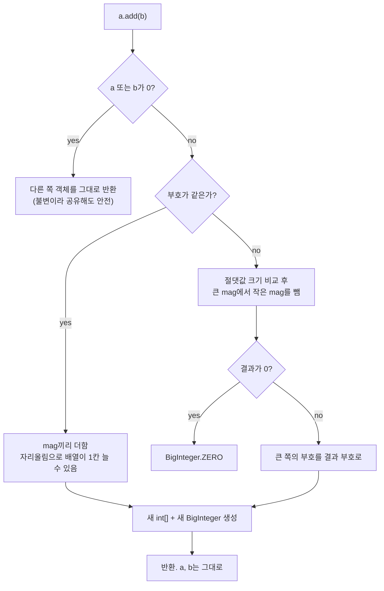
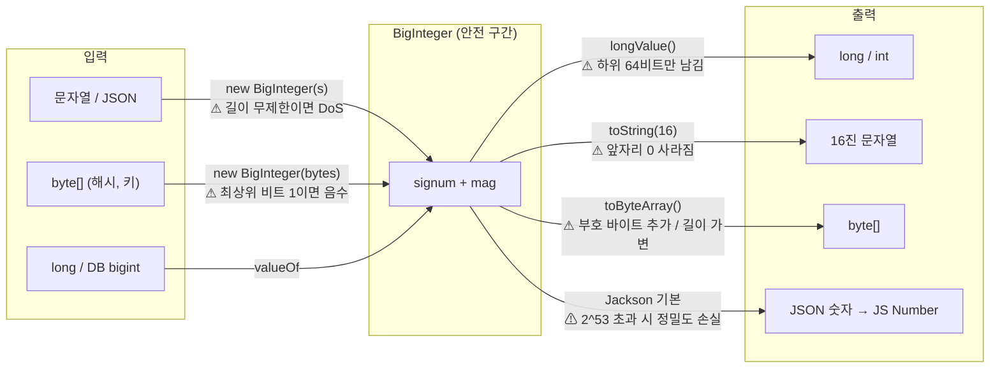

# BigInteger

관련 문서: [예제](./BigInteger-예제.md) · [BigDecimal](../BigDecimal/BigDecimal-이론.md) · [Jackson 직렬화](../Jackson직렬화/Jackson직렬화-이론.md)

---

## 1. 한 줄 요약

BigInteger는 `long`의 범위(약 ±9.22 × 10^18)를 넘는 정수를 **넘침 없이 정확하게** 계산하게 해주는 클래스다.
정확히는 부호(signum)와 `int[]` 크기 배열(magnitude)로 값을 표현하는 **불변(immutable) 임의 정밀도(arbitrary-precision) 정수** 타입이다.

---

## 2. 왜 필요한가

`int`/`long`은 고정 비트 수(32/64)의 2의 보수 정수다. 범위를 넘으면 **예외 없이 조용히 반대편 끝으로 돈다(wrap-around)**.

```java
System.out.println(Long.MAX_VALUE + 1);   // -9223372036854775808
System.out.println(factorialLong(21));    // -4249290049419214848  ← 21!은 long 범위를 넘는다
```

기존 해법과 한계:

| 해법 | 한계 |
|---|---|
| 그냥 `long` | 넘침이 조용히 일어나 잘못된 값이 그대로 저장·전송된다 |
| `Math.addExact`, `multiplyExact` (Java 8+) | 넘침을 **감지**해 예외를 던질 뿐, 큰 값을 **계산**하지는 못한다 |
| `double` | 범위는 넓지만 2^53을 넘으면 정수도 근사값이 된다 |
| `BigInteger` | 메모리가 허락하는 한 정확하다. 대신 느리고 매 연산마다 객체를 만든다 |

BigDecimal의 unscaled value(소수점을 뗀 정수 부분)도 long을 넘으면 내부에서 BigInteger로 저장된다([BigDecimal 6장](../BigDecimal/BigDecimal-이론.md#6-내부-구현-핵심만)). 즉 BigInteger는 Java 정밀 연산의 바닥 계층이다.

---

## 3. 최소 예제로 보기

```java
BigInteger max = BigInteger.valueOf(Long.MAX_VALUE);
BigInteger over = max.add(BigInteger.ONE);
System.out.println(over);                         // 9223372036854775808   ← 정확
System.out.println(over.longValue());             // -9223372036854775808  ← 조용히 잘림
over.longValueExact();                            // ArithmeticException: BigInteger out of long range

System.out.println(BigInteger.TWO.pow(100));      // 1267650600228229401496703205376

BigInteger neg = BigInteger.valueOf(-7);
System.out.println(neg.remainder(BigInteger.valueOf(3)));  // -1  ← 부호가 피제수를 따름
System.out.println(neg.mod(BigInteger.valueOf(3)));        // 2   ← 항상 0 이상

byte[] bytes = { 0x00, 0x0A, (byte) 0xFF };
System.out.println(new BigInteger(1, bytes).toString(16)); // aff ← 앞의 "000"이 사라짐
System.out.println(BigInteger.valueOf(255).toByteArray().length); // 2 ← [0x00, 0xFF], 부호 바이트 추가

System.out.println(new BigInteger("100").equals(BigInteger.valueOf(100)));      // true ← BigDecimal과 달리 scale 문제 없음
```

이 코드에서 볼 수 있는 핵심:
- BigInteger 안에서는 넘침이 없다. 문제는 **long/int로 다시 꺼낼 때** 생긴다.
- `remainder`와 `mod`는 음수에서 결과가 다르다.
- 바이트·16진수로 바꿀 때 **길이 정보가 없다.** 앞자리 0은 사라지고, 부호 바이트는 추가된다.
- `equals`는 값만 비교한다. BigDecimal의 scale 함정은 없다.

---

## 4. 핵심 개념

| 용어 | 영문 | 의미 |
|---|---|---|
| 임의 정밀도 | arbitrary precision | 자릿수가 고정되지 않고 필요한 만큼 늘어남 |
| 부호 | signum | -1, 0, 1 중 하나. 값의 부호만 따로 저장 |
| 크기 배열 | magnitude (`int[] mag`) | 절댓값을 32비트 단위로 나눠 담은 배열. 앞(인덱스 0)이 가장 높은 자리 |
| 부호-크기 표현 | sign-magnitude | 부호와 절댓값을 분리해 저장하는 방식. long의 2의 보수와 다름 |
| 2의 보수 | two's complement | long/int와 `toByteArray()`가 쓰는 음수 표현. 최상위 비트가 1이면 음수 |
| 비트 길이 | bitLength | 부호 비트를 제외하고 값을 표현하는 데 필요한 최소 비트 수. 크기 검증의 기준 |
| 정확 변환 | exact conversion (`longValueExact`) | 범위를 넘으면 잘라내지 않고 예외를 던지는 변환 |
| 불변성 | immutability | 모든 연산이 새 객체를 반환. 스레드 안전하지만 객체 생성 비용이 듦 |

---

## 5. 동작 원리와 흐름

### 5.1 값이 저장되는 방식

#### 값의 정의

```
값        = signum × magnitude
magnitude = mag[0] × 2^(32(n−1)) + mag[1] × 2^(32(n−2)) + … + mag[n−1] × 2^0
```

- **signum**: -1, 0, 1. 부호는 **오직 여기에만** 있다.
- **mag**: 절댓값을 32비트씩 끊어 **높은 자리부터** 담은 `int[]`. 2^32진법의 각 자리라고 보면 된다.
- **mag의 원소는 부호 없는(unsigned) 32비트로 해석한다.** Java `int`는 signed라서 `0xFFFFFFFF`를 출력하면 `-1`로 보이지만, mag 안에서는 4,294,967,295(2^32 − 1)다. mag에는 부호 비트가 없고 32비트 전부가 값이다.

| 값 | signum | mag (16진) | 비고 |
|---|---|---|---|
| 0 | 0 | `[]` | 0의 표현은 이것 하나뿐 |
| 1 | 1 | `[00000001]` | |
| −1 | −1 | `[00000001]` | 1과 mag가 같고 부호만 다르다 |
| 2^32 − 1 | 1 | `[FFFFFFFF]` | 원소 하나가 꽉 찬 상태. Java로 찍으면 `mag[0] == -1` |
| 2^32 | 1 | `[00000001, 00000000]` | 자리가 하나 늘었다 |
| Long.MAX_VALUE | 1 | `[7FFFFFFF, FFFFFFFF]` | |
| Long.MIN_VALUE (−2^63) | −1 | `[80000000, 00000000]` | long에선 특이값이지만 여기선 평범한 값 |

#### 생성 흐름

`new BigInteger("-18446744073709551616")` (= −2^64)

1. 문자열에서 부호를 떼고 `signum = -1`.
2. 절댓값 2^64를 32비트씩 끊는다 → `mag = [00000001, 00000000, 00000000]` (높은 자리부터).
3. **정규화(normalization)**: mag 앞쪽의 0인 원소는 제거하고, 값이 0이면 `signum = 0, mag = []`로 만든다.
4. 객체가 만들어진 뒤로 `signum`과 `mag`는 바뀌지 않는다(불변).

#### 원소가 꽉 찼을 때 — 올림(carry)

십진수 999 + 1처럼 윗자리로 올림이 일어나고, 맨 윗자리까지 넘치면 **배열 길이가 하나 늘어난 새 배열**이 만들어진다.

```
  [FFFFFFFF]              (2^32 − 1)
+ [00000001]
= [00000001, 00000000]    (2^32)   ← 맨 앞에 올림 1이 새 자리로
```

구현은 원소를 unsigned로 읽기 위해 long으로 넓혀서 더한다.

```java
long sum = (x[i] & 0xFFFFFFFFL) + (y[i] & 0xFFFFFFFFL) + carry; // 마스크로 부호 확장을 막아 0 ~ 2^32−1로 읽는다
result[i] = (int) sum;   // 하위 32비트가 이 자리의 값
carry = sum >>> 32;      // 넘친 부분(0 또는 1)이 윗자리로
```

`& 0xFFFFFFFFL`이 없으면 `0xFFFFFFFF`가 long `-1`로 부호 확장되어 계산이 틀린다. "mag는 unsigned"라는 규칙이 코드로 드러나는 지점이다.

#### long(2의 보수)과 무엇이 다른가

| | long (2의 보수) | BigInteger (부호-크기) |
|---|---|---|
| 부호 위치 | 최상위 비트 | 별도 필드 `signum` |
| 최댓값 + 1 | 올림이 부호 비트로 들어가 **음수가 된다** (wrap) | 올림이 새 자리로 가서 **배열이 늘어난다** |
| 범위 | 비대칭: −2^63 ~ 2^63−1 | 대칭: +M과 −M은 mag가 같다 |
| `abs` / `negate` | `Math.abs(Long.MIN_VALUE)`가 음수 그대로인 함정 | signum만 뒤집고 mag 배열은 복사 없이 공유 |
| 곱셈의 부호 | 비트 연산 결과에 섞여 있다 | `signum × signum`으로 따로 정하고, mag끼리는 절댓값 곱셈만 |

long이 넘치는 이유는 **값 비트와 부호 비트가 같은 64비트 공간을 나눠 쓰기 때문**이다. 부호-크기 표현은 둘을 분리했으므로 크기가 아무리 커져도 부호를 침범하지 않는다. **BigInteger 안에 "넘침"이라는 개념이 없는 이유가 이것이다.** 배열이 길어질 뿐이다.

#### 정규화가 하는 일

전통적인 부호-크기 방식은 +0과 −0이라는 두 표현이 생기는 약점이 있다. BigInteger는 위 3단계의 정규화로 **모든 값의 표현을 하나로** 만든다. 그 덕분에 `equals`는 signum과 mag 배열만 비교하면 되고, `compareTo`는 signum → mag 길이 → 높은 자리부터 원소를 unsigned로 비교하는 순서로 끝난다.

#### 경계: 비트·바이트 관점은 2의 보수

저장은 부호-크기지만 `and`, `or`, `not`, `shiftRight`, `testBit`, `toByteArray()`, `new BigInteger(byte[])`는 **"무한히 부호 확장된 2의 보수인 것처럼"** 동작하도록 정의되어 있다. 음수에 이런 연산을 하면 내부에서 mag를 2의 보수로 바꿔 가며 계산한다.

```java
BigInteger.valueOf(-1).shiftRight(1);   // -1  (2의 보수 …1111을 밀어도 …1111)
BigInteger.valueOf(-1).testBit(100);    // true (무한 부호 확장이라 모든 비트가 1)
```

두 표현이 만나는 이 경계가 8.3(`toByteArray`의 부호 바이트, 바이트 배열이 음수로 읽히는 문제)의 근본 원인이다.

### 5.2 연산 한 번의 흐름 (`a.add(b)`)



모든 연산은 **새 `int[]`와 새 BigInteger를 만든다.** 반복문에서 누적하면 반복 횟수만큼 객체가 생기고 GC 대상이 된다.

### 5.3 경계를 넘나드는 흐름 (실무에서 문제가 생기는 지점)

BigInteger 자체는 안전하다. 사고는 **다른 표현으로 바뀌는 경계**에서 난다.



8장의 함정 대부분이 이 그림의 ⚠ 표시 지점 중 하나다.

---

## 6. 내부 구현 (핵심만)

OpenJDK `java.math.BigInteger` 기준.

- **`signum`(int) + `mag`(int[])** — 부호-크기 표현이다. 그래서 `negate()`는 부호만 바꾸면 되고 `mag` 배열을 **복사 없이 공유**한다(불변이라 가능). 반면 `toByteArray()`·`new BigInteger(byte[])`는 2의 보수를 쓰기 때문에 변환 과정에서 부호 비트 처리가 끼어든다 → 8.3 함정의 원인.
- **`longValue()` / `intValue()`** — `Number`의 축소 변환(narrowing) 규칙을 그대로 따른다. 하위 64/32비트만 2의 보수로 잘라내고 **범위 검사를 하지 않는다.** `longValueExact()`는 `bitLength() <= 63`일 때만 성공하고 아니면 `ArithmeticException`.
- **`toString(radix)`** — 값만 표현한다. 원래 바이트가 몇 개였는지는 BigInteger에 저장되지 않으므로 앞자리 0을 되살릴 방법이 없다 → 8.2.
- **`remainder` / `mod`** — `remainder`는 Java `%` 연산자와 같은 규칙(부호가 피제수를 따름). `mod`는 수학의 모듈로 연산이라 결과가 항상 `[0, m)`이며, `m <= 0`이면 `ArithmeticException: BigInteger: modulus not positive`.
- **`multiply`** — 크기에 따라 알고리즘을 바꾼다. 작은 수는 자리별 곱셈(schoolbook), `mag` 길이가 일정 기준(80 int)을 넘으면 Karatsuba, 더 크면(240 int) Toom-Cook 3-way. 자릿수가 늘면 비용이 자릿수에 비례하는 것보다 훨씬 빠르게 커진다 → 8.7 DoS의 원인.
- **`valueOf(long)`** — -16 ~ 16은 캐시된 인스턴스를 반환한다. `==`로 비교하면 작은 값에서는 우연히 true가 나와 버그가 숨는다. 비교는 항상 `equals`/`compareTo`.

---

## 7. 유사 개념과의 비교

| 타입 | 범위 | 넘침 시 | 속도 | 언제 고르나 |
|---|---|---|---|---|
| `long` | ±9.22 × 10^18 | 조용히 wrap | 매우 빠름 | 대부분의 ID, 카운터, 금액(최소 단위) |
| `Math.*Exact` + long | 동일 | `ArithmeticException` | 매우 빠름 | 넘치면 안 되지만 넘칠 일도 거의 없는 계산. 넘침을 버그로 잡고 싶을 때 |
| `Long.*Unsigned` 메서드 | 0 ~ 1.84 × 10^19 | wrap | 매우 빠름 | 외부 시스템의 unsigned 64비트 ID를 long 하나로 다룰 때 |
| `BigInteger` | 사실상 무제한 (약 ±2^(2^31)) | 없음 | 느림 | 범위가 예측 불가한 정수, 암호·해시 값의 수치 연산, unsigned 64비트 초과 |
| `BigDecimal` | 사실상 무제한 + 소수 | 없음 | 더 느림 | 소수가 끼는 정확한 계산(금액·비율) |
| PostgreSQL `bigint` | long과 동일 | 에러 `bigint out of range` | - | long 대응 컬럼 |
| PostgreSQL `numeric(p,0)` | 최대 131,072자리 | precision 초과 시 에러 | - | BigInteger 대응 컬럼 |
| Python `int` | 무제한 (기본) | 없음 | - | Python은 정수가 원래 임의 정밀도라 별도 타입이 필요 없다. RAG 파이프라인과 값을 주고받을 때 Java 쪽만 주의하면 된다 |

판단 기준: **"이 값이 long을 넘을 수 있는가?"** → 넘을 수 없다면 long(필요하면 `Math.*Exact`). 넘을 수 있거나 외부에서 길이를 정하는 값이면 BigInteger.

---

## 8. 함정과 안티패턴

### 8.1 `longValue()`/`intValue()`로 조용히 잘림

- **증상**: 큰 ID를 DB `bigint`나 long 필드에 넣었더니 음수가 되거나 전혀 다른 숫자가 저장된다. 예외는 없다.
- **원인**: 축소 변환은 하위 비트만 남기고 범위 검사를 하지 않는다(6장).
- **해결**: `longValueExact()`/`intValueExact()`(Java 8+). Java 7이라면 `bitLength() <= 63`을 직접 확인한 뒤 `longValue()`.

### 8.2 `toString(16)`으로 해시를 16진수로 바꿀 때 앞자리 0 손실

- **증상**: SHA-256 해시 문자열이 가끔 64자가 아니라 63자, 62자. 다른 시스템과 비교하면 일치하지 않는다. 대략 해시 16개 중 1개꼴로 발생해 테스트에서 놓친다.
- **원인**: BigInteger는 값만 저장하고 원래 바이트 길이를 모른다. 첫 바이트가 `0x0?`이면 그 0이 사라진다(6장).
- **해결**: 바이트 배열 자체를 16진수로 바꾼다 — Java 17+ `HexFormat.of().formatHex(bytes)`. BigInteger를 써야 한다면 `String.format("%064x", value)`처럼 **고정 길이로 0을 채운다.**

### 8.3 `byte[]` ↔ BigInteger 변환의 부호 문제

- **증상**: 해시·키 바이트로 만든 BigInteger가 음수. 또는 `toByteArray()` 결과가 32바이트가 아니라 33바이트(또는 31바이트)라서 서명 검증·키 파싱이 실패.
- **원인**: `new BigInteger(byte[])`와 `toByteArray()`는 2의 보수다(6장). 첫 바이트의 최상위 비트가 1이면 음수로 읽고, 양수를 내보낼 때 최상위 비트가 1이면 `0x00` 부호 바이트를 앞에 붙인다. 앞자리 0바이트는 반대로 생략된다.
- **해결**: 읽을 때는 `new BigInteger(1, bytes)`(항상 양수로 해석). 내보낼 때는 맨 앞 `0x00`을 떼고 부족하면 앞을 0으로 채워 **고정 길이 배열**로 만든다(예제 `HexCodec#toFixedBytes`).

### 8.4 `remainder`로 샤드·버킷 번호 계산

- **증상**: `id.remainder(n)`으로 샤드 번호를 구했는데 `ArrayIndexOutOfBoundsException: Index -3`.
- **원인**: `remainder`는 결과 부호가 피제수를 따른다. 해시값이나 2의 보수로 읽은 값은 음수일 수 있다(6장, 8.3).
- **해결**: `mod(n)`을 쓴다. long이라면 `Math.floorMod`, unsigned 의미라면 `Long.remainderUnsigned`.

### 8.5 반환값을 버림 (불변성 망각)

- **증상**: `sum.add(x);`를 반복했는데 결과가 0.
- **원인**: 모든 연산이 새 객체를 반환한다(5.2).
- **해결**: `sum = sum.add(x)`. BigDecimal과 똑같은 함정이다.

### 8.6 JSON으로 내보낸 큰 정수가 프론트에서 바뀜

- **증상**: API 응답의 ID `9007199254740993`이 React에서 `9007199254740992`로 보이고, 그 ID로 다시 조회하면 404.
- **원인**: Jackson은 BigInteger(와 long)를 JSON 숫자로 내보낸다. JS `Number`는 double이라 2^53(9,007,199,254,740,992)을 넘는 정수를 정확히 표현하지 못한다(5.3).
- **해결**: 큰 정수 ID는 문자열로 내보낸다 — 필드에 `@JsonFormat(shape = JsonFormat.Shape.STRING)` 또는 `@JsonSerialize(using = ToStringSerializer.class)`. 프론트에서 연산이 필요하면 JS `BigInt`로 파싱한다.

### 8.7 검증 없는 외부 입력으로 DoS

- **증상**: 특정 요청 하나에 CPU 100%, 응답 없음 또는 `OutOfMemoryError`.
- **원인**: BigInteger는 범위 제한이 없어서 입력 크기가 곧 연산 비용이다. 수십만 자리 문자열 파싱, `pow(지수)`에 사용자 값을 넣는 경우, 큰 수끼리의 곱셈은 자릿수가 늘수록 비용이 급격히 커진다(6장 multiply).
- **해결**: 파싱 전에 문자열 길이, 파싱 후에 `bitLength()`를 업무상 최대치로 제한한다. `pow`·`shiftLeft`의 지수는 절대 외부 값을 그대로 쓰지 않는다. Jackson 2.15+는 `StreamReadConstraints`로 숫자 문자열 길이를 기본 1000자로 제한하지만, 그보다 작은 업무 한도는 직접 검증한다.

---

## 9. 실무 적용 시나리오

### 9.1 언제 BigInteger를 고르나

판단 기준은 7장의 **"이 값이 long을 넘을 수 있는가?"** 하나다. 소수가 있으면 BigInteger가 아니라 [BigDecimal](../BigDecimal/BigDecimal-이론.md#91-언제-bigdecimal을-고르나)이다.

| 상황 | 타입 | 이유 |
|---|---|---|
| 회원 ID, 주문 ID, 카운터, 페이지 번호 | long | long을 넘을 일이 없다 |
| 외부 시스템의 unsigned 64비트 ID | String / **BigInteger** / long + `Long.*Unsigned` | 2^63 이상이 올 수 있다 (아래 9.2) |
| 해시값으로 샤드·버킷 번호 계산 | **BigInteger** (`mod`) | 256비트 해시를 수로 다뤄야 한다 |
| 해시를 16진 문자열로 표시 | 둘 다 아님 → `HexFormat` | 수치 연산이 아니라 표현 문제다 (8.2) |
| 조합 수, 팩토리얼 같은 큰 수 | **BigInteger** | 21!부터 long을 넘는다 |
| 인증서 일련번호, RSA·EC 키 | **BigInteger** (JDK가 돌려줌) | 160비트, 2048비트 정수다 (아래 9.3) |

일반 업무 코드에서 BigInteger를 **직접 만드는 일은 드물다.** 대부분은 JDK·드라이버·Jackson이 BigInteger를 돌려줘서 받아 쓰게 된다.

### 9.2 계층별 적용

- **외부 시스템의 unsigned 64비트 ID**: Java에는 unsigned 64비트 타입이 없어서 2^63 이상(9,223,372,036,854,775,808 ~ 18,446,744,073,709,551,615)인 ID는 long에 그대로 담기지 않는다. `Long.parseLong`은 `NumberFormatException`, Jackson은 long 필드 역직렬화 시 `InputCoercionException`, PostgreSQL `bigint`는 `bigint out of range`.
  - **출처**: 다른 시스템의 MySQL `BIGINT UNSIGNED` PK, 64비트 해시(xxHash64 등)를 ID로 쓰는 시스템(값이 고르게 퍼져 **약 절반이 2^63 이상**), Go·Rust·C++ 서비스의 `uint64`, protobuf `uint64` 필드(protobuf-java는 이를 `long`에 담아 2^63 이상이면 음수로 보인다).
  - Discord·Twitter의 snowflake ID는 64비트지만 현재 값은 2^63보다 작아서 long에 들어간다. 대신 2^53을 넘으므로 8.6(JS 정밀도)의 대표 사례다. 두 문제를 구분한다.

  | 방식 | 저장 | 장점 | 주의 |
  |---|---|---|---|
  | String | `varchar(20)` | 가장 단순. JSON·JS 정밀도 문제도 없다 | 숫자 정렬·범위 비교 불가 |
  | BigInteger | `numeric(20,0)` | 정확. 비교·`mod`·정렬 가능 | 느리고 무겁다. JSON은 문자열로 |
  | long + `Long.*Unsigned` | `bigint` | 빠르고 작다 (protobuf 방식) | 출력·비교·정렬마다 unsigned 메서드 필요. DB `ORDER BY`에서 큰 ID가 음수라 맨 앞에 온다 |

  ID는 대부분 **식별자이지 계산 대상이 아니다.** 저장·조회·전달만 한다면 String, 크기 비교·범위 조회·샤딩이 필요하면 BigInteger, 대량 처리 성능이 중요하면 long + unsigned 메서드.
- **해시 기반 샤딩·버킷팅**: `new BigInteger(1, sha256).mod(BigInteger.valueOf(shardCount))`. 부호(8.3)와 mod(8.4)를 둘 다 지켜야 한다.
- **해시·체크섬 문자열**: 수치 연산이 아니라 표현만 필요하면 BigInteger를 쓰지 않는다. `HexFormat`(Java 17+)이나 직접 루프로 바이트 → 16진수(8.2).
- **REST API 응답**: 2^53을 넘을 수 있는 정수는 문자열로 직렬화(8.6). [Jackson 직렬화](../Jackson직렬화/Jackson직렬화-이론.md) 설정과 함께 관리한다.
- **JDBC/JPA**: PostgreSQL `numeric`은 JDBC에서 BigDecimal로 읽힌다. BigInteger가 필요하면 `rs.getBigDecimal(col).toBigIntegerExact()` — 소수부가 있으면 예외를 던지므로 데이터 오염을 바로 알 수 있다. JPA 엔티티 필드를 BigInteger로 선언했을 때의 기본 DDL 매핑은 Hibernate 버전별로 확인 필요. 컬럼 정의는 `@Column(precision = 20, scale = 0)`처럼 명시한다.
- **암호 연산**: RSA 등의 모듈러 연산(`modPow`, `modInverse`)이 BigInteger로 구현돼 있지만, 직접 구현하지 말고 JCA(`java.security`, `javax.crypto`)를 쓴다. BigInteger 연산은 상수 시간(constant-time)이 보장되지 않아 타이밍 공격에 취약할 수 있다.

### 9.3 실제로 만나는 사례

**① JDK가 돌려주는 BigInteger — 인증서 일련번호**

```java
X509Certificate cert = (X509Certificate) CertificateFactory.getInstance("X.509").generateCertificate(in);
BigInteger serial = cert.getSerialNumber();    // RFC 5280: 최대 20바이트(160비트) → long 불가
```

mTLS 클라이언트 인증서 검증, 폐기 목록(CRL) 대조, 인증서 만료 모니터링에서 만난다. 일련번호를 16진 문자열로 저장·비교할 때 8.2(앞자리 0 손실)를 실제로 겪는다.

**② JWKS로 RSA 공개키 조립 — `new BigInteger(1, bytes)`가 필수인 이유**

```java
byte[] nBytes = Base64.getUrlDecoder().decode(jwk.get("n"));
byte[] eBytes = Base64.getUrlDecoder().decode(jwk.get("e"));
RSAPublicKeySpec spec = new RSAPublicKeySpec(
        new BigInteger(1, nBytes),     // signum 생략 시 첫 바이트 최상위 비트가 1이면 모듈러스가 음수 → 키 생성 실패 (8.3)
        new BigInteger(1, eBytes));
PublicKey publicKey = KeyFactory.getInstance("RSA").generatePublic(spec);
```

JWT 서명 검증용 공개키를 인증 서버의 JWKS 엔드포인트에서 받아 만드는 코드다. 보통은 Spring Security·Nimbus JOSE가 대신 처리하지만 내부에서 하는 일이 이것이다. 반대로 `RSAPublicKey#getModulus()`도 BigInteger를 돌려준다.

**③ MySQL 네이티브 쿼리의 형변환 사고**

```java
Object result = em.createNativeQuery("SELECT COUNT(*) FROM orders").getSingleResult();
Long count = (Long) result;                     // MySQL + Hibernate 조합에서 ClassCastException: BigInteger cannot be cast to Long
long count = ((Number) result).longValue();     // ○
```

MySQL `COUNT(*)`·`BIGINT UNSIGNED` 결과를 드라이버가 BigInteger로 돌려주는 경우가 있다(드라이버·Hibernate 버전별 정확한 타입은 확인 필요). PostgreSQL은 `count(*)`가 `bigint`라 Long으로 온다. 네이티브 쿼리 결과는 항상 `Number`로 받는다.

**④ Jackson 타입 미지정 역직렬화**

```java
Map<String, Object> map = objectMapper.readValue("{\"id\": 18446744073709551615}", Map.class);
map.get("id").getClass();    // java.math.BigInteger  (크기에 따라 Integer → Long → BigInteger)
```

외부 웹훅 JSON을 `Map`으로 받아 `(Long) map.get("id")`로 꺼내면 대부분은 되다가 큰 값에서만 `ClassCastException`이 난다.

**⑤ 직접 쓰는 곳**

| 사례 | 코드 핵심 | 이유 |
|---|---|---|
| 단축 URL·짧은 ID | `new BigInteger(1, uuidBytes).toString(36)` | 128비트 UUID를 짧은 문자열로. long은 64비트라 담지 못한다 |
| 해시 기반 샤딩 | `new BigInteger(1, sha256).mod(n)` | 8.3·8.4 ([예제](./BigInteger-예제.md) `ShardRouter`) |
| 블록체인 금액 | web3j의 잔액·토큰 수량 | 이더리움은 `uint256`, 최소 단위(wei)가 10^18이라 long을 바로 넘는다 |
| unsigned 64비트 출력 | Guava `UnsignedLong#bigIntegerValue()` | long에 담긴 unsigned 값을 정확한 수로 바꿀 때 |
| BigDecimal 내부 | `intVal` 필드 | unscaled 값이 long을 넘으면 BigInteger로 저장 ([BigDecimal 6장](../BigDecimal/BigDecimal-이론.md#6-내부-구현-핵심만)) |

---

## 10. 버전 주의사항

| 버전 | 변화 | 코드 영향 |
|---|---|---|
| Java 8 | `longValueExact()`, `intValueExact()` 등 추가. 지원 범위(±2^Integer.MAX_VALUE 미만)를 넘으면 `ArithmeticException` | Java 7 코드의 `longValue()` 잘림 위험 지점을 `*ValueExact`로 교체 가능. Java 7에서는 `bitLength()`로 직접 검사 |
| Java 8 | `Long.parseUnsignedLong`, `Long.compareUnsigned`, `Long.remainderUnsigned` 등 unsigned 연산 추가 | unsigned 64비트를 BigInteger 없이 다룰 수 있게 됨 |
| Java 9 | `BigInteger.TWO`, `sqrt()` 추가 | Java 7·8 대상 코드에서는 `BigInteger.valueOf(2)` 사용 |
| Java 17 | `java.util.HexFormat` 추가 | 해시 16진 변환에 BigInteger를 쓰던 코드를 대체 |
| Java 19 | `parallelMultiply()` 추가 | 매우 큰 수의 곱셈을 ForkJoin 공용 풀로 병렬 처리. 일반 업무 코드에선 쓸 일이 거의 없음 |

---

## 11. 자가 점검 질문

1. `BigInteger.valueOf(Long.MAX_VALUE).add(BigInteger.ONE).longValue()`의 결과와 그 이유는?
   <details><summary>답</summary>-9223372036854775808. longValue는 하위 64비트만 2의 보수로 잘라내고 범위 검사를 하지 않는다. 2^63의 하위 64비트는 최상위 비트만 1이므로 Long.MIN_VALUE가 된다. longValueExact를 쓰면 ArithmeticException.</details>
2. SHA-256 해시를 `new BigInteger(1, digest).toString(16)`으로 바꿨더니 가끔 63자가 나온다. 원인과 해결은?
   <details><summary>답</summary>BigInteger는 값만 저장하고 원래 바이트 길이를 모르므로 첫 바이트가 0x0?이면 앞자리 0이 사라진다. HexFormat으로 바이트를 직접 변환하거나 String.format("%064x", v)로 고정 길이 0 채움.</details>
3. `new BigInteger(new byte[]{(byte) 0xFF})`와 `new BigInteger(1, new byte[]{(byte) 0xFF})`의 값은?
   <details><summary>답</summary>-1과 255. 첫 번째는 2의 보수로 해석해 최상위 비트 1을 음수로 읽고, 두 번째는 signum 1을 지정해 바이트를 절댓값(unsigned)으로 해석한다.</details>
4. `BigInteger.valueOf(-7).remainder(3)`과 `.mod(3)`의 결과가 다른 이유와, 샤드 번호에 어느 쪽을 써야 하는가?
   <details><summary>답</summary>-1과 2. remainder는 % 연산자처럼 부호가 피제수를 따르고, mod는 결과가 항상 [0, m). 배열 인덱스로 쓰는 샤드 번호는 음수가 나오면 안 되므로 mod.</details>
5. 사용자 입력 문자열을 길이 검사 없이 `new BigInteger(input)`으로 받으면 어떤 위험이 있는가?
   <details><summary>답</summary>BigInteger는 범위 제한이 없어 입력 크기가 그대로 메모리·CPU 비용이 된다. 아주 긴 숫자 문자열이나 그 값으로 하는 곱셈·거듭제곱으로 DoS가 가능하다. 문자열 길이와 bitLength를 업무 최대치로 제한한다.</details>

---

## 12. 참고 자료

- Java SE 21 API — [`java.math.BigInteger`](https://docs.oracle.com/en/java/javase/21/docs/api/java.base/java/math/BigInteger.html), [`java.util.HexFormat`](https://docs.oracle.com/en/java/javase/21/docs/api/java.base/java/util/HexFormat.html), [`Math#addExact`](https://docs.oracle.com/en/java/javase/21/docs/api/java.base/java/lang/Math.html#addExact(long,long))
- Java Language Specification §5.1.3 Narrowing Primitive Conversion — 축소 변환이 하위 비트만 남기는 규칙
- Effective Java 3판 아이템 17 — 변경 가능성을 최소화하라 (BigInteger를 불변 클래스의 예로 다룸)
- PostgreSQL 공식 문서 — [8.1 Numeric Types](https://www.postgresql.org/docs/current/datatype-numeric.html)
- MDN — [Number.MAX_SAFE_INTEGER](https://developer.mozilla.org/en-US/docs/Web/JavaScript/Reference/Global_Objects/Number/MAX_SAFE_INTEGER), [BigInt](https://developer.mozilla.org/en-US/docs/Web/JavaScript/Reference/Global_Objects/BigInt)

---

## 부록: 용어 정리

| 용어 | 영문 | 설명 |
|---|---|---|
| 부호 | signum | 값의 부호를 -1, 0, 1로 따로 저장한 필드 |
| 크기 배열 | magnitude (`mag`) | 절댓값을 32비트 int 단위로 높은 자리부터 담은 배열 |
| 불변 | immutable | 생성 후 상태가 바뀌지 않음. 모든 연산이 새 객체 반환 |
| 임의 정밀도 | arbitrary precision | 자릿수가 고정되지 않고 필요한 만큼 늘어나는 수 표현 |
| 2의 보수 | two's complement | 최상위 비트를 음수 판별에 쓰는 고정 길이 정수 표현. long/int와 toByteArray가 사용 |
| 랩어라운드 | wrap-around | 고정 길이 정수가 범위를 넘어 반대편 끝 값이 되는 현상 |
| 비스케일 값 | unscaled value | BigDecimal에서 소수점을 뗀 정수 부분. long을 넘으면 BigInteger로 저장 |
| 부호-크기 표현 | sign-magnitude | 부호와 절댓값을 분리해 저장하는 방식 |
| 비트 길이 | bitLength | 부호를 제외하고 값을 표현하는 데 필요한 최소 비트 수 |
| 정확 변환 | exact conversion | 범위를 넘으면 잘라내지 않고 예외를 던지는 변환(`*ValueExact`) |
| 부호 없는 해석 | unsigned interpretation | 32비트 전부를 값으로 읽는 방식. mag 원소 `0xFFFFFFFF`는 −1이 아니라 2^32 − 1 |
| 정규화 | normalization | mag 앞의 0 원소를 없애고 0을 `signum 0, mag []`로 통일해 표현을 하나로 만드는 처리 |
| 올림 | carry | 한 자리가 넘쳐 윗자리로 넘어가는 값. 맨 윗자리에서 넘치면 mag 배열이 길어진다 |
| 부호 확장 | sign extension | 작은 타입을 큰 타입으로 넓힐 때 최상위 비트를 복사해 채우는 동작. mag 연산에선 마스크로 막는다 |
| 축소 변환 | narrowing conversion | 큰 타입을 작은 타입으로 바꾸며 하위 비트만 남기는 변환 |
| 피제수 | dividend | 나눗셈에서 나누어지는 수. remainder 결과의 부호를 결정 |
| Karatsuba / Toom-Cook | Karatsuba / Toom-Cook multiplication | 큰 수 곱셈을 쪼개서 계산하는 알고리즘. 자리별 곱셈보다 빠르다 |
| 샤딩 | sharding | 데이터를 키의 해시·나머지로 여러 저장소에 나눠 담는 방식 |
| 서비스 거부 | DoS (Denial of Service) | 과도한 자원 소비를 유발해 서비스를 멈추게 하는 공격 |
| 상수 시간 | constant-time | 입력 값과 무관하게 같은 시간이 걸리는 연산. 타이밍 공격 방어 조건 |
| JCA | Java Cryptography Architecture | Java 표준 암호 API 체계 |
| 부호 없는 64비트 정수 | unsigned 64-bit integer | 64비트 전부를 값으로 쓰는 정수(0 ~ 2^64−1). Java에는 이 타입이 없다 |
| 스노플레이크 ID | Snowflake ID | 시각·노드·순번을 조합한 64비트 ID. long에 들어가지만 2^53을 넘는다 |
| X.509 인증서 | X.509 Certificate | TLS 등에서 쓰는 공개키 인증서 표준. 일련번호가 최대 160비트 |
| JWKS | JSON Web Key Set | JWT 서명 검증용 공개키를 JSON으로 배포하는 형식. RSA 키는 `n`, `e`를 Base64URL 바이트로 담는다 |
| 네이티브 쿼리 | native query | JPQL이 아닌 DB SQL을 그대로 실행하는 쿼리. 결과 타입을 드라이버가 정한다 |
