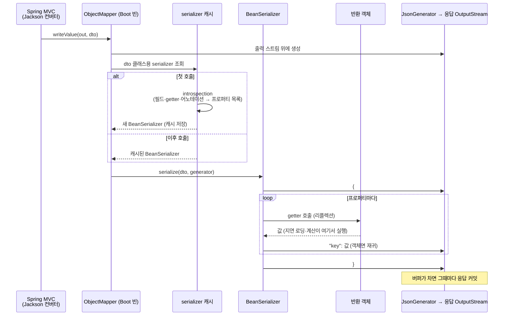

# Jackson 직렬화 — Spring 응답 객체가 JSON이 되는 원리

관련 문서: [예제](./Jackson직렬화-예제.md)

> 이 문서는 `@RestController`가 반환한 객체를 **Jackson이 JSON으로 바꾸는 단계**를 다룬다.
> Spring이 어떤 컨버터를 고르는지(콘텐츠 협상, `HttpMessageConverter`)와, JSON이 React에서 JS 타입으로 바뀔 때의 문제(`Long` 정밀도, 날짜, `undefined`)는 별도 주제로 다룬다.
>
> 연결되는 기존 학습 주제
> - **Java 기본 직렬화**: 이름은 같은 "직렬화"지만 무관하다. Jackson은 `Serializable`도 `ObjectOutputStream`도 쓰지 않는다 → [직렬화와 역직렬화](../직렬화/직렬화-이론.md), 7장 비교
> - **입출력 스트림**: Jackson은 응답 `OutputStream`에 흘려 쓴다. 직렬화 도중 예외가 나면 이미 나간 바이트를 되돌릴 수 없다 → [입출력 스트림](../입출력스트림/입출력스트림-이론.md), 8.7
> - **@Transactional / OSIV**: 엔티티를 반환하면 직렬화 시점이 트랜잭션 밖이다 → [@Transactional](../트랜잭셔널/트랜잭셔널-이론.md) 8.6, 이 문서 8.1
> - **JPA 엔티티 설계**: 지연 로딩 프록시와 양방향 연관관계가 Jackson과 충돌한다 (8.1)

---

## 1. 한 줄 요약

Jackson은 Java 객체의 **getter를 호출해서** 값을 꺼내 JSON 텍스트로 쓰고, 반대로 JSON을 읽어 객체를 만드는 라이브러리다.
정확히는, `ObjectMapper`가 클래스를 introspection해서 getter·public 필드·어노테이션으로 **프로퍼티 목록을 결정**하고, 그 목록으로 만든 `JsonSerializer`를 클래스별로 캐시한 뒤, 스트리밍 `JsonGenerator`로 출력 스트림에 토큰을 바로 쓰는 JSON 데이터 바인딩 엔진이다.

---

## 2. 왜 필요한가

**문제 1 — JSON을 손으로 만들면 틀린다.**
`"{\"name\":\"" + name + "\"}"` 같은 문자열 조립은 따옴표·역슬래시·개행 이스케이프, `null`, 중첩 객체, 컬렉션에서 반드시 틀린다. `org.json` 같은 라이브러리는 `JSONObject.put`을 필드마다 호출해야 해서 DTO가 늘어날 때마다 변환 코드도 같이 늘어난다.

**문제 2 — Java 기본 직렬화는 웹에 맞지 않는다.**
`ObjectOutputStream`의 결과는 Java만 읽을 수 있는 바이너리이고, 클래스 이름과 `serialVersionUID`가 박혀 있다. React는 이것을 읽을 수 없다. 웹 API에 필요한 것은 **언어 중립적인 텍스트 형식(JSON)** 과, 클래스 구조를 바꿔도 깨지지 않는 느슨한 매핑이다.

**Jackson의 해법**: 클래스를 리플렉션으로 한 번 분석해 "이 클래스는 이런 프로퍼티를 가진다"는 규칙을 만들고, 그 규칙으로 모든 인스턴스를 변환한다. 변환 코드를 쓰지 않아도 되고, 어노테이션과 설정으로 규칙만 조정하면 된다. Spring MVC는 이 엔진을 `HttpMessageConverter` 뒤에 꽂아, 컨트롤러가 객체만 반환하면 JSON 응답이 되게 만들었다.

---

## 3. 최소 예제로 보기

```java
public class MemberResponse {
    private Long id;
    private String name;
    private String password;          // getter 없음
    private LocalDateTime joinedAt;

    public Long getId() { return id; }
    public String getName() { return name; }
    public LocalDateTime getJoinedAt() { return joinedAt; }
    public String getDisplayName() { return name + "님"; }   // 필드 없음
    public boolean isVip() { return false; }               // 필드 없음
}
```

Spring Boot 컨트롤러가 이 객체를 반환하면 응답은 이렇다.

```json
{"id":1,"name":"kim","joinedAt":"2026-11-02T10:15:30","displayName":"kim님","vip":false}
```

- `password`는 필드가 있는데 **나가지 않았다**. getter가 없다.
- `displayName`, `vip`는 필드가 없는데 **나갔다**. getter가 있다. 이름에서 `get`/`is`가 떨어졌다.
- 즉 Jackson의 기준은 **필드가 아니라 getter**다.
- `joinedAt`이 ISO 문자열로 나간 것은 **Spring Boot가 구성한 `ObjectMapper`** 이기 때문이다. 같은 객체를 `new ObjectMapper().writeValueAsString(...)`으로 바꾸면 `LocalDateTime`을 처리할 수 없다는 예외가 난다 (8.5).

전체 실행 코드는 [예제 문서](./Jackson직렬화-예제.md)에 있다.

---

## 4. 핵심 개념

| 용어 | 설명 |
|---|---|
| `ObjectMapper` | Jackson의 진입점. 설정, 모듈, serializer 캐시를 가진다. 설정을 마친 뒤에는 스레드 안전해서 애플리케이션에 하나를 공유한다. Boot는 이것을 빈으로 등록한다. |
| 프로퍼티 (Property) | JSON의 키 하나에 대응하는 단위. getter·setter·필드·생성자 파라미터 중 같은 이름을 가진 것들을 묶어 하나로 만든다. |
| 인트로스펙션 (Introspection) | 클래스를 리플렉션으로 분석해 프로퍼티 목록과 이름, 접근 방법을 결정하는 과정. 클래스당 한 번 일어난다. |
| 가시성 (Visibility) | 어떤 멤버를 자동으로 프로퍼티로 인정할지 정하는 규칙. 기본값은 public getter, public `is` getter(원시 `boolean`), public 필드다. |
| `JsonSerializer` / `BeanSerializer` | 특정 타입을 JSON으로 쓰는 객체. 일반 클래스(POJO)용은 `BeanSerializer`이고, 프로퍼티마다 writer를 하나씩 가진다. `ObjectMapper` 안에 타입별로 캐시된다. |
| `JsonGenerator` | 토큰(`{`, 키, 값, `}`)을 출력 스트림에 바로 쓰는 스트리밍 API(jackson-core). 전체 JSON을 메모리에 만들지 않는다. |
| 모듈 (Module) | 특정 타입군의 serializer·deserializer 묶음. `java.time`은 `JavaTimeModule`(jsr310)이 있어야 처리된다. |
| 기능 플래그 (`SerializationFeature` / `DeserializationFeature` / `MapperFeature`) | 날짜를 숫자로 쓸지, 모르는 필드에서 실패할지 같은 전역 동작 스위치. Boot는 기본값 일부를 바꿔 둔다 (5.4). |

---

## 5. 동작 원리와 흐름

### 5.1 Spring에서 Jackson이 호출되는 지점

1. 컨트롤러가 `MemberResponse`를 반환한다.
2. Spring MVC가 반환값을 응답 본문으로 쓰기로 하고, JSON을 쓸 수 있는 `MappingJackson2HttpMessageConverter`를 고른다.
3. 컨버터가 **Boot가 등록한 `ObjectMapper` 빈**을 써서 응답 `OutputStream` 위에 `JsonGenerator`를 만들고 `writeValue`를 호출한다.

이 시점은 **컨트롤러 메서드가 끝난 뒤**다. 서비스의 `@Transactional`은 이미 끝났고, OSIV가 꺼져 있으면 영속성 컨텍스트도 닫혀 있다. 8.1의 원인은 여기서 출발한다.

### 5.2 serializer 결정 — 프로퍼티는 어떻게 정해지나

`MemberResponse`를 처음 직렬화할 때 한 번만 일어나고, 결과는 캐시된다.

1. **후보 수집**: 클래스(상위 클래스 포함)의 필드와 메서드를 훑는다.
   - 필드 → 필드 이름 그대로 (`password`, `joinedAt`)
   - `getXxx()` (파라미터 없음, 반환값 있음) → `xxx`
   - `isXxx()` (반환 타입이 원시 `boolean`) → `xxx`
   - 이름 변환 규칙: 앞의 **연속된 대문자를 모두 소문자로** 바꾼다. `getURL()` → `url`, `getXPos()` → `xpos`
2. **같은 이름끼리 묶기**: `name` 필드와 `getName()`은 하나의 프로퍼티 `name`이 된다. `isVip()`는 `vip`라는 새 프로퍼티가 된다.
3. **가시성과 어노테이션 적용**
   - 각 프로퍼티에 **보이는(visible) 접근자**가 하나라도 있어야 살아남는다. private 필드 `password`는 보이지 않고 getter도 없어서 제거된다.
   - `@JsonProperty`가 붙은 멤버는 private이어도 보이는 것으로 친다. 이름도 바꿀 수 있다.
   - `@JsonIgnore`가 붙으면 그 프로퍼티 전체가 제거된다.
4. **writer 목록 생성**: 남은 프로퍼티마다 "값을 꺼내는 방법(getter 또는 필드)"과 "이름"을 가진 writer를 만든다. 쓰기용 접근자는 getter가 필드보다 우선이다.
5. 이 writer 목록으로 `BeanSerializer`를 만들어 `ObjectMapper`의 캐시에 넣는다.

### 5.3 쓰기 — 인스턴스마다

```
writeStartObject                                    {
  writer "id"          → getId() 호출   → Long serializer        "id":1,
  writer "name"        → getName() 호출 → String serializer      "name":"kim",
  writer "joinedAt"    → getJoinedAt()  → LocalDateTime serializer (JavaTimeModule) ...
  writer "displayName" → getDisplayName() 호출 → 계산 결과
  writer "vip"         → isVip() 호출
writeEndObject                                      }
```

- 값을 꺼낼 때 **getter를 리플렉션으로 실제로 호출한다**. getter 안의 지연 로딩, 계산, 로그, 예외가 모두 이 시점에 일어난다.
- 값이 객체면 그 타입의 serializer로 **재귀**한다. 컬렉션은 원소마다 재귀하고, 순환 참조를 검사하지 않는다 (8.1).
- `null`은 기본적으로 `"key":null`로 쓴다(`@JsonInclude`로 생략 가능).
- `JsonGenerator`는 토큰을 응답 스트림에 바로 흘린다. Tomcat 응답 버퍼(기본 8KB)가 차면 응답이 커밋되어 상태 코드와 헤더가 먼저 나간다. 그 뒤에 예외가 나면 클라이언트는 **200 + 잘린 JSON**을 받는다 (8.7).



### 5.4 Boot의 `ObjectMapper`는 기본 `ObjectMapper`와 다르다

Spring Boot의 `JacksonAutoConfiguration`은 `Jackson2ObjectMapperBuilder`로 `ObjectMapper` 빈을 만들고, 아래 기본값을 바꿔 둔다.

| 항목 | Boot 빈 | `new ObjectMapper()` |
|---|---|---|
| `java.time` 모듈 (jsr310) | 클래스패스에 있으면 자동 등록 | 미등록 → `LocalDateTime` 직렬화 실패 (Jackson 2.12+) |
| `WRITE_DATES_AS_TIMESTAMPS` | 꺼짐 → `"2026-11-02T10:15:30"` | 켜짐 → 모듈을 등록해도 `[2026,11,2,10,15,30]` |
| `FAIL_ON_UNKNOWN_PROPERTIES` (읽기) | 꺼짐 → 모르는 필드 무시 | 켜짐 → `UnrecognizedPropertyException` |
| `DEFAULT_VIEW_INCLUSION` | 꺼짐 | 켜짐 |
| `spring.jackson.*` 프로퍼티 | 반영 | 무시 |
| `Jackson2ObjectMapperBuilderCustomizer` 빈 | 반영 | 무시 |

`starter-web`(`starter-json`)은 `jackson-datatype-jdk8`(`Optional`), `jackson-datatype-jsr310`(`java.time`), `jackson-module-parameter-names`를 함께 가져온다.

### 5.5 역직렬화(JSON → 객체) — 요약

`@RequestBody`에서 일어난다. 프로퍼티 결정 방식은 같고, **값을 넣는 방법**만 다르다.

1. 객체 생성 방법을 고른다: `@JsonCreator` 생성자·팩터리 → record 정식 생성자 → (parameter-names 모듈로 이름을 아는) 유일한 생성자 → 기본 생성자.
2. 기본 생성자로 만들었다면 setter, 없으면 필드에 값을 넣는다. 쓰기용 접근자는 setter가 필드보다 우선이다.
3. JSON에 있는데 클래스에 없는 키는 `FAIL_ON_UNKNOWN_PROPERTIES`에 따라 예외 또는 무시한다.

이 문서는 직렬화 쪽 사고를 주로 다룬다. 역직렬화에서 나는 사고는 5.4의 설정 차이(8.5)가 대부분이다.

### 5.6 무엇이 어디서 생기고 사라지나

| 객체 | 생성 | 수명 |
|---|---|---|
| `ObjectMapper` | 애플리케이션 시작 시 Boot가 빈으로 1개 | 애플리케이션 전체. 모든 요청이 공유 |
| serializer 캐시 (`BeanSerializer` 등) | 타입별 첫 직렬화 시 | 그 `ObjectMapper`가 살아 있는 동안. **`ObjectMapper`를 새로 만들면 캐시도 새로 시작한다** (8.5) |
| `JsonGenerator` | `writeValue` 호출마다 | 그 호출이 끝날 때까지. 출력 스트림을 감싸는 데코레이터와 같다 |
| 직렬화 대상 객체 | 컨트롤러가 반환 | 직렬화가 끝날 때까지 참조된다. 엔티티라면 그동안 지연 로딩이 계속 일어날 수 있다 |

---

## 6. 내부 구현 (핵심만)

| 클래스·메서드 | 하는 일 | 그래서 생기는 동작 |
|---|---|---|
| `POJOPropertiesCollector` | 필드·getter·setter·생성자 파라미터를 이름별로 묶고, 가시성·어노테이션을 적용해 프로퍼티 목록을 만든다 | getter가 없는 private 필드는 사라지고(8.2), 필드 없는 getter는 생긴다(8.3). `is`·대문자 접두사 이름 변환도 여기서 일어난다(8.4) |
| `BeanSerializerFactory#createSerializer` + `SerializerCache` | 프로퍼티 목록으로 `BeanSerializer`를 만들어 `ObjectMapper` 단위로 캐시한다 | 첫 요청만 느리다. 매번 `new ObjectMapper()`를 하면 매번 첫 요청이 된다 (8.5) |
| `BeanPropertyWriter#serializeAsField` | getter를 `Method.invoke`로 호출해 값을 얻고, 값 타입의 serializer로 위임한다 | 직렬화가 곧 getter 실행이다. JPA 지연 로딩·N+1·`LazyInitializationException`이 여기서 터진다 (8.1) |
| `BeanSerializer#serializeFields` | 프로퍼티를 순서대로 쓰며 중첩 객체를 재귀 처리한다. 방문한 객체를 기억하지 않는다 | 양방향 참조는 스택 오버플로나 중첩 깊이 초과로 끝난다 (8.1) |
| `UnknownSerializer` | 보이는 프로퍼티가 하나도 없는 타입을 맡는다. `FAIL_ON_EMPTY_BEANS`가 켜져 있으면 예외 | getter 없는 DTO, Hibernate 프록시 내부 객체에서 `No serializer found`가 난다 (8.1, 8.2) |
| `JacksonAutoConfiguration` / `Jackson2ObjectMapperBuilder` (Spring Boot) | 모듈 자동 등록, 기본 기능 플래그 변경, `spring.jackson.*`·커스터마이저 반영 | Boot 빈과 직접 만든 매퍼의 결과가 달라진다 (8.5) |

---

## 7. 유사 개념과의 비교

### 7.1 직렬화 방식

| 항목 | Jackson (JSON) | Gson (JSON) | Java 기본 직렬화 |
|---|---|---|---|
| 형식 | 텍스트 JSON | 텍스트 JSON | Java 전용 바이너리 |
| 값을 꺼내는 곳 | **getter** (기본) | **필드** (getter 무시) | 필드 (`transient` 제외) |
| 클래스 요구사항 | 보이는 프로퍼티가 있을 것 | 없음 | `Serializable` 구현 |
| 클래스 이름 포함 | 안 함 (기본) | 안 함 | 함 |
| Spring 기본 | Boot 기본 | 선택 가능 | 웹 응답에는 안 쓰임 |
| 판단 기준 | Spring 웹 API의 사실상 표준 | 기존 코드베이스가 Gson일 때 | JVM 간 세션·캐시 (권장하지 않음) |

**Gson에서 넘어온 코드 주의**: Gson은 필드를 보므로 getter가 없어도 잘 나간다. 같은 DTO를 Jackson으로 바꾸면 필드가 사라진다(8.2).

### 7.2 응답에서 필드를 통제하는 방법

| 방법 | 장점 | 단점 | 언제 |
|---|---|---|---|
| 응답 전용 DTO / record | API 스펙이 코드로 명확하다. 엔티티 변경과 분리된다. 지연 로딩 문제가 원천적으로 없다 | 클래스 수가 늘어난다 | **기본값** |
| 엔티티에 `@JsonIgnore` | 빠르다 | 화면마다 다른 노출을 표현할 수 없다. 엔티티가 웹 계층을 알게 된다 | 쓰지 않는다 |
| `@JsonView` | 한 클래스로 여러 노출 수준을 만든다 | 뷰 클래스 관리가 번거롭고, Boot에서는 `DEFAULT_VIEW_INCLUSION`이 꺼져 있어서 뷰를 안 붙인 필드는 빠진다 | 같은 DTO의 요약/상세 정도의 차이일 때 |
| `Map<String, Object>` 반환 | 유연하다 | 타입 안전성과 문서화가 없다 | 일회성 내부 API |

### 7.3 DTO 작성 방식

| 방식 | 버전 | 직렬화 | 역직렬화 |
|---|---|---|---|
| record | Java 16+, Jackson 2.12+ | 컴포넌트 접근자(`id()`) 사용. 선언 순서대로 | 정식 생성자 사용. setter 불필요 |
| 클래스 + getter (Lombok `@Getter`) | Java 8 | getter 사용 | 기본 생성자 + setter, 또는 `@JsonCreator` |
| public 필드 | 어디서나 | 필드 사용 | 필드 사용 |

---

## 8. 함정과 안티패턴

### 8.1 JPA 엔티티를 그대로 반환 — 프록시 에러, 지연 로딩 예외, N+1, 무한 재귀

- **증상**: 엔티티를 컨트롤러에서 그대로 반환하면 아래 중 하나가 일어난다.

| 증상 | 조건 |
|---|---|
| `No serializer found for class org.hibernate.proxy.pojo.bytebuddy.ByteBuddyInterceptor ... (through reference chain: ...["team"]->...$HibernateProxy$...["hibernateLazyInitializer"])` | LAZY `@ManyToOne` 필드가 프록시인 채로 직렬화됨 |
| `LazyInitializationException: could not initialize proxy - no Session` (`HttpMessageNotWritableException`으로 감싸짐) | OSIV 꺼짐 + 초기화 안 된 연관관계 |
| 에러 없이 SELECT가 수십~수백 개 | OSIV 켜짐(Boot 기본) + 목록 응답 |
| `Infinite recursion (StackOverflowError)` 또는 `Document nesting depth (1001) exceeds the maximum allowed (1000 ...)` | 양방향 연관관계 (`Member.team` ↔ `Team.members`). 메시지는 Jackson 버전에 따라 다르다(2.16+는 중첩 깊이 제한이 먼저 걸린다, 확인 필요) |

- **원인**
  - 직렬화는 컨트롤러가 끝난 뒤, 즉 트랜잭션 밖에서 일어나고(5.1), getter를 실제로 호출한다(5.3, 6장).
  - LAZY 연관관계는 Hibernate 프록시(엔티티의 하위 클래스)다. 프록시에는 `getHibernateLazyInitializer()` getter가 있어서 Jackson이 이것도 프로퍼티로 인식한다. 그 반환값에는 보이는 프로퍼티가 없으므로 `No serializer found`가 난다(5.2, 6장 `UnknownSerializer`).
  - OSIV가 켜져 있으면 getter의 지연 로딩이 성공하는 대신 원소마다 쿼리가 나간다. 이 동안 DB 커넥션도 붙잡고 있다([@Transactional](../트랜잭셔널/트랜잭셔널-이론.md) 8.6).
  - `BeanSerializer`는 방문한 객체를 기억하지 않으므로 양방향 참조를 끝없이 따라간다(6장).
- **해결**: 서비스 계층의 트랜잭션 안에서 필요한 연관관계를 fetch join이나 `@EntityGraph`로 읽고, **응답 DTO로 변환을 끝낸 뒤** 반환한다. `@JsonIgnore`, `@JsonManagedReference`/`@JsonBackReference`, Hibernate용 Jackson 모듈은 증상만 막는다. 엔티티 구조가 그대로 API 스펙이 되는 문제(필드 하나 추가하면 응답이 바뀜)는 그대로 남는다.

### 8.2 getter 없는 필드 — 조용히 빠지거나 `No serializer found`로 500

- **증상**: 응답에서 특정 필드만 빠져 있고 에러도 없다. getter가 하나도 없는 DTO라면 `InvalidDefinitionException: No serializer found for class ... and no properties discovered to create BeanSerializer (to avoid exception, disable SerializationFeature.FAIL_ON_EMPTY_BEANS)`로 500이 난다.
- **원인**: 기본 가시성은 public getter와 public 필드뿐이다. getter 없는 private 필드는 프로퍼티 후보에서 제거된다(5.2의 3단계). 하나도 남지 않으면 `UnknownSerializer`가 예외를 던진다(6장).
- **해결**: getter를 만들거나(Lombok `@Getter`) record를 쓴다. 필드 가시성을 전역으로 `ANY`로 바꾸는 설정은 의도하지 않은 내부 필드까지 노출하므로 피한다. Gson에서 넘어온 DTO는 특히 확인한다(7.1).

### 8.3 의도하지 않은 프로퍼티 노출 — 계산 getter, 편의 메서드, 비밀번호

- **증상**: 응답에 `displayName`, `empty`, `valid`, `new` 같은 키가 끼어 있다. 엔티티나 도메인 객체를 반환했다면 `password`(해시), 내부 상태 플래그가 노출된다.
- **원인**: `get`/`is`로 시작하는 public 메서드는 필드가 없어도 프로퍼티가 된다(5.2의 1단계). 도메인 객체의 `isEmpty()`, `isValid()`, `getTotalPrice()` 같은 편의 메서드가 전부 JSON 키가 된다. 그 메서드에서 예외가 나면 직렬화도 실패한다.
- **해결**: 응답 전용 DTO에 노출할 필드만 둔다(7.2). 도메인 객체를 반환하지 않는다. DTO에 계산 getter가 필요하면 의도한 것인지 확인하고, 아니면 `@JsonIgnore`를 붙인다.

### 8.4 프로퍼티 이름이 바뀐다 — `isActive` → `active`, `xPos` → `xpos`

- **증상**: 프론트는 `isActive`를 기대하는데 `active`로 온다. 필드 타입을 `boolean`에서 `Boolean`으로 바꿨더니 키가 `isActive`로 바뀌어 프론트가 깨진다. `xPos` 필드가 `xpos`로 나간다.
- **원인**: 이름은 필드가 아니라 getter에서 나온다(5.2).
  - Lombok은 `boolean isActive`에 `isActive()`를 만든다. Jackson이 `is`를 떼어 `active`가 되고, private 필드 `isActive`와 이름이 맞지 않아 별개로 취급된 뒤 제거된다.
  - `Boolean isActive`(래퍼)에는 `getIsActive()`를 만든다. 이름이 `isActive`가 된다.
  - `int xPos`에는 Lombok이 `getXPos()`를 만들고, Jackson은 앞의 연속 대문자 `XP`를 모두 소문자로 바꿔 `xpos`로 만든다.
- **해결**: boolean 필드에는 `is` 접두사를 붙이지 않는다(`active`). API 키를 고정해야 하면 getter에 `@JsonProperty("isActive")`를 붙인다. 두 번째 글자가 대문자인 필드명(`xPos`, `eMail`)은 피하거나 `@JsonProperty`로 고정한다. record는 컴포넌트 이름을 그대로 키로 쓰는 것이 원칙이다. 다만 `boolean isActive`처럼 `is`로 시작하는 컴포넌트는 Jackson 2.x 버전에 따라 처리가 달랐다는 보고가 있으므로(확인 필요), 키 이름을 테스트로 고정해 둔다.

### 8.5 `new ObjectMapper()`를 직접 만들어 쓰기 — 다른 결과, 느린 성능

- **증상**:
  - 서비스 코드나 유틸에서 만든 JSON과 API 응답의 형식이 다르다. 날짜가 배열 `[2026,11,2,10,15,30]`로 나온다.
  - `Java 8 date/time type 'java.time.LocalDateTime' not supported by default` 예외가 난다.
  - 같은 요청 JSON이 컨트롤러에서는 잘 읽히는데 직접 읽으면 `UnrecognizedPropertyException`이 난다.
  - Kafka·Redis 메시지 변환 구간에서 CPU 사용량이 높다.
  - `WebMvcConfigurer#configureMessageConverters`에 `new MappingJackson2HttpMessageConverter()`를 추가한 뒤로 API 응답 전체의 날짜 형식이 바뀐다.
- **원인**: Boot 빈과 기본 `ObjectMapper`의 설정이 다르다(5.4). serializer 캐시는 `ObjectMapper` 인스턴스 단위라서(5.6, 6장) 매번 새로 만들면 매번 introspection을 다시 한다.
- **해결**: `ObjectMapper`는 **Boot 빈을 주입받아** 쓴다. 설정은 `spring.jackson.*` 프로퍼티나 `Jackson2ObjectMapperBuilderCustomizer` 빈으로 바꾼다. Spring 컨텍스트 밖(테스트, 배치 유틸)에서 필요하면 `Jackson2ObjectMapperBuilder.json()`으로 만들고 날짜 설정을 맞춘다. 공유 빈의 설정을 런타임에 `configure(...)`로 바꾸지 않는다. 모든 API가 영향을 받는다.

### 8.6 `LocalDateTime` 응답이 9시간 어긋난다

- **증상**: DB와 서버 로그에는 10:00인데 React 화면에는 19:00이나 01:00으로 보인다. 로컬 개발 환경에서는 정상이고 운영(컨테이너)에서만 어긋난다.
- **원인**: `LocalDateTime`에는 타임존 정보가 없어서 `"2026-11-02T10:15:30"`처럼 오프셋 없이 나간다(5.4). 컨테이너의 기본 타임존은 보통 UTC여서 `LocalDateTime.now()` 자체가 UTC 기준이 된다. 브라우저는 오프셋 없는 문자열을 자기 로컬 시간으로 해석한다.
- **해결**: 시각(instant)을 주고받는 필드는 `OffsetDateTime`이나 `Instant`로 바꿔 오프셋이 포함되게 한다(`"2026-11-02T10:15:30+09:00"`). `LocalDateTime`을 유지해야 하면 서버 JVM 타임존을 명시하고, API 문서에 "KST 기준"을 명시한다. 프론트에서의 처리(파싱, 표시)는 JSON 타입 경계 주제에서 다룬다.

### 8.7 직렬화 도중 예외 — 200에 잘린 JSON

- **증상**: 서버 로그에는 `HttpMessageNotWritableException`이 찍히는데 클라이언트는 **상태 200**과 중간에 끊긴 JSON을 받는다. React에서는 `SyntaxError: Unexpected end of JSON input`이 난다. `@ExceptionHandler`의 에러 응답은 오지 않는다. 데이터가 적을 때는 정상적으로 500이 나서 재현이 어렵다.
- **원인**: `JsonGenerator`는 응답 스트림에 바로 흘려 쓰고, 버퍼가 차면 응답이 커밋된다(5.3). 커밋된 뒤에는 상태 코드와 이미 나간 바이트를 되돌릴 수 없다([입출력 스트림](../입출력스트림/입출력스트림-이론.md) 8.1의 반대 방향 문제). 직렬화 중 예외의 대부분은 8.1(지연 로딩)과 8.3(getter 안의 예외)이다.
- **해결**: 직렬화 단계에서 실패할 수 있는 일을 남기지 않는다. 즉 DTO는 순수 데이터만 들고 있어야 한다. 이것도 결국 8.1의 해결과 같다.

---

## 9. 실무 적용 시나리오

| 상황 | Jackson이 관여하는 곳 | 주의할 함정 |
|---|---|---|
| REST API 응답 | `@RestController` 반환값 → JSON | 8.1, 8.3, 8.7. 응답 DTO를 기본으로 한다 |
| REST API 요청 | `@RequestBody` → 객체 | 8.5(모르는 필드 처리 차이), 8.4(boolean 키 이름이 요청에서도 똑같이 적용) |
| 목록·페이징 응답 | `Page<Entity>`를 그대로 반환 | 8.1(N+1). Spring Data의 `PageImpl` 구조가 그대로 API 스펙이 된다. 버전에 따라 경고가 출력된다(확인 필요). `Page<Dto>`나 전용 페이지 DTO로 변환한다 |
| Redis 캐시 (`GenericJackson2JsonRedisSerializer`) | 캐시 값을 JSON으로 저장 | 8.5(별도 `ObjectMapper`로 날짜 형식이 다를 수 있음). 이 serializer는 타입 정보(`@class`)를 JSON에 포함하므로 패키지를 옮기면 캐시가 깨진다 |
| Kafka·외부 API 연동 | `ObjectMapper`로 메시지와 요청 본문을 직접 변환 | 8.5. 외부 API 응답은 필드가 계속 늘어나므로 모르는 필드를 무시하는 설정이 맞다 |
| 로그·감사 기록 | 객체를 JSON 문자열로 남김 | 8.3(비밀번호 등 민감 정보가 로그에 남음), 8.1(로그를 찍다가 지연 로딩) |

---

## 10. 버전 주의사항

- **Jackson 2.12+**: record를 지원한다. `java.time` 타입을 모듈 없이 직렬화하면 명시적인 예외가 난다. 그 전에는 내부 필드가 그대로 나가는 이상한 JSON이 만들어졌다.
- **Jackson 2.16+** (Spring Boot 3.3+에 포함, 확인 필요): 쓰기 중첩 깊이 제한(`StreamWriteConstraints`, 기본 1000)이 생겼다. 양방향 참조의 에러 메시지가 `Infinite recursion`에서 중첩 깊이 초과로 바뀔 수 있다. 에러 메시지로 알람을 걸었다면 확인한다.
- **Spring Boot 3.x**: Jackson 2.x(`com.fasterxml.jackson`)를 쓴다. 이 문서는 이 기준이다.
- **Spring Boot 4 / Spring Framework 7**: Jackson 3(`tools.jackson` 패키지)이 기본이다. 알려진 변경은 아래와 같고, 세부 사항은 확인이 필요하다. 업그레이드할 때 커스터마이저, `ObjectMapper` 주입 코드, import를 고쳐야 한다.
  - `JsonMapper` 불변 빌더 방식
  - unchecked 예외
  - 날짜 기본 출력이 문자열
  - `java.time` 지원이 기본 포함
  - 어노테이션 패키지(`com.fasterxml.jackson.annotation`)는 유지

---

## 11. 자가 점검 질문

1. getter 없이 `private String password` 필드만 있으면 JSON에 나가는가? `public String getDisplayName()`만 있고 필드가 없으면?

<details>
<summary>답</summary>

`password`는 나가지 않는다. 기본 가시성은 public getter와 public 필드이므로, getter 없는 private 필드는 프로퍼티 후보에서 제거된다. `displayName`은 나간다. `get`으로 시작하는 public 메서드는 필드가 없어도 프로퍼티가 된다. Jackson의 기준은 필드가 아니라 getter다.

</details>

2. Lombok `@Getter`가 붙은 클래스에서 `boolean isActive` 필드는 어떤 키로 나가는가? 필드 타입을 `Boolean`으로 바꾸면?

<details>
<summary>답</summary>

`boolean`이면 Lombok이 `isActive()`를 만들고, Jackson이 `is`를 떼어 `active`로 나간다. `Boolean`이면 Lombok이 `getIsActive()`를 만들어 `isActive`로 나간다. 타입만 바꿨는데 API 키가 바뀐다. `@JsonProperty`로 고정하거나 필드명에서 `is`를 뺀다.

</details>

3. OSIV가 켜진 Boot 기본 설정에서 `List<Order>` 엔티티를 그대로 반환했다. 에러는 없는데 무엇이 문제인가? OSIV를 끄면 어떤 예외로 바뀌는가?

<details>
<summary>답</summary>

직렬화는 컨트롤러가 끝난 뒤에 일어나고, getter를 실제로 호출한다. OSIV가 켜져 있으면 연관관계 getter마다 지연 로딩이 성공해서 주문 수만큼 추가 SELECT(N+1)가 나가고, 그동안 DB 커넥션을 붙잡는다. OSIV를 끄면 영속성 컨텍스트가 닫힌 뒤라 `LazyInitializationException`이 나고, 이것이 `HttpMessageNotWritableException`으로 감싸진다. 응답이 이미 커밋됐다면 200에 잘린 JSON이 된다.

</details>

4. 유틸 클래스에서 `new ObjectMapper().writeValueAsString(event)`를 호출했더니 `LocalDateTime` 필드에서 예외가 났다. 컨트롤러 응답에서는 같은 객체가 잘 나간다. 왜 다르고, 어떻게 고치는가?

<details>
<summary>답</summary>

컨트롤러는 Boot가 구성한 `ObjectMapper` 빈을 쓴다. 이 빈은 `JavaTimeModule`이 등록되어 있고 `WRITE_DATES_AS_TIMESTAMPS`가 꺼져 있다. `new ObjectMapper()`에는 모듈이 없어서 Jackson 2.12+에서는 예외가 난다. Boot 빈을 주입받아 쓴다. 매번 새로 만들면 serializer 캐시도 매번 새로 시작해서 느리다.

</details>

5. 작은 데이터로는 500 에러 응답이 정상적으로 오는데, 큰 목록에서는 200에 잘린 JSON이 오는 이유는?

<details>
<summary>답</summary>

Jackson은 응답 스트림에 바로 흘려 쓰고, 서블릿 응답 버퍼(Tomcat 기본 8KB)가 차면 응답이 커밋된다. 데이터가 작으면 예외가 났을 때 아직 커밋 전이라 버퍼를 비우고 에러 응답을 쓸 수 있다. 데이터가 크면 이미 200과 헤더, 일부 본문이 나간 뒤라 되돌릴 수 없다.

</details>

---

## 12. 참고 자료

- FasterXML [jackson-databind](https://github.com/FasterXML/jackson-databind) README·Wiki — `ObjectMapper`, 기능 플래그 목록
- FasterXML [jackson-modules-java8](https://github.com/FasterXML/jackson-modules-java8) — `jackson-datatype-jsr310`, `jdk8`, `parameter-names`
- Spring Boot Reference — "JSON" 절, How-to "Customize the Jackson ObjectMapper" (`spring.jackson.*`, `Jackson2ObjectMapperBuilderCustomizer`)
- Spring Framework Javadoc — `Jackson2ObjectMapperBuilder`, `MappingJackson2HttpMessageConverter`
- Spring Boot 소스 `JacksonAutoConfiguration` — 기본 기능 플래그 설정
- Jackson 소스 `POJOPropertiesCollector`, `BeanSerializerFactory`, `BeanPropertyWriter`
- JavaBeans Specification 1.01, 8.3절 — getter/`is` 명명 규칙 (Jackson의 이름 변환은 이와 일부 다르다)

---

## 부록: 용어 정리

| 용어 | 영문 | 설명 |
|---|---|---|
| 데이터 바인딩 | Data Binding | 객체와 JSON 사이를 규칙에 따라 자동으로 변환하는 방식 |
| 인트로스펙션 | Introspection | 클래스를 리플렉션으로 분석해 프로퍼티 목록을 결정하는 과정 |
| 프로퍼티 | Property | JSON 키 하나에 대응하는 단위. 같은 이름의 필드·getter·setter를 묶은 것 |
| 리플렉션 | Reflection | 실행 중에 클래스의 필드·메서드를 조회하고 호출하는 Java 기능 |
| 스트리밍 API | Streaming API | 전체를 메모리에 만들지 않고 토큰 단위로 바로 읽고 쓰는 방식 (`JsonGenerator`, `JsonParser`) |
| POJO | Plain Old Java Object | 특별한 상속이나 인터페이스 없이 필드와 메서드만 가진 일반 클래스 |
| 응답 커밋 | Response Commit | 상태 코드와 헤더가 클라이언트로 전송된 상태. 이후 변경할 수 없다 |
| 가시성 | Visibility | 어떤 멤버를 자동으로 프로퍼티로 인정할지 정하는 규칙 |
| 모듈 | Module | 특정 타입군의 serializer·deserializer를 묶어 등록하는 확장 단위 |
| 기능 플래그 | Feature Flag (`SerializationFeature` 등) | `ObjectMapper`의 전역 동작을 켜고 끄는 설정 |
| OSIV | Open Session In View | 영속성 컨텍스트를 HTTP 요청이 끝날 때까지 열어 두는 설정. Boot 기본값은 켜짐 |
| 지연 로딩 | Lazy Loading | 연관 엔티티를 실제로 접근할 때 쿼리로 읽어 오는 JPA 동작 |
| 프록시 | Proxy (Hibernate Proxy) | 지연 로딩을 위해 엔티티 대신 들어 있는 하위 클래스 객체 |
| N+1 | N+1 Query Problem | 목록 1번 조회 후 원소마다 추가 쿼리가 N번 나가는 문제 |
| 양방향 연관관계 | Bidirectional Association | 두 엔티티가 서로를 참조하는 매핑. 직렬화 시 무한 재귀의 원인이 된다 |
| 정식 생성자 | Canonical Constructor | record의 모든 컴포넌트를 순서대로 받는 생성자 |
| 오프셋 | Offset | UTC와의 시간 차이(`+09:00`). `LocalDateTime`에는 없다 |
