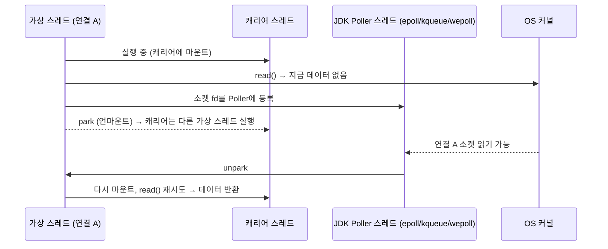

# 블로킹 소켓 + 가상 스레드 vs NIO Selector

관련 문서: [이론](./NIO셀렉터-이론.md) · [예제](./NIO셀렉터-예제.md)

---

## 1. 결론

Java 21 이상에서 **요청-응답형 TCP 서버**를 새로 만든다면 Selector를 직접 짜기보다 **`ServerSocket.accept()` + 연결당 가상 스레드 + 블로킹 `read`/`write`**가 낫다.
확장성은 거의 같다. 가상 스레드가 블로킹되면 JDK가 내부에서 epoll 같은 OS 멀티플렉싱으로 소켓을 감시한다. 대신 [이론 8장](./NIO셀렉터-이론.md#8-함정과-안티패턴)의 함정 7개 중 대부분이 **구조적으로 사라진다**.

Selector(또는 Netty)가 여전히 나은 경우는 6장에 따로 정리했다.

---

## 2. 같은 서버를 두 방식으로

길이 헤더(앞 5바이트가 전체 길이)로 전문을 받아 처리하고 응답하는 서버다.

**Selector 방식: 개발자가 상태 머신을 관리한다**

```java
// 이벤트 루프 스레드 1개
while (running) {
    selector.select();
    Iterator<SelectionKey> it = selector.selectedKeys().iterator();
    while (it.hasNext()) {
        SelectionKey key = it.next(); it.remove();               // 함정 1
        try {
            if (key.isAcceptable()) accept(key);
            else if (key.isReadable()) read(key);                // 부분 읽기 누적 + 프레이밍 (함정 4, 7)
            else if (key.isWritable()) flushPending(key);        // 쓰기 대기열 + OP_WRITE 토글 (함정 2)
        } catch (IOException e) { close(key); }                  // 함정 3
    }
    runTasks();                                                  // 워커가 넣은 응답 쓰기 (함정 5, 6)
}
// + 연결별 상태 클래스(읽기 버퍼, 쓰기 대기열, 순서 체인)
// + 워커 풀, 작업 큐, wakeup(), 연결별 idle 타임아웃 검사
```

**블로킹 + 가상 스레드 방식: 상태가 지역 변수에 있다**

```java
try (ServerSocket server = new ServerSocket(port);
     ExecutorService vts = Executors.newVirtualThreadPerTaskExecutor()) {
    while (running) {
        Socket s = server.accept();
        vts.submit(() -> handle(s));
    }
}

void handle(Socket s) {
    try (s) {
        s.setSoTimeout(30_000);                                  // 읽기 타임아웃
        DataInputStream in = new DataInputStream(new BufferedInputStream(s.getInputStream()));
        OutputStream out = s.getOutputStream();
        while (true) {
            byte[] lenField = new byte[5];
            in.readFully(lenField);                              // 다 올 때까지 기다린다 (부분 읽기 없음)
            int len = Integer.parseInt(new String(lenField, US_ASCII).trim());
            if (len < 5 || len > MAX) throw new IOException("bad length " + len);
            byte[] msg = new byte[len];
            System.arraycopy(lenField, 0, msg, 0, 5);
            in.readFully(msg, 5, len - 5);
            byte[] resp = businessLogic(msg);                    // DB, HTTP 호출을 그냥 해도 된다
            out.write(resp);                                     // 다 쓸 때까지 기다린다 (부분 쓰기 없음)
        }
    } catch (EOFException e) {
        // 상대가 정상 종료
    } catch (IOException e) {
        log.warn("연결 오류: {}", e.getMessage());
    }
}
```

두 번째 코드에는 `SelectionKey`, 관심 집합, attachment, 작업 큐, `wakeup()`, `ConcurrentHashMap`이 하나도 없다. 연결 하나의 처리 흐름이 **위에서 아래로 한 번에 읽힌다.**

---

## 3. 왜 나은가

### 3-1. 연결 상태가 스택에 있다 (상태 머신이 필요 없다)

Selector에서는 `read()`가 "지금 있는 만큼만" 읽고 반환하므로, "헤더 3바이트까지 받았음" 같은 진행 상태를 **어딘가에 저장해 뒀다가 다음 이벤트에서 이어 가야** 한다. 그래서 연결별 상태 객체, 읽기 버퍼, `flip`/`compact`, 기대 길이 같은 필드가 생긴다.

블로킹 방식에서는 `readFully()`가 다 받을 때까지 기다리므로 **진행 상태가 곧 "지금 몇 번째 줄을 실행 중인가"**다. 가상 스레드가 멈춰 있는 동안 그 상태(지역 변수, 호출 스택)는 JDK가 힙에 보관한다. 결국 같은 상태 머신을 **개발자가 직접 짜느냐, JDK가 스레드 스택으로 대신 관리해 주느냐**의 차이다([이론 7장](./NIO셀렉터-이론.md#7-유사-개념과의-비교)).

### 3-2. 스레드 경계가 사라진다

Selector에서는 이벤트 루프를 막으면 안 되므로 블로킹 작업을 워커로 넘긴다. 그 순간 **두 스레드가 한 연결을 다루게 되고**, 다음이 모두 필요해진다.

- 작업 큐 + `wakeup()`으로 결과 돌려보내기 (함정 6)
- 같은 연결의 요청 순서 보장 (`CompletableFuture` 체인 등)
- 워커가 느릴 때 큐가 무한히 쌓이지 않게 하는 백프레셔

가상 스레드 방식은 **연결 하나 = 스레드 하나**라 한 연결의 상태를 만지는 스레드가 늘 하나다. 응답 순서는 코드 순서 그대로 보장되고, 연결별 상태에 락이나 동시성 컬렉션이 필요 없다.

### 3-3. 블로킹 호출을 그냥 해도 된다

함정 5(이벤트 루프 블로킹)는 "스레드 하나가 여러 연결을 처리한다"는 구조에서 나온다. 가상 스레드는 연결마다 따로 있으므로 한 연결이 DB나 외부 HTTP를 500ms 기다려도 **그 연결만 기다린다**. JDBC, `RestTemplate`, 블로킹 소켓 클라이언트처럼 이미 가진 블로킹 라이브러리를 그대로 쓴다.

### 3-4. 부분 읽기·부분 쓰기를 JDK가 처리한다

| 문제 | Selector | 블로킹 + 가상 스레드 |
|---|---|---|
| 메시지가 잘려서 온다 | 연결별 버퍼에 누적, 완성된 것만 꺼내기 | `readFully(n)`이 n바이트가 올 때까지 기다린다 |
| 송신 버퍼가 차서 다 못 쓴다 | 쓰기 대기열 + `OP_WRITE` 켜기/끄기 | `write()`가 다 쓸 때까지 기다린다 |
| 상대가 끊었다 | `read() == -1` 감지 후 `cancel` + `close` | `EOFException`이 나고 `try-with-resources`가 닫는다 |

TCP에 메시지 경계가 없다는 사실(함정 4) 자체는 그대로다. **프레이밍 규칙(길이 헤더, 구분자)은 여전히 직접 정해야 한다.** 다만 "필요한 만큼 모일 때까지 기다리는" 코드를 쓸 수 있어서 버퍼 관리가 사라진다.

### 3-5. 타임아웃이 한 줄이다

Selector에서는 연결별 마지막 수신 시각을 기록하고 루프마다 전체 연결을 훑어 idle 연결을 찾는다. 블로킹 방식은 `socket.setSoTimeout(ms)` 한 줄이면, 그 시간 안에 데이터가 안 오면 `SocketTimeoutException`이 난다. 가상 스레드에서도 그대로 동작한다.

### 3-6. 디버깅과 관측이 쉽다

- **스택 트레이스**: 예외가 나면 `handle → readFully → ...`처럼 그 연결의 처리 흐름이 그대로 찍힌다. Selector에서는 모든 예외가 `run → handleRead`로 끝나서 어느 단계였는지 알기 어렵다.
- **스레드 덤프**: `jcmd <pid> Thread.dump_to_file -format=json <파일>`로 가상 스레드까지 덤프하면, 연결마다 "지금 어디서 기다리는가"가 보인다. Selector에서는 이벤트 루프 스레드 하나만 보인다.

### 3-7. 확장성은 유지된다

가상 스레드가 블로킹 소켓 I/O를 만나면 다음이 일어난다(Java 21).



- 기다리는 동안 **캐리어(OS) 스레드를 점유하지 않는다.** 캐리어 수는 기본으로 CPU 코어 수다.
- 감시는 JDK 내부 Poller가 OS 멀티플렉싱 API로 한다. 즉 **Selector가 하던 일을 JDK가 대신 한다.**
- 가상 스레드 하나의 스택은 힙에 있고 필요한 만큼만 커진다. 플랫폼 스레드처럼 수백 KB~1MB를 미리 예약하지 않는다. 수만 개를 띄워도 된다.

그래서 [이론 2장](./NIO셀렉터-이론.md#2-왜-필요한가)의 연결당 스레드 문제(C10K)는 가상 스레드에서는 해당하지 않는다.

### 3-8. 이론 문서의 함정과 대응

| 이론 8장 함정 | 블로킹 + 가상 스레드에서 |
|---|---|
| 1. `selectedKeys`를 지우지 않음 | **없음** (Selector를 직접 쓰지 않음) |
| 2. `OP_WRITE`를 항상 켜 둠 | **없음** (`write()`가 블로킹) |
| 3. -1인데 채널을 닫지 않음 | **거의 없음** (`EOFException` + `try-with-resources`) |
| 4. 한 번 읽기 = 메시지 하나라고 가정 | **남음.** 프레이밍은 직접 해야 한다. 단 `readFully`로 간단해진다 |
| 5. 이벤트 루프에서 블로킹 | **없음** (연결마다 스레드가 따로 있음) |
| 6. 다른 스레드가 Selector·상태를 만짐 | **없음** (연결 하나 = 스레드 하나) |
| 7. 연결끼리 버퍼 공유, `flip`/`compact` 실수 | **없음** (지역 변수 `byte[]`) |

---

## 4. 가상 스레드를 쓸 때 대신 생기는 주의점

공짜는 아니다. 함정이 사라진 자리에 다음이 생긴다.

| 주의점 | 증상 | 해결 |
|---|---|---|
| **피닝(Pinning)**: `synchronized` 안에서 블로킹 (Java 21~23) | 가상 스레드가 캐리어를 놓지 못해 캐리어 수(코어 수)만큼만 동시에 처리되고 나머지는 멈춘다 | 블로킹 구간을 `ReentrantLock`으로 바꾼다. Java 24(JEP 491)부터 `synchronized` 피닝이 해소됐다. `-Djdk.tracePinnedThreads`로 탐지(Java 21~23) |
| **하위 자원 고갈** | 가상 스레드는 무제한이라, 요청 1만 개가 동시에 DB 커넥션 풀(예: 10개)이나 외부 API로 몰린다 | 외부 자원 앞에 `Semaphore`로 동시 호출 수를 제한한다. 스레드 풀 크기가 하던 제한 역할을 따로 둬야 한다 |
| **가상 스레드를 풀링** | `Executors.newFixedThreadPool(n, virtualFactory)`처럼 써서 이점이 사라진다 | 작업마다 새로 만든다 (`newVirtualThreadPerTaskExecutor`). 생성 비용이 작다 |
| **`ThreadLocal` 캐시** | 스레드마다 큰 객체를 캐시하던 코드가 가상 스레드 수만큼 객체를 만들어 메모리가 늘어난다 | 캐시는 공유 풀로 바꾼다 |
| **연결당 버퍼 메모리** | 연결이 수십만 개면, 기다리는 동안에도 각 스레드가 잡은 버퍼(`BufferedInputStream` 기본 8KB 등)가 그대로 남는다 | 연결 수가 이 정도면 6장의 Selector/Netty를 검토한다 |
| **파일 I/O** | 파일 읽기는 캐리어를 붙잡는다(JDK가 캐리어를 임시로 늘려 보상) | 대량 파일 I/O가 핵심인 서버라면 측정 후 판단한다 |

---

## 5. Java 버전별 선택

| 환경 | 선택 |
|---|---|
| Java 21+ | 블로킹 + 가상 스레드. 피닝이 걱정되면 블로킹 구간의 `synchronized`를 점검한다 |
| Java 24+ | 위와 같고, `synchronized` 피닝 걱정이 줄어든다 |
| Java 8~17, **동시 연결이 수백 개 이하** | 블로킹 + **플랫폼 스레드 풀**(`newFixedThreadPool` 또는 `newCachedThreadPool` + 상한). 연결 수가 적으면 이것으로 충분하다 |
| Java 8~17, 동시 연결이 수천 개 이상 | Netty. Selector 직접 구현은 9-4절의 조건일 때만 |

중요한 점은, **동시 연결 수가 적으면 Java 8에서도 Selector가 필요 없다**는 것이다. Selector의 이점은 오직 "연결 수에 비해 스레드가 적다"이고, 연결이 적으면 그 이점이 쓰일 데가 없다.

---

## 6. 그래도 Selector(또는 Netty)가 나은 경우

| 상황 | 이유 |
|---|---|
| 동시 연결이 수십만 개 이상이고 대부분 유휴 (푸시, IoT, 대형 채팅) | 기다리는 연결마다 스택과 버퍼가 남는다. Netty는 준비된 연결에만 풀링된 버퍼를 빌려준다 |
| 한 메시지를 많은 연결에 뿌린다 (브로드캐스트, pub/sub) | 연결당 스레드 모델에서는 연결마다 쓰기 대기열과 쓰기 스레드가 따로 필요하다. 이벤트 루프는 이 일을 자연스럽게 한다 |
| 바이트 단위로 세밀하게 흐름을 제어해야 한다 (프록시, 로드밸런서) | 읽기 중단/재개(`OP_READ` 끄기), zero-copy, 버퍼 재사용을 직접 제어할 수 있다 |
| 이미 Netty·Reactor 기반 스택 위에 있다 (WebFlux, gRPC) | 모델을 섞으면 더 복잡해진다 |
| Java 21 미만이고 연결이 수천 개 이상 | 가상 스레드를 쓸 수 없다 |

---

## 7. 사례: 부하가 작은 사내 TCP 전문 중계 서버

외부 기관에서 길이 헤더 기반 TCP 전문을 받아 내부 HTTP 서버나 레거시 TCP 서버로 넘기는 중계 서버를 생각해 보자. 기존 레거시 시스템의 Selector 구조를 그대로 옮겨 Java 21로 새로 만든 경우다.

**부하 특성** (이런 서버에서 흔한 수준)

| 항목 | 값 |
|---|---|
| 연결 수 | 하루 수백 건 이하 |
| 연결당 전문 | 1건 (요청 하나 보내고 응답 받고 끊음) |
| 동시 연결 | 대부분 1~2개 |
| 전문 크기 | 온라인 수 KB~수십 KB, 배치 파일 수백 KB |
| 처리 시간 | 대부분 수십 ms (하위 HTTP·TCP 호출 대기가 대부분) |

**흔한 구조**: Selector 이벤트 루프가 accept·읽기·프레이밍을 하고, 실제 처리(하위 서버 호출)는 가상 스레드로 넘긴다. 결과적으로 두 모델이 섞이고, 그 경계에서 다음 문제가 생긴다.

- 연결별 상태 Map 여러 개를 `ConcurrentHashMap`으로 둔다 (워커가 세션 정리를 직접 호출하기 때문, 함정 6)
- 워커 스레드가 논블로킹 채널에 `while (hasRemaining()) write()`를 한다 (함정 2·4의 잠재 위험)
- 파일 전송 종료를 별도의 idle 타임아웃 검사 루프로 판단한다

**블로킹 + 가상 스레드였다면**

- 리스닝 포트마다 `accept` 루프 하나, 연결마다 가상 스레드 하나
- 헤더 `readFully` → 길이만큼 `readFully` → 하위 서버 호출 → `write`가 메서드 하나에 들어간다
- idle 타임아웃은 `setSoTimeout(ms)` + `SocketTimeoutException` 처리로 바뀐다
- 세션 Map, 상태 클래스, 콜백 인터페이스, idle 검사 루프가 모두 사라진다

**판단**: 동시 연결이 1~2개인 부하에서는 Selector의 이점이 쓰이지 않는다. 새로 만든다면 블로킹 + 가상 스레드가 맞다. 다만 이미 운영 중이고 오류 없이 돌고 있다면, 위 위험들은 이 부하에서 거의 드러나지 않으므로 **갈아엎을 근거는 약하다.** 고친다면 실제로 지연을 만드는 부분(예: 종료 판단을 위한 고정 대기)과 콜백의 스레드 경계부터 손대는 것이 우선이다.

---

## 8. 자가 점검 질문

1. 가상 스레드에서 블로킹 `read()`를 호출해도 OS 스레드가 묶이지 않는 이유는?
2. Selector 서버에서 필요한 "연결별 읽기 버퍼 + 기대 길이" 상태가 블로킹 + 가상 스레드 서버에서는 어디에 있는가?
3. 가상 스레드 방식에서도 여전히 직접 해결해야 하는 이론 8장의 함정은 무엇인가?
4. 가상 스레드로 바꾸면서 DB 커넥션 풀 고갈이 새로 생길 수 있는 이유와 해결 방법은?
5. 동시 연결이 2개 이하인 Java 8 서비스에서 Selector를 쓸 이유가 약한 이유는?

<details>
<summary>답 보기</summary>

1. 가상 스레드가 데이터가 없는 소켓에서 블로킹되면, JDK가 그 소켓을 내부 Poller(epoll 등)에 등록하고 가상 스레드를 park해 캐리어 스레드에서 내린다. 캐리어는 다른 가상 스레드를 실행하고, 소켓이 준비되면 Poller가 가상 스레드를 unpark한다.
2. 가상 스레드의 호출 스택(지역 변수와 "지금 어느 줄을 실행 중인가")에 있다. 기다리는 동안 JDK가 이 스택을 힙에 보관한다.
3. 함정 4(메시지 경계)다. TCP에 경계가 없다는 사실은 그대로라서 길이 헤더나 구분자로 프레이밍해야 한다. 다만 `readFully`로 필요한 바이트가 모일 때까지 기다릴 수 있어 버퍼 관리가 사라진다.
4. 플랫폼 스레드 풀에서는 풀 크기가 동시 DB 호출 수를 간접적으로 제한했다. 가상 스레드는 사실상 무제한이라 요청이 몰리면 커넥션 풀 대기와 타임아웃이 늘어난다. 외부 자원 앞에 `Semaphore`로 동시 호출 수를 명시적으로 제한한다.
5. Selector의 이점은 연결 수보다 훨씬 적은 스레드로 처리하는 것뿐이다. 동시 연결이 2개면 연결당 스레드 방식도 스레드 2개면 되므로 이점이 없고, 상태 머신·스레드 경계·OP_WRITE 관리 같은 복잡도만 남는다.

</details>

---

## 9. 참고 자료

- JEP 444 — Virtual Threads (Java 21)
- JEP 491 — Synchronize Virtual Threads without Pinning (Java 24)
- JEP 353 — Reimplement the Legacy Socket API (Java 13, 가상 스레드 친화적인 `NioSocketImpl`)
- Oracle Java SE 21 Core Libraries — Virtual Threads (피닝, 풀링 금지, `Semaphore` 권장)
- Doug Lea, "Scalable IO in Java" — 리액터 패턴

---

## 부록: 용어 정리

| 용어 | 영문 | 설명 |
|---|---|---|
| 가상 스레드 | Virtual Thread | JDK가 관리하는 경량 스레드. 블로킹되면 캐리어에서 내려온다 |
| 상태 머신 | State Machine | 연결의 진행 단계를 필드에 저장했다가 다음 이벤트에서 이어 가는 구조 |
| 캐리어 스레드 | Carrier Thread | 가상 스레드를 실제로 실행하는 플랫폼(OS) 스레드. 기본 개수는 CPU 코어 수 |
| Poller | Poller | 블로킹된 가상 스레드의 소켓을 OS 멀티플렉싱 API로 감시하는 JDK 내부 스레드 |
| 마운트 / 언마운트 | Mount / Unmount | 가상 스레드가 캐리어에 올라타 실행되는 것 / 내려오는 것 |
| park / unpark | park / unpark | 가상 스레드를 멈추고 캐리어를 놓는 것 / 다시 실행 가능하게 만드는 것 |
| 피닝 | Pinning | 가상 스레드가 블로킹 중에도 캐리어에서 내려오지 못하는 현상 |
| JEP | JDK Enhancement Proposal | JDK 기능 변경 제안 문서 |
| 세마포어 | Semaphore | 동시에 진입할 수 있는 수를 제한하는 동기화 도구 |
| 브로드캐스트 | Broadcast | 메시지 하나를 여러 연결에 동시에 보내는 것 |
| 제로 카피 | Zero-copy | 커널과 사용자 공간 사이의 데이터 복사를 줄이는 전송 기법 |
