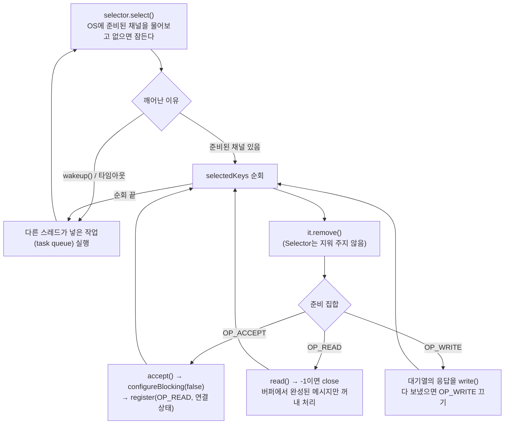
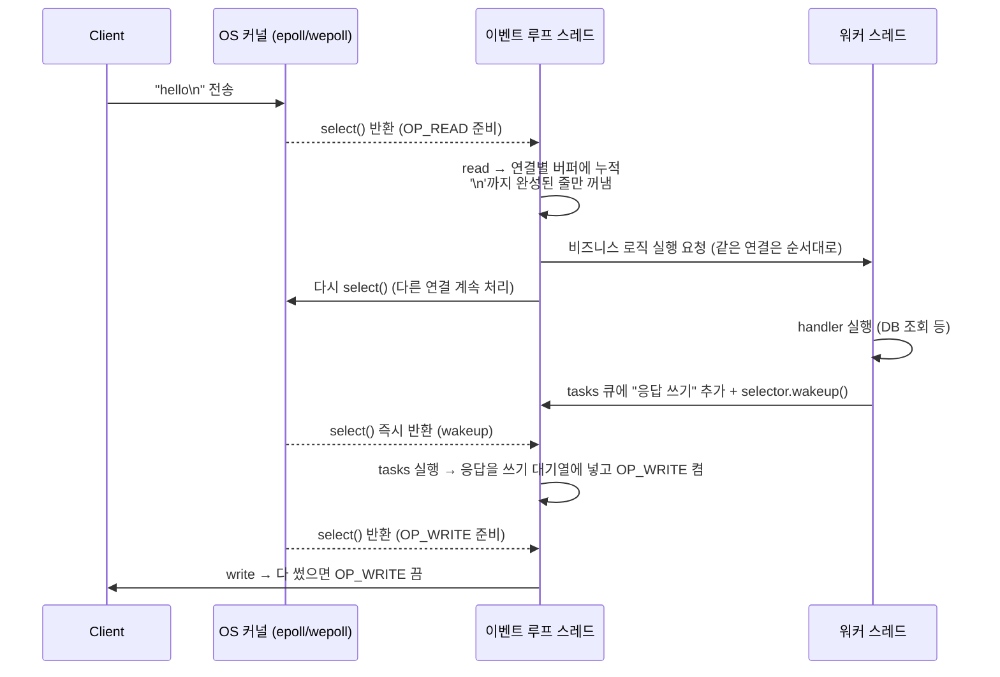
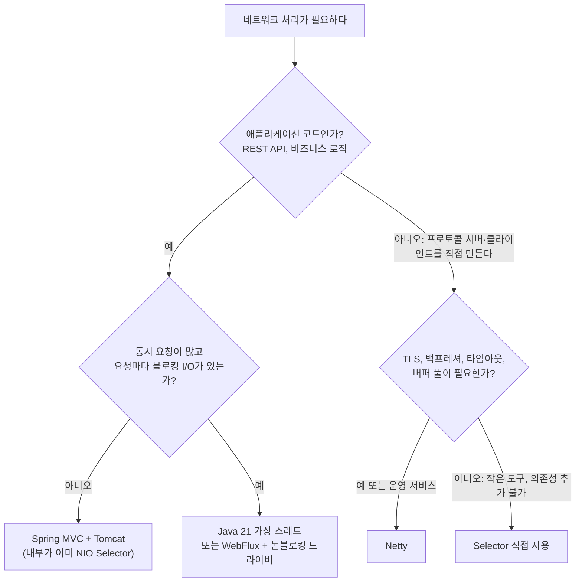

# NIO Selector

관련 문서: [예제](./NIO셀렉터-예제.md) · [입출력 스트림](../입출력스트림/입출력스트림-이론.md) · [volatile](../volatile/volatile-이론.md)

---

## 1. 한 줄 요약

Selector는 수많은 네트워크 연결 중에서 **지금 읽거나 쓸 수 있는 연결만 골라서** 알려 주는 객체로, 스레드 하나가 수천 개의 연결을 처리할 수 있게 해 준다.
정확히는 논블로킹 모드로 등록된 `SelectableChannel`들의 I/O 준비 상태(readiness)를 운영체제의 멀티플렉싱 기능(epoll, kqueue, wepoll 등)으로 한꺼번에 감시하고, 준비된 채널의 `SelectionKey` 집합을 돌려주는 `java.nio.channels` 컴포넌트다.

---

## 2. 왜 필요한가

**블로킹 I/O의 문제: 연결 하나에 스레드 하나**

[입출력 스트림](../입출력스트림/입출력스트림-이론.md)의 `InputStream.read()`는 데이터가 올 때까지 스레드를 멈춘다. 그래서 서버는 연결마다 스레드를 하나씩 둔다(thread-per-connection).

- 연결 1만 개 = 플랫폼 스레드 1만 개. 스레드마다 스택 메모리(기본 수백 KB~1MB 예약)가 들고, 컨텍스트 스위칭 비용이 커진다. 이 한계를 C10K 문제라고 부른다.
- 그런데 대부분의 연결은 **대부분의 시간 동안 아무것도 보내지 않는다**(채팅, 푸시, keep-alive, 롱폴링). 스레드는 `read()`에서 잠만 잔다.

| 해법 | 한계 |
|---|---|
| 연결당 스레드 | 스레드 수 = 동시 연결 수. 메모리·스케줄링 비용으로 수천 개에서 막힌다 |
| 스레드 풀 + 블로킹 I/O | 풀 크기만큼만 동시에 처리한다. 느린 클라이언트 몇 개가 풀을 다 잡으면 나머지는 대기한다 |
| 논블로킹 채널을 루프로 계속 확인(polling) | `read()`가 0을 반환하는 채널까지 계속 돌며 CPU를 100% 쓴다 |
| **Selector** | OS에 "이 채널들 중 준비된 것이 생기면 깨워 달라"고 맡긴다. 준비된 것만 처리하고, 없으면 잔다 |

실측(예제 2번): 동시 연결 1,000개에 대해 Selector 서버는 스레드가 **5개**(이벤트 루프 1 + 워커 4) 늘었고, 연결당 스레드 서버는 **1,001개** 늘었다.

Tomcat의 NIO 커넥터, Netty(Spring WebFlux·gRPC·Lettuce의 기반), Kafka 클라이언트가 모두 내부에서 이 Selector를 쓴다. 직접 Selector를 짤 일은 드물지만, **이 프레임워크들의 설정과 장애(이벤트 루프 블로킹, CPU 100%, 연결 누수)를 이해하려면** 동작 원리를 알아야 한다.

---

## 3. 최소 예제로 보기

```java
Selector selector = Selector.open();
ServerSocketChannel server = ServerSocketChannel.open().bind(new InetSocketAddress(8080));
server.configureBlocking(false);                       // 논블로킹이어야 등록할 수 있다
server.register(selector, SelectionKey.OP_ACCEPT);      // "연결 요청이 오면 알려 줘"

while (true) {
    selector.select();                                  // 준비된 채널이 생길 때까지 잔다
    Iterator<SelectionKey> it = selector.selectedKeys().iterator();
    while (it.hasNext()) {
        SelectionKey key = it.next();
        it.remove();                                    // 직접 지워야 한다
        if (key.isAcceptable()) {
            SocketChannel client = server.accept();
            client.configureBlocking(false);
            client.register(selector, SelectionKey.OP_READ, ByteBuffer.allocate(1024));
        } else if (key.isReadable()) {
            SocketChannel client = (SocketChannel) key.channel();
            ByteBuffer buf = (ByteBuffer) key.attachment();
            if (client.read(buf) == -1) { key.cancel(); client.close(); }   // 상대가 끊음
            // buf에서 완성된 메시지를 꺼내 처리한다
        }
    }
}
```

예제 문서의 서버로 실제 실행한 결과 중 일부(JDK 25.0.4, Windows 11):

```
== 2. 동시 연결 1,000개: 스레드 수 비교 ==
NIO Selector: 연결 1000개, 증가한 스레드 5개 (이벤트 루프 1 + 워커 4), 전체 왕복 117 ms
BIO 연결당 스레드: 증가한 스레드 1001개, 전체 왕복 109 ms

== 3. 할 일 없는 연결 1개를 1초 동안: OP_WRITE를 켜 두면 ==
OP_READ만        : select 반환 1회
OP_READ|OP_WRITE : select 반환 1057854회, 이 스레드 CPU 사용 1000 ms / 1000 ms
```

여기서 봐야 할 것 세 가지:

1. **스레드 하나가 루프를 돈다.** `select()`에서 자다가, 준비된 채널이 생기면 깨어나 그 채널들만 처리하고 다시 잔다. 이 구조를 **이벤트 루프(event loop)**라고 한다.
2. **Selector가 알려 주는 것은 "데이터가 왔다"가 아니라 "지금 호출하면 블로킹되지 않는다"이다.** 그래서 쓸 데이터가 없는데 `OP_WRITE`에 관심을 두면, 송신 버퍼에 빈자리가 있다는 이유로 초당 100만 번 깨어난다(함정 2).
3. **준비된 키 목록(`selectedKeys`)은 Selector가 비워 주지 않는다.** 처리한 키를 `it.remove()`로 지우는 것은 호출자의 책임이다(함정 1).

---

## 4. 핵심 개념

| 용어 | 영문 | 설명 |
|---|---|---|
| 셀렉터 | Selector | 여러 채널의 준비 상태를 OS에 한꺼번에 묻는 객체. 보통 이벤트 루프 스레드 하나가 하나를 소유한다 |
| 선택 가능한 채널 | SelectableChannel | Selector에 등록할 수 있는 채널. `ServerSocketChannel`, `SocketChannel`, `DatagramChannel`, `Pipe`. 파일 채널은 해당하지 않는다 |
| 논블로킹 모드 | Non-blocking Mode | `configureBlocking(false)`. `read`/`write`/`accept`가 기다리지 않고 지금 가능한 만큼만 하고 즉시 반환한다 |
| 선택 키 | SelectionKey | 채널 ↔ Selector 등록 하나를 나타내는 객체. 관심 집합·준비 집합·첨부 객체를 가진다 |
| 관심 집합 / 준비 집합 | Interest Set / Ready Set | 관심 집합: "이 연산이 가능해지면 알려 달라"(`OP_ACCEPT`·`OP_CONNECT`·`OP_READ`·`OP_WRITE`). 준비 집합: 마지막 select에서 실제로 준비된 연산 |
| 선택된 키 집합 | Selected-Key Set | `select()`가 준비됐다고 판단한 키들. Selector가 추가만 하고 **삭제는 호출자가 한다** |
| 첨부 객체 | Attachment | 키에 붙여 두는 임의 객체. 연결별 상태(읽기 버퍼, 쓰기 대기열)를 여기에 둔다 |
| 깨우기 | wakeup() | `select()`에서 잠든 스레드를 즉시 반환시킨다. 다른 스레드가 이벤트 루프에 일을 넘길 때 쓴다 |

### 4-1. 관심 연산 4가지: `OP_ACCEPT`, `OP_CONNECT`, `OP_READ`, `OP_WRITE`

`register()`와 `interestOps()`에 넘기는 값이다. 네 연산 모두 뜻은 같다. **"이 연산을 지금 호출하면 블로킹되지 않는다"**. "데이터가 왔다"나 "전송이 끝났다"는 뜻이 아니다.

| 상수 | 값(비트) | 등록하는 채널 | 준비되는 조건 | 준비되면 호출할 메서드 | 켜 두는 기간 |
|---|---|---|---|---|---|
| `OP_ACCEPT` | `1 << 4` (16) | `ServerSocketChannel` | 완료된 연결이 대기열(backlog)에 있다 | `accept()` (없으면 `null` 반환) | 서버가 열려 있는 동안 계속 |
| `OP_CONNECT` | `1 << 3` (8) | `SocketChannel` (클라이언트) | 논블로킹 `connect()`가 성공했거나 실패했다 | `finishConnect()` (실패면 여기서 `IOException`) | `connect()` 직후부터 `finishConnect()` 성공까지만 |
| `OP_READ` | `1 << 0` (1) | `SocketChannel`, `DatagramChannel`, `Pipe.SourceChannel` | 수신 버퍼에 데이터가 있다, **또는** 상대가 끊었다(EOF), **또는** 오류가 생겼다 | `read()` (-1이면 EOF, 예외면 RST 등) | 연결이 살아 있는 동안 계속 |
| `OP_WRITE` | `1 << 2` (4) | `SocketChannel`, `DatagramChannel`, `Pipe.SinkChannel` | 송신 버퍼에 빈자리가 있다(또는 오류) | `write()` (빈자리만큼만 씀) | **보낼 데이터가 남아 있는 동안만** |

**보통 언제 쓰는가**

| 상수 | 쓰는 쪽 | 대표 상황 | 실제 사례 |
|---|---|---|---|
| `OP_ACCEPT` | 서버 | 서버 소켓을 열고 새 연결을 기다릴 때. 서버마다 **딱 한 번** 등록하고 끄지 않는다 | Tomcat NIO 커넥터의 Acceptor, Netty의 boss 이벤트 루프 |
| `OP_CONNECT` | 클라이언트 | 서버 **여러 대에 동시에** 연결을 맺으면서 스레드를 연결 대기로 묶어 두지 않으려 할 때. 연결 맺는 순간 한 번 쓰고 끝난다 | Kafka 클라이언트가 브로커 여러 대에 연결할 때, Lettuce·Netty 클라이언트의 연결 수립 |
| `OP_READ` | 서버·클라이언트 모두 | 연결이 맺어진 직후 바로 켜서 **연결이 끝날 때까지 유지**한다. 요청 수신, 응답 수신, 상대의 연결 종료 감지를 모두 이것으로 한다 | 채팅·푸시 서버의 메시지 수신, HTTP 요청 수신, Redis·DB 프로토콜 응답 수신 |
| `OP_WRITE` | 서버·클라이언트 모두 | `write()`가 **한 번에 다 못 썼을 때만** 잠깐 켠다. 큰 응답(파일 다운로드, 대량 조회 결과)을 보내거나, 상대가 느리게 읽어서 송신 버퍼가 가득 찼을 때다. 작은 응답은 `write()` 한 번에 끝나므로 대부분 켤 일이 없다 | Netty가 채널이 쓰기 불가 상태가 되면 OP_WRITE를 켜고 flush를 이어 가는 방식, 느린 클라이언트로 대용량 전송 |

정리하면 **서버는 `OP_ACCEPT` → (연결마다) `OP_READ` 상시 + 필요할 때만 `OP_WRITE`**, **클라이언트는 `OP_CONNECT` → `OP_READ` 상시 + 필요할 때만 `OP_WRITE`** 순서가 기본 흐름이다. 상시 켜 두는 것은 `OP_ACCEPT`와 `OP_READ`이고, `OP_CONNECT`와 `OP_WRITE`는 일시적으로만 켠다.

**비트 플래그로 다룬다.** 값이 서로 다른 비트이므로 `|`로 합치고 `&`로 확인한다.

```java
key.interestOps(SelectionKey.OP_READ | SelectionKey.OP_WRITE);     // 읽기 + 쓰기 관심
key.interestOps(key.interestOps() & ~SelectionKey.OP_WRITE);       // OP_WRITE만 끄기
key.interestOpsOr(SelectionKey.OP_WRITE);                          // Java 11+: 켜기 축약
boolean readable = (key.readyOps() & SelectionKey.OP_READ) != 0;   // == key.isReadable()
```

- `interestOps()`는 **내가 알림받고 싶은 것**(관심 집합), `readyOps()`는 **마지막 select에서 실제로 준비된 것**(준비 집합)이다. `isReadable()`·`isWritable()`·`isAcceptable()`·`isConnectable()`은 `readyOps()`의 비트를 확인하는 축약 메서드다.
- 채널마다 가능한 연산이 정해져 있고 `channel.validOps()`로 확인한다. `ServerSocketChannel`은 `OP_ACCEPT`만, `SocketChannel`은 `OP_CONNECT | OP_READ | OP_WRITE`다. 지원하지 않는 연산으로 등록하면 `IllegalArgumentException`이 난다.
- 관심 집합을 `0`으로 둘 수도 있다. 등록은 유지하면서 잠시 알림을 끄는 용도다(예: 처리 중에는 더 읽지 않기 — 백프레셔).
- **"연결 종료" 전용 연산은 없다.** 상대가 끊으면 `OP_READ`가 준비되고 `read()`가 -1을 반환하는 것으로 알게 된다(함정 3). 그래서 쓰기만 하는 채널이라도 종료를 감지하려면 `OP_READ`를 켜 둔다.

**연산별로 주의할 점**

- **`OP_ACCEPT`**: 준비 알림을 받아도 그 사이 다른 처리(다른 스레드의 `accept`, 클라이언트의 즉시 RST)로 대기열이 비면 `accept()`가 `null`을 반환할 수 있다. 항상 null 확인한다. 받은 `SocketChannel`은 블로킹 모드로 시작하므로 `configureBlocking(false)` 후 `OP_READ`로 등록한다.
- **`OP_CONNECT`**: 클라이언트 쪽에서만 쓴다. 논블로킹 `connect()`는 대개 `false`를 반환하고 연결은 백그라운드에서 진행된다. 준비되면 `finishConnect()`로 연결을 확정하고, 관심 집합을 `OP_READ`(보낼 것이 있으면 `| OP_WRITE`)로 **바꾼다**. 연결 후에도 `OP_CONNECT`를 남겨 두면 OS 쪽에서는 쓰기 가능 이벤트로 계속 깨어나는데 준비 집합에는 반영되지 않아 `select()`가 0을 반환하며 헛돌 수 있다(JDK 구현상 동작, 플랫폼별 차이는 확인 필요).
- **`OP_READ`**: 준비 상태가 유지되는 한 매번 보고되므로(5-3) 한 번에 다 읽지 않아도 된다. 반대로 EOF 상태는 영원히 준비됨이라 닫지 않으면 헛바퀴를 돈다.
- **`OP_WRITE`**: 송신 버퍼는 평소 거의 비어 있으므로 **켜 두면 항상 준비됨**이다(함정 2, 실측 초당 약 100만 번). 기본 전략은 "바로 `write()`를 시도 → 다 못 썼으면 `OP_WRITE`를 켬 → 준비되면 나머지를 씀 → 대기열이 비면 끔"이다.

```java
// 클라이언트: OP_CONNECT → OP_READ 전환
SocketChannel ch = SocketChannel.open();
ch.configureBlocking(false);
if (ch.connect(new InetSocketAddress("localhost", 8080))) {
    ch.register(selector, SelectionKey.OP_READ);            // 로컬 연결은 즉시 성공하기도 한다
} else {
    ch.register(selector, SelectionKey.OP_CONNECT);
}
// 이벤트 루프 안
if (key.isConnectable()) {
    SocketChannel c = (SocketChannel) key.channel();
    if (c.finishConnect()) {                                 // 실패면 IOException → 정리 경로로
        key.interestOps(SelectionKey.OP_READ);               // OP_CONNECT를 끄고 읽기로 전환
    }
}
```

참고로 JDK는 이 연산들을 OS 이벤트로 번역한다. Linux epoll 기준 `OP_READ`·`OP_ACCEPT`는 `EPOLLIN`, `OP_WRITE`·`OP_CONNECT`는 `EPOLLOUT`에 대응한다. 그래서 `OP_ACCEPT`와 `OP_READ`, `OP_CONNECT`와 `OP_WRITE`는 OS 입장에서 같은 종류의 이벤트이고, 채널 종류에 따라 이름만 다르게 붙는다.

---

## 5. 동작 원리와 흐름

### 5-1. 이벤트 루프 한 바퀴



1. **등록**: 채널을 논블로킹으로 바꾸고 `channel.register(selector, 관심 연산, 첨부 객체)`를 호출한다. 이때 `SelectionKey`가 만들어지고 Selector의 **키 집합(key set)**에 들어간다. OS 쪽에도 해당 소켓(파일 디스크립터)이 감시 목록에 추가된다.
2. **선택(select)**: 이벤트 루프가 `select()`를 호출하면 Selector는 OS 멀티플렉싱 API(Linux epoll, macOS kqueue, Windows wepoll)에 "관심 연산이 가능해진 소켓이 있으면 알려 달라"고 묻고, 없으면 스레드를 재운다. 스레드는 CPU를 쓰지 않는다.
3. **깨어남**: 커널이 소켓에 데이터가 도착했거나(OP_READ), 송신 버퍼에 빈자리가 생겼거나(OP_WRITE), 연결 요청이 들어왔다(OP_ACCEPT)고 알려 주면 `select()`가 반환된다. 준비된 키들이 **선택된 키 집합**에 추가되고, 각 키의 **준비 집합**이 갱신된다.
4. **처리**: 호출자가 선택된 키를 하나씩 꺼내 **지우고**, 준비 집합에 따라 `accept`/`read`/`write`를 호출한다. 채널이 논블로킹이므로 이 호출들은 기다리지 않는다. 준비됐다고 했으니 대개 무언가를 처리하지만, 처리량은 "지금 가능한 만큼"뿐이다.
5. **반복**: 다시 `select()`로 돌아간다.

### 5-2. 선택된 키 집합은 왜 직접 지워야 하는가

`select()`는 Selector 명세에 따라 다음 순서로 동작한다.

1. 취소된 키(cancelled-key set)를 모든 집합에서 빼고 등록을 해제한다.
2. OS에 준비 상태를 묻는다. 준비된 채널마다:
   - 그 키가 선택된 키 집합에 **없으면** 집합에 추가하고 준비 집합을 새 값으로 **덮어쓴다**.
   - 그 키가 이미 집합에 **있으면** 준비 집합에 새로 준비된 연산을 **추가(OR)**만 한다. **예전 값은 지우지 않는다.**
3. `select()`의 반환값은 "준비 집합이 갱신된 키의 수"다. 0일 수도 있다(wakeup, 타임아웃).

그래서 처리한 키를 지우지 않으면 다음 바퀴에 그 키가 **예전 준비 집합을 그대로 들고** 다시 순회된다. 예제 5번에서 서버 소켓 키가 지워지지 않은 채 `isAcceptable()`이 계속 true로 남았고, 대기 중인 연결이 없는데 `accept()`를 호출해 `null`을 받았다. 이를 그대로 쓰다가 `NullPointerException`으로 이벤트 루프가 죽었다(select 2회 만에).

### 5-3. "준비됨"은 상태가 유지되는 한 매번 보고된다

Selector는 **상태 기반**으로 보고한다. 준비 조건이 계속 참이면 `select()`를 호출할 때마다 다시 준비됐다고 알려 준다(레벨 트리거, level-triggered 방식처럼 동작). 두 가지 결과가 생긴다.

- **OP_WRITE**: 소켓 송신 버퍼에 빈자리가 있으면 "쓸 수 있음"이다. 평소 송신 버퍼는 거의 비어 있으므로 OP_WRITE를 켜 두면 **항상 준비됨**이다. 실측: 할 일 없는 연결 하나로 1초에 1,057,854번 깨어나 CPU 한 코어를 100% 썼다.
- **연결 종료(EOF)**: 상대가 연결을 끊으면 `read()`는 영원히 -1을 반환하고, 그 채널은 영원히 "읽을 수 있음"이다. 닫지 않으면 1초에 435,889번 깨어났다(예제 4번).

반대로 말하면, 이번에 덜 읽은 데이터가 남아 있어도 다음 `select()`가 다시 알려 주므로 **한 번에 다 읽지 않아도 데이터를 잃지는 않는다.**

### 5-4. 다른 스레드와 협력하기: 작업 큐 + wakeup

이벤트 루프 스레드는 절대 오래 멈추면 안 된다(함정 5). 그래서 DB 조회처럼 느린 일은 워커 스레드에 넘기고, 결과를 다시 이벤트 루프로 돌려받아 소켓에 쓴다.



- **Selector·SelectionKey·연결 상태는 이벤트 루프 스레드만 만진다.** 워커는 `tasks.add(...)` + `selector.wakeup()`만 한다. 연결별 버퍼와 대기열에 락이 필요 없어진다.
- **같은 연결의 요청은 순서대로 처리한다.** 워커 풀에 그냥 던지면 처리 시간이 짧은 요청의 응답이 먼저 나가 순서가 뒤바뀐다. 예제는 연결마다 `CompletableFuture` 체인을 이어 붙여 앞 요청이 끝난 뒤 다음 요청을 실행한다(테스트 `responseOrderPreserved`).
- 실측(예제 8번): handler가 500ms 걸릴 때 이벤트 루프에서 직접 실행하면 **다른 연결**의 요청이 449ms 기다렸고, 워커 풀로 넘기면 0ms였다.

### 5-5. 객체 생명주기

| 객체 | 생성 | 소멸 | 비고 |
|---|---|---|---|
| `Selector` | 서버 시작 시 `Selector.open()` | 서버 종료 시 `close()` | 이벤트 루프 스레드 하나가 하나를 소유. OS 자원(epoll 인스턴스 등)을 잡는다 |
| `ServerSocketChannel` | 서버 시작 시 | 서버 종료 시 | `OP_ACCEPT`로 등록 |
| `SocketChannel` | `accept()` 때 연결마다 | 상대 종료(-1)·오류·타임아웃 시 `close()` | 닫지 않으면 소켓(fd)이 샌다 |
| `SelectionKey` | `register()` 때 | `cancel()` 또는 채널 `close()` 후 **다음 select에서** 등록 해제 | `isValid()`로 확인 |
| 연결 상태(attachment) | `register()` 때 함께 | 키와 함께 | 읽기 버퍼, 쓰기 대기열, 처리 순서 체인. 연결마다 따로 |

---

## 6. 내부 구현 (핵심만)

| 클래스·메서드 | 그래서 생기는 동작 |
|---|---|
| `SelectorProvider` → OS별 구현 | `Selector.open()`은 OS에 맞는 구현을 고른다. Linux `EPollSelectorImpl`, macOS `KQueueSelectorImpl`, Windows는 실측 JDK 25에서 `WEPollSelectorImpl`이었다(이전 Windows JDK는 `select()` 기반 `WindowsSelectorImpl`. 기본값이 바뀐 버전은 확인 필요). API와 의미는 같고 성능 특성만 다르다 |
| `SelectableChannel.register(...)` | 채널이 블로킹 모드면 `IllegalBlockingModeException`이 난다(실측). 같은 채널을 같은 Selector에 다시 `register`하면 새 키를 만들지 않고 기존 키의 관심 집합·첨부를 바꾼다. JDK 11부터는 다른 스레드에서 `select()`가 진행 중이어도 블로킹되지 않는다(실측 38µs, 10장) |
| `Selector.selectedKeys()` | 내부 집합을 그대로 돌려준다(복사본이 아니다). Selector는 추가만 하므로 `it.remove()`가 필요하다. 이 집합은 스레드 안전하지 않아서 이벤트 루프 스레드에서만 다뤄야 한다. JDK 11+의 `select(Consumer<SelectionKey>)`는 키를 하나씩 콜백으로 넘기고 집합을 쓰지 않으므로 지울 필요가 없다 |
| `SelectionKey.cancel()` / 채널 `close()` | 키는 즉시 무효(`isValid() == false`)가 되지만, 실제 등록 해제는 **다음 `select()`** 1단계에서 일어난다(5-2). 그래서 같은 순회 안에서 이미 닫은 키를 다시 만날 수 있고, `isValid()` 확인이 필요하다 |
| `SocketChannel.read` / `write` (논블로킹) | `read`는 지금 커널 수신 버퍼에 있는 만큼만 읽고 반환한다(0도 가능, 상대 종료면 -1). `write`는 커널 송신 버퍼 빈자리만큼만 쓰고 반환한다. 실측: 상대가 읽지 않을 때 32MB 중 약 393KB만 쓰고 그다음 호출은 0을 반환했다. **반환값만큼만 처리됐다**고 보고 나머지를 보관해야 한다 |
| `Selector.wakeup()` | `select()` 중이면 즉시 반환시키고, 아니면 **다음 `select()`를 즉시 반환**시킨다. 그래서 "작업을 넣고 wakeup" 순서면 작업이 유실되지 않는다. 내부적으로 파이프·소켓 쌍 등에 1바이트를 써서 OS 대기를 깨운다 |

---

## 7. 유사 개념과의 비교

| 방식 | 구조 | 동시 연결 1만 개 | 코드 스타일 | 언제 |
|---|---|---|---|---|
| BIO + 연결당 플랫폼 스레드 | `read()`에서 스레드가 블로킹 | 스레드 1만 개(메모리·스케줄링 한계) | 순차적, 가장 쉬움 | 연결 수가 적은 내부 도구 |
| **NIO Selector (리액터 패턴)** | 이벤트 루프가 준비된 채널만 처리 | 이벤트 루프 몇 개 | 상태 머신, 콜백. 버퍼·부분 읽기/쓰기를 직접 관리 | 라이브러리·프레임워크 구현, 커스텀 프로토콜 서버 |
| NIO.2 `AsynchronousSocketChannel` (프로액터 패턴) | OS/JDK가 I/O를 끝낸 뒤 `CompletionHandler` 호출 | 스레드 풀 + 완료 콜백 | 콜백 지옥이 되기 쉽다 | Windows IOCP 활용. 실무 사용은 드물다 |
| Netty (Selector 위의 프레임워크) | 이벤트 루프 그룹 + 파이프라인 | 이벤트 루프 = 코어 수 × 2 정도 | 핸들러 체인, 프레이밍·버퍼 풀 제공 | 고성능 네트워크 서버·클라이언트. WebFlux, gRPC, Lettuce |
| 가상 스레드 + 블로킹 API (Java 21+) | 블로킹 호출 시 JDK 내부 poller가 소켓을 감시하고 가상 스레드를 잠시 내려놓음 | 가상 스레드 1만 개(가벼움) | BIO처럼 순차적 | 새 애플리케이션 코드. 요청당 스레드 모델을 유지하면서 확장성이 필요할 때 |

### 7-1. Selector 방식이 맞는 작업

Selector(와 그 위의 Netty·Tomcat NIO)가 이득을 보는 조건은 **"연결은 많은데, 대부분의 연결이 대부분의 시간 동안 놀고 있다"**이다. 다음 조건이 많이 맞을수록 적합하다.

| 조건 | 맞는 예 | 맞지 않는 예 |
|---|---|---|
| 동시 연결 수가 많다 (수천~수십만) | 채팅, 푸시 알림, WebSocket, IoT 장비 연결, 게임 서버 | 사내 관리 도구, 연결 수십 개짜리 배치 |
| 연결이 오래 유지되고 대부분 유휴 상태다 | keep-alive, 롱폴링, SSE(Server-Sent Events), 하트비트만 오가는 연결 | 요청 하나 보내고 바로 끊는 짧은 연결만 있는 경우(이득이 작다) |
| 메시지당 처리가 짧고 블로킹이 없다 | 메시지 중계·라우팅, 프록시·게이트웨이, 캐시 조회 | 요청마다 JDBC 조회, 동기 HTTP 호출, 큰 파일 읽기(이벤트 루프를 막는다, 함정 5) |
| 한 스레드가 여러 상대와 동시에 통신해야 한다 | 브로커 여러 대에 붙는 Kafka 클라이언트, DB·Redis 커넥션 다중화 | 상대 서버가 하나뿐이고 요청을 순서대로 보내면 되는 경우 |
| I/O 대상이 네트워크 소켓이다 | TCP, UDP, 파이프 | 파일 I/O (`FileChannel`은 Selector에 등록할 수 없다) |

### 7-2. 고르는 기준



1. **애플리케이션 코드(REST API, 비즈니스 로직)라면 Selector를 직접 쓰지 않는다.** Spring MVC + Tomcat이 이미 내부에서 Selector로 연결을 관리한다(9-1). 블로킹 I/O가 많은 요청을 대량으로 처리해야 하면 Java 21 가상 스레드를 먼저 검토한다.
2. **커스텀 TCP 프로토콜 서버·클라이언트가 필요하면 Netty를 쓴다.** 프레이밍, 버퍼 풀, 백프레셔, 8장의 함정들을 이미 해결했다.
3. **Selector를 직접 쓰는 경우는 세 가지뿐이다.**
   - 의존성을 추가하기 어려운 작은 도구·게이트웨이 (예: 레거시 장비와 길이 헤더 기반 전문을 주고받는 중계기, 9-4)
   - 라이브러리·프레임워크 자체를 만들 때 (Kafka 클라이언트처럼 외부 의존성을 최소화해야 하는 경우)
   - 학습, 그리고 Tomcat·Netty·Kafka의 설정과 장애(이벤트 루프 블로킹, CPU 100%, 연결 누수)를 이해하고 튜닝할 때

즉 **대부분의 개발자는 Selector를 "직접 쓰는" 것이 아니라 "이미 쓰고 있는" 상태**다. Tomcat, WebFlux, Lettuce, Kafka 클라이언트를 쓰는 순간 그 안에서 Selector가 돈다. 이 문서의 내용은 그 위에서 생기는 문제를 진단하는 데 주로 쓰인다.

가상 스레드도 결국 내부에서는 OS 멀티플렉싱(epoll 등)을 쓴다. 차이는 **누가 상태 머신을 관리하느냐**다. Selector는 개발자가 연결 상태를 직접 관리하고, 가상 스레드는 JDK가 스레드 스택에 상태를 보관해 준다. [가상 스레드] 학습 내용과 연결되는 지점이다.

---

## 8. 함정과 안티패턴

### 함정 1. 처리한 키를 `selectedKeys`에서 지우지 않는다

- **증상**: 첫 연결이 들어온 직후 이벤트 루프가 `NullPointerException`으로 죽는다. 또는 같은 데이터를 두 번 처리하거나, `read()`가 0을 반환하는 헛바퀴가 반복된다.
- **원인**: Selector는 선택된 키 집합에 추가만 하고 지우지 않는다. 남아 있는 키는 다음 바퀴에 **예전 준비 집합을 그대로 유지한 채** 다시 순회된다(5-2). 서버 키의 `isAcceptable()`이 계속 true라서, 대기 중인 연결이 없는데 `accept()`를 호출하고 `null`을 받는다(예제 5번: select 2회 만에 NPE).
- **해결**: `Iterator`로 순회하며 꺼내자마자 `it.remove()`한다. JDK 11+라면 `selector.select(key -> handle(key))`를 쓰면 집합을 다루지 않는다. `accept()` 결과는 항상 null 확인한다.

### 함정 2. `OP_WRITE`를 항상 켜 둔다

- **증상**: 트래픽이 거의 없는데 서버 CPU가 코어 하나만큼 100%다. 스레드 덤프를 보면 이벤트 루프가 `select()` → 반환 → `select()`를 반복하고 있다.
- **원인**: OP_WRITE의 의미는 "송신 버퍼에 빈자리가 있다"이고, 평소에는 거의 항상 참이다. 준비 상태는 유지되는 한 매번 보고된다(5-3). 실측 1초에 1,057,854번 깨어났다.
- **해결**: 보낼 데이터가 생겼을 때 OP_WRITE를 켜고, 대기열을 다 비우면 끈다. 대부분은 OP_WRITE 없이 바로 `write()`를 시도하고, **다 못 쓴 경우에만** OP_WRITE를 켜는 방식이 더 효율적이다.

### 함정 3. `read()`가 -1을 반환해도 채널을 닫지 않는다

- **증상**: 클라이언트가 끊을 때마다 CPU 사용률이 올라가고, 시간이 지나면 `Too many open files`(파일 디스크립터 고갈)가 난다.
- **원인**: 상대가 FIN을 보내면 그 채널은 영원히 "읽을 수 있음"이고 `read()`는 영원히 -1을 반환한다(5-3). 닫지 않으면 키도 소켓도 남는다. 실측: 끊어진 연결 하나로 1초에 435,889번 깨어났다.
- **해결**: `read() == -1`이면 `key.cancel()` + `channel.close()`. `IOException`(상대가 RST로 끊음)도 같은 정리 경로로 보낸다. 연결 하나의 예외가 이벤트 루프 전체를 죽이지 않도록 키 단위로 `try-catch`한다.

### 함정 4. `read` 한 번 = 메시지 하나, `write` 한 번 = 전부 전송이라고 가정한다

- **증상**: 로컬 테스트에서는 잘 되다가, 운영에서 메시지가 잘려서 파싱 오류가 나거나 두 메시지가 붙어서 들어온다. 큰 응답의 뒷부분이 사라진다.
- **원인**: TCP는 바이트 스트림이라 메시지 경계가 없다. 실측: 클라이언트가 `"HEL"`과 `"LO\nWOR"`를 200ms 간격으로 따로 보냈는데 서버는 `read` 한 번에 `"HELLO\nWOR"` 9바이트를 받았다(예제 6번). 논블로킹 `write`는 송신 버퍼 빈자리만큼만 쓴다. 실측: 32MB 중 393KB만 쓰고 0을 반환했다(6장).
- **해결**: 연결마다 **읽기 버퍼**를 두고, 구분자(`\n`)나 길이 헤더로 **완성된 메시지만** 꺼낸다. 남은 앞부분은 `compact()`로 버퍼 앞으로 당겨 다음 `read`를 기다린다. 쓰기는 연결마다 **쓰기 대기열**을 두고, `buf.hasRemaining()`이면 OP_WRITE를 켜고 다음에 이어서 쓴다. 최대 메시지 길이를 정해서 넘으면 연결을 끊는다(무한 버퍼링 방지).

### 함정 5. 이벤트 루프 스레드에서 블로킹 작업을 한다

- **증상**: 특정 API 하나가 느려지자 **그 서버의 모든 연결**이 함께 느려진다. 해당 기능과 상관없는 헬스 체크까지 타임아웃이 난다.
- **원인**: 이벤트 루프 스레드 하나가 수많은 연결을 처리한다(5-1). 그 스레드가 DB 조회·`Thread.sleep`·동기 HTTP 호출·큰 파일 읽기·무거운 계산으로 멈추면 그동안 다른 연결의 `select()` 처리도 멈춘다. 실측: 500ms 작업 하나 때문에 다른 연결의 응답이 449ms 늦어졌다(예제 8번).
- **해결**: 블로킹 작업은 워커 풀로 넘기고, 결과는 작업 큐 + `wakeup()`으로 이벤트 루프에 돌려준다(5-4). 같은 연결의 순서를 지켜야 하면 연결별로 직렬화한다. Netty·WebFlux의 "이벤트 루프를 블로킹하지 말라"는 규칙이 이것이다(WebFlux에서 JDBC를 직접 호출하면 같은 문제가 생긴다).

### 함정 6. 다른 스레드에서 Selector·키·연결 상태를 직접 만진다

- **증상**: (Java 8) 워커 스레드의 `channel.register()`나 `key.interestOps()` 호출이 한참 멈추거나 교착 상태가 된다. (모든 버전) 가끔 응답이 섞이거나 `ConcurrentModificationException`, `BufferOverflowException`이 난다.
- **원인**: JDK 10 이하에서는 `select()`가 진행 중이면 다른 스레드의 `register()`가 그 `select()`가 끝날 때까지 블로킹됐다(10장). 버전과 무관하게 선택된 키 집합과 연결별 버퍼·대기열은 스레드 안전하지 않다(6장).
- **해결**: Selector와 연결 상태는 **이벤트 루프 스레드만** 만지게 하고, 다른 스레드는 작업 큐에 넣고 `wakeup()`한다(5-4). 이 규칙 하나로 락 없이 동시성 문제를 피한다. Netty의 `channel.eventLoop().execute(...)`가 같은 구조다.

### 함정 7. 연결끼리 버퍼를 공유하거나 `flip`/`compact`를 잘못 쓴다

- **증상**: 가끔 다른 사용자의 데이터가 응답에 섞이거나, 메시지 앞부분이 사라진다.
- **원인**: 버퍼 하나를 모든 연결이 같이 쓰면, 연결 A가 덜 읽은 데이터 위에 연결 B의 `read`가 덮어쓴다. `flip()` 없이 읽거나, 처리 후 `clear()`로 미완성 앞부분까지 버리면 데이터가 사라진다.
- **해결**: 읽기 버퍼는 연결마다 attachment로 둔다. 읽기 → `flip()`(읽기 모드) → 완성된 메시지 처리 → `compact()`(남은 바이트를 앞으로, 쓰기 모드로 복귀) 순서를 지킨다. 연결 수 × 버퍼 크기만큼 메모리가 들므로 버퍼 크기는 최대 메시지 길이에 맞춘다(Netty는 버퍼 풀로 이 비용을 줄인다).

---

## 9. 실무 적용 시나리오

### 9-1. Tomcat(Spring MVC)의 NIO 커넥터

Spring Boot의 내장 Tomcat은 기본적으로 NIO 커넥터(`Http11NioProtocol`)를 쓴다.

1. **Acceptor 스레드**가 연결을 받아 **Poller 스레드**의 Selector에 등록한다.
2. Poller가 `select()`로 "요청 데이터가 도착한 연결"을 찾으면, 그 소켓 처리를 **워커 스레드 풀**(`server.tomcat.threads.max`, 기본 200)에 넘긴다.
3. 워커 스레드는 HTTP를 파싱하고 서블릿(DispatcherServlet → 컨트롤러)을 **블로킹 방식으로** 실행한다.

즉 Tomcat은 **연결 대기는 Selector로, 요청 처리는 스레드 풀로** 한다. 그래서 keep-alive 연결이 1만 개여도 요청을 처리 중인 스레드는 200개다(`server.tomcat.max-connections` 기본 8192가 연결 상한이다). 반대로 컨트롤러가 DB를 기다리는 동안에는 워커 스레드가 묶이므로, 동시에 처리하는 요청 수는 여전히 스레드 수로 제한된다. Spring Boot 3.2+에서 `spring.threads.virtual.enabled=true`로 가상 스레드를 켜면 이 워커가 가상 스레드로 바뀐다.

### 9-2. Spring WebFlux / Reactor Netty

WebFlux는 Netty의 이벤트 루프(코어 수만큼의 스레드)에서 컨트롤러를 실행한다. 함정 5가 그대로 적용된다.
- JDBC(PostgreSQL 드라이버 포함)는 블로킹이다. WebFlux 핸들러에서 JPA/JDBC를 직접 호출하면 이벤트 루프가 멈춘다. R2DBC를 쓰거나 `Schedulers.boundedElastic()`로 넘긴다.
- 개발 중에는 BlockHound로 이벤트 루프의 블로킹 호출을 탐지할 수 있다.

### 9-3. 클라이언트 라이브러리 이해: Kafka, Redis(Lettuce)

- Kafka 자바 클라이언트는 `java.nio.channels.Selector`를 감싼 자체 `Selector` 클래스로 브로커 연결들을 스레드 하나(`poll()` 호출 스레드 또는 Producer의 sender 스레드)에서 처리한다. 그래서 **`KafkaConsumer`는 스레드 안전하지 않고**, `poll()` 루프에서 오래 걸리는 처리를 하면 `max.poll.interval.ms`를 넘겨 리밸런스가 일어난다. 이벤트 루프 블로킹과 같은 원리다.
- Lettuce(Spring Data Redis 기본 클라이언트)는 Netty 기반이라, 연결 하나를 여러 스레드가 공유해도 된다. 요청은 이벤트 루프가 순서대로 보내고 응답을 순서대로 매칭한다(5-4의 순서 보장과 같은 원리).

### 9-4. 직접 구현이 정당한 경우

사내 장비·레거시 시스템과 길이 헤더 기반 TCP 전문을 주고받는 작은 게이트웨이처럼, Netty 의존성을 들이기 어려운 경우다. 이때도 예제의 `LineEchoServer` 구조(연결별 attachment, 읽기 버퍼 + 프레이밍, 쓰기 대기열 + OP_WRITE 토글, 작업 큐 + wakeup, 최대 길이 제한, 키 단위 예외 처리)를 갖춰야 한다. 그 이상(TLS, 백프레셔, 타임아웃, 버퍼 풀)이 필요해지면 Netty로 옮긴다.

---

## 10. 버전 주의사항

| 버전 | 변화 | 고칠 코드 |
|---|---|---|
| Java 11 (JDK-8201315) | `select()`가 진행 중일 때 다른 스레드의 `register()`·`interestOps()`가 더 이상 블로킹되지 않는다 | Java 8 코드에서 워커 스레드가 직접 `register()`하면 멈출 수 있다. 작업 큐 + `wakeup()` 패턴을 쓴다(모든 버전에서 안전) |
| Java 11 (JDK-8199433) | `select(Consumer<SelectionKey>)`, `selectNow(Consumer)`가 추가됐다 | 선택 사항. 쓰면 `selectedKeys`를 지우는 코드가 필요 없다 |
| Java 21 (JEP 444) | 가상 스레드 정식 도입 | Selector 코드 자체는 그대로다. 새로 작성하는 요청당 처리 코드는 Selector 대신 가상 스레드 + 블로킹 API를 먼저 검토한다 |

---

## 11. 자가 점검 질문

1. Selector 서버에서 처리한 키를 `selectedKeys()`에서 지우지 않으면, 첫 연결 직후 `accept()`가 `null`을 반환하는 이유는?
2. 보낼 데이터가 없는데 `OP_WRITE`를 등록해 두면 CPU가 100%가 되는 이유는 무엇이고, OP_WRITE는 언제 켜고 꺼야 하는가?
3. 클라이언트가 `"HEL"`과 `"LO\n"`을 따로 보냈을 때, 서버가 `read()` 한 번의 결과를 메시지 하나로 처리하면 생기는 문제와 해결 방법은?
4. 이벤트 루프 스레드에서 500ms 걸리는 DB 조회를 하면, 그 요청과 무관한 다른 연결에는 어떤 영향이 있는가?
5. 워커 스레드가 처리 결과를 소켓에 쓰려고 할 때, 직접 `channel.write()`나 `key.interestOps()`를 호출하지 않고 작업 큐 + `wakeup()`을 쓰는 이유는?

<details>
<summary>답 보기</summary>

1. Selector는 선택된 키 집합에 추가만 하고 지우지 않는다. 키가 이미 집합에 있으면 다음 `select()`는 준비 집합에 새 연산을 OR로 더할 뿐 예전 값을 지우지 않는다. 그래서 서버 키의 `isAcceptable()`이 계속 true로 남고, 대기 중인 연결이 없는데 논블로킹 `accept()`를 호출해 `null`을 받는다.
2. OP_WRITE는 "송신 버퍼에 빈자리가 있다"는 뜻이고, 평소에는 거의 항상 참이다. Selector는 준비 상태가 유지되는 한 매번 보고하므로 `select()`가 즉시 반환되기를 반복한다(실측 초당 약 100만 번). 보낼 데이터가 생겼을 때(또는 `write()`가 다 못 썼을 때) 켜고, 쓰기 대기열을 다 비우면 끈다.
3. TCP는 메시지 경계가 없어서 `read()` 결과가 메시지의 일부일 수도, 여러 메시지가 붙은 것일 수도 있다. 잘린 메시지를 파싱하다 오류가 나거나 응답이 두 번 나간다. 연결마다 읽기 버퍼를 두고 `\n`(또는 길이 헤더)까지 완성된 메시지만 꺼내며, 남은 앞부분은 `compact()`로 보관해 다음 `read()`에 이어 붙인다.
4. 이벤트 루프 스레드 하나가 모든 연결의 `select()`와 I/O를 처리하므로, 그 500ms 동안 다른 연결의 요청도 읽히지 않고 응답도 나가지 않는다. 실측에서 무관한 연결의 응답이 449ms 늦어졌다. 블로킹 작업은 워커 풀로 넘겨야 한다.
5. 선택된 키 집합과 연결별 버퍼·대기열은 스레드 안전하지 않고, Java 10 이하에서는 `select()` 중인 Selector에 대한 `register()`가 블로킹된다. Selector와 연결 상태를 이벤트 루프 스레드만 만지게 하면 락 없이 안전하다. 워커는 작업을 큐에 넣고 `wakeup()`으로 잠든 이벤트 루프를 깨우기만 하면 된다. `wakeup()`은 `select()` 중이 아니어도 다음 `select()`를 즉시 반환시키므로 작업이 유실되지 않는다.

</details>

---

## 12. 참고 자료

- Java SE API — `java.nio.channels.Selector` (select 동작 순서와 키 집합 명세), `SelectionKey`, `SelectableChannel`
- JSR 51 — New I/O APIs for the Java Platform (Java 1.4)
- JDK-8201315 — (se) Allow SelectableChannel.register to be invoked while selection operation is in progress (JDK 11)
- JDK-8199433 — (se) select(Consumer<SelectionKey> action) (JDK 11)
- JEP 444 — Virtual Threads (Java 21)
- Doug Lea, "Scalable IO in Java" — 리액터 패턴과 NIO 이벤트 루프 설계
- Dan Kegel, "The C10K problem"
- Linux man page `epoll(7)` — 레벨 트리거와 엣지 트리거
- Apache Tomcat Configuration Reference — HTTP Connector (NIO, `maxConnections`, `maxThreads`)
- Netty 공식 문서 / Norman Maurer, 『Netty in Action』 — EventLoop, 이벤트 루프 블로킹 금지 규칙

---

## 부록: 용어 정리

| 용어 | 영문 | 설명 |
|---|---|---|
| 셀렉터 | Selector | 여러 채널의 I/O 준비 상태를 한꺼번에 감시해 준비된 키를 돌려주는 객체 |
| 준비 상태 | Readiness | 지금 호출하면 블로킹되지 않는 상태. "데이터 도착"과 같은 말이 아니다 |
| 선택 가능한 채널 | SelectableChannel | Selector에 등록할 수 있는 채널(소켓·데이터그램·파이프) |
| 선택 키 | SelectionKey | 채널 ↔ Selector 등록 하나. 관심·준비 집합과 첨부 객체를 가진다 |
| epoll / kqueue / wepoll | epoll / kqueue / wepoll | Linux / BSD·macOS / Windows의 I/O 멀티플렉싱 API(wepoll은 Windows용 epoll 호환 구현) |
| 연결당 스레드 | Thread-per-connection | 연결마다 스레드 하나가 블로킹 I/O를 담당하는 모델 |
| C10K 문제 | C10K Problem | 동시 연결 1만 개를 처리하기 어려운 문제 |
| 폴링 | Polling | 준비 여부를 반복해서 직접 확인하는 방식 |
| 이벤트 루프 | Event Loop | select → 준비된 채널 처리 → select를 반복하는 스레드와 그 루프 |
| 논블로킹 모드 | Non-blocking Mode | I/O 호출이 기다리지 않고 지금 가능한 만큼만 하고 반환하는 모드 |
| 관심 집합 | Interest Set | 이 키에 대해 알림받고 싶은 연산 집합 |
| 준비 집합 | Ready Set | 마지막 select에서 준비된 것으로 확인된 연산 집합 |
| 선택된 키 집합 | Selected-Key Set | select가 준비됐다고 판단한 키 집합. 삭제는 호출자 책임 |
| 첨부 객체 | Attachment | 키에 붙이는 연결별 상태 객체 |
| 깨우기 | wakeup() | select 중인 스레드를 즉시 반환시키는 메서드 |
| 관심 연산 | Interest Operation (`OP_*`) | `OP_ACCEPT`·`OP_CONNECT`·`OP_READ`·`OP_WRITE`. "이 호출이 블로킹되지 않게 되면 알려 달라"는 대상 |
| 연결 대기열 | Backlog | 서버 소켓에서 3-way 핸드셰이크가 끝나고 `accept()`를 기다리는 연결 목록 |
| 연결 완료 | finishConnect() | 논블로킹 `connect()`를 확정하는 메서드. 실패면 `IOException` |
| 수신 버퍼 / 송신 버퍼 | Receive / Send Buffer | 커널이 소켓마다 두는 버퍼. 각각 OP_READ·OP_WRITE 준비 여부를 결정한다 |
| 비트 플래그 | Bit Flag | 값마다 다른 비트를 써서 `\|`로 합치고 `&`로 확인하는 상수 표현 |
| 유효 연산 | validOps() | 채널이 등록할 수 있는 관심 연산 집합 |
| EPOLLIN / EPOLLOUT | EPOLLIN / EPOLLOUT | epoll의 읽기 가능 / 쓰기 가능 이벤트. OP_READ·OP_ACCEPT / OP_WRITE·OP_CONNECT에 대응 |
| 키 집합 | Key Set | Selector에 등록된 모든 키 |
| 파일 디스크립터 | File Descriptor (fd) | OS가 열린 파일·소켓을 가리키는 번호. 닫지 않으면 고갈된다 |
| 취소된 키 집합 | Cancelled-Key Set | cancel된 키를 다음 select에서 등록 해제하기 위해 모아 두는 집합 |
| 레벨 트리거 | Level-triggered | 조건이 참인 동안 매번 알리는 방식. 반대는 상태가 바뀔 때만 알리는 엣지 트리거 |
| EOF | End Of File | 상대가 연결을 닫아 더 읽을 데이터가 없는 상태. 채널 read가 -1을 반환 |
| 작업 큐 | Task Queue | 다른 스레드가 이벤트 루프에 실행을 맡기는 큐 |
| 리액터 패턴 | Reactor Pattern | 준비 이벤트를 받아 핸들러에 분배하는 이벤트 구동 구조. Selector 기반 서버 |
| 프로액터 패턴 | Proactor Pattern | I/O 완료 후 완료 핸들러를 호출하는 구조. NIO.2 비동기 채널 |
| 가상 스레드 | Virtual Thread | JDK가 관리하는 경량 스레드. 블로킹 시 내부 poller가 소켓을 감시한다 |
| SSE | Server-Sent Events | 서버가 열린 HTTP 연결로 클라이언트에 이벤트를 계속 밀어 보내는 방식. 유휴 연결이 많다 |
| 프레이밍 | Framing | 바이트 스트림에서 메시지 경계를 구분하는 규칙(구분자, 길이 헤더) |
| 백프레셔 | Backpressure | 받는 쪽이 감당할 수 있는 속도로 보내는 쪽을 늦추는 흐름 제어 |
| FIN / RST | FIN / RST | TCP의 정상 종료 / 강제 종료 신호 |
| Acceptor / Poller | Acceptor / Poller | Tomcat NIO 커넥터에서 연결을 받는 스레드 / Selector로 준비된 연결을 찾는 스레드 |
| BlockHound | BlockHound | 이벤트 루프 스레드에서의 블로킹 호출을 탐지하는 도구 |
| 리밸런스 | Rebalance | Kafka 컨슈머 그룹의 파티션 재할당 |
| JEP | JDK Enhancement Proposal | JDK 기능 변경 제안 문서 |
