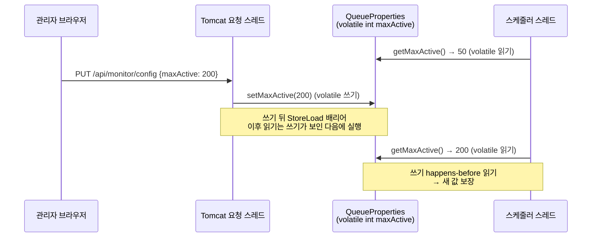

# volatile — 스레드 간 가시성과 순서 보장

관련 문서: [예제](./volatile-예제.md)

> 이 문서는 login-queue 프로젝트의 `QueueProperties`가 왜 모든 필드에 `volatile`을 붙였는지에서 출발했다. 9장에서 그 코드를 다시 분석한다.

---

## 1. 한 줄 요약

`volatile`은 한 스레드가 필드에 쓴 값을 다른 스레드가 **곧바로, 그리고 앞뒤 순서가 섞이지 않은 채로** 읽게 해주는 필드 수식어다.
정확히는 Java 메모리 모델(JMM)에서 같은 volatile 변수에 대한 쓰기가 그 뒤의 모든 읽기보다 **happens-before** 관계에 있도록 정하는 키워드이며, 복합 연산의 원자성(atomicity)은 보장하지 않는다.

---

## 2. 왜 필요한가

### 2.1 "내가 쓴 값이 다른 스레드에 보인다"는 보장이 원래 없다

단일 스레드 프로그램에서는 "코드 순서대로 실행되고, 쓴 값은 바로 읽힌다"고 믿어도 된다. 하지만 성능을 위해 세 계층이 각자 최적화를 한다.

| 계층 | 하는 일 | 다른 스레드 입장에서 생기는 일 |
|---|---|---|
| JIT 컴파일러 | 반복해서 읽는 필드를 레지스터에 캐시, 루프 밖으로 끌어냄, 명령 재배치 | 다른 스레드가 바꾼 값을 영원히 다시 읽지 않을 수 있다 |
| CPU | 비순차 실행(out-of-order execution), 스토어 버퍼(store buffer) | 쓰기가 늦게 보이거나, 두 쓰기가 반대 순서로 보일 수 있다 |
| 캐시 계층 | 코어별 캐시 | 위 두 효과와 겹쳐 "언제 보이는지"가 불확정해진다 |

이 최적화들은 **단일 스레드 관점에서 결과가 같으면 허용**된다(as-if-serial). 다른 스레드가 어떻게 보는지는 고려 대상이 아니다.

### 2.2 기존 해법의 한계

- **`synchronized`**: 가시성과 원자성을 모두 보장하지만 락(lock)을 잡아야 한다. 값 하나를 읽는 데에도 락 획득·해제가 필요하고, 경합이 있으면 스레드가 블록된다. 자주 읽고 가끔 쓰는 설정값이나 플래그에는 과하다.
- **Java 5 이전의 volatile**: 가시성은 주었지만 일반 필드와의 재배치는 막지 못했다. 그래서 DCL(Double-Checked Locking) 같은 관용구가 volatile을 써도 깨졌다. JSR-133(Java 5)에서 지금의 의미로 강화됐다.

`volatile`은 **락 없이 가시성과 순서만** 보장하는 가벼운 도구다.

---

## 3. 최소 예제로 보기

```java
public class StopFlagBad {

    private static boolean running = true;   // volatile 없음

    public static void main(String[] args) throws InterruptedException {
        Thread worker = new Thread(() -> {
            long count = 0;
            while (running) { count++; }
            System.out.println("worker 종료, count=" + count);
        });
        worker.start();

        Thread.sleep(1000);
        running = false;
        System.out.println("main: running=false 설정");

        worker.join(3000);
        System.out.println("3초 후 worker 살아있음? " + worker.isAlive());
        System.exit(0);
    }
}
```

실제 실행 결과 (Java 21.0.12, HotSpot, Windows 11, 24코어):

```text
main: running=false 설정
3초 후 worker 살아있음? true          ← 3번 실행해서 3번 모두 멈추지 않음
```

| 실행 조건 | 결과 |
|---|---|
| `running`에 volatile 없음 (기본 실행) | worker가 **멈추지 않는다** |
| `running`에 volatile 없음 + `-Xint` (JIT 끔) | worker가 멈춘다 |
| `private static volatile boolean running` | worker가 멈춘다 |

JIT를 끄면 멈춘다는 점이 핵심 단서다. **CPU 캐시 때문이 아니라 JIT 컴파일러의 최적화 때문**에 멈추지 않는 것이다(6장). 전체 코드와 나머지 실험은 [예제 문서](./volatile-예제.md)에 있다.

---

## 4. 핵심 개념

| 용어 | 정의 |
|---|---|
| 가시성 (Visibility) | 한 스레드가 쓴 값을 다른 스레드가 읽을 수 있는지 여부. 동기화 없이는 보장되지 않는다. |
| 재배치 (Reordering) | 컴파일러·CPU가 단일 스레드 결과를 바꾸지 않는 범위에서 메모리 접근 순서를 바꾸는 것. |
| 원자성 (Atomicity) | 연산이 중간 상태 없이 한 번에 일어나는 성질. `count++`는 읽기·더하기·쓰기 3단계라 원자적이지 않다. |
| Java 메모리 모델 (JMM, Java Memory Model) | 멀티스레드에서 어떤 읽기가 어떤 쓰기의 값을 볼 수 있는지 정한 규칙. JLS 17장. |
| happens-before | JMM의 핵심 관계. A happens-before B이면 A의 결과(와 A 이전의 모든 쓰기)가 B에게 보인다. |
| 메모리 배리어 (Memory Barrier / Fence) | 배리어 앞뒤의 메모리 접근이 서로 넘나들지 못하게 막는 CPU·컴파일러 수준의 장치. |
| 안전한 발행 (Safe Publication) | 객체를 다른 스레드에 넘길 때, 받는 쪽이 완전히 초기화된 상태를 보도록 보장하는 것. |

---

## 5. 동작 원리와 흐름

### 5.1 volatile이 만드는 happens-before

JLS 17.4.5는 다음을 happens-before로 정한다(이 주제와 관련된 것만).

1. **프로그램 순서 규칙**: 같은 스레드 안에서는 앞선 코드가 뒤 코드보다 happens-before.
2. **volatile 규칙**: volatile 변수 `v`에 대한 쓰기는 **그 뒤에 `v`를 읽는 모든 읽기**보다 happens-before.
3. **전이성**: A → B이고 B → C이면 A → C.

세 규칙을 이으면 volatile의 실제 효과가 나온다.

> 스레드 A가 volatile `v`에 쓰기 **전에** 한 모든 쓰기(일반 필드 포함)는, `v`에서 그 값을 읽은 스레드 B가 **그 뒤에** 하는 읽기에 모두 보인다.

즉 volatile 쓰기는 "여기까지 한 일을 발행(publish)한다", volatile 읽기는 "발행된 것을 받는다"는 의미를 가진다. volatile 변수 자체뿐 아니라 **그 앞의 일반 필드 쓰기까지 함께 보인다**는 점이 중요하다. DCL이 이 성질에 기대고 있다(8.5).

### 5.2 흐름: login-queue에서 설정이 바뀌는 과정

1. 관리자가 모니터링 화면에서 `maxActive`를 200으로 저장한다.
2. Tomcat 요청 스레드가 `MonitorController`에서 `QueueProperties#setMaxActive(200)`을 호출한다. **volatile 쓰기**가 일어난다.
3. JVM은 이 쓰기 뒤에 배리어를 두어, 쓰기가 다른 코어에서 보일 때까지 이 스레드의 다음 읽기를 미룬다(6장).
4. 입장 처리 스케줄러 스레드가 다음 턴에 `QueueService#hasFreeSlot()`에서 `getMaxActive()`를 호출한다. **volatile 읽기**이므로 레지스터에 캐시된 값을 쓰지 않고 메모리에서 다시 읽는다.
5. volatile 규칙에 따라 2번이 4번보다 happens-before이므로 스케줄러는 200을 본다.



### 5.3 생성·소멸 관점

volatile은 객체를 만들지 않는다. 바뀌는 것은 **필드 접근 방식**뿐이다. 같은 필드라도 volatile이면 모든 읽기·쓰기가 배리어가 붙은 접근이 되고, 일반 필드면 JIT가 자유롭게 캐시·재배치한다. 객체 생성과 소멸은 일반 필드와 같다.

---

## 6. 내부 구현 (핵심만)

### 6.1 바이트코드: 플래그 하나

`javac`는 volatile 필드에 `ACC_VOLATILE` 접근 플래그만 붙인다. 읽기·쓰기 명령은 일반 필드와 똑같은 `getfield`/`putfield`(static이면 `getstatic`/`putstatic`)다. **실제 의미는 인터프리터와 JIT가 이 플래그를 보고 만든다.** 그래서 같은 코드도 JIT가 개입하기 전과 후의 동작이 다를 수 있다.

### 6.2 JIT: 루프 밖으로 끌어내기 (3장의 원인)

C2 같은 최적화 JIT는 루프 안에서 바뀌지 않는 식을 루프 밖으로 옮긴다(loop-invariant code motion, hoisting). 일반 필드 `running`은 루프 안에서 이 스레드가 쓰지 않으므로 "불변"으로 보고 이렇게 바꿀 수 있다.

```java
// JIT가 사실상 이렇게 컴파일한다
if (running) {
    while (true) { count++; }
}
```

다른 스레드가 `running = false`를 써도 이 스레드는 다시 읽지 않는다. `-Xint`로 JIT를 끄면 인터프리터가 매번 필드를 읽기 때문에 멈추는 것이다. volatile 필드는 이 최적화 대상에서 빠진다. **매 반복마다 다시 읽어야 한다.**

### 6.3 메모리 배리어

JSR-133 Cookbook(Doug Lea)은 volatile을 네 종류의 배리어로 구현하는 방법을 정리했다.

| 위치 | 배리어 | 막는 것 |
|---|---|---|
| volatile 쓰기 **앞** | StoreStore | 앞의 일반 쓰기가 volatile 쓰기 뒤로 밀리는 것 → 5.1의 "앞의 쓰기까지 발행" |
| volatile 쓰기 **뒤** | StoreLoad | volatile 쓰기가 보이기 전에 뒤의 읽기가 먼저 실행되는 것 |
| volatile 읽기 **뒤** | LoadLoad + LoadStore | 뒤의 읽기·쓰기가 volatile 읽기 앞으로 당겨지는 것 → "받은 뒤에 읽는다" |

CPU마다 필요한 실제 명령이 다르다.

- **x86-64**: 메모리 모델이 강해서(TSO) StoreLoad만 명령이 필요하다. HotSpot은 volatile 쓰기 뒤에 `lock addl $0, (rsp)` 같은 lock 접두 명령을 넣는다. **volatile 읽기는 일반 `mov`와 같다.**
- **ARM64(AArch64)**: 읽기는 `ldar`(load-acquire), 쓰기는 `stlr`(store-release) 명령을 쓴다.

결과적으로 **x86에서 volatile 읽기는 거의 공짜이고, 쓰기가 상대적으로 비싸다.** "자주 읽고 가끔 쓰는" 설정값·플래그에 volatile이 잘 맞는 이유다. 단, 읽기도 JIT 최적화(캐시·재배치)가 막히므로 비용이 완전히 0은 아니다.

### 6.4 long/double 쓰기의 원자성

JLS 17.7은 volatile이 아닌 `long`/`double` 쓰기를 32비트씩 두 번에 나눠 해도 된다고 허용한다. 다른 스레드가 상위 32비트는 새 값, 하위 32비트는 옛 값인 "찢어진 값(word tearing)"을 볼 수 있다는 뜻이다. **volatile `long`/`double`의 읽기·쓰기는 항상 원자적이다.** 64비트 HotSpot에서는 실제로 찢어지는 일이 드물지만, 명세가 보장하지 않으므로 공유되는 `long`에는 volatile을 붙인다.

---

## 7. 유사 개념과의 비교

| 도구 | 가시성 | 순서 보장 | 복합 연산 원자성 | 블로킹 | 적합한 경우 |
|---|---|---|---|---|---|
| `volatile` | O | O | **X** (단순 읽기·쓰기만 원자적) | X | 한 스레드가 쓰고 여럿이 읽는 플래그·설정값, 불변 객체 참조 교체 |
| `synchronized` / `Lock` | O | O | O (블록 전체) | O | 여러 필드를 함께 바꾸는 불변식, check-then-act |
| `AtomicInteger` / `AtomicLong` / `AtomicReference` | O (내부가 volatile) | O | O (CAS 기반 단일 변수) | X | 카운터, 단일 변수의 compare-and-set |
| `LongAdder` | O | O | O (합계) | X | 쓰기 경합이 심한 카운터 (읽기는 상대적으로 느림) |
| `final` 필드 + 불변 객체 | 생성 완료 후 O | 생성자 안 쓰기에 한정 | 해당 없음(변경 불가) | X | 바뀌지 않는 값. volatile 참조와 조합해 스냅샷 교체 |
| `VarHandle` (Java 9+) | 모드별 | 모드별 (plain / opaque / acquire-release / volatile) | CAS 지원 | X | 라이브러리 수준에서 필드별로 정밀한 메모리 순서가 필요할 때 |

**선택 기준**

1. 값이 바뀌지 않는다 → `final` (동기화 불필요).
2. 쓰는 쪽이 **현재 값과 무관하게 대입만** 한다 + 필드끼리 관계가 없다 → `volatile`.
3. 현재 값을 읽고 그 값으로 새 값을 만든다(`++`, `if (x < max) x++`) → `Atomic*` 또는 `synchronized`.
4. 여러 필드가 **함께** 일관돼야 한다 → 불변 객체로 묶어 `volatile` 참조 하나로 교체하거나, `synchronized`.

---

## 8. 함정과 안티패턴

### 8.1 종료 플래그에 volatile을 빠뜨림

- **증상**: `stop()`을 호출했는데 백그라운드 스레드가 끝나지 않는다. 로컬 디버깅(JIT 최적화 전, 짧은 실행)에서는 잘 멈추다가 운영에서만 멈추지 않는다.
- **원인**: JIT가 일반 필드 읽기를 루프 밖으로 끌어낸다(6.2). 루프가 충분히 실행돼 C2로 컴파일된 뒤에 생기므로 재현이 들쭉날쭉하다.
- **해결**: 플래그를 `volatile boolean`으로 선언한다. 또는 `Thread#interrupt()`와 `isInterrupted()`를 쓴다.

### 8.2 volatile 필드에 `count++`

- **증상**: 8개 스레드가 10만 번씩 증가시켰는데 결과가 80만이 아니라 28만~32만이 나온다([예제 2](./volatile-예제.md)).
- **원인**: `count++`는 읽기 → +1 → 쓰기 3단계다. volatile은 각 단계가 최신 값을 보게 할 뿐, **세 단계 사이에 다른 스레드가 끼어드는 것은 막지 않는다**(4장의 원자성). 두 스레드가 같은 값을 읽고 둘 다 +1을 쓰면 하나가 사라진다(lost update).
- **해결**: `AtomicInteger#incrementAndGet()`, 경합이 심하면 `LongAdder`, 다른 상태와 함께 바꿔야 하면 `synchronized`.

### 8.3 check-then-act

- **증상**: `if (active < maxActive) active++;`처럼 "확인 후 행동"하는 코드에서 상한을 넘는다.
- **원인**: 8.2와 같다. 확인과 행동 사이에 다른 스레드가 같은 조건을 통과할 수 있다. volatile은 두 동작을 하나로 묶지 않는다.
- **해결**: `AtomicInteger#compareAndSet` 반복, `Semaphore`, 또는 `synchronized`로 확인과 행동을 한 임계 영역에 둔다.

### 8.4 서로 관련된 필드를 각각 volatile로 둠

- **증상**: `min`/`max`를 각각 volatile로 두고 `set(min, max)`로 바꿨더니, 읽는 쪽이 `min > max`이거나 짝이 맞지 않는 값을 본다. 예제에서는 1초 동안 약 57만~68만 번 관측됐다.
- **원인**: volatile은 **변수 하나 단위**로 보장한다. `this.min = ...; this.max = ...;` 사이에 읽는 스레드가 끼어들면 새 `min` + 옛 `max`를 본다. getter를 두 번 호출하면 그 사이에 값이 또 바뀔 수도 있다.
- **해결**: 두 값을 불변 객체(`record Range(int min, int max)`)로 묶고 `volatile Range range` 참조만 교체한다. 읽는 쪽은 `Range snap = range;`처럼 **한 번만 읽어 지역 변수로** 쓴다. 참조 대입은 원자적이고, 5.1의 규칙으로 객체 내용까지 함께 보인다.

### 8.5 volatile 없는 DCL(Double-Checked Locking)

- **증상**: 지연 초기화한 싱글턴을 다른 스레드가 받았는데 필드가 `null`이거나 기본값이다. 아주 드물게, 고부하에서만 발생한다.
- **원인**: `instance = new Helper();`는 ① 메모리 할당 ② 생성자 실행 ③ 참조 대입으로 나뉜다. volatile이 없으면 ②와 ③이 재배치될 수 있어, 다른 스레드가 첫 번째 `if (instance == null)` 검사(락 밖)에서 **생성이 끝나지 않은 객체의 참조**를 받는다. volatile 쓰기 앞의 StoreStore 배리어(6.3)가 ②를 ③ 앞에 고정한다.
- **해결**: 필드를 `private static volatile Helper instance;`로 선언한다. 더 간단한 대안은 홀더 클래스 관용구(lazy initialization holder class)나 enum 싱글턴이다(Effective Java 아이템 83).

```java
private static volatile Helper instance;

public static Helper getInstance() {
    Helper result = instance;              // volatile 읽기를 한 번으로 줄인다
    if (result == null) {
        synchronized (Helper.class) {
            result = instance;
            if (result == null) {
                instance = result = new Helper();
            }
        }
    }
    return result;
}
```

### 8.6 volatile 참조면 내부도 스레드 안전하다고 착각

- **증상**: `volatile List<String> list`나 `volatile int[] arr`를 선언했는데 `list.add()`, `arr[i] = x`가 다른 스레드에 보이지 않거나 `ArrayList` 내부가 깨진다.
- **원인**: volatile은 **필드에 담긴 참조 값**에만 적용된다. 참조가 가리키는 객체의 필드나 배열 원소는 일반 메모리 접근이다.
- **해결**: 참조를 통째로 교체하는 방식(copy-on-write, 불변 컬렉션)으로 쓰거나, `CopyOnWriteArrayList`·`ConcurrentHashMap`·`AtomicIntegerArray`처럼 내부가 스레드 안전한 타입을 쓴다.

---

## 9. 실무 적용 시나리오

### 9.1 실행 중에 바뀌는 설정 — login-queue `QueueProperties`

```java
@ConfigurationProperties(prefix = "queue")
public class QueueProperties {
    private volatile int maxActive = 50;
    private volatile int admitPerSecond = 20;
    // ...
    public void setMaxActive(int maxActive) { this.maxActive = maxActive; }
}
```

| 역할 | 위치 | 실행 스레드 |
|---|---|---|
| 쓰기 | `MonitorController` (`p.setMaxActive(...)` 등) | Tomcat HTTP 요청 스레드 |
| 읽기 | `QueueService#hasFreeSlot()`, `#bucket()`, `#purgeAbandoned()` | 입장 처리 스케줄러 스레드 |
| 읽기 | `MetricsSampler`, Micrometer `Gauge` | 메트릭 수집 스레드 |

volatile만으로 충분한 이유를 7장의 선택 기준으로 확인할 수 있다.

- setter가 **단순 대입**만 한다. 현재 값을 읽어 계산하지 않는다(8.2·8.3 해당 없음).
- 필드 5개가 **서로 독립**이다. 함께 일관돼야 하는 불변식이 없다(8.4 해당 없음).
- 아주 잠깐 옛 값이 쓰여도(예: 입장 처리 한 턴) 문제가 없다. **결국 새 값이 보이기만 하면 된다.**
- 읽기가 쓰기보다 훨씬 많다. x86에서 volatile 읽기는 거의 공짜다(6.3). `synchronized`를 쓰면 스케줄러가 읽을 때마다 락을 잡아야 한다.

참고로 애플리케이션 시작 시 바인딩만 하고 다시 바꾸지 않는 설정이라면 volatile이 필요 없다. 이 클래스는 **실행 중 변경**이라는 요구 때문에 volatile이 필요해졌다. 나중에 "maxActive와 admitPerSecond를 항상 함께 바꿔야 한다"는 요구가 생기면 8.4의 불변 스냅샷 방식으로 바꿔야 한다.

### 9.2 백그라운드 작업 종료 플래그

배치 워커, 폴링 루프, 커스텀 스케줄러의 `volatile boolean running`. `@PreDestroy`나 shutdown hook에서 `false`로 내리면 워커 스레드가 다음 반복에서 멈춘다(8.1).

### 9.3 상태 값 발행

한 스레드가 계산한 결과를 불변 객체로 만들어 `volatile` 참조에 대입하면, 다른 스레드는 락 없이 최신 결과를 읽는다. 캐시된 라우팅 테이블, 피처 플래그 스냅샷, 주기적으로 새로 고치는 토큰 등이 이 패턴이다.

### 9.4 JDK 내부

JDK의 동시성 클래스도 volatile 위에 만들어졌다. `AtomicInteger`의 `value`, `ConcurrentHashMap` 노드의 `val`·`next`, `FutureTask`의 `state`가 모두 volatile 필드다. 락이 없는 읽기 경로는 대부분 volatile 읽기로 가시성을 확보한다.

---

## 10. 자가 점검 질문

1. 3장의 `StopFlagBad`가 `-Xint`에서는 멈추고 기본 실행에서는 멈추지 않는 이유는?
<details><summary>답</summary>

C2 JIT가 루프 안에서 바뀌지 않는 일반 필드 읽기를 루프 밖으로 끌어내(hoisting) `if (running) while (true)` 형태로 컴파일하기 때문이다. `-Xint`는 JIT를 끄므로 인터프리터가 매 반복마다 필드를 읽는다. CPU 캐시가 아니라 컴파일러 최적화가 원인이다.
</details>

2. `volatile int count`에 8개 스레드가 `count++`를 하면 왜 값이 사라지는가? volatile이 보장하는 것과 보장하지 않는 것으로 설명하라.
<details><summary>답</summary>

volatile은 각 읽기가 최신 값을 보고 각 쓰기가 곧바로 보이게 한다(가시성). 하지만 `count++`는 읽기·더하기·쓰기 3단계이고, volatile은 그 사이에 다른 스레드가 끼어드는 것을 막지 않는다(원자성 미보장). 두 스레드가 같은 값을 읽고 둘 다 +1을 쓰면 증가 하나가 사라진다.
</details>

3. volatile 변수 `ready`에 `true`를 쓰기 직전에 일반 필드 `data = 42`를 썼다. 다른 스레드가 `ready == true`를 읽은 뒤 `data`를 읽으면 42가 보장되는가?
<details><summary>답</summary>

보장된다. 프로그램 순서 규칙으로 `data = 42` → `ready = true`, volatile 규칙으로 `ready` 쓰기 → `ready` 읽기, 프로그램 순서로 `ready` 읽기 → `data` 읽기. 전이성으로 `data = 42`가 `data` 읽기보다 happens-before이다. 구현상으로는 volatile 쓰기 앞의 StoreStore 배리어와 읽기 뒤의 LoadLoad 배리어가 이 순서를 지킨다.
</details>

4. `min`/`max` 두 필드를 각각 volatile로 둔 클래스에서 읽는 쪽이 `min > max`를 볼 수 있는 이유와 해결책은?
<details><summary>답</summary>

volatile은 변수 하나 단위로만 보장하므로 `min`을 쓴 뒤 `max`를 쓰기 전 사이에 읽으면 새 min + 옛 max를 볼 수 있다. 두 값을 불변 객체로 묶고 그 객체의 참조 하나만 volatile로 교체한 뒤, 읽는 쪽은 참조를 한 번만 읽어 지역 변수로 쓴다.
</details>

5. login-queue의 `QueueProperties`가 `synchronized` 대신 volatile만 써도 되는 조건 세 가지는? 그리고 어떤 요구가 생기면 이 설계를 바꿔야 하는가?
<details><summary>답</summary>

① setter가 현재 값과 무관한 단순 대입만 한다. ② 필드끼리 함께 지켜야 할 불변식이 없다. ③ 잠깐 옛 값을 읽어도 결국 새 값이 보이면 충분하다. 여러 설정을 항상 함께 바꾸고 읽는 쪽도 같은 묶음을 봐야 한다는 요구가 생기면, 불변 설정 객체 + volatile 참조 교체 방식(또는 synchronized)으로 바꿔야 한다.
</details>

---

## 11. 참고 자료

- JLS (Java Language Specification) §8.3.1.4 `volatile` Fields
- JLS §17.4 Memory Model, §17.4.5 Happens-before Order, §17.7 Non-Atomic Treatment of double and long
- JSR-133 FAQ — Jeremy Manson, Brian Goetz: <https://www.cs.umd.edu/~pugh/java/memoryModel/jsr-133-faq.html>
- The JSR-133 Cookbook for Compiler Writers — Doug Lea: <https://gee.cs.oswego.edu/dl/jmm/cookbook.html>
- Brian Goetz 외, 『Java Concurrency in Practice』 3.1.4 Volatile Variables, 16장 The Java Memory Model
- Joshua Bloch, 『Effective Java 3판』 아이템 78 (공유 중인 가변 데이터는 동기화해 사용하라), 아이템 83 (지연 초기화는 신중히 사용하라)
- login-queue: `backend/src/main/java/com/study/loginqueue/queue/QueueProperties.java`

---

## 부록: 용어 정리

| 용어 | 영문 | 설명 |
|---|---|---|
| 볼라틸 | volatile | 필드 읽기·쓰기에 가시성과 순서 보장을 붙이는 Java 수식어 |
| 자바 메모리 모델 | JMM (Java Memory Model) | 멀티스레드에서 어떤 쓰기가 어떤 읽기에 보이는지 정한 JLS 17장의 규칙 |
| 해픈스 비포 | happens-before | A의 결과와 A 이전의 쓰기가 B에게 보인다는 것을 보장하는 JMM 관계 |
| 원자성 | Atomicity | 연산이 중간 상태 없이 한 번에 일어나는 성질 |
| JIT 컴파일러 | Just-In-Time Compiler | 실행 중에 자주 쓰는 바이트코드를 기계어로 컴파일·최적화하는 JVM 구성 요소 |
| 비순차 실행 | Out-of-order Execution | CPU가 명령을 코드 순서와 다르게 실행해 성능을 높이는 기법 |
| 스토어 버퍼 | Store Buffer | CPU가 쓰기를 캐시에 반영하기 전에 잠시 모아두는 버퍼 |
| 애즈 이프 시리얼 | as-if-serial | 단일 스레드 결과만 같으면 어떤 재배치든 허용한다는 최적화 원칙 |
| 락 | Lock | 한 번에 한 스레드만 임계 영역에 들어가게 하는 동기화 장치 |
| DCL | Double-Checked Locking | 락 밖과 안에서 두 번 null 검사를 하는 지연 초기화 관용구 |
| JSR-133 | Java Specification Request 133 | Java 5에서 메모리 모델과 volatile 의미를 재정의한 명세 |
| 가시성 | Visibility | 한 스레드가 쓴 값을 다른 스레드가 읽을 수 있는지 여부 |
| 재배치 | Reordering | 단일 스레드 결과를 바꾸지 않는 범위에서 메모리 접근 순서를 바꾸는 최적화 |
| 메모리 배리어 | Memory Barrier / Fence | 앞뒤 메모리 접근이 서로 넘나들지 못하게 막는 장치 |
| 안전한 발행 | Safe Publication | 다른 스레드가 완전히 초기화된 객체를 보도록 넘기는 것 |
| 발행 | Publish | 지금까지 한 쓰기를 다른 스레드가 볼 수 있게 내보내는 것. volatile 쓰기가 이 역할을 한다 |
| 접근 플래그 | ACC_VOLATILE | 클래스 파일에서 필드가 volatile임을 나타내는 플래그 |
| 루프 불변식 이동 | Loop-invariant Code Motion (Hoisting) | 루프 안에서 바뀌지 않는 계산을 루프 밖으로 옮기는 JIT 최적화 |
| 인터프리터 모드 | -Xint | JIT 없이 바이트코드를 한 줄씩 해석 실행하는 JVM 옵션 |
| TSO | Total Store Order | x86의 메모리 모델. 쓰기 뒤 읽기 재배치만 허용한다 |
| 로드 획득 / 스토어 해제 | Load-Acquire / Store-Release | ARM64의 `ldar`/`stlr` 명령. 각각 volatile 읽기·쓰기 의미를 만든다 |
| 워드 티어링 | Word Tearing | 64비트 값이 32비트씩 나뉘어 써져 반쪽만 새 값인 상태로 읽히는 현상 |
| CAS | Compare-And-Swap | 현재 값이 기대값과 같을 때만 새 값으로 바꾸는 원자적 CPU 명령 |
| 바르핸들 | VarHandle | Java 9+에서 필드·배열 원소에 메모리 순서 모드를 골라 접근하는 API |
| 유실된 갱신 | Lost Update | 두 스레드가 같은 값을 읽고 각자 써서 한 쪽 변경이 사라지는 현상 |
| 확인 후 행동 | Check-then-act | 조건을 확인한 뒤 그 결과로 행동하는, 원자적이지 않은 2단계 패턴 |
| 불변 객체 | Immutable Object | 생성 후 상태가 바뀌지 않는 객체. 공유해도 동기화가 필요 없다 |
| 홀더 클래스 관용구 | Lazy Initialization Holder Class | 클래스 초기화의 스레드 안전성을 이용한 지연 초기화 방식 |
| 카피 온 라이트 | Copy-on-Write | 변경할 때마다 복사본을 만들어 참조를 통째로 교체하는 방식 |
