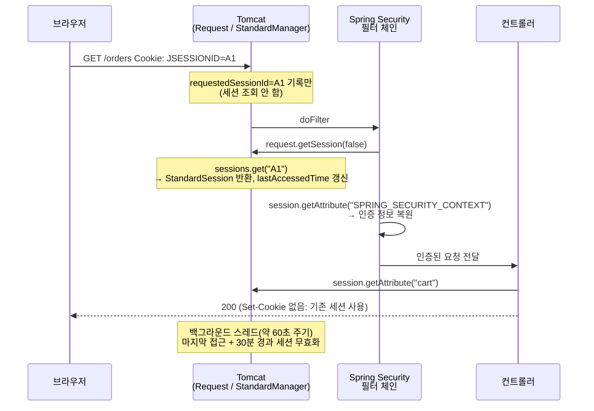
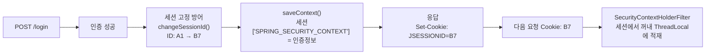

# 서버 세션 (HttpSession)

관련 문서: [예제](./세션-예제.md) · [쿠키](../쿠키/쿠키-이론.md) · [분산 세션](../분산세션/분산세션-이론.md) · [직렬화](../직렬화/직렬화-이론.md)

> 이 문서는 **서버 한 대**에서 서블릿 컨테이너(Tomcat)가 세션을 만들고, 찾고, 끝내는 과정을 다룬다. 서버가 여러 대일 때 생기는 문제는 [분산 세션](../분산세션/분산세션-이론.md) 문서에서 다룬다.
> 쿠키 속성(HttpOnly, SameSite 등)의 의미는 [쿠키](../쿠키/쿠키-이론.md) 문서를 전제로 한다.

---

## 1. 한 줄 요약

서버가 사용자별 데이터를 자기 메모리에 보관하고, 브라우저에는 그 보관함의 번호표(세션 ID)만 쿠키로 주는 방식이다.
정확히는 서블릿 컨테이너가 관리하는 `HttpSession` 객체로, 요청의 `JSESSIONID` 쿠키 값을 키로 컨테이너 내부 맵에서 조회되며, 마지막 접근 이후 설정된 비활성 시간(기본 30분)이 지나면 무효화된다.

---

## 2. 왜 필요한가

[쿠키](../쿠키/쿠키-이론.md)만으로도 상태를 유지할 수 있다. 하지만 데이터를 쿠키에 직접 넣으면 세 가지 문제가 생긴다.


| 쿠키에 데이터 직접 저장             | 문제                                       |
| ------------------------- | ---------------------------------------- |
| `role=ADMIN`, `userId=42` | 사용자가 값을 **고칠 수 있다**. 서버는 받은 값을 믿을 근거가 없다 |
| 장바구니 목록                   | 쿠키당 약 4KB 제한. 모든 요청에 실려 대역폭을 낭비한다        |
| 로그인 상태                    | 서버가 **강제로 끊을 방법이 없다**. 쿠키 만료 전까지는 유효하다   |


세션은 데이터를 서버에 두고 쿠키에는 **추측 불가능한 ID**만 둔다. 서버가 데이터를 소유하므로 위변조가 불가능하고, 크기 제한이 없고, `invalidate()` 한 번으로 즉시 끊을 수 있다.
그 대가로 **서버가 상태를 가진다(stateful)**. 메모리를 쓰고, 서버가 재시작되면 사라지고, 서버를 늘리면 공유 문제가 생긴다. 이 대가가 [분산 세션](../분산세션/분산세션-이론.md)과 JWT 같은 무상태 토큰이 등장한 이유다.

---

## 3. 최소 예제로 보기

```java
@RestController
class VisitController {

    @GetMapping("/visit")
    String visit(HttpServletRequest request) {
        HttpSession session = request.getSession();          // 없으면 만든다
        Integer count = (Integer) session.getAttribute("count");
        count = (count == null) ? 1 : count + 1;
        session.setAttribute("count", count);
        return "id=" + session.getId() + ", count=" + count + ", new=" + session.isNew();
    }

    @GetMapping("/peek")
    String peek(HttpServletRequest request) {
        HttpSession session = request.getSession(false);     // 없으면 null. 만들지 않는다
        return session == null ? "no session" : "count=" + session.getAttribute("count");
    }
}
```

```text
GET /peek                                   → no session              (Set-Cookie 없음)
GET /visit                                  → id=8F2A...C1, count=1, new=true
  ← Set-Cookie: JSESSIONID=8F2A...C1; Path=/; HttpOnly
GET /visit   Cookie: JSESSIONID=8F2A...C1   → id=8F2A...C1, count=2, new=false
GET /peek    Cookie: JSESSIONID=8F2A...C1   → count=2
GET /visit   Cookie: JSESSIONID=WRONG       → id=77BD...09, count=1, new=true
  ← Set-Cookie: JSESSIONID=77BD...09; ...   (모르는 ID는 무시하고 새로 만든다)
```

이 출력에서 다음 세 가지를 알 수 있다.

1. 세션은 요청이 왔다고 생기지 않는다. **`getSession()`을 호출하는 순간** 생긴다.
2. 브라우저가 보낸 것은 ID뿐이다. `count`는 서버 메모리에 있다.
3. 서버가 모르는 ID가 오면 그 ID를 쓰지 않고 **새 ID를 발급**한다. (Tomcat 기본 동작)


getSession() 동작

1. JSESSIONID가 없음 -&gt; 새 세션 생성
2. JSESSIONID가 있고 서버에 유효한 세션이 있음 -&gt; 기존 세션반환
3. JSESSIONID는 있지만 세션이 만료괴더나 삭제됨 -&gt; 새 세션 생성

---

## 4. 핵심 개념


| 용어          | 영문                        | 의미                                                              |
| ----------- | ------------------------- | --------------------------------------------------------------- |
| 세션          | HttpSession               | 컨테이너가 사용자별로 만드는 서버 측 속성 저장소. `getAttribute`/`setAttribute`로 다룬다 |
| 세션 ID       | Session ID                | 세션을 찾는 키. Tomcat은 `SecureRandom`으로 만든 16바이트를 32자 16진수로 표현한다     |
| 세션 추적 방식    | Session Tracking Mode     | 세션 ID를 주고받는 방법. `COOKIE`, `URL`(`;jsessionid=`), `SSL`          |
| 세션 매니저      | Session Manager           | 컨테이너 안에서 세션 생성·조회·만료를 담당하는 객체. Tomcat의 `StandardManager`        |
| 비활성 타임아웃    | Max Inactive Interval     | 마지막 접근 이후 이 시간 동안 접근이 없으면 세션이 무효화된다. 생성 시점 기준이 아니다              |
| 무효화         | Invalidate                | 세션을 즉시 폐기하는 것. 속성이 모두 제거되고 리스너가 호출된다                            |
| 세션 고정 공격    | Session Fixation          | 공격자가 미리 알고 있는 세션 ID를 피해자가 쓰게 만든 뒤, 피해자가 로그인하면 그 ID로 접근하는 공격     |
| 보안 컨텍스트 저장소 | SecurityContextRepository | Spring Security가 인증 정보를 요청 사이에 보관하는 곳. 기본 구현은 세션에 저장한다          |


---

## 5. 동작 원리와 흐름

### 5.1 요청 하나에서 일어나는 일 (Tomcat + Spring MVC)

1. **요청 파싱**: Tomcat이 `Cookie` 헤더에서 `JSESSIONID` 값을 꺼내 "요청된 세션 ID(requested session id)"로 기록만 한다. **이 시점에는 세션을 찾지 않는다.**
2. **필터·컨트롤러 실행**: 누군가 `request.getSession()`을 호출할 때 처음으로 매니저를 조회한다.
3. **조회 (`getSession(true)` 기준)**
   - 요청된 ID로 매니저의 맵을 찾는다.
   - 있고 유효하면 마지막 접근 시각을 갱신하고 그 세션을 돌려준다.
   - 없거나 만료됐으면 **새 ID로 새 세션을 만들고** 응답에 `Set-Cookie: JSESSIONID=새ID; Path=/{context-path}; HttpOnly`를 추가한다. 요청이 HTTPS로 인식되면 `Secure`도 붙인다.
   - `getSession(false)`면 새로 만들지 않고 `null`을 돌려준다.
4. **속성 접근**: `setAttribute`는 세션 내부 맵에 **객체 참조**를 넣는다. 복사하지 않는다.
5. **응답 완료**: 세션 객체는 매니저 맵에 그대로 남는다. 다음 요청이 같은 ID를 가져오면 **같은 Java 객체**를 받는다.
6. **만료**: 컨테이너의 백그라운드 스레드가 주기적으로(Tomcat 기본 약 60초) 맵을 훑어 타임아웃이 지난 세션을 무효화한다. 그 전에 요청이 오면 조회 시점에 유효성 검사로 걸러진다.
7. **명시적 종료**: `session.invalidate()`는 즉시 맵에서 제거한다. 브라우저의 쿠키는 그대로 남지만 다음 요청에서는 모르는 ID가 된다.



### 5.2 로그인 시점 (Spring Security 폼 로그인)

1. `UsernamePasswordAuthenticationFilter`가 `POST /login`을 가로채 아이디·비밀번호를 검증한다.
2. 성공하면 **세션 고정 방어**를 실행한다. 기본 전략은 `request.changeSessionId()`다. 세션 객체와 속성은 그대로 두고 **ID만 바꾼다**. 응답에 새 `JSESSIONID`가 나간다.
3. `SecurityContext`(인증된 사용자 정보)를 `HttpSessionSecurityContextRepository`를 통해 세션 속성 `SPRING_SECURITY_CONTEXT`에 저장한다.
4. 이후 요청마다 `SecurityContextHolderFilter`가 세션에서 이 속성을 꺼내 `SecurityContextHolder`(스레드 로컬)에 올린다. 요청이 끝나면 스레드 로컬을 비운다.



### 5.3 계층별로 생기는 객체


| 계층                       | 객체                                         | 생명 주기                                                         |
| ------------------------ | ------------------------------------------ | ------------------------------------------------------------- |
| 브라우저                     | `JSESSIONID` 쿠키                            | 기본은 **세션 쿠키**(Max-Age 없음) → 브라우저 종료 시 삭제                      |
| Tomcat `Request`         | 요청된 세션 ID 문자열                              | 요청 하나                                                         |
| Tomcat `StandardManager` | `StandardSession` (속성 맵 포함)                | 생성 \~ 타임아웃/무효화. **여러 요청이 같은 객체를 공유**                          |
| Spring Security          | `SecurityContext`                          | 세션 속성으로 보관. 요청마다 `SecurityContextHolder`(ThreadLocal)에 올렸다 내림 |
| Spring MVC               | `@SessionScope` 빈, `@SessionAttributes` 모델 | 세션 속성으로 보관되므로 세션과 같은 수명                                       |


---

## 6. 내부 구현 (핵심만)

### 6.1 세션 저장소는 `ConcurrentHashMap`, 속성도 `ConcurrentHashMap`이다

Tomcat의 `ManagerBase`는 세션을 `Map<String, Session> sessions = new ConcurrentHashMap<>()`에 보관하고, `StandardSession`은 속성을 다시 `ConcurrentHashMap`에 보관한다.
그래서 `setAttribute`/`getAttribute` **호출 자체**는 스레드 안전하다. 그러나 꺼낸 **객체 내부**(예: `ArrayList` 장바구니)는 보호하지 않는다. 같은 사용자가 탭 두 개, 병렬 AJAX로 동시에 요청하면 두 스레드가 **같은 리스트 인스턴스**를 동시에 수정한다. (→ 함정 3)

### 6.2 세션 생성은 `Request#doGetSession`에서만 일어난다

Tomcat의 `org.apache.catalina.connector.Request#doGetSession(boolean create)`이 세션 조회·생성의 단일 진입점이다. 세션을 만드는 경로는 모두 여기로 모인다.
따라서 "누가 세션을 만들었는가"를 추적하려면 `getSession()`/`getSession(true)` 호출자를 찾으면 된다. 흔한 호출자는 다음과 같다.

- Spring Security `HttpSessionRequestCache`: 비로그인 사용자가 보호된 URL에 접근하면 "로그인 후 돌아갈 주소"를 저장하려고 세션을 만든다.
- Spring Security 기본 `SessionCreationPolicy.IF_REQUIRED`: 필요할 때 만든다. (인증 저장, CSRF 토큰 저장)
- `HttpSessionCsrfTokenRepository`: CSRF 토큰을 세션에 둔다. 토큰을 **읽는** 시점에 세션이 생긴다.
- JSP 페이지: `<%@ page session="true" %>`가 기본값이라 JSP를 렌더링하기만 해도 세션이 생긴다.
- `@SessionScope` 빈, `@SessionAttributes` 접근.

헬스 체크·봇·크롤러 요청이 이 경로를 타면 요청마다 세션이 하나씩 쌓인다. (→ 함정 4)

### 6.3 `changeSessionId()`는 ID만 바꾼다

Servlet 3.1에 추가된 `HttpServletRequest#changeSessionId()`는 같은 세션 객체를 맵에서 **새 키로 옮긴다**. 속성은 그대로 유지되고 기존 ID로는 더 이상 찾을 수 없다.
공격자가 피해자에게 심어둔 ID가 로그인 시점에 무효가 되므로 세션 고정 공격이 막힌다. Spring Security 폼 로그인은 이를 자동 수행한다. 하지만 **직접 작성한 로그인 컨트롤러는 Spring Security 6에서 이 처리를 자동으로 받지 못한다.** (→ 함정 2)

### 6.4 Spring Security 6은 SecurityContext를 자동 저장하지 않는다

Spring Security 5까지의 `SecurityContextPersistenceFilter`는 요청이 끝날 때 `SecurityContextHolder`의 내용을 **자동으로** 세션에 저장했다.
Spring Security 6의 `SecurityContextHolderFilter`는 **불러오기만** 한다. 저장은 인증 필터가 `SecurityContextRepository#saveContext`로 명시적으로 해야 한다.
그래서 REST 로그인 컨트롤러에서 `SecurityContextHolder.getContext().setAuthentication(auth)`만 하면, 그 요청 안에서는 로그인 상태지만 **다음 요청에서는 익명**이 된다. (→ 함정 1)

### 6.5 만료는 "마지막 접근" 기준이고, 정리는 늦게 일어난다

세션은 `lastAccessedTime + maxInactiveInterval`이 지나면 무효 판정된다. 계속 요청을 보내는 사용자의 세션은 끝나지 않는다.
만료된 세션을 맵에서 실제로 치우는 것은 백그라운드 스레드(`ManagerBase#processExpires`, 기본 약 60초 주기)다. 그래서 `HttpSessionListener#sessionDestroyed`는 타임아웃 시각보다 **최대 1분가량 늦게** 호출될 수 있다. 정확한 시각에 무언가를 해야 하는 로직(예: "30분 후 정확히 좌석 해제")을 세션 만료 이벤트에 걸면 안 된다.

---

## 7. 유사 개념과의 비교

### 7.1 상태 저장 방식


| 항목          | 서버 세션               | JWT (무상태 토큰)          | 쿠키에 데이터 직접  |
| ----------- | ------------------- | --------------------- | ----------- |
| 데이터 위치      | 서버 메모리/저장소          | 토큰 안 (서명됨)            | 브라우저        |
| 위변조         | 불가 (서버 소유)          | 서명으로 탐지               | 가능 (서명 없으면) |
| 강제 로그아웃     | `invalidate()` 즉시   | 만료 전까지 어려움 (블랙리스트 필요) | 불가          |
| 서버 확장       | 공유 저장소 필요           | 서명 키만 공유              | 문제없음        |
| 요청당 비용      | 맵 조회 (분산 시 네트워크 왕복) | 서명 검증 (CPU)           | 없음          |
| 권한 변경 즉시 반영 | 세션 갱신 시 반영          | 토큰 재발급 전까지 반영 안 됨     | —           |


**선택 기준**: 사용자가 브라우저로 접근하는 단일 서비스(관리자 화면, 사내 시스템)는 세션이 단순하고 안전하다. 모바일 앱·여러 서비스가 토큰을 검증해야 하는 구조는 JWT가 맞다. 즉시 차단(계정 정지, 비밀번호 변경 후 전체 로그아웃)이 중요하면 세션 쪽이 유리하다.

### 7.2 Spring에서 세션에 값을 두는 방법


| 방법                              | 범위             | 정리 시점                              | 언제 쓰나                                           |
| ------------------------------- | -------------- | ---------------------------------- | ----------------------------------------------- |
| `HttpSession#setAttribute`      | 세션 전체          | invalidate/타임아웃                    | 로그인 사용자 정보 등 명확한 세션 데이터                         |
| `@SessionScope` 빈               | 세션 전체          | 세션과 함께                             | 세션 데이터를 타입 안전하게 다루고 싶을 때. 싱글톤 빈에 주입하면 프록시가 들어간다 |
| `@SessionAttributes` (컨트롤러)     | 해당 컨트롤러의 여러 요청 | `SessionStatus#setComplete()` 호출 시 | 여러 단계 폼(위저드). **setComplete를 안 부르면 세션에 계속 남는다** |
| Flash 속성 (`RedirectAttributes`) | 다음 요청 하나       | 리다이렉트 후 자동                         | PRG 패턴의 완료 메시지                                  |


---

## 8. 함정과 안티패턴

### 함정 1. Spring Boot 3 업그레이드 후 REST 로그인이 다음 요청에서 풀린다

- **증상**: `POST /api/login`은 200, 바로 이어진 `GET /api/me`는 401 또는 익명. Spring Boot 2(Security 5)에서는 잘 되던 코드다.
- **원인**: 6.4. Spring Security 6은 `SecurityContextHolder`에 넣은 인증을 세션에 자동 저장하지 않는다.
- **해결**: 로그인 컨트롤러에서 `SecurityContextRepository#saveContext(context, request, response)`를 직접 호출한다. 저장소 빈은 필터 체인과 **같은 인스턴스**를 써야 한다(`HttpSessionSecurityContextRepository`, 또는 기본 구성인 `DelegatingSecurityContextRepository`).

### 함정 2. 직접 만든 로그인 API가 로그인 전후 같은 세션 ID를 쓴다 (세션 고정)

- **증상**: 보안 점검에서 "로그인 후 세션 ID가 변경되지 않음" 지적. 폼 로그인을 쓸 때는 없던 문제다.
- **원인**: 5.2-2, 6.3. 세션 고정 방어(`SessionAuthenticationStrategy`)는 Spring Security 인증 필터가 실행한다. Spring Security 6은 `SessionManagementFilter`가 "인증이 생겼는지"를 감지해 대신 실행해주던 동작도 기본으로 꺼두었다. 컨트롤러에서 인증하면 아무도 ID를 바꾸지 않는다.
- **해결**: 인증 성공 직후 `request.changeSessionId()`를 호출하거나, `SessionAuthenticationStrategy`(`ChangeSessionIdAuthenticationStrategy`)를 주입해 `onAuthentication`을 호출한다. 그다음 함정 1의 `saveContext`를 호출한다. 순서는 **ID 변경 → 컨텍스트 저장**이다.

### 함정 3. 세션의 장바구니·목록이 가끔 깨지거나 `ConcurrentModificationException`

- **증상**: 상품을 빠르게 연속 추가하면 일부가 사라진다. 드물게 `ConcurrentModificationException`. 재현이 어렵다.
- **원인**: 5.1-4, 6.1. 세션 속성은 객체 참조이고, 같은 사용자의 동시 요청이 같은 `ArrayList`를 수정한다. 속성 맵만 스레드 안전하고 값 객체는 그렇지 않다.
- **해결**: 세션에 **불변 객체**를 두고 변경 시 새 객체로 교체(`setAttribute`)한다. 꼭 가변 객체를 수정해야 하면 `WebUtils.getSessionMutex(session)`으로 동기화한다. 이 습관은 [분산 세션](../분산세션/분산세션-이론.md)에서 "setAttribute를 다시 호출해야 저장된다"는 규칙과도 맞는다.

### 함정 4. 트래픽은 그대로인데 힙 메모리가 계속 늘다가 OOM

- **증상**: 힙 덤프에 `StandardSession`이 수십만 개. 로그인 사용자는 수천 명뿐이다.
- **원인**: 6.2. 헬스 체크, 크롤러, 모니터링 요청이 세션을 만드는 경로(JSP, CSRF 토큰 읽기, `HttpSessionRequestCache`, 습관적인 `request.getSession()`)를 탄다. 쿠키를 저장하지 않는 클라이언트는 요청마다 **새 세션**을 만들고, 각 세션은 30분간 메모리에 남는다.
- **해결**: 조회 목적이면 `getSession(false)`를 쓴다. 헬스 체크·정적 리소스·공개 API는 `SecurityFilterChain`을 분리하고 `SessionCreationPolicy.STATELESS`로 둔다. Tomcat 매니저의 `activeSessions` 지표(JMX/Actuator)를 모니터링한다. 세션에는 ID 수준의 작은 데이터만 넣는다.

### 함정 5. 세션에 JPA 엔티티를 넣었더니 다음 요청에서 `LazyInitializationException`

- **증상**: 로그인 때 세션에 넣은 `Member` 엔티티의 `member.getOrders()`를 다음 요청에서 호출하면 예외가 난다. 또는 세션 속 엔티티 정보가 DB와 다르다.
- **원인**: 5.1-5. 세션 객체는 요청을 넘어 살아남지만, 엔티티를 로딩한 영속성 컨텍스트는 첫 요청이 끝날 때 닫혔다. 엔티티는 준영속(detached) 상태로 세션에 남고, 지연 로딩 프록시는 더 이상 초기화할 수 없다.
- **해결**: 세션에는 엔티티 대신 **ID와 화면에 필요한 최소 필드의 불변 DTO**를 둔다. 최신 데이터가 필요하면 ID로 다시 조회한다. 서버를 늘릴 때 세션 데이터를 직렬화해야 하는데, DTO가 직렬화하기도 쉽다([직렬화](../직렬화/직렬화-이론.md)).

### 함정 6. 배포·재시작할 때마다 모든 사용자가 로그아웃된다

- **증상**: 무중단 배포를 해도 사용자가 로그인 화면으로 튕긴다. 서버를 2대로 늘리자 로그인이 랜덤하게 풀린다.
- **원인**: 5.3. 세션은 그 JVM의 `StandardManager` 맵에만 있다. Spring Boot 내장 Tomcat은 기본적으로 재시작 시 세션을 보존하지 않는다(`server.servlet.session.persistent=false`). 다른 서버의 맵에는 그 ID가 없으므로 6.2에 따라 새 세션이 만들어진다.
- **해결**: 세션 저장소를 JVM 밖(Redis, DB)으로 옮긴다. → [분산 세션](../분산세션/분산세션-이론.md)

### 함정 7. URL에 `;jsessionid=...`가 붙어 나간다

- **증상**: 첫 페이지 링크나 리다이렉트 URL에 `;jsessionid=8F2A...`가 보인다. 로그·Referer로 세션 ID가 유출된다. Spring Security가 `RequestRejectedException: The request was rejected because the URL contained a potentially malicious String ";"`를 던지기도 한다.
- **원인**: 세션 추적 방식 기본값에 `URL`이 포함되어 있다. 첫 응답 시점에는 브라우저가 쿠키를 지원하는지 알 수 없어서 컨테이너가 `encodeURL`/`encodeRedirectURL`(JSP의 `<c:url>`, 리다이렉트 처리) 결과에 ID를 붙인다.
- **해결**: `server.servlet.session.tracking-modes=cookie`. 외장 Tomcat은 `web.xml`의 `<tracking-mode>COOKIE</tracking-mode>`. (Spring Security는 기본으로 URL 재작성을 막는 필터를 두지만, 컨테이너 설정으로 끄는 것이 근본 해결이다)

---

## 9. 실무 적용 시나리오


| 시나리오                 | 세션 사용 방식                                                                 | 주의점                                                                                                     |
| -------------------- | ------------------------------------------------------------------------ | ------------------------------------------------------------------------------------------------------- |
| 관리자·사내 시스템 로그인       | Spring Security 폼 로그인 + 기본 세션                                            | 타임아웃(`server.servlet.session.timeout`)을 보안 정책에 맞춘다                                                      |
| React SPA + 세션 인증    | `/api/login` REST 컨트롤러 + `JSESSIONID` 쿠키                                 | 함정 1·2. CORS 자격 증명([쿠키 함정 1](../쿠키/쿠키-이론.md#8-함정과-안티패턴)). CSRF 토큰을 `CookieCsrfTokenRepository`로 SPA에 전달 |
| 여러 단계 회원가입·주문 위저드    | `@SessionAttributes`                                                     | 마지막 단계에서 `SessionStatus#setComplete()`. 탭 두 개로 동시 진행 시 서로 덮어씀                                           |
| 동시 로그인 제한 (1계정 1세션)  | `sessionManagement().maximumSessions(1)` + `HttpSessionEventPublisher` 빈 | 기본 `SessionRegistry`는 JVM 메모리다. 서버 2대 이상이면 동작하지 않는다 → 분산 세션                                             |
| 공개 REST API, 서버 간 통신 | 세션 사용 안 함 (`STATELESS`)                                                  | 함정 4 예방                                                                                                 |
| 비밀번호 변경·계정 정지        | 해당 사용자의 모든 세션 무효화                                                        | 단일 서버 메모리 세션은 사용자 → 세션 목록을 찾을 방법이 기본으로 없다. `SessionRegistry` 또는 Spring Session의 인덱스 저장소가 필요             |


---

## 10. 버전 주의사항


| 시점                                    | 변화                                                                                                          | 코드 영향                                                                                        |
| ------------------------------------- | ----------------------------------------------------------------------------------------------------------- | -------------------------------------------------------------------------------------------- |
| Servlet 3.0                           | `SessionCookieConfig`, `SessionTrackingMode` 추가                                                             | 세션 쿠키 이름·HttpOnly·추적 방식을 코드/설정으로 지정 가능                                                       |
| Servlet 3.1 (Tomcat 8)                | `HttpServletRequest#changeSessionId()` 추가                                                                   | 이전에는 세션 고정 방어가 "새 세션 생성 + 속성 복사"(`migrateSession`) 방식이었다. Spring Security 3.x 시절 코드에서 볼 수 있다 |
| Spring Boot 3.0 / Spring Security 6.0 | `SecurityContextPersistenceFilter` → `SecurityContextHolderFilter`, 명시적 저장 필요. 커스텀 인증에 대한 세션 고정 방어 자동 실행 꺼짐 | 함정 1·2. REST 로그인 코드를 반드시 점검                                                                  |
| Spring Boot 3.0                       | `javax.servlet.http.HttpSession` → `jakarta.servlet.http.HttpSession`                                       | import 변경                                                                                    |


---

## 11. 자가 점검 질문

1. 쿠키를 저장하지 않는 클라이언트가 `request.getSession()`을 호출하는 API를 1초에 100번 호출한다. 30분 뒤 서버 메모리에는 세션이 몇 개 있는가? 무엇으로 막는가?
2. Spring Security 6에서 컨트롤러에 `SecurityContextHolder.getContext().setAuthentication(auth)`만 작성한 로그인 API가 다음 요청에서 익명이 되는 이유는?
3. `changeSessionId()`가 세션 고정 공격을 막는 원리는? 로그인 컨트롤러에서 호출 순서는 `saveContext`보다 앞이어야 하는가, 뒤여야 하는가?
4. 세션 속성 맵이 `ConcurrentHashMap`인데도 세션 안의 `ArrayList`가 깨지는 이유는?
5. 세션 타임아웃이 30분일 때 `HttpSessionListener#sessionDestroyed`가 정확히 30분에 호출된다고 기대하면 안 되는 이유는?

<details class="orca-details">
<summary>답</summary>

1. 약 18만 개(100 × 60 × 30). 쿠키를 저장하지 않으면 매 요청이 모르는(또는 없는) ID로 오므로 `getSession()`이 매번 새 세션을 만들고, 각 세션은 마지막 접근 후 30분간 남는다. 조회만 할 때는 `getSession(false)`를 쓰고, 해당 경로는 `SessionCreationPolicy.STATELESS`인 별도 필터 체인으로 분리한다.
2. Spring Security 6의 `SecurityContextHolderFilter`는 세션에서 불러오기만 하고 요청 종료 시 자동 저장하지 않는다. `SecurityContextHolder`는 ThreadLocal이라 요청이 끝나면 비워진다. `SecurityContextRepository#saveContext`로 세션에 명시적으로 저장해야 한다.
3. 공격자가 피해자에게 심은 세션 ID를 로그인 시점에 다른 ID로 바꾸므로, 공격자가 알고 있는 ID는 매니저 맵에서 더 이상 찾을 수 없다. 순서는 ID 변경이 앞이다. 저장소가 세션 속성에 컨텍스트를 쓰므로 어느 쪽이든 같은 세션 객체에 저장되긴 하지만, 인증 정보가 옛 ID로 접근 가능한 순간을 만들지 않으려면 ID를 먼저 바꾼다.
4. `ConcurrentHashMap`은 `get`/`put` 같은 맵 연산만 보호한다. 꺼낸 값은 같은 `ArrayList` 인스턴스의 참조이므로, 같은 사용자의 동시 요청 두 개가 보호 없이 그 리스트를 동시에 수정한다.
5. 만료된 세션을 실제로 치우는 것은 백그라운드 스레드의 주기 작업(Tomcat 기본 약 60초)이다. 그 사이에 요청이 오면 조회 시점에 무효 판정되지만, 요청이 없으면 다음 주기까지 리스너 호출이 늦어진다.

</details>

---

## 12. 참고 자료

- Jakarta Servlet 6.0 Specification — 7장 Sessions: [https://jakarta.ee/specifications/servlet/6.0/](https://jakarta.ee/specifications/servlet/6.0/)
- Tomcat 10.1 Manager 설정 (`StandardManager`, `processExpiresFrequency`): [https://tomcat.apache.org/tomcat-10.1-doc/config/manager.html](https://tomcat.apache.org/tomcat-10.1-doc/config/manager.html)
- Spring Security 레퍼런스 — Persisting Authentication, Session Management: [https://docs.spring.io/spring-security/reference/servlet/authentication/session-management.html](https://docs.spring.io/spring-security/reference/servlet/authentication/session-management.html)
- Spring Security 6.0 마이그레이션 가이드 — "Require Explicit Saving of SecurityContextRepository", "Require Explicit Invocation of SessionAuthenticationStrategy"
- Spring Boot 레퍼런스 — `server.servlet.session.*` 프로퍼티
- OWASP Cheat Sheet — Session Management

---

## 부록: 용어 정리


| 용어                          | 영문                          | 설명                                                          |
| --------------------------- | --------------------------- | ----------------------------------------------------------- |
| 서블릿 컨테이너                    | Servlet Container           | 서블릿을 실행하고 세션을 관리하는 서버 (Tomcat 등)                            |
| 무상태 / 상태 유지                 | Stateless / Stateful        | 서버가 요청 간 데이터를 기억하지 않음 / 기억함                                 |
| JWT                         | JSON Web Token              | 서명된 JSON 토큰. 서버가 상태 없이 검증                                   |
| 세션                          | HttpSession                 | 컨테이너가 사용자별로 만드는 서버 측 속성 저장소                                 |
| 세션 ID                       | Session ID                  | 세션 조회 키. 쿠키 `JSESSIONID`로 전달                                |
| 세션 추적 방식                    | Session Tracking Mode       | 세션 ID 전달 방법 (COOKIE/URL/SSL)                                |
| 세션 매니저                      | Session Manager             | 세션 생성·조회·만료 담당. Tomcat `StandardManager`                    |
| 비활성 타임아웃                    | Max Inactive Interval       | 마지막 접근 이후 허용되는 비활성 시간                                       |
| 무효화                         | Invalidate                  | 세션을 즉시 폐기                                                   |
| 세션 고정 공격                    | Session Fixation            | 미리 아는 세션 ID를 피해자에게 쓰게 한 뒤 로그인 후 탈취                          |
| 보안 컨텍스트                     | SecurityContext             | 현재 사용자의 인증 정보를 담는 Spring Security 객체                        |
| 보안 컨텍스트 저장소                 | SecurityContextRepository   | 요청 사이에 SecurityContext를 보관·복원하는 Spring Security 인터페이스       |
| 요청된 세션 ID                   | Requested Session ID        | 요청 쿠키/URL에서 읽은 ID. 실제 세션 존재 여부와 별개                          |
| StandardSession             | StandardSession             | Tomcat의 HttpSession 구현. 속성을 ConcurrentHashMap에 보관           |
| SecurityContextHolder       | SecurityContextHolder       | SecurityContext를 ThreadLocal로 보관하는 홀더                       |
| SecurityContextHolderFilter | SecurityContextHolderFilter | Spring Security 6에서 저장소의 컨텍스트를 불러오는 필터. 자동 저장 안 함           |
| 세션 쿠키                       | Session Cookie              | 만료 시각 없는 쿠키. JSESSIONID 기본값                                 |
| `@SessionScope`             | Session Scope               | 세션마다 인스턴스가 생기는 Spring 빈 스코프                                 |
| `@SessionAttributes`        | Session Attributes          | 컨트롤러 모델 속성을 세션에 임시 보관. `setComplete()`로 정리                  |
| Flash 속성                    | Flash Attributes            | 리다이렉트 직후 요청 하나에만 전달되는 속성                                    |
| HttpSessionRequestCache     | HttpSessionRequestCache     | 로그인 후 돌아갈 원래 요청을 세션에 저장하는 Spring Security 구성 요소             |
| 세션 생성 정책                    | SessionCreationPolicy       | Spring Security가 세션을 만들지 정하는 정책 (IF\_REQUIRED, STATELESS 등) |
| 세션 뮤텍스                      | Session Mutex               | `WebUtils.getSessionMutex`가 돌려주는 세션 단위 동기화 객체               |
| 준영속                         | Detached                    | 영속성 컨텍스트가 닫혀 더 이상 관리되지 않는 JPA 엔티티 상태                        |
| 지연 로딩                       | Lazy Loading                | 연관 엔티티를 실제 접근 시점에 조회하는 JPA 방식                               |
| 세션 레지스트리                    | SessionRegistry             | 사용자별 세션 목록을 추적하는 Spring Security 구성 요소. 기본은 JVM 메모리         |
| URL 재작성                     | URL Rewriting               | 링크 URL에 `;jsessionid=`를 붙여 세션 ID를 전달하는 방식                   |
