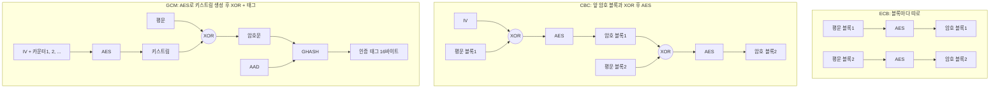
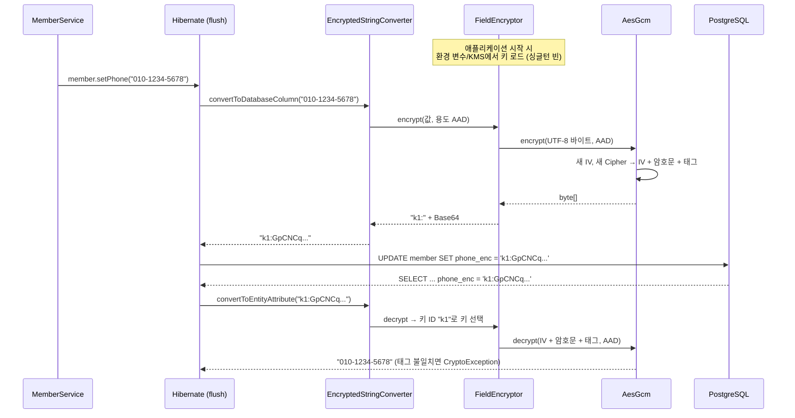
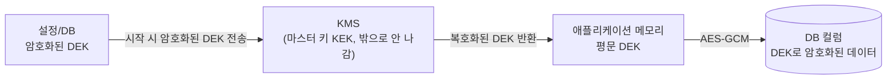

# 대칭키 암호화

관련 문서: [예제](./대칭키암호화-예제.md) · [해시](../해시/해시-이론.md)

> 암호화 시리즈 2/3. 이전 주제: [해시](../해시/해시-이론.md) → 다음 주제: [비대칭키 암호화](../비대칭키암호화/비대칭키암호화-이론.md)

---

## 1. 한 줄 요약

대칭키 암호화는 하나의 비밀 키로 데이터를 알아볼 수 없게 바꾸고, 같은 키로 다시 원래 데이터를 되돌리는 방식이다.
정확히는 암호화 키와 복호화 키가 같은 암호 체계이며, 실무 표준은 블록 암호 AES를 인증 암호화 모드 GCM으로 운용하는 AES-GCM이다.

---

## 2. 왜 필요한가

[해시](../해시/해시-이론.md)는 원문을 되돌릴 수 없다. 그런데 **원문이 다시 필요한 데이터**가 있다.

- 고객센터가 전화를 걸어야 하는 **전화번호**, 송금에 쓰는 **계좌번호**
- 외부 API를 호출할 때 실어 보내야 하는 **API 키, OAuth 리프레시 토큰**
- 법령상 암호화 저장 의무가 있는 **주민등록번호 등 고유식별정보** (개인정보의 안전성 확보조치 기준. 대상 범위는 확인 필요)

이런 데이터를 평문으로 두면 SQL 인젝션, 백업 파일 유출, 운영자 실수 한 번으로 그대로 노출된다.

| 해법 | 한계 |
|---|---|
| 평문 저장 | DB·백업·로그가 새면 끝 |
| Base64로 "암호화" | 인코딩일 뿐이다. 키가 없으므로 누구나 디코드한다 |
| DB 디스크 암호화(TDE) | 디스크를 훔쳐 가는 경우만 막는다. DB 계정이나 SQL 인젝션으로 조회하면 평문이 나온다 |
| 직접 만든 XOR·치환 | 암호학적으로 검증되지 않았다. 대부분 쉽게 깨진다 |
| `Cipher.getInstance("AES")` | 표준 알고리즘이지만 기본 모드가 **ECB**라서 패턴이 드러난다(함정 1) |
| AES-CBC | 패턴은 숨기지만 **변조를 감지하지 못한다**(함정 5) |
| **AES-GCM** | 기밀성 + 무결성을 함께 보장한다. 현재 기본값 |

정리하면 "AES를 쓴다"만으로는 부족하다. **어떤 모드로, IV를 어떻게, 키를 어디에** 두는지가 안전성을 결정한다. 이 문서는 그 세 가지를 다룬다.

---

## 3. 최소 예제로 보기

```java
SecretKey key = KeyGenerator.getInstance("AES").generateKey(); // 실무에서는 init(256) 후 KMS·환경 변수에서 로드
byte[] plain = "010-1234-5678".getBytes(UTF_8);

byte[] iv = new byte[12];
new SecureRandom().nextBytes(iv);                 // 암호화할 때마다 새 IV
Cipher enc = Cipher.getInstance("AES/GCM/NoPadding");
enc.init(Cipher.ENCRYPT_MODE, key, new GCMParameterSpec(128, iv));
byte[] ct = enc.doFinal(plain);                   // 암호문 + 인증 태그 16바이트

Cipher dec = Cipher.getInstance("AES/GCM/NoPadding");
dec.init(Cipher.DECRYPT_MODE, key, new GCMParameterSpec(128, iv)); // 같은 키, 같은 IV
System.out.println(new String(dec.doFinal(ct), UTF_8));
```

예제 문서의 `AesGcm` 클래스(위 코드에 "IV를 앞에 붙여 저장"을 더한 것)로 실제 실행한 결과:

```
평문 13바이트 → 저장 41바이트 (IV 12 + 암호문 13 + 태그 16)
1회차: 6862d994e4e691dc12356275492c50be40b1b1a3f55ac0710676b7a2899c80a592c2be97052941c95d
2회차: fed5108a4feb25ec8c7287820c0829ea9a1db9bca695bd511b98c2b8ae11c33f83684551fbde9376b8
같은 평문인데 암호문이 같은가? false
복호화: 010-1234-5678
```

여기서 봐야 할 것 세 가지:

1. **같은 키, 같은 평문인데 암호문이 다르다.** IV가 매번 랜덤이기 때문이다. 그래서 암호문만 보고 "두 사람의 전화번호가 같다"는 사실도 알 수 없다.
2. **저장 크기 = IV 12 + 평문 길이 + 태그 16.** IV와 태그는 복호화할 때 필요하므로 암호문과 함께 저장한다. IV는 비밀이 아니다.
3. **복호화에는 키와 IV가 둘 다 필요하다.** 키만 비밀이면 된다. 즉 보안은 전부 **키 관리**에 달려 있다.

---

## 4. 핵심 개념

| 용어 | 영문 | 설명 |
|---|---|---|
| 대칭키 | Symmetric Key | 암호화와 복호화에 같은 키를 쓴다. AES 키는 16·24·32바이트(128·192·256비트) |
| 블록 암호 | Block Cipher | 고정 크기 블록 하나를 같은 크기로 바꾸는 함수. AES는 16바이트 블록 |
| 운영 모드 | Mode of Operation | 블록 암호로 여러 블록(임의 길이 데이터)을 처리하는 규칙. ECB·CBC·CTR·GCM |
| 초기화 벡터 / 논스 | IV (Initialization Vector) / Nonce | 같은 키로 같은 평문을 암호화해도 결과가 달라지게 하는 값. 비밀은 아니지만 **재사용하면 안 된다** |
| 패딩 | Padding | 평문을 블록 크기의 배수로 맞추려고 덧붙이는 바이트. ECB·CBC에 필요, GCM은 불필요 |
| 인증 암호화 | AEAD (Authenticated Encryption with Associated Data) | 암호화와 변조 검증을 한 번에 하는 방식. GCM, ChaCha20-Poly1305 |
| 인증 태그 | Authentication Tag | AEAD가 만드는 검증값(GCM은 보통 16바이트). 하나라도 바뀌면 복호화가 실패한다 |
| 추가 인증 데이터 | AAD (Additional Authenticated Data) | 암호화하지는 않지만 태그 계산에 포함하는 데이터. 암호문을 특정 맥락(행 ID, 용도)에 묶는다 |

---

## 5. 동작 원리와 흐름

### 5-1. AES 자체는 16바이트 하나만 처리한다

AES는 "키 + 16바이트 → 16바이트" 변환이다. 같은 키, 같은 16바이트 입력이면 **항상 같은 출력**이 나온다. 그래서 16바이트보다 긴 데이터를 어떻게 나눠서 처리할지, 같은 입력이 같은 출력이 되는 성질을 어떻게 숨길지를 **운영 모드**가 결정한다.

### 5-2. 운영 모드: ECB → CBC → GCM



1. **ECB (Electronic Codebook)**: 블록마다 독립적으로 AES를 돌린다. 평문에서 같은 16바이트가 반복되면 **암호문에서도 같은 16바이트가 반복된다**. 실측에서 `ACCOUNT=12345678`을 두 번 이어 붙여 암호화하니 블록1과 블록2가 `89d80d4b05db95f1e566a1773ae7a45f`로 똑같았다. 또 IV가 없으므로 같은 평문 전체는 항상 같은 암호문이 된다.
2. **CBC (Cipher Block Chaining)**: 각 평문 블록을 직전 암호 블록(첫 블록은 IV)과 XOR한 뒤 AES를 돌린다. 패턴은 사라지지만 두 가지 약점이 있다.
   - 복호화는 `평문 = AES⁻¹(암호 블록) XOR 직전 블록`이다. 공격자가 **IV(또는 직전 블록)의 비트를 뒤집으면 평문의 같은 위치 비트가 그대로 뒤집힌다.** 무결성 검사가 없으므로 예외 없이 조작된 평문이 나온다(실측: `amount=1000` → `amount=9000`).
   - 마지막 블록의 패딩이 올바른지에 따라 에러가 달라지면, 그 차이를 이용해 평문을 알아내는 패딩 오라클 공격(padding oracle attack)이 가능하다.
3. **GCM (Galois/Counter Mode)**: `AES(키, IV‖카운터)`로 키스트림(keystream)을 만들어 평문과 XOR한다(CTR 모드). 그리고 암호문과 AAD를 GHASH로 묶어 **인증 태그**를 만든다.
   - 패딩이 필요 없다. 암호문 길이 = 평문 길이.
   - 복호화할 때 태그를 먼저 검증하고, 맞지 않으면 평문을 하나도 돌려주지 않는다(`AEADBadTagException: Tag mismatch`). CBC의 비트 뒤집기와 패딩 오라클이 모두 막힌다.
   - 대가: **같은 키로 같은 IV를 두 번 쓰면** 같은 키스트림이 나온다. 그러면 `c1 XOR c2 = p1 XOR p2`가 되므로 평문 하나를 아는 공격자는 다른 평문을 그대로 복원한다(실측: 자기 연봉 `03000000`을 아는 사람이 남의 연봉 `09500000`을 키 없이 복원). 태그 위조 키(GHASH 키)까지 노출될 수 있다.

### 5-3. Java에서 한 번 암호화할 때 일어나는 일

1. `Cipher.getInstance("AES/GCM/NoPadding")`: 등록된 Provider(기본 SunJCE)에서 구현체를 찾아 **새 Cipher 객체**를 만든다. 변환 문자열(transformation)을 `"AES"`처럼 알고리즘만 적으면 **Provider 기본 모드**가 쓰인다. SunJCE는 `AES/ECB/PKCS5Padding`이다.
2. `init(ENCRYPT_MODE, key, GCMParameterSpec(128, iv))`: 키 길이를 검사하고(16·24·32바이트가 아니면 `InvalidKeyException`), 키 스케줄과 IV로 내부 상태를 초기화한다.
3. `updateAAD(aad)`: AAD를 태그 계산에 넣는다. 암호문 처리 전에 호출해야 한다.
4. `doFinal(plain)`: 암호화하고 태그를 붙여 반환한다. 반환 후 Cipher는 같은 키·IV로는 다시 암호화할 수 없는 상태가 된다(재사용 방지, 6장).
5. 호출자가 `IV + 암호문 + 태그`를 하나로 묶어 저장한다. 문자열 컬럼이면 Base64로 인코딩한다.

**객체 생명주기**

| 객체 | 생명주기 | 이유 |
|---|---|---|
| `SecretKey` | 애플리케이션 시작 시 한 번 로드, 싱글턴 | 불변이라 공유해도 안전. 매번 KMS를 호출하면 느리다 |
| `SecureRandom` | static 공유 | 스레드 안전하다 |
| `Cipher` | **호출마다 새로 생성** | init~doFinal 사이의 상태를 가진다. 공유하면 섞인다(함정 6) |
| IV | 암호화할 때마다 새로 생성, 암호문과 함께 저장 | 재사용하면 GCM이 무너진다(함정 2) |

### 5-4. Spring + JPA 계층에서의 흐름 (컬럼 암호화)



- 엔티티 필드에는 평문이, DB 컬럼에는 암호문이 있다. 서비스 코드는 암호화를 의식하지 않는다.
- 저장값 앞의 **키 ID(`k1:`)**가 있어야 나중에 키를 바꿔도 예전 데이터를 읽을 수 있다. [해시의 `{bcrypt}` 접두어](../해시/해시-이론.md#6-내부-구현-핵심만)와 같은 발상이다.
- AttributeConverter는 **어느 행인지 모른다.** 그래서 AAD에 행 ID를 넣을 수 없고, 용도 문자열 정도만 넣을 수 있다.

### 5-5. 키는 어디에 두는가

키가 암호문과 같은 곳(DB, 같은 저장소의 설정 파일)에 있으면 암호화한 의미가 없다. 수준별로 다음과 같다.

1. **환경 변수 / 시크릿 저장소**(Kubernetes Secret, Vault 등)에 Base64 키를 두고 시작할 때 읽는다. 소스·Git에는 없다.
2. **KMS 봉투 암호화(envelope encryption)**: 데이터는 데이터 키(DEK, Data Encryption Key)로 암호화하고, DEK는 KMS 안에서만 존재하는 마스터 키(KEK, Key Encryption Key)로 암호화해서 저장한다. 앱은 시작할 때 KMS에 "암호화된 DEK"를 보내 평문 DEK를 받아 메모리에만 둔다. 마스터 키는 KMS 밖으로 나오지 않는다.



---

## 6. 내부 구현 (핵심만)

| 클래스·메서드 | 그래서 생기는 동작 |
|---|---|
| `Cipher.getInstance(String)` | `"알고리즘/모드/패딩"` 중 모드·패딩을 생략하면 Provider 기본값을 쓴다. SunJCE의 `"AES"`는 `AES/ECB/PKCS5Padding`이다(실측으로 두 결과가 같았다). 정적 분석 도구가 `Cipher.getInstance("AES")`를 경고하는 이유다 |
| `Cipher` 인스턴스 상태 | `init`이 내부 상태(키 스케줄, IV, 버퍼)를 만들고 `doFinal`이 마무리한다. 공유하면 다른 스레드의 `init`이 끼어든다. 실측 결과 8스레드에서 16만 번 중 틀린 결과 26,684건, 예외 69,312건이었다 |
| GCM 암호화의 IV 재사용 검사 | SunJCE는 **같은 Cipher 객체**에서 직전과 같은 키·IV로 다시 암호화하려 하면 `InvalidAlgorithmParameterException: Cannot reuse iv for GCM encryption`을 던진다. **새 Cipher 객체를 만들면 검사하지 않는다.** 고정 IV 상수, 서버 재시작, 여러 인스턴스에서 생기는 재사용은 JDK가 막지 못한다 |
| GCM 복호화 버퍼링 | SunJCE GCM 복호화는 태그를 검증하기 전에 평문을 내보내지 않으려고 `doFinal`까지 **암호문 전체를 메모리에 모은다**. 그래서 `update()`가 빈 배열을 돌려주고, 수 GB 파일을 한 번에 GCM으로 복호화하면 메모리가 터진다(9-4) |
| `SecretKeySpec` | 생성자는 키 길이를 검사하지 않는다. 13바이트 문자열로도 객체는 만들어지고, `init` 시점에 `InvalidKeyException: Invalid AES key length: 13 bytes`가 난다. 이 에러를 없애려고 문자열을 잘라 붙이는 코드가 함정 3으로 이어진다 |
| `AEADBadTagException` | `BadPaddingException`의 하위 클래스다. 키가 틀렸든, 암호문이 변조됐든, AAD가 다르든 **같은 예외**가 난다. 원인을 구분할 수 없는 것이 정상이다(구분되면 공격자에게 힌트가 된다) |

---

## 7. 유사 개념과의 비교

### 7-1. 운영 모드

| 모드 | 패턴 숨김 | 변조 감지 | IV 재사용 시 | 패딩 | 판단 |
|---|---|---|---|---|---|
| ECB | ✗ | ✗ | (IV 없음) | 필요 | **쓰지 않는다** |
| CBC | ✓ | ✗ | 같은 앞부분이 노출된다 | 필요 | 레거시 호환용. 단독 사용 금지 |
| CBC + HMAC (Encrypt-then-MAC) | ✓ | ✓ | 같은 앞부분이 노출된다 | 필요 | Java 7 등 GCM이 없는 환경의 대안. 구현 실수 여지가 크다 |
| CTR | ✓ | ✗ | **평문 XOR 노출** | 불필요 | 단독 사용 금지 |
| **GCM** | ✓ | ✓ | **평문 노출 + 위조 가능** | 불필요 | **기본 선택**. IV는 12바이트 랜덤, 한 키로 2^32회 이내 암호화 |
| ChaCha20-Poly1305 | ✓ | ✓ | GCM과 같음 | 불필요 | AES 하드웨어 가속(AES-NI)이 없는 환경. Java 11+ |

### 7-2. 다른 보호 수단과 비교

| 구분 | 원문 복원 | 키 | 쓰는 곳 |
|---|---|---|---|
| [해시 / 비밀번호 해시](../해시/해시-이론.md) | 불가 | 없음(HMAC은 키) | 비밀번호, 무결성, 검색용 인덱스 |
| **대칭키 암호화(AES-GCM)** | 키로 가능 | 양쪽이 같은 키 | 개인정보 컬럼, 파일, 외부 API 토큰 저장 |
| 비대칭키 암호화(RSA, ECC) | 개인키로 가능 | 공개키·개인키 쌍 | 키 교환, 전자서명. 대용량 데이터에는 느려서 쓰지 않는다 |
| DB TDE / 디스크 암호화 | DB가 자동 복호화 | DB·OS가 관리 | 물리 매체 도난 대비. SQL로 조회하는 공격은 못 막는다 |
| PostgreSQL pgcrypto `pgp_sym_encrypt` | 가능 | **SQL에 키를 실어 보낸다** | 키가 쿼리 로그·`pg_stat_statements`에 남을 수 있다. 애플리케이션 암호화를 우선한다 |

### 7-3. 구현 수단

| 수단 | 특징 | 언제 |
|---|---|---|
| JCA `Cipher` 직접 사용 | 모든 걸 통제하지만 IV·형식·키 ID를 직접 설계해야 한다 | 이 문서와 예제의 방식. 원리를 알아야 할 때 |
| Spring Security `Encryptors.stronger` / `delux` | 비밀번호 + salt에서 PBKDF2로 키를 유도하고 AES-GCM을 쓴다(실측: 16바이트 IV + 태그). `standard` / `text`는 **CBC**다 | 간단한 설정값 암호화. 키 ID·키 교체 기능은 없다 |
| Google Tink | IV 생성, 키 ID 접두어, 키 교체(keyset)를 라이브러리가 처리한다. 잘못 쓰기 어렵게 설계됐다 | 새 시스템에서 직접 구현을 피하고 싶을 때 |
| 클라우드 KMS 직접 암호화 | 키가 앱에 오지 않는다. 호출마다 네트워크 왕복과 요금이 발생한다 | 소량·고가치 데이터, 또는 DEK 암호화(5-5) |

**고르는 기준**
1. 원문이 다시 필요한가? → 아니오: 해시. 예: 계속.
2. 새로 만드는가? → **AES-256-GCM**, IV 12바이트 랜덤, 저장 형식에 키 ID를 포함한다.
3. 상대 시스템이 CBC만 지원하는가? → CBC + HMAC-SHA256(Encrypt-then-MAC). 검증에 실패하면 패딩 에러와 구분되지 않는 같은 응답을 준다.
4. 검색해야 하는가? → 암호문으로는 검색할 수 없다. 별도로 HMAC 블라인드 인덱스를 둔다(함정 7).

---

## 8. 함정과 안티패턴

### 함정 1. `Cipher.getInstance("AES")` — 모드를 안 적었다

- **증상**: 같은 값을 넣으면 DB에 항상 같은 암호문이 저장된다. 같은 전화번호를 쓰는 회원끼리 암호문이 같고, 긴 데이터에서는 16바이트 단위로 반복 패턴이 보인다. 보안 점검 도구가 "ECB 모드 사용"으로 지적한다.
- **원인**: 모드를 생략하면 SunJCE 기본값인 ECB가 쓰인다(6장). ECB는 IV가 없고 블록을 독립적으로 처리하므로 같은 입력 → 같은 출력이다(5-2).
- **해결**: 항상 `"AES/GCM/NoPadding"`처럼 변환 문자열을 전부 적는다. 기존 ECB 데이터는 키 ID를 붙인 새 형식으로 재암호화한다(9-2).

### 함정 2. IV를 고정하거나 재사용한다

- **증상**: `new byte[16]`(전부 0)이나 상수 IV를 쓰고 있다. CBC라면 같은 접두어를 가진 평문끼리 암호문 앞부분이 같다. GCM이라면 겉으로는 아무 증상이 없다가 **유출되는 순간 평문이 복원된다**.
- **원인**: IV의 역할은 같은 키·같은 평문이 같은 암호문이 되지 않게 하는 것이다(4장). GCM은 CTR 기반이라 IV가 같으면 키스트림이 같고, `c1 XOR c2 = p1 XOR p2`가 된다(5-2). JDK는 같은 Cipher 객체에서의 재사용만 막고, 새 객체로 같은 IV를 쓰는 것은 막지 않는다(6장).
- **해결**: 암호화할 때마다 `SecureRandom`으로 12바이트 IV를 새로 만들고 암호문 앞에 붙여 저장한다. 카운터 기반 IV는 서버 재시작과 다중 인스턴스에서 중복되기 쉬우므로 쓰지 않는다. 랜덤 96비트 IV는 같은 키로 2^32번 암호화하기 전까지 안전하므로, 그보다 많으면 키를 교체한다.

### 함정 3. 키를 문자열로, 소스 코드에 둔다

- **증상**: `"my-secret-key"`를 키로 쓰다가 `InvalidKeyException: Invalid AES key length: 13 bytes`가 나자, 문자열을 16글자로 맞추거나 `Arrays.copyOf(key, 16)`으로 자른다. 이 키가 Git 이력에 남아 있고, 바꾸면 기존 데이터를 못 읽으니 몇 년째 같은 키를 쓴다.
- **원인**: AES 키는 정확히 16·24·32바이트의 **난수**여야 한다(4장, 6장). 사람이 고른 문자열은 엔트로피가 낮고, 소스에 있으면 저장소 접근 권한이 곧 복호화 권한이다. 저장 형식에 키 ID가 없으면 어떤 키로 암호화했는지 알 수 없어서 키를 교체할 수 없다(5-4).
- **해결**: `KeyGenerator.init(256)`으로 만든 키를 Base64로 시크릿 저장소나 KMS에 둔다(5-5). 저장 형식에 `키ID:`를 넣는다. 반드시 비밀번호(passphrase)에서 키를 만들어야 한다면 `PBKDF2WithHmacSHA256` 같은 키 유도 함수(KDF, Key Derivation Function)를 salt와 함께 쓴다.

### 함정 4. 암호문을 `new String(bytes)`로 저장한다

- **증상**: 암호화는 되는데 복호화에서 `IllegalBlockSizeException: Input length must be multiple of 16 when decrypting with padded cipher` 또는 `BadPaddingException`이 난다. 어떤 값은 되고 어떤 값은 안 된다.
- **원인**: 암호문은 임의의 바이트다. UTF-8로 해석할 수 없는 바이트는 `new String()`에서 U+FFFD(�)로 바뀌어 원래 값이 사라진다. 실측에서 16바이트 암호문이 문자열을 거쳐 26바이트가 됐다.
- **해결**: 문자열 컬럼에는 **Base64**(또는 hex)로 인코딩해서 저장한다. PostgreSQL이면 `bytea`, Oracle이면 `RAW`/`BLOB`으로 바이트 그대로 저장할 수도 있다. 평문 ↔ 바이트 변환에는 항상 `StandardCharsets.UTF_8`을 쓴다.

### 함정 5. CBC만 쓰고 무결성 검증을 하지 않는다

- **증상**: 암호화된 쿠키나 토큰을 조작했는데 서버가 예외 없이 받아들이고, 조작된 값대로 동작한다. 또는 보안 점검에서 패딩 오라클 취약점이 나온다.
- **원인**: CBC 복호화는 IV(또는 직전 블록)와 XOR하므로, 그 비트를 뒤집으면 평문 비트가 그대로 뒤집힌다(5-2). 실측에서 IV 한 바이트를 바꿨더니 `amount=1000;to=A`가 `amount=9000;to=A`로 복호화됐다. **암호화는 기밀성만 보장하고 무결성은 보장하지 않는다.**
- **해결**: GCM 같은 AEAD를 쓴다. 같은 조작에 대해 GCM은 `AEADBadTagException: Tag mismatch`로 거부했다. CBC를 유지해야 하면 암호문 전체(IV 포함)에 HMAC을 붙이고, 복호화 전에 상수 시간으로 검증한다([해시 함정 5](../해시/해시-이론.md#함정-5-서명토큰을-stringequals로-비교한다)).

### 함정 6. `Cipher`를 필드로 공유한다

- **증상**: 부하 테스트나 운영 피크 시간에만 예외가 섞여 나거나, 예외 없이 틀린 값이 나온다. 실측(ECB 공유)에서 나온 예외는 `BadPaddingException: Given final block not properly padded`, `IllegalBlockSizeException`, `IllegalStateException: Cipher not initialized`, `ArrayIndexOutOfBoundsException` 순으로 많았다. 메시지가 "bad key"를 암시해서 키 문제로 오진하기 쉽다.
- **원인**: Cipher는 init~doFinal 사이의 상태를 가진다(5-3, 6장). 싱글턴 빈의 필드나 static에 두면 여러 요청 스레드가 같은 상태를 덮어쓴다. 실측에서 16만 번 중 60%가 실패했다.
- **해결**: 호출마다 `Cipher.getInstance()`로 새로 만든다. 1KB 암호화 10만 번에 159ms(약 610MB/s)로, 생성 비용을 포함해도 충분히 빠르다. 공유해도 되는 것은 `SecretKey`와 `SecureRandom`이다. [해시의 `MessageDigest` 공유 문제](../해시/해시-이론.md#함정-3-messagedigest를-static-필드로-공유)와 같은 원인이다.

### 함정 7. 암호화한 컬럼으로 검색한다

- **증상**: `memberRepository.findByPhone("010-1234-5678")`이 항상 빈 결과를 돌려준다. `LIKE '%5678'`, `ORDER BY phone`, `UNIQUE(phone)`이 의미 없게 동작한다.
- **원인**: Hibernate는 쿼리 파라미터에도 Converter를 적용한다. 그런데 GCM은 IV가 랜덤이라 같은 평문을 다시 암호화하면 다른 값이 된다(3장). 저장된 암호문과 절대 같아지지 않는다. 이를 피하려고 IV를 고정하는 "결정적 암호화"를 하면 함정 2가 된다.
- **해결**: 검색용 컬럼을 따로 둔다. 정규화한 값의 **HMAC-SHA256**(별도 키)을 저장하고 그 컬럼으로 등치 검색한다(블라인드 인덱스, [해시 9-4](../해시/해시-이론.md#9-4-개인정보-검색용-해시-blind-index)). 부분 검색이 필요하면 "뒤 4자리 HMAC"처럼 필요한 형태만 별도 인덱스로 만든다. 정렬·범위 검색은 암호화와 양립하기 어려우므로 요구사항 단계에서 조정한다.

---

## 9. 실무 적용 시나리오

### 9-1. JPA 엔티티 개인정보 컬럼 암호화 (Spring Boot 3 + PostgreSQL)

```java
@Entity
public class Member {

    @Id
    @GeneratedValue(strategy = GenerationType.IDENTITY)
    private Long id;

    @Convert(converter = EncryptedStringConverter.class)
    @Column(name = "phone_enc", length = 255)
    private String phone;

    // 검색용 블라인드 인덱스. HMAC 키는 암호화 키와 다른 키를 쓴다.
    @Column(name = "phone_hash", length = 64)
    private String phoneHash;

    public void changePhone(String phone, BlindIndexer indexer) {
        this.phone = phone;
        this.phoneHash = indexer.index(phone);
    }
}
```

```sql
-- PostgreSQL
CREATE TABLE member (
    id         BIGSERIAL    PRIMARY KEY,
    -- "k1:" + Base64(12 + 평문 + 16). 13자 전화번호면 59자. 긴 값·키 ID 변경을 고려해 여유 있게.
    phone_enc  VARCHAR(255),
    phone_hash CHAR(64)
);
CREATE INDEX idx_member_phone_hash ON member (phone_hash);
-- Oracle: id NUMBER GENERATED BY DEFAULT AS IDENTITY, VARCHAR2(255), CHAR(64)
```

- `EncryptedStringConverter`는 Spring Boot가 Hibernate에 Spring 빈 컨테이너를 연결해 주므로 생성자 주입을 받을 수 있다(예제 문서 참고).
- 조회는 `findByPhoneHash(indexer.index(input))`로 한다(함정 7).
- [JPA 엔티티 설계] 학습 내용과 연결하면, 암호화는 **엔티티 경계 안**(Converter)에서 끝나므로 서비스·컨트롤러는 평문만 다룬다. 반대로 로그나 `toString()`에 평문이 찍히지 않도록 엔티티 `toString()`에서 이 필드는 빼야 한다.

### 9-2. 키 교체 (key rotation)

1. 새 키 `k2`를 추가하고 활성 키를 `k2`로 바꿔 배포한다. 이제 새로 쓰는 값은 `k2:`로 저장된다. `k1`은 복호화용으로 남겨 둔다.
2. 배치로 `phone_enc LIKE 'k1:%'`인 행을 읽어 복호화하고 `k2`로 다시 암호화한다(`needsReEncryption`). 대량이면 청크 단위로 커밋한다.
3. `k1:` 행이 0건인 것을 확인한 뒤 `k1`을 키 목록에서 제거한다. 너무 일찍 제거하면 남은 데이터는 영원히 읽을 수 없다(예제 테스트 `removedKey`).

### 9-3. 외부 API 자격증명·OAuth 리프레시 토큰 저장

[해시 9-3](../해시/해시-이론.md#9-3-리프레시-토큰api-키를-db에-저장)은 **우리 서버가 발급한 토큰**을 검증용으로 저장하는 경우라 해시로 충분했다. 반대로 **우리가 외부에 보내야 하는 토큰**(사용자가 연동한 외부 서비스의 리프레시 토큰, 파트너사 API 키)은 원문이 필요하므로 AES-GCM으로 저장한다. AAD에 `"oauth:" + 사용자ID`를 넣으면 다른 사용자 행으로 옮긴 토큰은 복호화되지 않는다.

### 9-4. 파일·대용량 데이터 암호화

- GCM 복호화는 태그 검증 전까지 전체를 메모리에 모은다(6장). 수백 MB 이상의 파일은 **일정 크기(예: 1MB) 청크마다 별도 IV로 GCM 암호화**하고, 청크 순서·마지막 청크 여부를 AAD에 넣어 순서 바꾸기·잘라내기를 막는다. 직접 설계하기보다 Tink의 Streaming AEAD 같은 검증된 구현을 쓰는 편이 안전하다. 세부 설계는 심화에서 다룬다.
- S3 등 오브젝트 스토리지의 서버 측 암호화(SSE-KMS)는 디스크 암호화와 같은 범주다. 버킷 권한이 있는 사람에게는 평문이 보인다.

---

## 10. 버전 주의사항

| 버전 | 변화 | 고칠 코드 |
|---|---|---|
| Java 8 | SunJCE에 AES-GCM(`GCMParameterSpec`)이 추가됐다 | Java 7 코드베이스에는 GCM이 없다. CBC + HMAC(Encrypt-then-MAC) 또는 BouncyCastle을 쓴다 |
| Java 8u161 (8u151에서 설정 도입), Java 9+ | 무제한 암호 정책(unlimited crypto policy)이 기본값이 됐다 | 그 이전 Java 8에서는 AES-256 `init`이 `InvalidKeyException: Illegal key size`로 실패했다. 오래된 8 버전 서버에서만 AES-256이 실패한다면 JDK 업데이트나 정책 파일을 확인한다 |
| Java 11 (JEP 329) | ChaCha20-Poly1305가 추가됐다 | 고칠 코드는 없다. AES 하드웨어 가속이 없는 환경의 선택지가 생겼다 |
| Spring Boot 3 (Jakarta EE 9+) | `javax.persistence.AttributeConverter` → `jakarta.persistence.AttributeConverter` | Boot 2 → 3으로 올릴 때 Converter의 import를 바꿔야 한다 |

---

## 11. 자가 점검 질문

1. `Cipher.getInstance("AES")`로 암호화하면 같은 전화번호를 가진 두 회원의 암호문이 같아지는 이유는 무엇인가?
2. IV는 비밀이 아닌데도 암호문과 함께 저장해도 되는 이유와, 재사용하면 안 되는 이유는 각각 무엇인가?
3. AES-CBC로 암호화한 `amount=1000` 쿠키를 공격자가 키 없이 `amount=9000`으로 바꿀 수 있는 원리는 무엇이고, GCM은 이를 어떻게 막는가?
4. `@Convert`로 암호화한 `phone` 필드에 대해 `findByPhone()`이 항상 빈 결과를 돌려주는 이유와 해결책은?
5. 저장 형식에 키 ID(`k1:`)를 넣지 않으면 키를 교체할 때 어떤 문제가 생기는가?

<details>
<summary>답 보기</summary>

1. 모드를 생략하면 SunJCE 기본값인 ECB(`AES/ECB/PKCS5Padding`)가 쓰인다. ECB는 IV 없이 블록마다 독립적으로 AES를 적용하므로, 같은 키·같은 평문이면 항상 같은 암호문이 나온다.
2. IV는 "같은 키·같은 평문이 같은 암호문이 되지 않게" 하는 값이라 비밀일 필요가 없고, 복호화에 필요하므로 함께 저장한다. 하지만 GCM은 `AES(키, IV‖카운터)`로 키스트림을 만들어 XOR하므로, IV가 같으면 키스트림이 같아져 `c1 XOR c2 = p1 XOR p2`가 된다. 평문 하나를 아는 공격자는 다른 평문을 복원하고, 태그 위조까지 가능해진다.
3. CBC 복호화는 `AES⁻¹(암호 블록) XOR 직전 블록(첫 블록은 IV)`이다. IV의 해당 바이트를 `'1' XOR '9'`로 뒤집으면 평문의 같은 위치가 `1`→`9`로 바뀐다. CBC에는 무결성 검사가 없어서 예외 없이 조작된 평문이 나온다. GCM은 암호문과 AAD로 인증 태그를 계산해 두고, 복호화할 때 태그가 맞지 않으면 평문을 돌려주지 않고 `AEADBadTagException`을 던진다.
4. Hibernate가 쿼리 파라미터에도 Converter를 적용해 암호화하는데, GCM은 IV가 랜덤이라 같은 평문도 매번 다른 암호문이 된다. 그래서 저장값과 같아질 수 없다. 별도 키로 계산한 HMAC 블라인드 인덱스 컬럼을 두고 그 컬럼으로 검색한다.
5. 어떤 데이터가 어떤 키로 암호화됐는지 알 수 없으므로, 새 키를 도입하는 순간 예전 데이터를 복호화할 수 없거나 모든 키를 하나씩 시도해야 한다. 그래서 키를 교체하지 못하고 유출된 키를 계속 쓰게 된다. 키 ID가 있으면 예전 키는 복호화용으로 남겨 두고 새 키로 점진적으로 재암호화할 수 있다.

</details>

---

## 12. 참고 자료

- FIPS 197 — Advanced Encryption Standard (AES)
- NIST SP 800-38A — 블록 암호 운영 모드(ECB, CBC, CTR 등)
- NIST SP 800-38D — GCM (IV 길이, 한 키당 암호화 횟수 제한)
- RFC 8439 — ChaCha20 and Poly1305
- Java Cryptography Architecture (JCA) Reference Guide — `Cipher`, Provider, 변환 문자열
- Java Security Standard Algorithm Names — `Cipher` 변환 문자열 목록
- JEP 329 — ChaCha20 and Poly1305 Cryptographic Algorithms (Java 11)
- OWASP Cryptographic Storage Cheat Sheet — 알고리즘·모드·키 관리 권장 사항
- Google Tink 문서 — AEAD, Streaming AEAD, keyset 교체
- Spring Security Reference — Spring Security Crypto Module (`Encryptors`)
- 개인정보의 안전성 확보조치 기준(개인정보보호위원회 고시) — 암호화 대상과 방식(세부 조항 확인 필요)

---

## 부록: 용어 정리

| 용어 | 영문 | 설명 |
|---|---|---|
| 대칭키 암호화 | Symmetric-key Encryption | 암호화와 복호화에 같은 키를 쓰는 방식 |
| 블록 암호 | Block Cipher | 고정 크기 블록을 같은 크기로 바꾸는 함수. AES는 16바이트 |
| AES | Advanced Encryption Standard | 현재 표준 블록 암호. 키는 128·192·256비트 |
| GCM | Galois/Counter Mode | CTR 암호화에 GHASH 인증 태그를 더한 AEAD 모드 |
| 고유식별정보 | Unique Identification Information | 주민등록번호 등 법령으로 암호화 저장이 요구되는 정보 |
| TDE | Transparent Data Encryption | DB가 디스크에 쓸 때 자동으로 암호화하는 기능 |
| ECB | Electronic Codebook | 블록마다 독립적으로 암호화하는 모드. 패턴이 드러난다 |
| CBC | Cipher Block Chaining | 직전 암호 블록과 XOR 후 암호화하는 모드. 무결성 없음 |
| 운영 모드 | Mode of Operation | 블록 암호로 임의 길이 데이터를 처리하는 규칙 |
| 초기화 벡터 / 논스 | IV (Initialization Vector) / Nonce | 같은 평문도 다른 암호문이 되게 하는 값. 비밀은 아니지만 재사용 금지 |
| 패딩 | Padding | 평문을 블록 크기 배수로 맞추려 덧붙이는 바이트 |
| AEAD | Authenticated Encryption with Associated Data | 암호화와 변조 검증을 함께 하는 방식 |
| 인증 태그 | Authentication Tag | AEAD가 만드는 검증값. 불일치하면 복호화 실패 |
| AAD | Additional Authenticated Data | 암호화하지 않지만 태그에 포함해 암호문을 맥락에 묶는 데이터 |
| 패딩 오라클 공격 | Padding Oracle Attack | 패딩 오류 응답 차이를 이용해 CBC 평문을 알아내는 공격 |
| 키스트림 | Keystream | CTR·GCM에서 AES로 만든 뒤 평문과 XOR하는 난수열 |
| CTR | Counter Mode | IV‖카운터를 암호화해 키스트림을 만드는 모드 |
| GHASH | GHASH | GCM에서 인증 태그를 계산하는 갈루아 체 곱셈 기반 함수 |
| 변환 문자열 | Transformation | `Cipher.getInstance`에 넘기는 `"알고리즘/모드/패딩"` 문자열 |
| Provider | Provider | JCA 알고리즘 구현을 제공하는 모듈. 기본은 SunJCE |
| 봉투 암호화 | Envelope Encryption | 데이터는 DEK로, DEK는 KMS의 마스터 키로 암호화하는 구조 |
| DEK | Data Encryption Key | 실제 데이터를 암호화하는 키 |
| KEK | Key Encryption Key | DEK를 암호화하는 마스터 키. KMS 밖으로 나오지 않는다 |
| KMS | Key Management Service | 키를 생성·보관하고 암복호화 API를 제공하는 서비스 |
| 키 교체 | Key Rotation | 새 키로 바꾸고 기존 데이터를 점진적으로 재암호화하는 작업 |
| 키 유도 함수 | KDF (Key Derivation Function) | 비밀번호 등에서 정해진 길이의 키를 만드는 함수. 예: PBKDF2 |
| 결정적 암호화 | Deterministic Encryption | 같은 평문이 항상 같은 암호문이 되는 암호화. 검색은 되지만 패턴이 노출된다 |
| 블라인드 인덱스 | Blind Index | 암호화 컬럼 검색용으로 따로 저장하는 키 기반 해시(HMAC) |
| AES-NI | AES New Instructions | AES 연산을 가속하는 CPU 명령어 |
| 무제한 암호 정책 | Unlimited Crypto Policy | 키 길이 제한을 없앤 JDK 암호 정책. 8u161부터 기본 |
| JEP | JDK Enhancement Proposal | JDK 기능 변경 제안 문서 |
