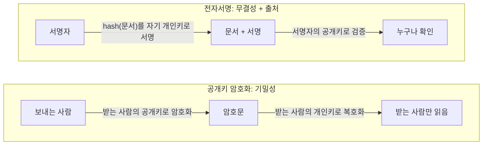
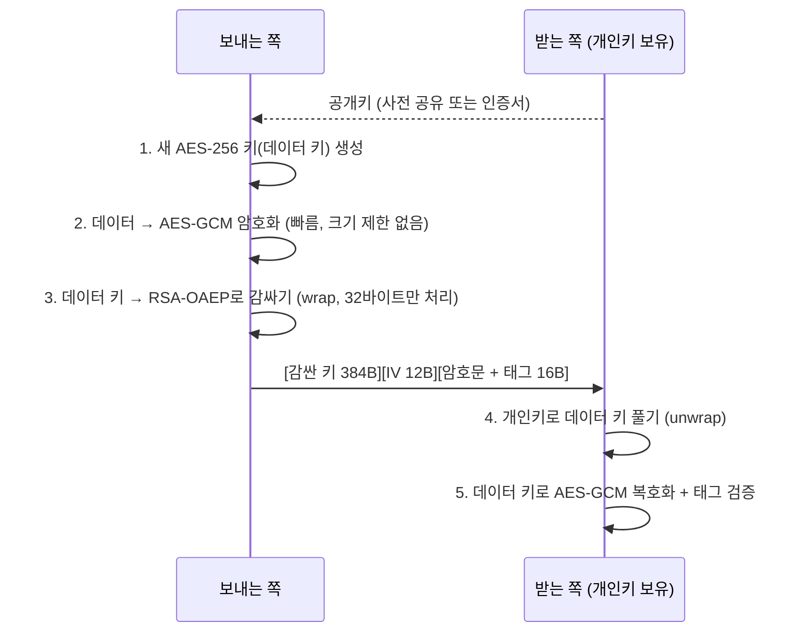
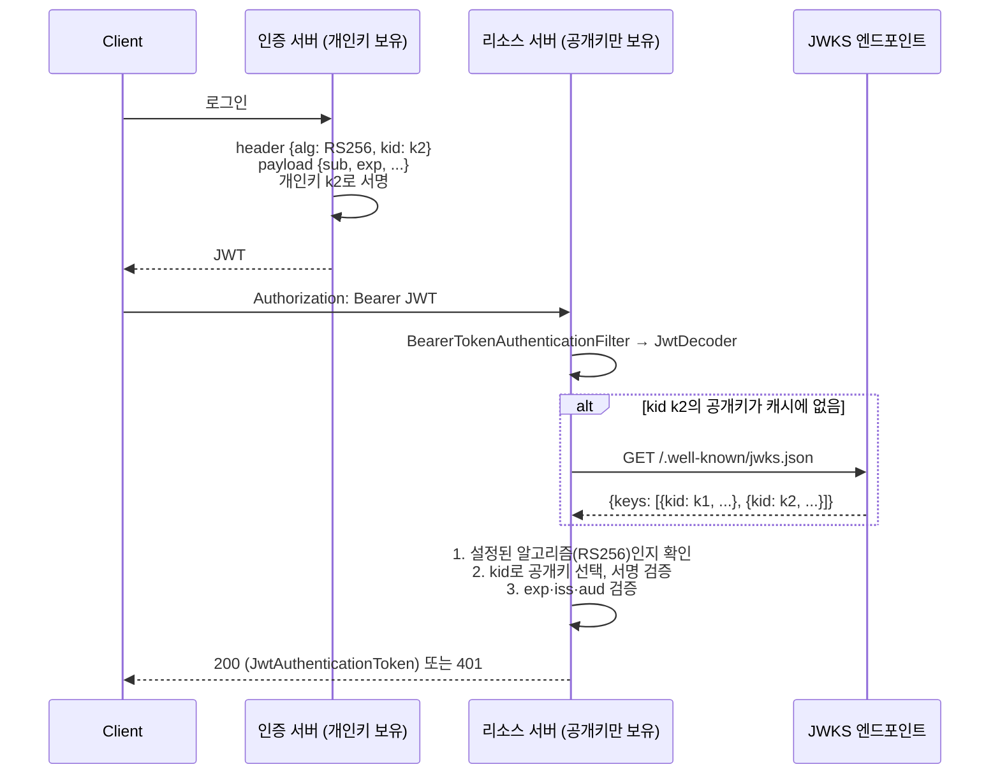

# 비대칭키 암호화

관련 문서: [예제](./비대칭키암호화-예제.md) · [해시](../해시/해시-이론.md) · [대칭키 암호화](../대칭키암호화/대칭키암호화-이론.md)

> 암호화 시리즈 3/3. 이전 주제: [해시](../해시/해시-이론.md) → [대칭키 암호화](../대칭키암호화/대칭키암호화-이론.md)

---

## 1. 한 줄 요약

비대칭키 암호화는 서로 짝을 이루는 두 개의 키를 만들어, 하나는 모두에게 공개하고 하나는 혼자만 갖는 방식이다. 공개한 키로 잠근 것은 숨긴 키로만 열리고, 숨긴 키로 만든 서명은 공개한 키로 누구나 확인할 수 있다.
정확히는 공개키(public key)와 개인키(private key) 쌍을 쓰는 암호 체계이며, **공개키 암호화**(기밀성)와 **전자서명**(무결성·인증·부인 방지)이라는 두 가지 용도가 있다. 대표 알고리즘은 RSA와 타원곡선 계열(ECDSA, Ed25519)이다.

---

## 2. 왜 필요한가

[대칭키 암호화](../대칭키암호화/대칭키암호화-이론.md)는 빠르고 안전하지만 두 가지를 해결하지 못한다.

**문제 1. 키를 처음에 어떻게 나눠 갖는가 (키 분배 문제, key distribution problem)**
AES 키를 상대에게 보내려면 안전한 통로가 필요한데, 그 통로를 만들려면 또 키가 필요하다. 참여자가 n명이면 쌍마다 키가 하나씩, 즉 n(n-1)/2개가 필요하다.

**문제 2. "누가 만들었는지" 증명할 수 없다**
[HMAC](../해시/해시-이론.md#5-4-hmac-키를-아는-사람만-만들-수-있는-해시)은 키를 아는 쪽이면 **누구나** 같은 값을 만들 수 있다. 검증하는 쪽도 서명을 만들 수 있다는 뜻이다.
JWT를 HS256으로 발급하면, 토큰을 검증해야 하는 모든 마이크로서비스가 같은 비밀 키를 가지므로 **어느 서비스든 토큰을 위조할 수 있다.** 서비스 하나만 털려도 전체 인증이 무너진다.

| 해법 | 한계 |
|---|---|
| 대칭키를 미리 사람이 전달 | 상대가 많거나 처음 만나는 상대(브라우저 ↔ 서버)에게는 불가능 |
| HMAC으로 서명 | 검증자도 서명을 만들 수 있다. 제3자에게 "이건 A가 만들었다"고 증명할 수 없다 |
| **공개키 암호화** | 공개키는 공개해도 된다. 받는 사람의 공개키로 잠그면 그 사람만 연다 → 키 분배 해결 |
| **전자서명** | 개인키를 가진 쪽만 서명할 수 있고, 검증자는 공개키만 가진다 → 검증자가 위조할 수 없다 |

대가는 **속도와 크기 제한**이다. 비대칭키 연산은 대칭키보다 수천 배 느리고, RSA는 키 길이보다 긴 데이터를 직접 암호화하지 못한다. 그래서 실무에서는 **비대칭키로 대칭키를 전달하고, 데이터는 대칭키로 암호화**한다(하이브리드 암호화, 5-4).

---

## 3. 최소 예제로 보기

```java
KeyPairGenerator g = KeyPairGenerator.getInstance("RSA");
g.initialize(3072);
KeyPair kp = g.generateKeyPair();          // 공개키 + 개인키 한 쌍

// 용도 1: 공개키로 암호화 → 개인키로만 복호화 (기밀성)
Cipher enc = Cipher.getInstance("RSA/ECB/OAEPPadding");
enc.init(Cipher.ENCRYPT_MODE, kp.getPublic(), OAEP_SHA256);
byte[] ct = enc.doFinal(secret32Bytes);

// 용도 2: 개인키로 서명 → 공개키로 누구나 검증 (무결성·출처)
Signature s = Signature.getInstance("SHA256withRSA");
s.initSign(kp.getPrivate());
s.update(document);
byte[] sig = s.sign();

Signature v = Signature.getInstance("SHA256withRSA");
v.initVerify(kp.getPublic());
v.update(document);
System.out.println(v.verify(sig));         // 문서가 1바이트라도 바뀌면 false
```

예제 문서의 데모로 실제 실행한 결과(JDK 25.0.4):

```
== 1. 공개키로 암호화, 개인키로 복호화 (RSA-OAEP 3072) ==
평문 32바이트 → 암호문 384바이트 (키 길이와 같음)
같은 평문 두 번 암호화 결과가 같은가? false (OAEP는 랜덤 패딩)
개인키로 복호화: AES-KEY-32-BYTES-PLACEHOLDER!!!!
다른 개인키로 복호화 → BadPaddingException: Padding error in decryption

== 2. 개인키로 서명, 공개키로 검증 ==
SHA256withRSA    서명 384바이트 | 원본 검증 true  | 위조 문서 false | 두 번 서명 결과 같음 true
SHA256withECDSA  서명  71바이트 | 원본 검증 true  | 위조 문서 false | 두 번 서명 결과 같음 false
Ed25519          서명  64바이트 | 원본 검증 true  | 위조 문서 false | 두 번 서명 결과 같음 true
```

여기서 봐야 할 것 세 가지:

1. **방향이 두 가지다.** 암호화는 "공개키로 잠그고 개인키로 연다", 서명은 "개인키로 만들고 공개키로 확인한다". 어느 쪽이든 **개인키는 한 곳에만 있다.**
2. **32바이트를 암호화했는데 384바이트가 됐다.** RSA 암호문은 항상 키 길이(3072비트 = 384바이트)다. 반대로 키 길이보다 긴 데이터는 한 번에 암호화할 수 없다(함정 1).
3. **ECDSA 서명은 매번 다르고 길이도 71바이트처럼 들쭉날쭉하다.** 그래도 검증은 된다. 이 성질 때문에 JWT 연동에서 사고가 난다(함정 6).

---

## 4. 핵심 개념

| 용어 | 영문 | 설명 |
|---|---|---|
| 키 쌍 | Key Pair (Public / Private Key) | 수학적으로 짝을 이루는 두 키. 공개키에서 개인키를 계산해 내는 것은 계산상 불가능하다 |
| 공개키 암호화 | Public-key Encryption | 받는 사람의 공개키로 암호화하고, 받는 사람만 개인키로 복호화한다 |
| 전자서명 | Digital Signature | 개인키로 데이터의 해시에 서명하고, 공개키로 검증한다. 무결성 + 출처 + 부인 방지 |
| RSA | Rivest–Shamir–Adleman | 큰 수의 소인수분해가 어렵다는 데 기반한 알고리즘. 암호화와 서명 모두 가능. 2048비트 이상 |
| 타원곡선 암호 | ECC (Elliptic Curve Cryptography) | 같은 보안 강도를 훨씬 짧은 키로 낸다. 서명은 ECDSA·Ed25519, 키 교환은 ECDH |
| 패딩 (OAEP / PSS) | Optimal Asymmetric Encryption Padding / Probabilistic Signature Scheme | RSA를 안전하게 쓰기 위한 랜덤 패딩. 암호화는 OAEP, 서명은 PSS(또는 PKCS#1 v1.5) |
| 하이브리드 암호화 | Hybrid Encryption | 데이터는 대칭키로, 그 대칭키는 공개키로 암호화하는 조합. TLS·PGP·JWE의 기본 구조 |
| 공개키 신뢰 | Public Key Authenticity | 받은 공개키가 정말 그 상대의 것인지 확인하는 문제. 인증서(CA 서명)나 사전 등록으로 해결한다 |

---

## 5. 동작 원리와 흐름

### 5-1. 두 가지 용도는 키를 쓰는 방향이 반대다



- 암호화: 공개키는 누구나 갖고 있으니 **누구나 보낼 수 있고**, 개인키를 가진 **한 사람만 읽는다.**
- 서명: 개인키를 가진 **한 사람만 만들 수 있고**, 공개키를 가진 **누구나 확인한다.**
- 서명은 문서 전체가 아니라 **문서의 해시**에 한다(`SHA256withRSA` = SHA-256으로 해시한 뒤 RSA 서명). 그래서 문서 크기에 제한이 없다. 해시의 충돌 저항성이 깨지면 서명도 깨지므로 SHA-1 서명은 쓰지 않는다.

### 5-2. RSA: 왜 크기 제한이 있고, 왜 패딩이 필요하고, 왜 느린가

RSA의 핵심은 다음 한 줄이다(n = p × q, 두 큰 소수의 곱).

```
암호화: c = m^e mod n      (공개키 = n, e)
복호화: m = c^d mod n      (개인키 = d)
서명:   s = hash(m)^d mod n,  검증: s^e mod n == hash(m) ?
```

1. **크기 제한**: m은 n보다 작은 정수여야 한다. 3072비트 키면 평문은 384바이트 미만이고, 패딩이 자리를 차지하므로 OAEP-SHA256에서는 `384 - 2×32 - 2 = 318바이트`가 한계다(실측: 319바이트에서 `IllegalBlockSizeException: Data must not be longer than 318 bytes`).
2. **패딩이 필요한 이유**: 공식 그대로의 RSA(textbook RSA)는 결정적이다. 같은 평문이면 같은 암호문이 나오므로 후보를 넣어 보면 맞힐 수 있다. 또 곱셈 구조가 그대로 남아 암호문을 조작할 수 있다(`c × 2^e`를 복호화하면 `2m`). **OAEP**는 랜덤 값을 섞어 같은 평문도 매번 다른 암호문을 만든다(실측: 두 번 암호화 결과 false). 구식 PKCS#1 v1.5 암호화 패딩은 패딩 오류 응답을 이용한 Bleichenbacher 공격이 알려져 있다(함정 2).
3. **속도**: 수천 비트 정수의 거듭제곱이다. 공개키 쪽 e는 보통 65537(작은 수)이라 빠르고, 개인키 쪽 d는 키만큼 큰 수라 느리다. 실측 RSA-3072 **서명 1,780µs vs 검증 43µs**, OAEP **암호화 59µs vs 복호화 2,247µs**였다. 같은 환경에서 AES-GCM은 1KB에 약 1.6µs였다([대칭키 예제](../대칭키암호화/대칭키암호화-예제.md) 11번 결과 기준).

### 5-3. 타원곡선(ECC): 짧은 키, 그리고 서명의 랜덤성

- **키 길이**: P-256(256비트) 키가 RSA-3072와 비슷한 보안 강도(128비트 보안)를 낸다. 공개키·서명이 작아서 JWT, 모바일, IoT에 유리하다.
- **ECDSA는 서명마다 랜덤 값 k를 쓴다.** 그래서 같은 문서를 두 번 서명하면 결과가 다르다(실측: false). **k가 재사용되거나 예측 가능하면 서명 두 개로 개인키가 계산된다.** 직접 구현하지 말아야 하는 대표적인 이유다.
- **Ed25519**는 k를 문서와 개인키에서 결정적으로 유도한다. 같은 문서면 같은 서명이 나오고(실측: true), 랜덤 생성기 결함에 영향을 받지 않는다. Java 15+에서 쓸 수 있다.
- ECDSA 서명은 수학적으로 정수 두 개(r, s)다. Java의 `SHA256withECDSA`는 이를 **DER(ASN.1) 형식**으로 인코딩한다. 정수 앞자리에 따라 길이가 달라지므로 70~72바이트가 나온다(실측). 반면 JWT(ES256)와 많은 외부 API는 **r‖s를 32바이트씩 붙인 64바이트 고정 형식(IEEE P1363)**을 쓴다. 이 차이가 함정 6이다.

### 5-4. 하이브리드 암호화: 비대칭키로 대칭키를 전달한다



- 실측: 1MB를 암호화하는 데 17ms, 복호화에 10ms가 걸렸다. 오버헤드는 414바이트(길이 2 + 감싼 키 384 + IV 12 + 태그 16)다.
- 데이터 키는 메시지마다 새로 만든다. 그래서 [대칭키 함정 2](../대칭키암호화/대칭키암호화-이론.md#함정-2-iv를-고정하거나-재사용한다)의 IV 재사용 걱정이 사실상 사라진다.
- 감싼 키를 AES-GCM의 AAD로 넣으면, 다른 메시지의 감싼 키로 바꿔 끼우는 조작도 태그 검증에서 걸린다(예제 테스트 `swapWrappedKey`).
- TLS도 같은 구조다. 다만 최신 TLS 1.3은 RSA로 키를 감싸지 않고 **ECDHE 키 합의**로 양쪽이 같은 대칭키를 계산한다. 서버 개인키가 나중에 유출돼도 과거 통신을 복호화할 수 없게 하기 위해서다(전방 비밀성, forward secrecy).

### 5-5. Spring에서 JWT(RS256)를 검증할 때 일어나는 일



1. 인증 서버만 개인키를 갖는다. 리소스 서버들은 공개키만 받으므로 **털려도 토큰을 위조할 수 없다**(2장 문제 2 해결).
2. 리소스 서버는 JWKS(JSON Web Key Set)에서 공개키 목록을 받아 캐시한다. 토큰 헤더의 `kid`(key ID)로 어떤 키로 검증할지 고른다. [대칭키의 `k1:` 접두어](../대칭키암호화/대칭키암호화-이론.md#5-4-spring--jpa-계층에서의-흐름-컬럼-암호화)와 같은 역할이고, 이것으로 키를 무중단으로 교체한다(9-2).
3. **알고리즘은 토큰 헤더가 아니라 서버 설정이 정한다.** 헤더의 `alg`를 믿으면 함정 4의 알고리즘 혼동 공격이 성립한다.

**객체 생명주기**

| 객체 | 생명주기 | 이유 |
|---|---|---|
| `PrivateKey`, `PublicKey` | 시작 시 한 번 로드, 싱글턴 | 불변. 로드(PEM 파싱·KMS 호출)가 비싸다 |
| `JwtDecoder` | 싱글턴 빈. 내부에 JWKS 캐시 | 매 요청마다 JWKS를 받으면 인증 서버가 병목이 된다 |
| `Signature`, `Cipher` | 호출마다 새로 생성 | `update`로 데이터를 쌓는 상태 객체다. 해시·대칭키 문서의 `MessageDigest`·`Cipher`와 같은 이유 |
| 데이터 키(하이브리드) | 메시지마다 새로 생성 | 메시지 간 독립성. IV 재사용 위험 제거 |

### 5-6. 공개키는 누구 것인가

공개키 암호화의 마지막 구멍은 **"이 공개키가 정말 상대의 것인가"**다. 중간자(MITM, Man-in-the-Middle)가 자기 공개키를 상대 것인 척 건네면, 암호화는 공격자를 위해 하는 셈이 되고 서명 검증은 공격자 서명을 통과시킨다.

- **인증서(X.509 Certificate)**: 신뢰하는 기관(CA)이 "이 공개키는 example.com의 것"이라고 **서명**한 문서다. 브라우저·JDK는 CA의 공개키를 미리 갖고 있다(trust store).
- **사전 등록**: 외부 연동에서 상대 공개키를 계약·관리자 화면 등 별도 경로로 받아 설정에 고정한다.
- **HTTPS로 받는 JWKS**: 리소스 서버는 TLS 인증서로 인증 서버를 확인한 뒤 공개키를 받는다.

이 부분이 TLS 핸드셰이크와 인증서 체인으로 이어진다. 시리즈 범위를 넘으므로 여기서는 원리만 다룬다.

---

## 6. 내부 구현 (핵심만)

| 클래스·메서드 | 그래서 생기는 동작 |
|---|---|
| `Cipher.getInstance("RSA")` | SunJCE에서 `RSA/ECB/PKCS1Padding`(PKCS#1 v1.5 암호화 패딩)이 된다. 실측: 1024비트 키에서 117바이트(= 128 - 11)까지만 들어갔다. `ECB`라는 이름이 붙어 있지만 RSA는 블록을 이어 처리하지 않으므로 의미가 없다 |
| `"RSA/ECB/OAEPWithSHA-256AndMGF1Padding"` | 이름과 달리 **MGF1 내부 해시는 SHA-1**을 쓴다(실측: `getParameters()`가 MGF1 SHA-1을 반환). WebCrypto·.NET 등은 MGF1도 SHA-256으로 보는 경우가 많아 서로 `BadPaddingException`이 난다. `OAEPParameterSpec`을 직접 넘겨 모든 파라미터를 고정해야 한다 |
| `Signature` | `initSign`/`initVerify` → `update`(데이터 누적) → `sign`/`verify`. 상태 객체라 공유하면 안 된다. `verify`는 서명 **형식**이 깨졌으면 false 대신 `SignatureException`을 던지는 경우가 있다(DER 파싱 실패 등) |
| `SHA256withECDSA` vs `SHA256withECDSAinP1363Format` | 앞의 것은 DER(가변 70~72바이트), 뒤의 것은 r‖s 고정 64바이트(P-256)다. 실측: P1363 서명을 DER 검증기에 넣으면 false |
| `KeyFactory` + `PKCS8EncodedKeySpec` / `X509EncodedKeySpec` | 표준 API가 읽는 형식은 PKCS#8(개인키)과 X.509 SubjectPublicKeyInfo(공개키) DER뿐이다. `Key.getEncoded()`도 이 형식으로 내보낸다. OpenSSL 전통 형식(`BEGIN RSA PRIVATE KEY` = PKCS#1, `BEGIN EC PRIVATE KEY` = SEC1)은 `InvalidKeySpecException`이 난다 |
| `KeyPairGenerator` 기본 키 길이 | `initialize()`를 생략하면 JDK 기본값을 쓴다. 실측 JDK 25: RSA 3072, EC 384비트 곡선. 이전 JDK에서는 RSA 2048, EC 256이었다(10장). 상대 시스템과 맞춰야 하는 값이므로 항상 명시한다 |

---

## 7. 유사 개념과의 비교

### 7-1. 서명 알고리즘

| 항목 | RSA (PKCS#1 v1.5 / PSS) | ECDSA P-256 | Ed25519 |
|---|---|---|---|
| 권장 키 길이 | 2048 이상(장기: 3072) | 256비트 | 256비트 |
| 서명 크기(실측) | 384바이트 (3072) | DER 70~72 / P1363 64 | 64 |
| 서명 속도(실측) | 1,780µs (느림) | 98µs | 492µs* |
| 검증 속도(실측) | 43µs (빠름) | 305µs | 476µs* |
| 같은 문서 재서명 | 같음(v1.5) / 다름(PSS) | 다름(랜덤 k) | 같음(결정적) |
| JWT `alg` | RS256 / PS256 | ES256 | EdDSA |
| Java 지원 | 전 버전 | 전 버전 | 15+ |

\* 측정 환경(JDK 25 순수 Java 구현, 워밍업 200회)에 따라 순위가 바뀔 수 있다. 직접 측정해서 판단한다.

**고르는 기준**
- **검증이 압도적으로 많은 경우**(JWT를 수많은 리소스 서버가 검증): RSA가 검증이 빠르고 호환성이 가장 넓다. RS256이 무난한 기본값이다.
- **토큰·서명 크기가 중요한 경우**(모바일, 쿠키, QR): ES256 또는 EdDSA.
- **상대 시스템이 정해 둔 경우**: 상대의 알고리즘·형식(DER/P1363)을 그대로 따른다.

### 7-2. 대칭 vs 비대칭 vs HMAC

| 구분 | 키 | 속도 | 누가 만들 수 있나 | 쓰는 곳 |
|---|---|---|---|---|
| [HMAC](../해시/해시-이론.md) | 공유 비밀 1개 | 매우 빠름 | 키를 가진 **모두** | 내부 시스템 간 서명, JWT HS256(발급자 = 검증자일 때) |
| [AES-GCM](../대칭키암호화/대칭키암호화-이론.md) | 공유 비밀 1개 | 매우 빠름 | 키를 가진 모두 | 데이터 암호화 |
| **전자서명** | 개인키 / 공개키 | 느림 | **개인키 보유자만** | JWT RS256(발급자 ≠ 검증자), 외부 연동 서명, 코드 서명 |
| **공개키 암호화** | 공개키 / 개인키 | 느림, 크기 제한 | 공개키 보유자 누구나(암호화) | 대칭키 전달(하이브리드) |

**JWT: HS256 vs RS256**
- 발급과 검증을 **한 서비스**가 다 한다 → HS256으로 충분하다. 단순하고 빠르다.
- 검증하는 서비스가 **여럿**이거나 **외부**다 → RS256(또는 ES256). 검증자에게 서명 능력을 주지 않는다.

---

## 8. 함정과 안티패턴

### 함정 1. 큰 데이터를 RSA로 직접 암호화한다

- **증상**: 짧은 테스트 값은 되는데 JSON 전체를 넣자 `IllegalBlockSizeException: Data must not be longer than 117 bytes`(1024비트 PKCS#1 기준, 실측)가 난다. "그럼 잘라서 여러 번 암호화하자"며 청크 단위 RSA 루프를 짠다.
- **원인**: RSA 평문은 모듈러스 n보다 작아야 하고 패딩이 자리를 차지한다(5-2). 청크 루프는 느리고(개인키 연산이 청크마다 ms 단위), 청크 순서 바꾸기·삭제를 감지하지 못한다.
- **해결**: 하이브리드 암호화를 쓴다(5-4). RSA는 32바이트 AES 키만 감싸고, 데이터는 AES-GCM으로 암호화한다. 실측 1MB에 17ms.

### 함정 2. `Cipher.getInstance("RSA")` — 패딩을 안 적었다

- **증상**: 코드는 동작한다. 보안 점검에서 "RSA PKCS#1 v1.5 암호화 사용"으로 지적된다.
- **원인**: SunJCE의 `"RSA"`는 `RSA/ECB/PKCS1Padding`이다(6장). v1.5 암호화 패딩은 복호화 측이 "패딩이 틀렸다"는 사실을 응답 차이(에러 메시지, 응답 시간)로 드러내면 그것을 이용해 평문을 알아내는 Bleichenbacher 공격이 가능하다. [대칭키의 ECB 기본값 함정](../대칭키암호화/대칭키암호화-이론.md#함정-1-ciphergetinstanceaes--모드를-안-적었다)과 같은 구조다.
- **해결**: 암호화는 **OAEP**를 쓰고 파라미터를 명시한다(함정 3). 서명은 PKCS#1 v1.5 서명(`SHA256withRSA`)이 여전히 널리 쓰이고 알려진 실용적 공격은 없다. 새로 설계한다면 PSS(`RSASSA-PSS`)도 고려한다.

### 함정 3. OAEP 파라미터를 다른 시스템과 맞추지 않았다

- **증상**: 브라우저(WebCrypto)나 다른 언어에서 공개키로 암호화한 값을 Java 서버가 복호화하면 `BadPaddingException: Padding error in decryption`이 난다. 양쪽 모두 "RSA-OAEP SHA-256"이라고 적혀 있다.
- **원인**: SunJCE의 `OAEPWithSHA-256AndMGF1Padding`은 OAEP 해시는 SHA-256, **MGF1 해시는 SHA-1**이다(6장, 실측). WebCrypto의 `RSA-OAEP` + `hash: SHA-256`은 둘 다 SHA-256이다.
- **해결**: 변환 문자열은 `"RSA/ECB/OAEPPadding"`으로 두고 `new OAEPParameterSpec("SHA-256", "MGF1", MGF1ParameterSpec.SHA256, PSource.PSpecified.DEFAULT)`를 `init`에 직접 넘긴다. 연동 문서에 OAEP 해시, MGF1 해시, label 세 가지를 명시한다.

### 함정 4. JWT 헤더의 `alg`를 믿는다 (알고리즘 혼동 공격)

- **증상**: 공격자가 `role: ADMIN`으로 바꾼 토큰을 보냈는데 검증을 통과한다. 개인키는 유출되지 않았다.
- **원인**: 검증기가 토큰 헤더의 `alg`를 보고 검증 방법을 고르면, 공격자가 `alg`를 바꿀 수 있다.
  - `alg: HS256`: 검증기는 가진 "키"(= RSA **공개키** 바이트)를 HMAC 비밀로 쓴다. 공개키는 누구나 아므로 공격자도 같은 HMAC을 만든다.
  - `alg: none`: 서명 없이 통과한다.
  - 실측: 헤더를 믿는 검증기는 공개키만으로 위조한 HS256 토큰과 none 토큰을 **둘 다 통과시켰다**. 알고리즘을 RS256으로 고정한 검증기는 둘 다 거부했다(예제 7번).
- **해결**: **검증 알고리즘은 서버 설정으로 고정**한다(5-5의 3번). Spring Security의 `NimbusJwtDecoder.withPublicKey(key)`는 RS256으로 고정되고 다른 `alg`를 거부한다. 직접 구현하지 말고 검증된 라이브러리를 쓰되, 허용 알고리즘 목록을 명시적으로 설정한다(RFC 8725).

### 함정 5. PEM 형식을 잘못 읽는다

- **증상**: OpenSSL로 만든 키를 읽으면 `InvalidKeySpecException`이 난다. 또는 Windows에서 만든 파일만 `IllegalArgumentException: Illegal base64 character d`가 난다.
- **원인**: Java 표준 API는 PKCS#8(`BEGIN PRIVATE KEY`)과 X.509(`BEGIN PUBLIC KEY`)만 읽는다(6장). `BEGIN RSA PRIVATE KEY`(PKCS#1)와 `BEGIN EC PRIVATE KEY`(SEC1)는 내부 구조가 다르다. 또 `Base64.getDecoder()`는 줄바꿈(`\r`=0x0d)을 허용하지 않는다.
- **해결**: `openssl pkcs8 -topk8 -nocrypt -in key.pem -out key-pkcs8.pem`으로 변환한다. 디코딩은 `Base64.getMimeDecoder()`를 쓴다(줄바꿈·공백 무시). 키 알고리즘(`KeyFactory.getInstance("RSA"/"EC"/"Ed25519")`)도 파일과 맞춘다.

### 함정 6. ECDSA 서명 형식(DER vs P1363)이 맞지 않는다

- **증상**: ES256 JWT나 외부 API 서명을 Java로 검증하면 항상 false다. 반대로 Java가 만든 서명은 상대가 거부한다. 키는 확실히 맞다.
- **원인**: Java의 `SHA256withECDSA`는 DER 형식(70~72바이트)을 만들고 기대한다. JWT(RFC 7518)와 많은 API는 r‖s 64바이트 고정 형식(P1363)을 쓴다(5-3). 실측: 64바이트 P1363 서명을 DER 검증기에 넣으면 false였다.
- **해결**: Java 9+에서는 `SHA256withECDSAinP1363Format`을 쓴다(Java 8에서는 DER ↔ r‖s를 직접 변환하거나 BouncyCastle 사용). 연동 문서에서 서명 인코딩을 반드시 확인한다. JWT는 라이브러리가 변환해 주므로 직접 구현할 때만 문제가 된다.

### 함정 7. 공개키를 확인 없이 받는다

- **증상**: 토큰 헤더의 `jku`(JWKS URL)나 `jwk`(키 자체)를 그대로 따라가 검증한다. 또는 외부 연동 상대의 공개키를 "요청에 같이 실어 보내 주는 값"으로 받는다.
- **원인**: 서명 검증은 "이 서명은 이 공개키의 짝이 만들었다"만 증명한다. 그 공개키를 공격자가 고를 수 있으면 공격자는 자기 키 쌍으로 서명하고 자기 공개키를 함께 보내면 된다(5-6).
- **해결**: 검증에 쓸 공개키(또는 JWKS URL)는 **서버 설정에 고정**한다. 토큰 안의 `jku`·`jwk`·`x5u`는 무시한다. 외부 연동 공개키는 별도 경로로 등록하고, 교체 절차를 정해 둔다.

---

## 9. 실무 적용 시나리오

### 9-1. Spring Boot 리소스 서버에서 RS256 JWT 검증

```yaml
# application.yml (properties 방식)
spring:
  security:
    oauth2:
      resourceserver:
        jwt:
          # 인증 서버의 JWKS. kid로 키를 고르고 캐시한다. 키 교체에 자동 대응
          jwk-set-uri: https://auth.example.com/.well-known/jwks.json
          jws-algorithms: RS256       # 허용 알고리즘 고정 (함정 4)
          # JWKS가 없으면 공개키 파일을 직접 지정: public-key-location: classpath:jwt-public.pem
```

```java
// Java Config 방식 (공개키를 직접 쓰는 경우)
@Bean
public JwtDecoder jwtDecoder(@Value("${app.jwt.public-key-pem}") String pem) {
    RSAPublicKey key = (RSAPublicKey) PemKeys.readPublicKey(pem, "RSA");
    // withPublicKey는 RS256으로 고정된다. HS256·none 토큰은 거부된다.
    return NimbusJwtDecoder.withPublicKey(key).build();
}
```

- [JWT + Spring Security] 학습에서 HS256으로 구현했다면, 서비스가 여러 개로 나뉘는 시점에 RS256으로 전환을 검토한다(7-2).
- `exp`·`iss`·`aud` 검증은 서명과 별개다. `JwtValidators.createDefaultWithIssuer(...)`로 issuer 검증을 추가한다.

### 9-2. 직접 JWT를 발급하는 서버의 키 교체

1. 새 키 쌍 `k3`를 만들어 **JWKS에 먼저 공개**한다. 아직 서명에는 쓰지 않는다. 리소스 서버들의 JWKS 캐시가 갱신될 시간을 둔다.
2. 서명 키를 `k3`로 바꾼다. 새 토큰 헤더는 `kid: k3`다.
3. `k2`로 서명된 토큰의 최대 수명(access token `exp`)이 지난 뒤 JWKS에서 `k2`를 뺀다.
4. 개인키는 KMS/HSM이나 시크릿 저장소에 두고, 가능하면 KMS의 서명 API를 써서 **개인키가 애플리케이션 메모리에 오지 않게** 한다.

순서를 바꿔 "서명 키 교체 → JWKS 공개" 순으로 하면, 캐시가 갱신되기 전까지 새 토큰이 전부 401이 된다.

### 9-3. 외부 기관 연동 요청 서명

결제·금융·공공 API 중에는 "요청 본문을 우리 개인키로 서명해서 헤더에 넣고, 응답은 상대 공개키로 검증하라"는 방식이 많다.
- 서명 대상 바이트를 정확히 맞춘다. **직렬화한 원본 바이트**에 서명하고, 그 바이트를 그대로 전송한다(Jackson으로 다시 직렬화하면 필드 순서·공백이 달라진다, [해시 9-2](../해시/해시-이론.md#9-2-외부-시스템-웹훅api-서명-검증-hmac)와 같은 원리).
- 알고리즘, 해시, 서명 인코딩(DER/P1363, Base64/hex), 키 형식(PKCS#8/PKCS#1)을 연동 명세서에서 하나씩 확인한다. 연동 장애의 대부분이 함정 3·5·6이다.

### 9-4. 브라우저(React) → 서버 민감 정보 암호화

카드번호처럼 서버 로그·중간 프록시에도 평문으로 남기면 안 되는 값을, 브라우저에서 서버 공개키로 암호화해 보내는 경우다.
- 브라우저: WebCrypto `crypto.subtle.encrypt({name: "RSA-OAEP"}, publicKey, data)`, 공개키는 `importKey("spki", ...)`로 읽는다(`spki` = X.509 SubjectPublicKeyInfo, Java의 `getEncoded()`와 같은 형식).
- 서버: OAEP 파라미터를 SHA-256 / MGF1-SHA-256으로 명시해야 복호화된다(함정 3).
- 데이터가 크면 브라우저에서도 하이브리드(AES-GCM 키 생성 → RSA-OAEP로 감싸기)를 쓴다.
- HTTPS가 이미 전송 구간을 암호화하므로, 이 방식은 "TLS가 끝나는 지점 이후(로드밸런서, WAF, 로그)"까지 보호해야 할 때만 쓴다.

---

## 10. 버전 주의사항

| 버전 | 변화 | 고칠 코드 |
|---|---|---|
| Java 9 | `SHA256withECDSAinP1363Format` 등 P1363 형식 서명 알고리즘이 추가됐다(도입 버전 확인 필요) | Java 8에서는 DER ↔ r‖s 변환을 직접 하거나 BouncyCastle을 쓴다 |
| Java 15 (JEP 339) | Ed25519 / Ed448(EdDSA)가 추가됐다 | Java 8·11 코드베이스에서 EdDSA가 필요하면 BouncyCastle을 쓴다 |
| JDK 16 | SunEC에서 레거시 곡선(`secp256k1` 등)이 제거됐다(14에서 비활성화, 16에서 제거로 알려져 있음. 확인 필요) | 실측 JDK 25: `Curve not supported: secp256k1`. 블록체인 연동 등에서 필요하면 BouncyCastle을 쓴다 |
| JDK 19 (JDK-8267319) | 키 길이를 지정하지 않았을 때의 기본값이 커졌다. RSA 2048 → 3072, EC 256 → 384, AES 128 → 256 | `initialize()`를 생략한 코드는 JDK 업그레이드 후 키 길이·서명 크기가 바뀐다. 상대 시스템이 P-256(ES256)을 기대하면 검증이 실패한다. 항상 명시한다 |

---

## 11. 자가 점검 질문

1. HS256 대신 RS256으로 JWT를 서명하면, 리소스 서버 하나가 해킹당했을 때 무엇이 달라지는가?
2. RSA-3072 OAEP-SHA256으로 1KB JSON을 암호화하면 무슨 일이 생기고, 올바른 방법은 무엇인가?
3. WebCrypto에서 `RSA-OAEP`, `SHA-256`으로 암호화한 값을 Java의 `OAEPWithSHA-256AndMGF1Padding`으로 복호화하면 실패하는 이유는?
4. 헤더의 `alg`를 보고 검증 방법을 고르는 JWT 검증기에서, 공격자가 RSA 공개키만으로 유효한 토큰을 만드는 방법은?
5. ES256 JWT의 서명을 Java의 `SHA256withECDSA`로 직접 검증하면 항상 false가 나오는 이유는?

<details>
<summary>답 보기</summary>

1. HS256은 검증하는 모든 서비스가 같은 비밀 키를 가지므로, 리소스 서버 하나가 털리면 공격자가 그 키로 임의의 토큰을 발급할 수 있다. RS256은 리소스 서버가 공개키만 가지므로, 털려도 공격자는 검증만 할 수 있고 서명은 만들 수 없다. 개인키는 인증 서버에만 있다.
2. RSA는 평문이 모듈러스보다 작아야 하고 OAEP 패딩이 자리를 차지하므로 최대 318바이트까지만 암호화된다. 1KB면 `IllegalBlockSizeException`이 난다. 하이브리드 암호화로 해결한다. 메시지마다 AES-256 키를 만들어 데이터는 AES-GCM으로 암호화하고, 그 32바이트 키만 RSA-OAEP로 감싸서 함께 보낸다.
3. SunJCE의 그 변환 문자열은 OAEP 해시는 SHA-256이지만 MGF1 해시는 SHA-1을 쓴다. WebCrypto는 둘 다 SHA-256이다. 패딩 검증이 맞지 않아 `BadPaddingException`이 난다. `OAEPParameterSpec`으로 MGF1까지 SHA-256으로 명시한다.
4. 헤더를 `{"alg":"HS256"}`으로 바꾸고, RSA 공개키의 인코딩 바이트를 HMAC 비밀로 써서 서명한다. 검증기는 HS256이라는 헤더를 믿고, 가진 키(공개키 바이트)로 HMAC을 계산하므로 일치한다. 공개키는 누구나 알 수 있으므로 위조가 성립한다. `alg: none`도 같은 원리다. 해결책은 검증 알고리즘을 서버 설정으로 고정하는 것이다.
5. ECDSA 서명은 정수 r, s 두 개인데, JWT(ES256)는 이를 32바이트씩 이어 붙인 64바이트 고정 형식(P1363)으로 담는다. Java의 `SHA256withECDSA`는 DER(ASN.1) 형식을 기대하므로 형식이 맞지 않는다. `SHA256withECDSAinP1363Format`을 쓰거나 형식을 변환한다.

</details>

---

## 12. 참고 자료

- RFC 8017 — PKCS #1 v2.2: RSA Cryptography Specifications (OAEP, PSS, v1.5)
- FIPS 186-5 — Digital Signature Standard (RSA, ECDSA, EdDSA)
- RFC 8032 — Edwards-Curve Digital Signature Algorithm (EdDSA)
- RFC 7515 / 7517 / 7518 — JWS, JWK, JWA (RS256·ES256 정의, ES256의 r‖s 서명 형식)
- RFC 8725 — JSON Web Token Best Current Practices (알고리즘 고정, `none` 거부)
- RFC 7468 — PEM 텍스트 인코딩, RFC 5958 — PKCS#8(Asymmetric Key Packages)
- NIST SP 800-57 Part 1 — 키 길이와 보안 강도(RSA-3072 ≈ P-256 ≈ 128비트)
- JEP 339 — Edwards-Curve Digital Signature Algorithm (Java 15)
- JDK-8267319 — Use larger default key sizes and algorithms (JDK 19)
- Java Security Standard Algorithm Names — `Signature`, `Cipher`, `KeyPairGenerator` 이름
- Spring Security Reference — OAuth 2.0 Resource Server › JWT
- W3C Web Cryptography API — `RSA-OAEP`, `importKey("spki")`

---

## 부록: 용어 정리

| 용어 | 영문 | 설명 |
|---|---|---|
| 공개키 | Public Key | 공개해도 되는 쪽 키. 암호화와 서명 검증에 쓴다 |
| 개인키 | Private Key | 소유자만 갖는 키. 복호화와 서명에 쓴다 |
| 공개키 암호화 | Public-key Encryption | 공개키로 암호화하고 개인키로 복호화하는 방식 |
| 전자서명 | Digital Signature | 개인키로 해시에 서명하고 공개키로 검증하는 방식 |
| RSA | Rivest–Shamir–Adleman | 소인수분해의 어려움에 기반한 공개키 알고리즘 |
| ECDSA | Elliptic Curve Digital Signature Algorithm | 타원곡선 기반 서명. 서명마다 랜덤 k를 쓴다 |
| Ed25519 | Edwards-curve Digital Signature Algorithm (Curve25519) | 결정적 EdDSA 서명. Java 15+ |
| 키 분배 문제 | Key Distribution Problem | 대칭키를 처음에 안전하게 나눠 갖기 어려운 문제 |
| 부인 방지 | Non-repudiation | 서명자가 나중에 "내가 만든 게 아니다"라고 부인할 수 없는 성질 |
| 타원곡선 암호 | ECC (Elliptic Curve Cryptography) | 타원곡선 위 이산로그 문제에 기반한 암호. 짧은 키 |
| ECDH | Elliptic Curve Diffie–Hellman | 타원곡선 기반 키 합의. 양쪽이 같은 비밀을 계산한다 |
| OAEP | Optimal Asymmetric Encryption Padding | RSA 암호화용 랜덤 패딩 |
| PSS | Probabilistic Signature Scheme | RSA 서명용 랜덤 패딩 |
| MGF1 | Mask Generation Function 1 | OAEP·PSS 내부에서 마스크를 만드는 함수. 별도의 해시를 쓴다 |
| 하이브리드 암호화 | Hybrid Encryption | 데이터는 대칭키로, 대칭키는 공개키로 암호화하는 조합 |
| 모듈러스 | Modulus | RSA의 n = p × q. 키 길이 = n의 비트 수 |
| 교과서 RSA | Textbook RSA | 패딩 없는 RSA. 결정적이고 조작 가능해 안전하지 않다 |
| PKCS#1 v1.5 | Public-Key Cryptography Standards #1 version 1.5 | 구식 RSA 패딩. 암호화용은 Bleichenbacher 공격에 취약 |
| Bleichenbacher 공격 | Bleichenbacher's Attack | PKCS#1 v1.5 패딩 오류 응답으로 RSA 평문을 알아내는 공격 |
| DER | Distinguished Encoding Rules | ASN.1 구조를 바이트로 인코딩하는 규칙. Java의 ECDSA 서명·키 형식 |
| P1363 형식 | IEEE P1363 | ECDSA 서명을 r‖s 고정 길이로 붙인 형식. JWT ES256이 사용 |
| 키 래핑 | Key Wrapping | 키를 다른 키로 암호화하는 것. `Cipher.WRAP_MODE` |
| ECDHE | Elliptic Curve Diffie–Hellman Ephemeral | 매 연결마다 새 키로 하는 ECDH. TLS 1.3의 키 합의 |
| 전방 비밀성 | Forward Secrecy | 장기 개인키가 유출돼도 과거 통신을 복호화할 수 없는 성질 |
| JWKS | JSON Web Key Set | 공개키 목록을 JSON으로 제공하는 형식·엔드포인트 |
| kid | Key ID | JWT 헤더의 키 식별자. 어떤 공개키로 검증할지 고른다 |
| 중간자 공격 | MITM (Man-in-the-Middle) | 통신 중간에서 상대인 척 끼어드는 공격 |
| 인증서 | X.509 Certificate | CA가 "이 공개키는 누구의 것"이라고 서명한 문서 |
| 인증 기관 | CA (Certificate Authority) | 인증서를 발급·서명하는 신뢰 기관 |
| 신뢰 저장소 | Trust Store | 미리 신뢰하는 CA 인증서 목록 |
| PKCS#8 | Public-Key Cryptography Standards #8 | 개인키 표준 형식. `BEGIN PRIVATE KEY` |
| X.509 SubjectPublicKeyInfo | X.509 SPKI | 공개키 표준 형식. `BEGIN PUBLIC KEY`, WebCrypto의 `spki` |
| PEM | Privacy-Enhanced Mail (텍스트 인코딩) | DER을 Base64로 감싸 BEGIN/END 줄을 붙인 텍스트 형식 |
| SEC1 | Standards for Efficient Cryptography 1 | OpenSSL 전통 EC 개인키 형식. `BEGIN EC PRIVATE KEY` |
| 알고리즘 혼동 공격 | Algorithm Confusion Attack | JWT `alg`를 바꿔 다른 검증 방식으로 통과시키는 공격 |
| HSM | Hardware Security Module | 키를 하드웨어 안에 보관하고 연산만 제공하는 장치 |
| JEP | JDK Enhancement Proposal | JDK 기능 변경 제안 문서 |
