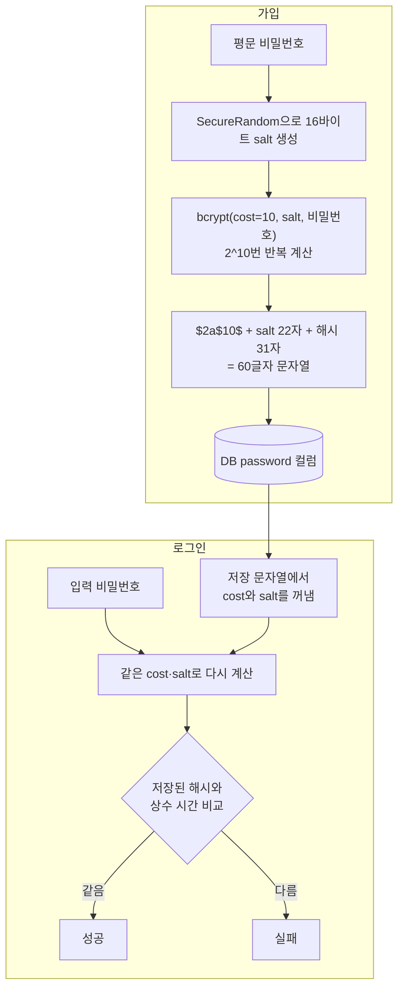
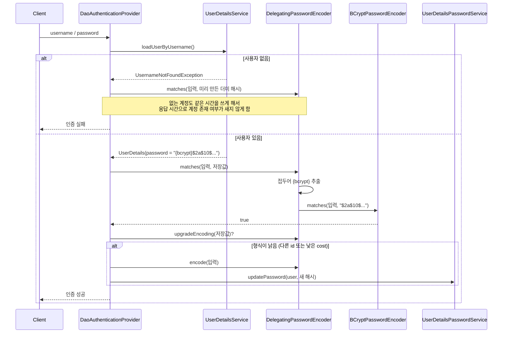
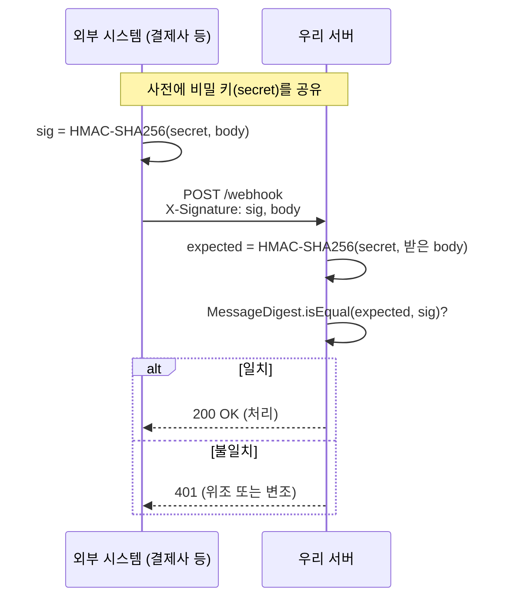

# 해시 (Hash)

관련 문서: [예제](./해시-예제.md) · [BigInteger](../../BigInteger/BigInteger-이론.md)

> 암호화 시리즈 1/3. 다음 주제: [대칭키 암호화](../대칭키암호화/대칭키암호화-이론.md) → [비대칭키 암호화](../비대칭키암호화/비대칭키암호화-이론.md)

---

## 1. 한 줄 요약

해시는 아무리 긴 데이터라도 정해진 길이의 "지문"으로 바꾸고, 그 지문으로는 원래 데이터를 되돌릴 수 없게 만드는 변환이다.
정확히는 임의 길이의 바이트열을 고정 길이 출력(다이제스트)으로 사상하는 결정적 함수이며, 암호학적 해시 함수는 여기에 역상 저항성·충돌 저항성을 추가로 보장한다.

---

## 2. 왜 필요한가

**문제 1. 서버가 비밀번호 원문을 갖고 있으면 DB 유출이 곧 계정 탈취다.**
사용자는 여러 사이트에 같은 비밀번호를 쓰므로, 한 곳이 유출되면 다른 서비스 계정까지 털린다(크리덴셜 스터핑, credential stuffing).
그런데 로그인할 때 필요한 것은 원문이 아니라 **"입력값이 저장된 값과 같은가"** 하나뿐이다.

**문제 2. 데이터가 중간에 바뀌었는지 확인할 방법이 필요하다.**
다운로드한 파일, 외부 시스템이 보낸 웹훅 본문이 원본 그대로인지 알아야 한다.

| 해법 | 한계 |
|---|---|
| 평문 저장 | DB·백업·로그가 한 번만 새어도 전부 노출된다 |
| 양방향 암호화(AES)로 저장 | 키도 서버에 있으므로 서버가 털리면 키와 함께 복호화된다. 비밀번호는 복호화할 이유가 없다 |
| MD5 / SHA-256으로 해시 | 되돌릴 수는 없지만 **너무 빨라서** 무차별 대입(brute force)으로 원문을 찾을 수 있다. 같은 비밀번호는 같은 해시라 미리 계산된 표로도 뚫린다 |
| **salt + 느린 해시**(bcrypt, Argon2) | 사용자마다 다른 salt, 일부러 느린 계산 → 현재 표준 |

정리하면, 해시는 "되돌릴 필요가 없는 비교"를 위한 도구이고, 용도(무결성 / 메시지 인증 / 비밀번호)에 따라 **어떤 해시를 쓰는지가 달라진다**. 이 문서의 핵심은 그 구분이다.

---

## 3. 최소 예제로 보기

```java
// 1) 일반 해시: 같은 입력 → 같은 출력, 한 글자 차이 → 완전히 다른 출력
MessageDigest md = MessageDigest.getInstance("SHA-256");
HexFormat hex = HexFormat.of();
System.out.println(hex.formatHex(md.digest("password123".getBytes(UTF_8))));
System.out.println(hex.formatHex(md.digest("password123".getBytes(UTF_8))));
System.out.println(hex.formatHex(md.digest("password124".getBytes(UTF_8))));

// 2) 비밀번호 해시: 같은 입력 → 매번 다른 출력, 비교는 matches로
BCryptPasswordEncoder bcrypt = new BCryptPasswordEncoder();
String h1 = bcrypt.encode("password123");
String h2 = bcrypt.encode("password123");
System.out.println(h1);
System.out.println(h2);
System.out.println(h1.equals(h2) + " / " + bcrypt.matches("password123", h1));
```

실행 결과 (Java 25, spring-security-crypto 6.4.5에서 실제 실행. bcrypt 값은 실행마다 다르다):

```
ef92b778bafe771e89245b89ecbc08a44a4e166c06659911881f383d4473e94f
ef92b778bafe771e89245b89ecbc08a44a4e166c06659911881f383d4473e94f
33631376724e5d5480fa397dfcf03b66ad47b934ab495174d7058c38f2bb0087
$2a$10$s8rf5pqRq1gtIJC3R5La1uLUJaLdtAcYCg/wCDsetwKNRX7c08qLW
$2a$10$i2Wr5qrcegipX7PVIjf4NeOjOYrok0YgJzJ4O1YQBO.Q.BqsHmajO
false / true
```

여기서 봐야 할 것 세 가지:

1. SHA-256은 **결정적**이다. 그래서 무결성 검증에 쓸 수 있지만, 같은 비밀번호를 쓰는 사용자는 DB에서 같은 값으로 보인다.
2. 끝 글자 하나(`3`→`4`)만 바꿔도 출력이 완전히 달라진다. 실제로 256비트 중 118비트가 바뀌었다(**눈사태 효과**, avalanche effect). 출력만 보고 "입력이 비슷하다"는 것조차 알 수 없다.
3. bcrypt는 같은 입력에도 **매번 다른 문자열**을 만든다. 그래서 `equals`로는 비교할 수 없고 `matches()`를 써야 한다. 그 이유는 5장에서 설명한다.

---

## 4. 핵심 개념

| 용어 | 영문 | 설명 |
|---|---|---|
| 해시 함수 | Hash Function | 임의 길이 입력 → 고정 길이 출력. 같은 입력이면 항상 같은 출력 |
| 다이제스트 | Digest | 해시 함수의 출력값. SHA-256이면 32바이트(hex로 64글자) |
| 역상 저항성 | Preimage Resistance | 출력만 보고 그 출력을 만드는 입력을 찾기가 계산상 불가능한 성질. "단방향"의 정체다 |
| 충돌 저항성 | Collision Resistance | 같은 출력을 내는 서로 다른 두 입력을 찾기가 계산상 불가능한 성질. MD5·SHA-1은 이미 깨졌다 |
| 솔트 | Salt | 해시 전에 입력에 섞는 사용자별 랜덤 값. 비밀이 아니며 해시와 함께 저장한다 |
| 작업 계수 | Work Factor (Cost) | 해시 한 번에 드는 계산량을 조절하는 값. bcrypt의 strength 10이면 2^10번 반복한다 |
| HMAC | Hash-based Message Authentication Code | 비밀 키를 섞은 해시. 키를 아는 쪽만 같은 값을 만들 수 있으므로 위조를 막는다 |
| 상수 시간 비교 | Constant-time Comparison | 어디서 달라지든 끝까지 비교해서, 걸린 시간으로 정보가 새지 않게 하는 비교 |

"단방향"이라는 말은 수학적으로 되돌리는 연산이 없다는 뜻이지, **추측해서 맞히는 것까지 막는다는 뜻은 아니다.** 해시의 보안은 "입력 후보를 하나씩 넣어 보는 비용"으로 결정된다. 이 점이 8장 함정 대부분의 뿌리다.

---

## 5. 동작 원리와 흐름

### 5-1. 일반 해시(SHA-256)가 계산되는 방식

1. 문자열을 **바이트로 변환**한다. 이 단계에서 문자 인코딩(UTF-8, MS949 등)이 결과를 결정한다. 해시 함수는 문자를 모른다.
2. `MessageDigest.update(bytes)`가 바이트를 **내부 버퍼**에 쌓는다. 64바이트(블록 크기)가 찰 때마다 압축 함수(compression function)를 돌려 내부 상태(256비트)를 갱신한다.
3. `digest()`가 남은 바이트에 패딩(padding)과 전체 길이를 붙여 마지막 블록을 처리하고, 내부 상태를 출력한 뒤 **객체를 초기 상태로 리셋**한다.
4. 결과는 `byte[32]`다. 사람이 읽거나 DB에 넣으려면 hex(64글자) 또는 Base64(44글자)로 인코딩한다.

핵심은 2번이다. `MessageDigest`는 **호출과 호출 사이에 상태를 들고 있는 객체**다. 이 사실이 [함정 3](#함정-3-messagedigest를-static-필드로-공유)의 원인이다.

### 5-2. 비밀번호 해시(bcrypt): 가입과 로그인



1. **가입**: `encode()`가 매번 새 salt를 만든다. 그래서 같은 비밀번호라도 결과가 다르다(3장 결과).
2. salt와 cost는 **결과 문자열 안에 그대로 들어 있다**(`$2a$10$s8rf5pqRq1gtIJC3R5La1u...`). 별도 컬럼이 필요 없다. salt는 비밀이 아니다. 목적은 "같은 비밀번호 → 같은 해시"를 깨서, 공격자가 사용자마다 따로 계산하게 만드는 것이다.
3. **로그인**: `matches(raw, stored)`가 저장 문자열에서 salt와 cost를 꺼내 **같은 조건으로 다시 계산**한 뒤 비교한다. 다시 계산해야 하므로 `encode(raw).equals(stored)`로는 절대 같아질 수 없다.
4. cost가 1 오를 때마다 계산량이 2배가 된다. 실측에서 strength 10은 37ms, 12는 149ms였다(환경마다 다르다). 같은 환경에서 SHA-256은 100만 번에 88ms였다. **bcrypt(12) 한 번이 SHA-256 약 170만 번과 맞먹는다.** 공격자의 대입 속도도 같은 비율로 떨어진다.

### 5-3. Spring Security에서 로그인할 때 일어나는 일



객체 생명주기:

- `PasswordEncoder`는 **싱글턴 빈**이다. 무상태(stateless)라 공유해도 안전하다. 매 호출마다 내부에서 salt와 계산 버퍼를 새로 만든다.
- 더미 해시(`userNotFoundEncodedPassword`)는 처음 필요할 때 **한 번만** 만들어 Provider에 보관한다.
- 평문 비밀번호는 요청 처리 중에만 존재한다. **로그인 성공 직후가 평문을 가진 유일한 순간**이므로, 해시 형식 교체(마이그레이션)도 이때만 할 수 있다.

### 5-4. HMAC: 키를 아는 사람만 만들 수 있는 해시



1. 그냥 `SHA-256(body)`를 보내면 공격자도 본문을 바꾼 뒤 해시를 다시 계산해서 붙일 수 있다. 해시는 **변조 감지**만 하고, **누가 만들었는지**는 보장하지 못한다.
2. HMAC은 계산에 비밀 키가 들어가므로, 키가 없는 공격자는 올바른 서명을 만들 수 없다. 내부적으로는 `H((K⊕opad) ‖ H((K⊕ipad) ‖ m))` 형태로 해시를 **두 번 중첩**한다. 이 중첩 구조 덕분에 [함정 6](#함정-6-sha256secret--message로-서명을-만든다)의 길이 확장 공격이 통하지 않는다.
3. 비교는 상수 시간으로 한다([함정 5](#함정-5-서명토큰을-stringequals로-비교한다)).

---

## 6. 내부 구현 (핵심만)

| 클래스·메서드 | 그래서 생기는 동작 |
|---|---|
| `MessageDigest` (`update` / `digest`) | 입력을 내부 버퍼에 쌓고 `digest()` 때 리셋한다. **상태가 있어서 스레드 안전하지 않다.** 공유했을 때 실측 결과 16만 번 중 8만여 번이 틀린 값을 냈고, 1,910번은 `ArrayIndexOutOfBoundsException`이 났다(JDK 내부 `DigestBase.engineUpdate`에서 발생). `Mac`도 마찬가지다 |
| `MessageDigest.isEqual(byte[], byte[])` | 길이가 같으면 모든 바이트를 XOR해서 누적하고 끝까지 비교한다(Java 6u17부터 상수 시간). `Arrays.equals`나 `String.equals`는 처음 다른 위치에서 바로 반환한다 |
| `BCryptPasswordEncoder#encode` / `#matches` | `encode`는 `SecureRandom`으로 salt를 새로 만들어 `$2a$<cost>$<salt><hash>` 60글자를 반환한다. `matches`는 저장 문자열에서 salt와 cost를 꺼내 다시 계산한다. 저장값이 bcrypt 형식이 아니면 **예외 없이 경고 로그만 남기고 false**를 반환한다("Encoded password does not look like BCrypt") |
| `BCryptPasswordEncoder#upgradeEncoding` | 저장된 해시의 cost가 현재 설정보다 낮으면 true. strength를 올리면 기존 사용자는 다음 로그인 때 자동으로 재해시된다 |
| `DelegatingPasswordEncoder` | 저장값 앞의 `{id}`(예: `{bcrypt}`, `{argon2}`)를 보고 실제 인코더를 고른다. `encode`는 항상 `idForEncode` 인코더로 만들고 접두어를 붙인다. 접두어가 없는 값은 `defaultPasswordEncoderForMatches`로 넘기는데, 기본값은 **예외를 던지는 인코더**다. `upgradeEncoding`은 id가 `idForEncode`와 다르면(접두어 없음 포함) true를 반환한다 |

`PasswordEncoderFactories.createDelegatingPasswordEncoder()`는 `bcrypt`를 기본으로 하고 `argon2`, `scrypt`, `pbkdf2`, `noop`, 레거시 `MD5`·`SHA-256` 등을 등록한 `DelegatingPasswordEncoder`를 만든다. Spring Boot에서 `PasswordEncoder` 빈을 직접 정의하지 않으면 이 인코더가 쓰인다.

---

## 7. 유사 개념과의 비교

| 구분 | 예 | 키 | 속도 | 되돌리기 | 막는 것 | 쓰는 곳 |
|---|---|---|---|---|---|---|
| 해시 테이블용 해시 | `Object.hashCode()` | 없음 | 매우 빠름 | — | 아무것도 못 막음(충돌 쉬움) | `HashMap` 버킷 분배 |
| 체크섬 | CRC32 | 없음 | 매우 빠름 | — | 우연한 전송 오류 | 네트워크·압축 파일 오류 검출 |
| 암호학적 해시 | SHA-256, SHA3-256 | 없음 | 빠름 | 불가 | 우연한 변조 + 충돌 위조 | 파일 무결성, 고엔트로피 토큰 저장, 중복 판별 |
| 메시지 인증 코드 | HMAC-SHA256 | **비밀 키** | 빠름 | 불가 | 키 없는 자의 위조 | 웹훅·API 서명, JWT HS256, 검색용 해시 |
| 비밀번호 해시 | bcrypt, Argon2id, scrypt, PBKDF2 | 없음(salt 내장) | **일부러 느림** | 불가 | 유출 후 대입 공격 | 사용자 비밀번호 저장 |
| 양방향 암호화 | AES-GCM | 비밀 키 | 빠름 | **키로 가능** | 키 없는 자의 열람 | 원문이 다시 필요한 개인정보 |

**고르는 기준**

1. 나중에 원문이 필요한가? → 예: 양방향 암호화(다음 주제). 아니오: 해시 계열.
2. 사람이 고른 값(비밀번호)인가? → 예: **비밀번호 해시**(bcrypt / Argon2id). 후보가 적어서 빠른 해시로는 대입 공격을 막지 못한다.
3. 위조까지 막아야 하는가(상대가 악의적일 수 있는가)? → 예: **HMAC**. 아니오(내 파일이 손상됐는지만 확인): SHA-256.
4. 서버가 만든 128비트 이상 랜덤 값(API 키, 리프레시 토큰)인가? → **SHA-256으로 충분**하다. 후보 공간이 2^128이라 느린 해시가 필요 없고, 매 요청 검증에 bcrypt를 쓰면 CPU만 낭비한다.

비밀번호 해시 알고리즘 간 선택(OWASP Password Storage Cheat Sheet 기준):
- 새 시스템: **Argon2id**(메모리를 많이 써서 GPU·ASIC 공격에 강함). Spring에서는 BouncyCastle 의존성이 필요하다.
- 이미 bcrypt를 쓰고 있다면 그대로 써도 된다(cost 10 이상 권장).
- FIPS-140 인증이 필요한 환경: PBKDF2-HMAC-SHA256.

---

## 8. 함정과 안티패턴

### 함정 1. 비밀번호를 SHA-256(또는 MD5)으로 저장한다

- **증상**: DB가 유출되자 며칠 만에 대부분의 비밀번호 원문이 공개된다. "단방향이라 안전하다"고 생각했다.
- **원인**: 단방향은 "역산 불가"일 뿐, 추측 대입은 막지 못한다(4장). SHA-256은 빠르게 설계되어 있어서 일반 PC에서도 초당 1천만 번 이상, GPU로는 초당 수십억 번 계산된다. salt까지 없으면 같은 비밀번호는 같은 해시라서 미리 계산해 둔 표(레인보우 테이블, rainbow table)로 즉시 찾고, 한 번 계산으로 그 비밀번호를 쓴 모든 사용자가 동시에 뚫린다.
- **해결**: `BCryptPasswordEncoder`나 `Argon2PasswordEncoder`를 쓴다. 손수 `SHA-256(salt + pw)`를 만들어 1만 번 돌리는 식으로 만들지 않는다. 기존 데이터는 `DelegatingPasswordEncoder`로 로그인할 때마다 점진적으로 마이그레이션한다(5-3, 예제 4단계).

### 함정 2. bcrypt 결과를 `equals`나 SQL `WHERE`로 비교한다

- **증상**: 비밀번호가 맞는데도 로그인이 항상 실패한다. `SELECT * FROM member WHERE email = ? AND password = ?` 같은 쿼리가 결과를 돌려주지 않는다.
- **원인**: `encode()`는 호출마다 새 salt를 만들기 때문에(5-2) 같은 비밀번호도 결과가 다르다.
- **해결**: 사용자를 **식별자로만** 조회하고, 비교는 애플리케이션에서 `passwordEncoder.matches(raw, stored)`로 한다.
- 비슷한 증상: 컬럼 길이가 짧아(`VARCHAR(50)` 등) 60~68글자 해시가 잘려 저장되면, `matches`는 예외 없이 경고 로그만 남기고 false를 반환한다(6장). 로그에 `Encoded password does not look like BCrypt`가 보이면 컬럼 길이나 접두어 처리부터 의심한다.

### 함정 3. `MessageDigest`를 static 필드로 공유

- **증상**: 평소에는 괜찮은데 트래픽이 몰리면 가끔 해시 검증이 실패하거나 `ArrayIndexOutOfBoundsException`이 난다. 로컬에서는 재현되지 않는다.
- **원인**: `MessageDigest`는 내부 버퍼와 상태를 가진다(5-1). 두 스레드가 동시에 `digest()`를 호출하면 버퍼가 섞인다. 실측 결과 8스레드에서 16만 번 중 52%가 틀린 값이었고, 1.2%는 예외가 났다(예제 6장).
- **해결**: 호출마다 `MessageDigest.getInstance()`로 새로 얻는다(비용은 해시 계산보다 작다). 정말 줄여야 한다면 `ThreadLocal`에 둔다. `Mac`도 똑같다. 반면 Spring의 `PasswordEncoder` 구현체는 무상태라 싱글턴으로 공유해도 된다.

### 함정 4. 같은 값인데 시스템마다 해시가 다르다 (인코딩·hex 변환)

- **증상**: 서버 A와 B, 또는 Java와 PostgreSQL·Node.js에서 같은 문자열의 해시가 다르게 나온다. 한글이 들어간 경우에만 다르거나, 16번에 1번꼴로 길이가 63글자다.
- **원인**:
  1. 해시는 바이트에 대해 계산된다(5-1의 1단계). `getBytes()`를 charset 없이 호출하면 플랫폼 기본 인코딩을 쓴다. Java 17 이하 한국어 Windows에서는 MS949라서 한글 바이트가 UTF-8과 다르다.
  2. `new BigInteger(1, digest).toString(16)`은 해시를 **숫자**로 보기 때문에 첫 바이트가 `0x0X`이면 앞자리 0을 버린다. 실측에서 `"user1"`의 해시가 64글자가 아니라 63글자가 됐다. ([BigInteger](../../BigInteger/BigInteger-이론.md)는 부호와 크기로 수를 표현하므로 앞자리 0이라는 개념이 없다.)
- **해결**: 항상 `getBytes(StandardCharsets.UTF_8)`을 쓴다. hex 변환은 `HexFormat.of().formatHex()`(Java 17+), Java 8에서는 `String.format("%02x", b)` 루프나 Commons Codec `Hex.encodeHexString`을 쓴다. 저장 형식(hex 소문자인지 Base64인지)을 시스템 간에 문서로 맞춘다.

### 함정 5. 서명·토큰을 `String.equals`로 비교한다

- **증상**: 기능은 정상이고 테스트도 통과하는데, 보안 점검에서 타이밍 공격(timing attack) 취약점으로 지적된다.
- **원인**: `String.equals`는 처음 다른 글자에서 바로 반환한다. 공격자가 서명의 첫 글자를 바꿔 가며 응답 시간을 대량으로 재면, 맞은 글자가 하나씩 늘어날 때마다 아주 조금씩 느려지는 차이로 서명을 한 글자씩 맞혀 갈 수 있다.
- **해결**: 바이트 배열로 바꿔 `MessageDigest.isEqual()`로 비교한다(6장). 비밀번호는 `PasswordEncoder.matches()`가 내부에서 이미 상수 시간 비교를 한다.

### 함정 6. `SHA256(secret + message)`로 서명을 만든다

- **증상**: 직접 만든 API 서명 방식이 보안 감사에서 "길이 확장 공격(length extension attack) 가능"으로 지적된다.
- **원인**: SHA-256(SHA-2 계열)은 출력값이 곧 마지막 내부 상태다(5-1의 3단계). 공격자는 `H(secret ‖ m)`과 secret의 길이만 알면, secret을 몰라도 그 상태에서 계산을 이어 `H(secret ‖ m ‖ 패딩 ‖ 추가데이터)`를 만들 수 있다. 예를 들어 `amount=1000` 뒤에 `&amount=1`을 붙인 요청에 유효한 서명을 만들 수 있다.
- **해결**: 직접 조합하지 말고 표준 **HMAC**(`Mac.getInstance("HmacSHA256")`)을 쓴다. HMAC은 해시를 두 번 중첩하므로 이 공격이 통하지 않는다(5-4).

### 함정 7. bcrypt는 72바이트까지만 본다

- **증상**: (구버전) 아주 긴 비밀번호의 앞 72바이트만 맞으면 뒷부분이 달라도 로그인된다. (패치 버전) 긴 비밀번호로 가입하면 `IllegalArgumentException: password cannot be more than 72 bytes`로 500 에러가 난다.
- **원인**: bcrypt 알고리즘은 입력을 최대 72바이트까지만 키로 쓰고 나머지는 버린다. UTF-8 한글은 한 글자가 3바이트라서 **한글 25글자(75바이트)만 돼도 넘는다**. Spring Security는 CVE-2025-22228 패치(6.4.4, 6.3.8 등)부터 `encode()`에서 72바이트 초과를 거부한다. 단, 실측 결과 6.4.5에서도 **`matches()`는 거부하지 않았다**. 72바이트 비밀번호로 저장한 계정에 "같은 72바이트 + 아무 문자"로 로그인하면 true가 나왔다(예제 6장).
- **해결**: 가입·변경 API에서 **바이트 기준** 최대 길이를 검증해 400으로 응답한다(`pw.getBytes(UTF_8).length <= 72`). 긴 비밀번호를 허용해야 하면 Argon2id를 쓴다. 72바이트 이전에서 HMAC 등으로 먼저 줄이는 우회책도 있지만, 표준 방식은 아니라서 이론 문서에서는 다루지 않는다.

---

## 9. 실무 적용 시나리오

### 9-1. 회원 비밀번호 저장 (Spring Boot 3 + PostgreSQL)

```java
@Configuration
public class PasswordConfig {

    @Bean
    public PasswordEncoder passwordEncoder() {
        // 저장값에 {bcrypt} 접두어가 붙는다. 나중에 Argon2로 바꿔도 기존 값을 그대로 검증할 수 있다.
        return PasswordEncoderFactories.createDelegatingPasswordEncoder();
    }
}
```

```sql
-- PostgreSQL
CREATE TABLE member (
    id       BIGSERIAL    PRIMARY KEY,
    email    VARCHAR(255) NOT NULL UNIQUE,
    -- {bcrypt}까지 68글자, {argon2}는 100글자 안팎. 알고리즘을 바꿀 수 있으니 여유 있게 잡는다.
    password VARCHAR(255) NOT NULL
);
-- Oracle: id NUMBER GENERATED BY DEFAULT AS IDENTITY, VARCHAR2(255)
```

- 로그인은 `email`로만 조회하고 `matches`로 비교한다(함정 2).
- `UserDetailsPasswordService`를 구현해 두면 5-3의 자동 재해시가 동작한다.
- [JWT + Spring Security] 학습 내용에서 `AuthenticationManager`가 호출하는 Provider가 바로 5-3의 `DaoAuthenticationProvider`다.

### 9-2. 외부 시스템 웹훅·API 서명 검증 (HMAC)

결제 대행사(PG), 메신저 봇, Git 호스팅 서비스의 웹훅은 대부분 `X-...-Signature: HMAC-SHA256(secret, 원본 body)` 형태를 쓴다.
- **역직렬화하기 전의 원본 바이트**로 검증한다. Jackson으로 객체로 읽었다가 다시 직렬화하면 공백·필드 순서가 바뀌어 서명이 맞지 않는다.
- hex인지 Base64인지, 타임스탬프를 서명에 포함하는지(재전송 공격, replay attack 방지)를 제공사 문서에서 확인한다.

### 9-3. 리프레시 토큰·API 키를 DB에 저장

- 토큰 원문을 저장하면 DB 유출이 곧 세션 탈취다. **SHA-256 해시만 저장**하고, 요청이 오면 들어온 토큰을 해시해서 조회한다(`WHERE token_hash = ?`).
- 서버가 만든 128비트 이상 랜덤 값이라 후보 공간이 커서 빠른 해시로 충분하다(7장 기준 4). salt도 필요 없고, 결정적이어야 인덱스로 조회할 수 있다.

### 9-4. 개인정보 검색용 해시 (Blind Index)

전화번호를 AES로 암호화해 저장하면 `WHERE phone = ?`로 검색할 수 없다. 그래서 검색용 해시 컬럼을 추가로 둔다.
- **SHA-256(전화번호)는 안 된다.** 휴대폰 번호는 `010-XXXX-XXXX`, 1억 개뿐이라 몇 초 만에 전부 계산된다(함정 1과 같은 원리). 주민번호, 생년월일도 마찬가지다.
- **HMAC-SHA256(서버 비밀 키, 정규화한 전화번호)**를 쓴다. 키는 DB가 아닌 KMS나 환경 변수에 둔다. DB만 유출되면 대입할 수 없다.
- 입력을 먼저 정규화(하이픈 제거 등)해야 같은 번호가 같은 해시가 된다.

### 9-5. 파일 무결성·중복 판별

- 업로드 파일의 SHA-256을 저장해 두면 같은 파일 중복 업로드를 찾거나, 스토리지 저장 경로 키로 쓸 수 있다.
- 배포 산출물, 외부에서 받은 라이브러리는 공개된 SHA-256 체크섬과 비교한다. 체크섬이 같은 서버에 있으면 둘 다 바뀔 수 있으므로, 출처를 보증하려면 서명(비대칭키, 3번째 주제)이 필요하다.

---

## 10. 버전 주의사항

| 버전 | 변화 | 고칠 코드 |
|---|---|---|
| Java 18 (JEP 400) | 기본 charset이 OS와 상관없이 UTF-8로 바뀌었다 | `getBytes()`를 charset 없이 쓰던 Windows 서버는 Java 17→21 업그레이드 후 한글이 들어간 기존 해시와 맞지 않을 수 있다. 항상 `StandardCharsets.UTF_8`을 명시한다 |
| Spring Security 5.0 | 기본 `PasswordEncoder`가 `DelegatingPasswordEncoder`가 되어 `{id}` 접두어를 요구한다 | 접두어 없는 기존 데이터는 `IllegalArgumentException`이 난다. 데이터에 `{bcrypt}`를 붙이는 UPDATE를 실행하거나 `setDefaultPasswordEncoderForMatches()`를 설정한다 |
| Spring Security 5.8 | Pbkdf2·SCrypt·Argon2 인코더의 기본 생성자가 deprecated되고 `defaultsForSpringSecurity_v5_8()` 팩토리가 추가됐다 | 기존 기본 파라미터로 저장된 해시가 있다면 파라미터를 명시해서 계속 검증할 수 있게 한다. 세부 파라미터 값은 확인 필요 |
| Spring Security 6.4.4 / 6.3.8 등 (CVE-2025-22228 패치) | `BCryptPasswordEncoder.encode()`가 72바이트 초과 입력을 거부한다 | 가입·변경 API에서 바이트 길이를 미리 검증한다(함정 7). 패치된 버전 목록 전체는 확인 필요 |

---

## 11. 자가 점검 질문

1. bcrypt로 같은 비밀번호를 두 번 `encode()`하면 결과가 다른데, 로그인할 때는 어떻게 비교할 수 있는가?
2. 비밀번호에는 SHA-256을 쓰면 안 되는데, 리프레시 토큰 저장에는 SHA-256을 써도 되는 이유는 무엇인가?
3. 웹훅 서명을 `SHA-256(body)`로 만들면 안 되는 이유와, `SHA-256(secret + body)`로 만들면 안 되는 이유는 각각 무엇인가?
4. `private static final MessageDigest MD`로 선언한 유틸에서 운영 중에만 간헐적으로 잘못된 해시가 나오는 이유는 무엇인가?
5. bcrypt strength를 10에서 12로 올렸을 때, 이미 가입한 사용자의 해시는 어떻게 바뀌는가?

<details>
<summary>답 보기</summary>

1. salt와 cost가 결과 문자열 안에 들어 있다. `matches()`가 저장 문자열에서 salt와 cost를 꺼내 입력 비밀번호를 같은 조건으로 다시 계산한 뒤, 저장된 해시 부분과 상수 시간으로 비교한다. 그래서 `encode(raw).equals(stored)`는 항상 false다.
2. 해시의 보안은 "후보를 하나씩 넣어 보는 비용"으로 정해진다. 사람이 고른 비밀번호는 후보 공간이 작아서 빠른 해시로는 대입 공격을 막지 못한다. 서버가 만든 128비트 이상 랜덤 토큰은 후보가 2^128개라서 빠른 해시로도 대입이 불가능하다. 또 조회하려면 결정적이어야 하므로 salt 없는 SHA-256이 맞다.
3. `SHA-256(body)`는 키가 없으므로 공격자도 본문을 바꾼 뒤 해시를 다시 계산할 수 있다(변조 감지만 되고 위조는 못 막는다). `SHA-256(secret + body)`는 SHA-2의 출력이 곧 내부 상태라서, secret을 몰라도 그 상태에서 계산을 이어 데이터를 덧붙인 메시지의 유효한 해시를 만들 수 있다(길이 확장 공격). 둘 다 HMAC으로 해결한다.
4. `MessageDigest`는 `update`로 받은 바이트를 내부 버퍼에 쌓고 `digest` 때 리셋하는 상태 객체다. 동시 호출 시 다른 스레드의 입력이 섞이거나 버퍼 인덱스가 어긋나 틀린 값이나 `ArrayIndexOutOfBoundsException`이 나온다. 동시 요청이 적은 로컬에서는 거의 재현되지 않는다.
5. 바로 바뀌지는 않는다. 다음 로그인이 성공했을 때 `upgradeEncoding()`이 "저장된 cost 10 < 설정 12"를 감지해 true를 반환하고, 평문이 있는 그 시점에 cost 12로 재해시해서 저장한다(`UserDetailsPasswordService` 또는 직접 구현). 로그인하지 않은 사용자는 계속 cost 10으로 남는다.

</details>

---

## 12. 참고 자료

- OWASP Password Storage Cheat Sheet — 알고리즘별 권장 파라미터(Argon2id, bcrypt, PBKDF2)
- Spring Security Reference — Features › Authentication › Password Storage (`DelegatingPasswordEncoder`, 형식 업그레이드)
- Spring Security Advisory CVE-2025-22228 — `BCryptPasswordEncoder` 72바이트 제한
- RFC 2104 — HMAC: Keyed-Hashing for Message Authentication
- FIPS 180-4 — Secure Hash Standard (SHA-2), FIPS 202 — SHA-3
- RFC 9106 — Argon2
- JEP 400 — UTF-8 by Default (Java 18)
- Java Security Standard Algorithm Names — `MessageDigest`, `Mac` 알고리즘 이름과 필수 지원 목록
- `java.security.MessageDigest` Javadoc — `isEqual`의 상수 시간 비교 설명

---

## 부록: 용어 정리

| 용어 | 영문 | 설명 |
|---|---|---|
| 해시 | Hash | 임의 길이 데이터를 고정 길이 값으로 바꾸고 되돌릴 수 없는 변환 |
| 다이제스트 | Digest | 해시 함수의 출력값 |
| 결정적 함수 | Deterministic Function | 같은 입력에 항상 같은 출력을 내는 함수 |
| 역상 저항성 | Preimage Resistance | 출력으로부터 입력을 찾기가 계산상 불가능한 성질 |
| 충돌 저항성 | Collision Resistance | 같은 출력을 내는 서로 다른 두 입력을 찾기가 계산상 불가능한 성질 |
| 크리덴셜 스터핑 | Credential Stuffing | 다른 곳에서 유출된 아이디·비밀번호를 그대로 대입하는 공격 |
| 무차별 대입 | Brute Force | 가능한 입력 후보를 전부 넣어 보는 공격 |
| 눈사태 효과 | Avalanche Effect | 입력 1비트 변화가 출력 비트의 약 절반을 바꾸는 성질 |
| 솔트 | Salt | 해시 전에 섞는 사용자별 랜덤 값. 비밀이 아니고 해시와 함께 저장한다 |
| 작업 계수 | Work Factor (Cost) | 해시 계산량을 조절하는 값. bcrypt는 cost가 1 오르면 2배 느려진다 |
| HMAC | Hash-based Message Authentication Code | 비밀 키를 섞어 키 보유자만 만들 수 있게 한 해시 |
| 상수 시간 비교 | Constant-time Comparison | 차이 위치와 관계없이 끝까지 비교해 시간으로 정보가 새지 않게 하는 비교 |
| 압축 함수 | Compression Function | 블록 하나와 현재 내부 상태를 받아 새 내부 상태를 만드는 해시 내부 함수 |
| 패딩 | Padding | 마지막 블록을 채우려고 덧붙이는 바이트. SHA-2는 전체 길이도 함께 넣는다 |
| 레인보우 테이블 | Rainbow Table | 흔한 비밀번호의 해시를 미리 계산해 둔 조회용 표 |
| 타이밍 공격 | Timing Attack | 처리 시간 차이로 비밀 값을 조금씩 알아내는 공격 |
| 길이 확장 공격 | Length Extension Attack | `H(secret‖m)`만으로 `H(secret‖m‖추가)`를 만드는 SHA-2 계열 공격 |
| 재전송 공격 | Replay Attack | 유효한 요청을 가로채 그대로 다시 보내는 공격 |
| 블라인드 인덱스 | Blind Index | 암호화한 컬럼을 검색하려고 따로 저장하는 키 기반 해시 |
| CVE | Common Vulnerabilities and Exposures | 공개된 보안 취약점에 붙는 고유 식별 번호 |
| JEP | JDK Enhancement Proposal | JDK 기능 변경 제안 문서 |
