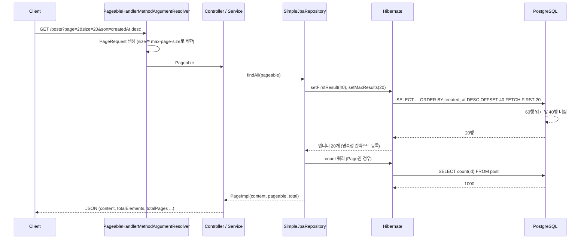
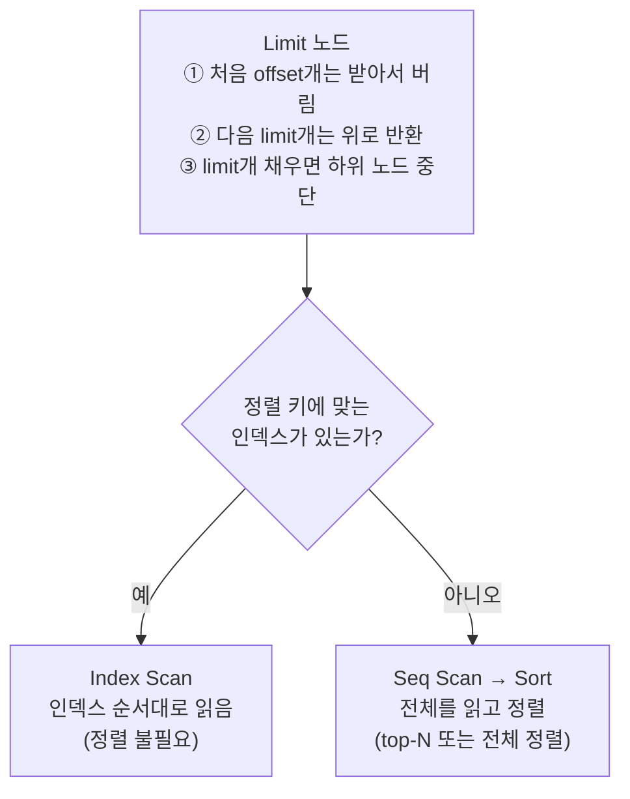

# 오프셋 페이징 — LIMIT/OFFSET이 실제로 하는 일

관련 문서: [예제](./오프셋페이징-예제.md)

> 연결되는 기존 학습 주제
> - **@Transactional**: `Page` 조회는 content 쿼리와 count 쿼리, 두 SQL을 실행한다. PostgreSQL 기본 격리 수준(READ COMMITTED)에서는 두 SQL이 서로 다른 스냅샷을 볼 수 있다 (8.4). → [@Transactional 이론](../트랜잭셔널/트랜잭셔널-이론.md)
> - **JPA 엔티티 설계**: 컬렉션 fetch join과 페이징을 같이 쓰면 DB가 아니라 메모리에서 페이징된다 (8.5).
> - **커서 페이징**: 이 문서 8.2·8.4의 한계를 해결하는 방식이다. → [커서 페이징 이론](../커서페이징/커서페이징-이론.md)

---

## 1. 한 줄 요약

오프셋 페이징은 정렬된 결과에서 앞쪽 N개를 건너뛰고 그다음 M개를 가져와 목록을 페이지 단위로 나눠 보여주는 방식이다.
정확히는 `ORDER BY`로 순서를 고정한 결과 집합에 대해 `OFFSET (page × size)`와 `LIMIT size`로 **순번(position) 구간**을 잘라내는 페이징 기법이다.

---

## 2. 왜 필요한가

### 2.1 페이징이 없던 코드

```java
List<Post> all = postRepository.findAll();          // 100만 건 전부 SELECT
List<Post> page = all.subList(40, 60);              // 그중 20건만 사용
```

- DB는 100만 행을 읽고, 네트워크로 100만 행을 보내고, JVM은 100만 개 엔티티를 만든다. 그리고 99만 9,980개를 버린다.
- 엔티티가 영속성 컨텍스트에 모두 올라가므로 힙과 GC 부담이 행 수에 비례해 커진다. 데이터가 늘면 `OutOfMemoryError`가 난다.

### 2.2 오프셋 페이징이 해결하는 것

**"필요한 구간만 DB에서 잘라 보내게"** 한다. 전송량과 객체 생성량이 `size`로 고정된다.
그리고 **페이지 번호 → 순번 구간**이라는 단순한 공식(`offset = page × size`) 덕분에 다음이 쉬워진다.

- 페이지 번호 UI(1 2 3 … 50)와 임의 페이지 점프
- `COUNT(*)`로 전체 개수와 총 페이지 수 표시

### 2.3 남는 한계 (이 문서가 다루는 함정의 뿌리)

오프셋은 **DB에서 잘라낼 뿐, DB가 건너뛸 행을 읽지 않는 것은 아니다.** 또 "N번째"라는 순번은 데이터가 바뀌면 다른 행을 가리킨다.
이 두 가지 때문에 8장의 함정이 생긴다.

---

## 3. 최소 예제로 보기

```sql
-- PostgreSQL. post 테이블 1,000건, id 1~1000
SELECT id, title FROM post ORDER BY id DESC LIMIT 3 OFFSET 0;  -- 1페이지
SELECT id, title FROM post ORDER BY id DESC LIMIT 3 OFFSET 3;  -- 2페이지
SELECT count(*) FROM post;                                     -- 총 페이지 수 계산용
```

```text
-- 1페이지      -- 2페이지      -- count
 id  | title     id  | title      count
-----+-------   -----+-------    -------
1000 | ...       997 | ...        1000
 999 | ...       996 | ...
 998 | ...       995 | ...
```

같은 일을 Spring Data JPA로 하면 이렇다.

```java
Pageable pageable = PageRequest.of(1, 3, Sort.by(Sort.Direction.DESC, "id")); // page는 0부터
Page<Post> page = postRepository.findAll(pageable);

page.getContent();        // [997, 996, 995]
page.getTotalElements();  // 1000  ← count 쿼리 결과
page.getTotalPages();     // 334
```

실행되는 SQL (Hibernate 6, PostgreSQL 방언 기준):

```sql
select p1_0.id, p1_0.title ... from post p1_0 order by p1_0.id desc offset ? rows fetch first ? rows only
select count(p1_0.id) from post p1_0
```

여기서 봐야 할 세 가지:

1. `PageRequest.of(1, 3)`의 1은 **두 번째 페이지**다. (0부터 시작)
2. SQL이 **두 번** 나간다. 하나는 데이터, 하나는 개수다.
3. `OFFSET 3`이라고 해서 DB가 4번째 행으로 바로 가는 것이 아니다. 5장에서 본다.

---

## 4. 핵심 개념

| 용어 | 영문 | 의미 |
|---|---|---|
| 오프셋 | Offset | 결과 앞쪽에서 **건너뛸 행 수**. `page × size` |
| 리밋 | Limit | 건너뛴 뒤 **가져올 최대 행 수**. 보통 `size` |
| 결정적 정렬 | Deterministic Ordering | 같은 데이터에 대해 항상 같은 순서가 나오는 정렬. 정렬 키 조합이 **유일(unique)**해야 성립 |
| 총 개수 쿼리 | Count Query | 전체 페이지 수를 계산하려고 별도로 실행하는 `SELECT count(*)` |
| 페이지 / 슬라이스 | Page / Slice | Spring Data의 결과 타입. `Page`는 count 쿼리를 실행하고, `Slice`는 `size+1`건만 조회해 다음 페이지 유무만 판단 |
| 깊은 페이지 | Deep Pagination | 큰 offset으로 뒤쪽 페이지를 조회하는 상황. 성능 문제의 원인 |
| 커버링 인덱스 | Covering Index | 쿼리가 필요로 하는 컬럼이 모두 인덱스에 있어 테이블(힙)을 읽지 않아도 되는 인덱스 |
| 지연 조인 | Deferred Join | 커버링 인덱스로 id만 먼저 페이징한 뒤, 그 id로 본 테이블을 조인하는 깊은 페이지 최적화 기법 |

---

## 5. 동작 원리와 흐름

### 5.1 요청 흐름 (Spring Boot + Spring Data JPA)

1. 클라이언트가 `GET /posts?page=2&size=20&sort=createdAt,desc`를 보낸다.
2. Spring MVC의 `PageableHandlerMethodArgumentResolver`가 쿼리 파라미터를 읽어 **`PageRequest` 객체를 생성**한다. 이때 `size`는 `max-page-size`(기본 2000)를 넘지 않도록 잘린다.
3. 컨트롤러가 서비스 → 리포지토리로 `Pageable`을 넘긴다.
4. `SimpleJpaRepository`가 JPQL/Criteria 쿼리를 만들고 `setFirstResult(offset)`, `setMaxResults(size)`를 설정한다.
5. Hibernate가 방언(Dialect)에 맞춰 `offset ? rows fetch first ? rows only`(PostgreSQL) 또는 `LIMIT ? OFFSET ?` 형태의 SQL로 바꿔 실행한다.
6. DB는 정렬된 결과를 앞에서부터 읽으며 **offset개를 버리고** size개를 반환한다 (5.2).
7. 결과 행으로 **엔티티가 생성되어 영속성 컨텍스트에 등록**된다. `size`개만 생성된다.
8. 반환 타입이 `Page`이면 count 쿼리를 **한 번 더** 실행한다. (생략 가능한 경우는 6장)
9. content와 total로 **`PageImpl` 객체를 생성**해 반환한다.
10. 트랜잭션이 끝나면 영속성 컨텍스트와 함께 엔티티는 준영속 상태가 되고, 컨트롤러가 DTO로 변환해 JSON으로 응답한다.



### 5.2 DB 내부 실행 흐름

PostgreSQL 실행 계획은 **아래 노드가 행을 하나씩 위로 올려 보내는** 구조다. 맨 위의 `Limit` 노드가 OFFSET과 LIMIT을 처리한다.



- **인덱스가 있을 때**: 인덱스를 정렬 순서대로 따라가며 행을 올린다. `Limit`이 `offset + limit`개를 받으면 멈춘다. 읽는 양 ≈ **offset + limit**.
- **인덱스가 없을 때**: 테이블 전체를 읽고 정렬해야 한다. `offset + limit`이 작으면 그 개수만큼만 유지하는 top-N 정렬을 쓰지만, offset이 크면 정렬해야 할 양도 커진다. 읽는 양 = **테이블 전체**.

어느 쪽이든 **건너뛸 행도 실제로 읽힌다.** PostgreSQL 공식 문서도 "OFFSET으로 건너뛴 행도 서버 안에서 계산되어야 하므로 큰 OFFSET은 비효율적일 수 있다"고 명시한다.

```text
OFFSET 40      → 인덱스 60개 항목 + 힙 60행 읽고 20행 반환
OFFSET 100000  → 인덱스 100,020개 항목 + 힙 100,020행 읽고 20행 반환
```

### 5.3 순번은 "그 순간"의 순번이다

OFFSET은 **쿼리 실행 시점의 정렬 결과**에서 순번을 센다. 1페이지를 조회한 쿼리와 2페이지를 조회한 쿼리는 **서로 다른 시점의 서로 다른 SQL**이다. 그 사이 데이터가 바뀌면 같은 순번이 다른 행을 가리킨다.

```text
t1: 1페이지 OFFSET 0 → [100, 99, 98, 97, 96]
t2: 새 글 101 INSERT              → 모든 행의 순번이 +1
t3: 2페이지 OFFSET 5 → [96, 95, 94, 93, 92]   ← 96 중복
```

---

## 6. 내부 구현 (핵심만)

| 구성 요소 | 하는 일 | 그래서 생기는 동작 |
|---|---|---|
| `PageableHandlerMethodArgumentResolver` | `page`, `size`, `sort` 파라미터로 `PageRequest` 생성 | `page`는 기본 **0부터**. `size`는 `max-page-size`(기본 **2000**)까지 허용. `sort`는 **클라이언트가 아무 프로퍼티나 지정 가능** → 8.6 |
| `SimpleJpaRepository#readPage` | content 쿼리에 `setFirstResult/setMaxResults` 적용 후 count 쿼리를 공급자(Supplier)로 넘김 | `Page` 반환 시 SQL이 2번 나간다 → 8.3 |
| `PageableExecutionUtils#getPage` | content만 보고 total을 추론할 수 있으면 count 쿼리를 **생략** | 첫 페이지에서 content가 size보다 적거나, 마지막 페이지이면 count를 안 날린다. 그 외에는 항상 실행 |
| Slice 조회 (`Slice<T>` 반환 메서드) | `setMaxResults(size + 1)`로 한 건 더 조회 | 남는 1건으로 `hasNext()`를 판단. count 쿼리가 없다 |
| PostgreSQL `Limit` 노드 | 하위 노드에서 행을 당겨 offset개를 버리고 limit개를 반환 | 건너뛸 행도 읽힌다 → 8.2. 정렬이 비결정적이면 실행 계획에 따라 순서가 바뀐다 → 8.1 |

**정렬과 LIMIT의 관계** (8.1의 원인):
PostgreSQL 문서에 따르면 옵티마이저는 LIMIT/OFFSET 값을 고려해 실행 계획을 고른다. 그래서 **페이지마다 다른 계획이 선택될 수 있고**, `ORDER BY`로 순서가 완전히 정해지지 않았다면 페이지마다 다른 순서가 나올 수 있다. `ORDER BY created_at`에서 `created_at`이 같은 행끼리의 순서는 **보장되지 않는다.**

---

## 7. 유사 개념과의 비교

| 방식 | 원리 | 성능 (뒤쪽 페이지) | 페이지 점프 | 전체 개수 | 데이터 변경 시 | 언제 고르나 |
|---|---|---|---|---|---|---|
| 메모리 페이징 (`findAll()` 후 `subList`) | 전부 조회 후 JVM에서 자름 | 항상 전체 비용 | 가능 | 가능 | 비교적 안정 (한 번에 조회) | **쓰지 않는다**. 수십 건 고정 코드 테이블 정도만 |
| 오프셋 + `Page` | `LIMIT/OFFSET` + count | O(offset + size) | 가능 | 제공 | 중복/누락 | 관리자 목록, 페이지 번호 UI, 데이터 변화가 적은 목록 |
| 오프셋 + `Slice` | `LIMIT size+1 OFFSET` | O(offset + size) | 가능 (번호는 모름) | 없음 | 중복/누락 | "더 보기" 버튼인데 깊이가 얕은 목록 |
| 오프셋 + 지연 조인 | 커버링 인덱스로 id만 OFFSET 후 조인 | O(offset)이지만 인덱스만 읽음 | 가능 | 제공 가능 | 중복/누락 | 페이지 번호 UI를 유지해야 하는데 깊은 페이지가 느릴 때 |
| 커서 페이징 (Keyset) | `WHERE (정렬키) < (마지막 값)` | O(log N + size), 일정 | 불가 | 없음 | 안정 | 무한 스크롤, 실시간 피드, 외부 API, 대량 배치 순회 |

판단 기준:

1. **페이지 번호 UI가 필요한가?** → 아니면 [커서 페이징](../커서페이징/커서페이징-이론.md)이 기본값이다.
2. 필요하다면 **사용자가 실제로 몇 페이지까지 가는가?** 대부분 앞쪽 몇 페이지라면 오프셋으로 충분하다. 깊은 페이지 요청이 있다면 지연 조인 또는 최대 페이지 제한을 둔다.
3. **총 개수가 정말 필요한가?** 필요 없으면 `Slice`로 count 쿼리를 없앤다.

---

## 8. 함정과 안티패턴

### 8.1 정렬 키가 유일하지 않아 페이지 사이에 행이 겹치거나 빠짐

- **증상**: 데이터를 전혀 바꾸지 않았는데 1페이지에 나온 글이 2페이지에 또 나오고, 어떤 글은 어느 페이지에도 안 나온다. 재현이 들쭉날쭉하다.
- **원인**: `ORDER BY created_at DESC`에서 `created_at`이 같은 행들의 순서는 정해지지 않는다. 페이지마다 OFFSET/LIMIT 값이 달라 실행 계획이 달라질 수 있고(6장), 그때마다 동점 행의 순서가 바뀐다.
- **해결**: 정렬 끝에 **유일 컬럼(PK)을 tie-breaker로 추가**한다. `ORDER BY created_at DESC, id DESC`. 인덱스도 같은 순서로 `(created_at DESC, id DESC)`를 만든다. Spring에서는 `Sort.by(desc("createdAt"), desc("id"))`.

### 8.2 뒤쪽 페이지로 갈수록 느려짐 (Deep Pagination)

- **증상**: 1페이지는 5ms인데 5,000페이지는 수백 ms. 크롤러나 "마지막 페이지" 버튼이 DB CPU를 잡아먹는다.
- **원인**: `Limit` 노드는 건너뛸 행도 하위 노드에서 받아서 버린다 (5.2). 인덱스가 있어도 offset만큼 인덱스와 힙을 읽는다. 정렬 키 인덱스가 없으면 매번 전체 정렬이다.
- **해결**:
  1. 정렬 키(+tie-breaker)에 맞는 인덱스부터 확인한다. `EXPLAIN (ANALYZE)`로 `Sort` 노드가 없는지 본다.
  2. **최대 페이지를 제한**한다 (예: 1,000페이지 이후는 검색 조건을 좁히도록 안내).
  3. **지연 조인**: 커버링 인덱스로 id만 OFFSET한 뒤 본 테이블과 조인한다. 버리는 행에 대해 힙 접근이 줄어든다. 단, PostgreSQL의 Index Only Scan은 visibility map이 최신일 때만 힙 접근을 생략하므로 VACUUM 상태에 영향을 받는다.
  4. 번호 UI가 필수가 아니면 **커서 페이징**으로 바꾼다.

### 8.3 count 쿼리가 content 쿼리보다 느림

- **증상**: 목록 API가 느려서 보면 `select count(...)`가 대부분의 시간을 차지한다. 특히 조인·검색 조건이 붙은 목록에서 그렇다.
- **원인**: `Page` 반환 타입은 count 쿼리를 함께 실행한다 (6장 `readPage`). PostgreSQL은 MVCC 구조상 테이블 행 수를 따로 저장하지 않으므로 `count(*)`는 조건에 맞는 행을 **전부** 확인해야 한다. content는 20건에서 멈추지만 count는 멈추지 않는다.
- **해결**:
  1. 총 개수가 필요 없는 화면은 반환 타입을 **`Slice`**로 바꾼다.
  2. 필요하다면 **count 전용 쿼리**를 분리한다. `@Query(countQuery = ...)`로 불필요한 조인(fetch join, 개수에 영향 없는 `LEFT JOIN`)을 뺀다.
  3. 정확한 값이 필요 없으면 "1,000+"처럼 상한을 두고 세거나(`LIMIT 1001`인 서브쿼리 count), 통계 추정치를 쓴다.

### 8.4 페이지를 넘기는 사이 데이터가 바뀌어 중복/누락

- **증상**: 게시글이 빠르게 쌓이는 목록에서 다음 페이지로 가면 방금 본 글이 또 보인다. 삭제가 잦으면 일부 글이 건너뛰어진다. 또는 `totalElements`와 실제 content 개수가 맞지 않는다.
- **원인**: 오프셋은 쿼리 시점의 **순번**을 기준으로 한다 (5.3). INSERT는 순번을 밀고 DELETE는 당긴다. 또 READ COMMITTED에서는 content 쿼리와 count 쿼리가 **각자 새 스냅샷**을 보므로 두 값이 어긋날 수 있다.
- **해결**:
  1. 실시간으로 쌓이는 목록(피드, 알림, 로그)은 **커서 페이징**을 쓴다.
  2. 오프셋을 유지해야 하면 클라이언트에서 id 기준으로 중복을 제거하거나, 첫 조회 시각을 기준점으로 고정한다 (`WHERE created_at <= :firstRequestedAt`). 이렇게 하면 이후 INSERT로 순번이 밀리지 않는다.
  3. content와 count의 일관성이 꼭 필요하면 `@Transactional(readOnly = true, isolation = REPEATABLE_READ)`로 두 쿼리를 같은 스냅샷에서 실행한다.

### 8.5 컬렉션 fetch join + 페이징 → 메모리 페이징

- **증상**: 페이징 쿼리인데 SQL에 LIMIT/OFFSET이 없다. 로그에 `HHH90003004: firstResult/maxResults specified with collection fetch; applying in memory` 경고가 나오고, 데이터가 많으면 OOM이 난다.
- **원인**: `@OneToMany` 컬렉션을 fetch join하면 부모 1건이 자식 수만큼 **여러 행으로 늘어난다.** SQL 행 단위로 LIMIT을 걸면 부모 단위로 자를 수 없으므로 Hibernate는 **전체를 조회한 뒤 메모리에서 자른다.** 2.1의 메모리 페이징과 같은 문제가 된다.
- **해결**:
  1. 부모만 페이징 조회하고, 컬렉션은 `@BatchSize` 또는 `hibernate.default_batch_fetch_size`로 IN 쿼리 로딩한다.
  2. 또는 부모 id만 먼저 페이징 조회한 뒤, 그 id 목록으로 fetch join을 따로 실행한다.
  3. 실수를 막으려면 `hibernate.query.fail_on_pagination_over_collection_fetch=true`로 경고 대신 예외를 내게 한다.

### 8.6 page/size/sort를 검증 없이 받음

- **증상**: ① 프론트는 1페이지를 요청했는데 두 번째 페이지가 나온다. ② `size=2000` 요청 하나로 API가 느려진다. ③ `sort=content` 같은 파라미터로 인덱스 없는 컬럼 정렬이 실행되거나, 존재하지 않는 프로퍼티라 500 에러가 난다.
- **원인**: `PageableHandlerMethodArgumentResolver`는 page를 **0부터** 해석하고, size 상한 기본값이 2000이며, sort 프로퍼티를 클라이언트 입력 그대로 쓴다 (6장).
- **해결**:
  1. 0/1 시작 규칙을 API 명세로 정하고, 1부터 받으려면 `spring.data.web.pageable.one-indexed-parameters=true`를 쓴다.
  2. `spring.data.web.pageable.max-page-size`를 화면 요구에 맞게 낮춘다 (예: 100).
  3. 정렬은 허용 목록(whitelist)으로 매핑하거나 서버에서 고정한다. 클라이언트는 `sort=latest`처럼 의미 있는 값만 보낸다.

---

## 9. 실무 적용 시나리오

| 시나리오 | 권장 방식 | 이유 |
|---|---|---|
| 관리자 회원 목록 (번호 페이징, 총 n명 표시) | 오프셋 + `Page` + 정렬 tie-breaker | 번호 이동과 총계가 요구사항. 데이터 변화가 느림 |
| 게시판 (번호 UI, 수백만 건) | 오프셋 + `Page` + count 쿼리 분리 + 최대 페이지 제한 또는 지연 조인 | 앞쪽 페이지 위주로 접근하고, 깊은 페이지가 DB를 잡지 않게 막음 |
| 모바일 "더 보기" (얕은 깊이) | 오프셋 + `Slice` | count가 필요 없고 구현이 단순함 |
| 무한 스크롤 피드, 알림 | 커서 페이징 | 깊이 무제한, 데이터 변경이 잦음 (8.2, 8.4) |
| 배치에서 전체 테이블 순회 | 커서(Keyset) 방식으로 순회 | 오프셋으로 순회하면 전체 비용이 O(N²/size). 처리 중 UPDATE/DELETE로 누락 위험 |
| 검색 결과 + 연관 컬렉션 표시 | 부모 페이징 + 배치 페치 | 컬렉션 fetch join 페이징 금지 (8.5) |

> 배치 순회에서 오프셋을 쓰면 안 되는 이유: 페이지 k는 `k × size`행을 버리므로 전체 순회 비용은 `size × (1 + 2 + … + N/size)` ≈ N²/(2·size)행 읽기가 된다.

---

## 10. 버전 주의사항

| 대상 | 변화 | 코드에 미치는 영향 |
|---|---|---|
| Spring Data Commons 3.3 (Boot 3.3+) | `PageImpl`을 그대로 JSON 직렬화하면 경고 로그. 직렬화 구조가 안정적이지 않다는 이유 | 컨트롤러에서 `Page`를 바로 반환하지 말고 자체 DTO로 변환하거나, `@EnableSpringDataWebSupport(pageSerializationMode = VIA_DTO)`로 `PagedModel` 형식을 쓴다 |
| Hibernate 6 (Boot 3.x) | 컬렉션 fetch + 페이징 경고 코드가 `HHH000104` → `HHH90003004`로 바뀜. PostgreSQL에서 생성 SQL이 `limit ? offset ?` 대신 `offset ? rows fetch first ? rows only` 형식 | 로그 모니터링 규칙에서 경고 코드를 갱신한다. SQL 형식 차이는 동작에 영향 없음 |
| Oracle 11g 이하 | `OFFSET ... FETCH` 미지원. `ROWNUM` 서브쿼리 필요 (12c+는 `OFFSET n ROWS FETCH NEXT m ROWS ONLY` 지원) | 네이티브 쿼리로 페이징을 직접 쓴 경우 DB별로 다르게 작성해야 한다 |

---

## 11. 자가 점검 질문

1. 데이터 변경이 전혀 없는데도 `ORDER BY created_at DESC LIMIT 20 OFFSET 20`에서 1페이지와 2페이지에 같은 행이 나올 수 있는 이유는?
<details><summary>답</summary>

`created_at`이 같은 행끼리의 순서는 정해져 있지 않다. 옵티마이저가 LIMIT/OFFSET 값에 따라 다른 실행 계획을 고를 수 있으므로 페이지마다 동점 행의 순서가 달라질 수 있다. `id` 같은 유일 컬럼을 정렬 끝에 추가해 결정적 정렬로 만들어야 한다.
</details>

2. `(created_at DESC, id DESC)` 인덱스가 있는데도 `OFFSET 100000`이 느린 이유는?
<details><summary>답</summary>

`Limit` 노드는 건너뛸 행도 하위 노드(Index Scan)에서 받아서 버린다. 인덱스 덕분에 정렬은 피하지만 100,020개의 인덱스 항목과 그에 해당하는 힙 행을 읽는다. 인덱스는 "정렬"을 없애 줄 뿐 "건너뛰기"를 없애 주지 않는다.
</details>

3. `Page`와 `Slice`는 실행하는 SQL이 어떻게 다르고, 각각 언제 쓰는가?
<details><summary>답</summary>

`Page`는 `LIMIT size` content 쿼리와 count 쿼리를 실행한다 (단, 첫 페이지에서 결과가 size보다 적거나 마지막 페이지이면 count 생략). `Slice`는 `LIMIT size+1`로 한 번만 조회하고 남는 1건으로 다음 페이지 유무를 판단한다. 총 개수/총 페이지가 필요하면 `Page`, "더 보기"처럼 다음 여부만 필요하면 `Slice`.
</details>

4. 로그에 `firstResult/maxResults specified with collection fetch; applying in memory`가 찍혔다. 무슨 일이 일어나고 있고 어떻게 고치는가?
<details><summary>답</summary>

컬렉션 fetch join 때문에 부모 1건이 여러 행이 되어 SQL 수준에서 부모 단위로 자를 수 없다. Hibernate가 LIMIT/OFFSET 없이 전체를 조회한 뒤 메모리에서 페이징하고 있다. 부모만 페이징하고 컬렉션은 배치 페치(`default_batch_fetch_size`, `@BatchSize`)로 로딩하거나, id를 먼저 페이징한 뒤 fetch join을 따로 실행한다.
</details>

5. 실시간으로 글이 쌓이는 목록에서 오프셋 페이징을 유지해야 할 때, 다음 페이지 중복을 줄이는 방법은?
<details><summary>답</summary>

첫 요청 시각(또는 첫 페이지의 최대 id)을 기준점으로 고정해 `WHERE created_at <= :기준시각` 조건을 모든 페이지 쿼리에 넣는다. 그 이후 INSERT된 행은 결과에서 빠지므로 순번이 밀리지 않는다. 삭제로 인한 누락까지 막으려면 커서 페이징으로 바꿔야 한다.
</details>

---

## 12. 참고 자료

- PostgreSQL Documentation — 7.6 LIMIT and OFFSET: https://www.postgresql.org/docs/current/queries-limit.html
- PostgreSQL Documentation — 14.1 Using EXPLAIN: https://www.postgresql.org/docs/current/using-explain.html
- Spring Data JPA Reference — Paging, Iterating Large Results, Sorting & Limiting: https://docs.spring.io/spring-data/jpa/reference/repositories/query-methods-details.html
- Spring Data Commons Reference — Web support (`PageableHandlerMethodArgumentResolver`, `PagedModel`): https://docs.spring.io/spring-data/commons/reference/repositories/core-extensions.html
- Hibernate ORM 6 User Guide — Pagination, `fail_on_pagination_over_collection_fetch`
- Markus Winand, *Use The Index, Luke!* — Paging Through Results: https://use-the-index-luke.com/sql/partial-results/fetch-next-page

---

## 부록: 용어 정리

| 용어 | 영문 | 설명 |
|---|---|---|
| 오프셋 페이징 | Offset-based Pagination | 정렬 결과에서 앞쪽 N개를 건너뛰고 M개를 가져오는 페이징 방식 |
| 순번 | Position | 정렬 결과 안에서 행이 몇 번째인지. 오프셋 페이징의 기준 |
| 영속성 컨텍스트 | Persistence Context | JPA가 조회한 엔티티를 관리하는 1차 캐시. 조회 건수만큼 엔티티가 등록됨 |
| 오프셋 | Offset | 건너뛸 행 수. `page × size` |
| 리밋 | Limit | 건너뛴 뒤 가져올 최대 행 수 |
| 결정적 정렬 | Deterministic Ordering | 정렬 키 조합이 유일해서 항상 같은 순서가 나오는 정렬 |
| 총 개수 쿼리 | Count Query | 총 페이지 수 계산을 위해 별도로 실행하는 `count(*)` 쿼리 |
| 페이지 | Page | Spring Data 결과 타입. content와 함께 count 쿼리로 얻은 총 개수를 가짐 |
| 슬라이스 | Slice | Spring Data 결과 타입. `size+1` 조회로 다음 페이지 유무만 가짐 |
| 깊은 페이지 | Deep Pagination | 큰 offset으로 뒤쪽 페이지를 조회하는 상황 |
| 커버링 인덱스 | Covering Index | 쿼리에 필요한 컬럼이 모두 인덱스에 있어 힙을 읽지 않아도 되는 인덱스 |
| 지연 조인 | Deferred Join | 커버링 인덱스로 id만 페이징한 뒤 본 테이블과 조인하는 기법 |
| 방언 | Dialect | Hibernate가 DB별 SQL 문법 차이를 처리하는 구성 요소 |
| 실행 계획 | Execution Plan | 옵티마이저가 고른 SQL 실행 방법. 노드 트리로 표현됨 |
| Limit 노드 | Limit Node | 실행 계획에서 OFFSET 행을 버리고 LIMIT 행만 위로 넘기는 노드 |
| top-N 정렬 | Top-N Heapsort | 상위 N개만 유지하며 정렬하는 방식. `offset + limit`이 작을 때 사용 |
| 힙 | Heap | PostgreSQL에서 실제 행 데이터가 저장된 테이블 파일 |
| 타이브레이커 | Tie-breaker | 정렬 값이 같을 때 순서를 정하려고 추가하는 유일 컬럼 |
| 가시성 맵 | Visibility Map | 페이지의 모든 행이 모든 트랜잭션에 보이는지 기록한 맵. Index Only Scan의 힙 접근 생략 여부를 결정 |
| 다중 버전 동시성 제어 | MVCC (Multi-Version Concurrency Control) | 행의 여러 버전을 두어 읽기와 쓰기가 서로 막지 않게 하는 방식. 그래서 count가 행 수를 저장해 두지 못함 |
| 스냅샷 | Snapshot | 쿼리 또는 트랜잭션이 보는 데이터의 특정 시점 상태 |
| 읽기 커밋 | READ COMMITTED | PostgreSQL 기본 격리 수준. SQL 문마다 새 스냅샷을 봄 |
| 반복 읽기 | REPEATABLE READ | 트랜잭션 전체가 하나의 스냅샷을 보는 격리 수준 |
| 페치 조인 | Fetch Join | JPQL에서 연관 엔티티를 한 SQL로 함께 조회하는 조인 |
| 배치 페치 | Batch Fetch | 지연 로딩 대상을 IN 절로 묶어 한 번에 조회하는 방식 |
| 커서 페이징 | Cursor-based (Keyset) Pagination | 마지막으로 본 정렬 키 값 다음부터 조회하는 페이징 방식 |
