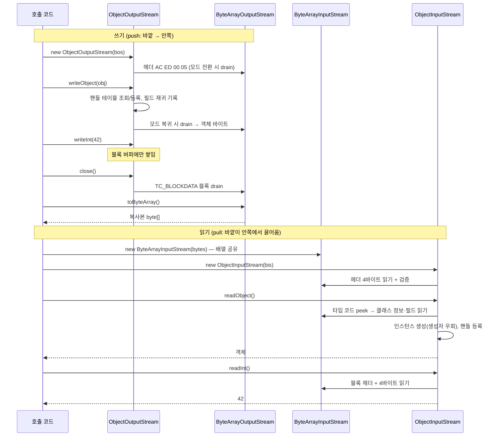

# 입출력 스트림 조합 — ByteArray·Object Input/OutputStream

관련 문서: [예제](./입출력스트림-예제.md)

> 이 문서는 아래 코드에 나온 **네 스트림이 각각 무엇을 하고, 서로 어떻게 맞물리는가**를 다룬다.
>
> ```java
> ByteArrayOutputStream bos = new ByteArrayOutputStream();
> new ObjectOutputStream(bos).writeObject(original);                                     // 직렬화
> byte[] bytes = bos.toByteArray();
> User copy = (User) new ObjectInputStream(new ByteArrayInputStream(bytes)).readObject(); // 역직렬화
> ```
>
> 직렬화 자체(`Serializable`, `serialVersionUID`, `transient`, 역직렬화 보안)는 [직렬화와 역직렬화](../직렬화/직렬화-이론.md)에서 다뤘다. 여기서는 **스트림 쪽**만 본다.

---

## 1. 한 줄 요약

`ByteArrayOutputStream`/`ByteArrayInputStream`은 메모리의 바이트 배열에 쓰고 읽는 스트림이고, `ObjectOutputStream`/`ObjectInputStream`은 그 위에 얹혀 객체를 바이트로 바꾸거나 바이트에서 객체를 되살리는 스트림이다.
정확히는, `ByteArray*Stream`은 힙의 `byte[]`를 **끝점(출력은 sink, 입력은 source)** 으로 쓰는 스트림 구현이고, `Object*Stream`은 다른 스트림을 감싸 Java 직렬화 프로토콜을 쓰고 읽는 **데코레이터(decorator) 스트림**이다. 데코레이터는 자체 블록 버퍼와 "이미 다룬 객체" 표를 가진다.

---

## 2. 왜 필요한가

**문제 1 — "어떤 형식으로"와 "어디서/어디로"가 섞인다.**
객체를 파일·소켓·`byte[]`에 쓰고 읽는 코드를 각각 따로 만들면 직렬화 형식 로직이 끝점 수만큼 복제된다. `java.io`는 이 둘을 분리했다.

- **끝점 스트림**: 바이트가 실제로 어디에 있는지를 정한다. `FileInput/OutputStream`, 소켓 스트림, `ByteArrayInput/OutputStream`.
- **데코레이터 스트림**: 바이트를 어떤 형식으로 해석할지, 어떻게 모을지를 정한다. `Buffered*`, `Data*`, `Object*`, `GZIP*`.

생성자로 끼워 맞추기만 하면 `Object*Stream` 코드 한 벌로 파일·네트워크·메모리를 모두 다룰 수 있다.

**문제 2 — 파일 없이 `byte[]`로 주고받아야 할 때가 많다.**
Redis·캐시에 값 넣기, 깊은 복사(deep copy), 메시지 본문 만들기, 테스트 데이터 주입 같은 경우다. 임시 파일은 느리고 정리도 번거롭다. `ByteArray*Stream`은 "끝점 = 메모리"라서 `OutputStream`/`InputStream`을 요구하는 모든 API에 `byte[]`를 바로 연결할 수 있다.

---

## 3. 최소 예제로 보기

```java
ByteArrayOutputStream bos = new ByteArrayOutputStream();
ObjectOutputStream oos = new ObjectOutputStream(bos);
System.out.println(bos.size());                    // ① 4
oos.writeObject("hi");
System.out.println(bos.size());                    // ② 9
oos.writeInt(42);
System.out.println(bos.size());                    // ③ 9   ← 아직 안 내려왔다
oos.close();
System.out.println(bos.size());                    // ④ 15
byte[] bytes = bos.toByteArray();

ByteArrayInputStream bis = new ByteArrayInputStream(bytes);
ObjectInputStream ois = new ObjectInputStream(bis);
System.out.println(bis.available());               // ⑤ 11  ← 생성자가 헤더 4바이트를 이미 읽었다
System.out.println(ois.readObject());              // ⑥ hi
System.out.println(ois.available());               // ⑦ 4   ← 블록 데이터(int) 바이트만 센다
System.out.println(ois.readInt());                 // ⑧ 42

-----------------------------------------------------------------------------------------
ByteArrayOutputStream bytes = new ByteArrayOutputStream();
ObjectOutputStream objects = new ObjectOutputStream(bytes);

objects.writeObject("안녕하세요");
objects.flush();

byte[] result = bytes.toByteArray()

objects.writeObject("안녕하세요")를 호출하면 ObjectOutputStream이 문자열 객체를 직렬화해 바이트로 만들고, 연결된 ByteArrayOutputStream이 그 바이트를 메모리에 담는다.
```

바이트로 보면 이렇다.

```
AC ED 00 05 | 74 00 02 68 69 | 77 04 00 00 00 2A
  헤더         TC_STRING "hi"   TC_BLOCKDATA 4바이트 = 42
```

이 예제에서 볼 수 있는 것:

- **출력**: `ByteArrayOutputStream`에는 `ObjectOutputStream`이 "내려보낸" 바이트만 있다. 헤더는 생성자에서 즉시(①), 객체는 `writeObject`가 끝날 때(②) 내려가지만, `writeInt`는 `close()`(또는 `flush()`) 전까지 위 스트림에 머문다(③ → ④).
- **입력**: `ObjectInputStream`은 생성자에서 헤더를 **읽고 검증한다**(⑤). `ois.available()`은 "남은 바이트 수"가 아니라 **현재 블록 데이터 안에서 남은 바이트 수**다. 그래서 ⑥ 전에 호출하면 객체가 남아 있어도 0이 나온다.

즉 출력 쪽 함정은 **"아직 안 내려갔다"**, 입력 쪽 함정은 **"얼마나 남았는지, 어디가 끝인지 모른다"** 에서 나온다.

전체 실행 코드는 [예제 문서](./입출력스트림-예제.md)에 있다.

---

## 4. 핵심 개념

| 용어 | 설명 |
|---|---|
| 끝점 스트림 (Source / Sink Stream) | 바이트가 실제로 있는 곳을 가진 스트림. 입력은 source, 출력은 sink. 여기서는 둘 다 힙의 `byte[]`이다. |
| 데코레이터 스트림 (Decorator / Filter Stream) | 다른 스트림을 생성자로 받아 감싸고 읽기·쓰기를 가공하는 스트림. `Object*Stream`, `Buffered*Stream`. |
| 스트림 체인 (Stream Chain) | 데코레이터를 겹겹이 감싼 구조. 출력은 바깥에서 안쪽으로 **밀어 넣고(push)**, 입력은 바깥이 안쪽에서 **끌어온다(pull)**. `close()`는 양쪽 모두 바깥에서 안쪽으로 전파된다. |
| 버퍼와 플러시 (Buffer / Flush) | 데코레이터가 바이트를 잠시 모아 두는 배열과, 그 배열을 안쪽으로 강제로 내려보내는 동작. 출력 쪽에만 있는 개념이다. `close()`는 flush를 포함한다. |
| 스트림 헤더 (Stream Header) | `ObjectOutputStream` 생성자가 쓰고 `ObjectInputStream` 생성자가 읽어 검증하는 4바이트 `AC ED 00 05`. |
| 블록 데이터 모드 (Block Data Mode) | `writeInt` 같은 원시값을 최대 1024바이트짜리 `TC_BLOCKDATA` 블록으로 묶어 쓰고 읽는 모드. |
| 핸들 테이블 (Handle Table) | 한 스트림이 이미 쓰거나 읽은 객체를 기억하는 표. 같은 객체는 두 번째부터 "n번 객체" 참조로만 오간다. 쓰는 쪽과 읽는 쪽이 같은 번호를 맞춰 간다. |
| 스트림 끝 (EOF, End Of File) | 더 읽을 바이트가 없는 상태. `read()`는 `-1`을 돌려주고, `readObject`·`readInt` 같은 형식 읽기는 `EOFException`을 던진다. |

---

## 5. 동작 원리와 흐름

### 5.1 쓰기 흐름 (push)

1. `new ByteArrayOutputStream()` — 길이 32인 `byte[] buf`와 `count = 0`을 만든다.
2. `new ObjectOutputStream(bos)`
   1. 내부 블록 버퍼(`BlockDataOutputStream`)를 만들고 `bos`를 안쪽에 연결한다.
   2. 헤더 `AC ED 00 05`를 블록 버퍼에 쓴다.
   3. 블록 데이터 모드를 켠다. **모드가 바뀌는 순간 버퍼를 비우므로** 헤더가 곧바로 `bos`로 내려간다.
3. `writeObject(obj)`
   1. 블록 데이터 모드를 끈다(전환 → 버퍼 비움).
   2. 핸들 테이블에서 `obj`를 찾는다. 있으면 `TC_REFERENCE` + 핸들 번호 5바이트만 쓰고, 없으면 새 번호를 붙인 뒤 클래스 정보와 필드를 재귀적으로 쓴다.
   3. 모드를 원래대로 되돌린다(전환 → 버퍼 비움). 그래서 최상위 `writeObject`가 끝나면 그 바이트는 `bos`에 도착해 있다. **현재 JDK 구현의 결과이며 API 명세가 보장하지는 않는다.**
4. `writeInt` 같은 원시값은 블록 버퍼에 쌓이기만 한다. 버퍼가 1024바이트를 넘거나, 모드가 바뀌거나, `flush()`/`close()`가 불릴 때 `TC_BLOCKDATA` 블록으로 감싸져 내려간다.
5. `bos`는 쓰기 요청을 받을 때마다 공간을 확인하고, 모자라면 약 2배 크기의 새 배열로 복사한다.
6. `bos.toByteArray()` — 앞 `count`바이트를 **새 배열로 복사해서** 돌려준다.
7. `oos.close()` — flush → 핸들 테이블 비우기 → `bos.close()`(아무 일도 하지 않음).

### 5.2 읽기 흐름 (pull)

1. `new ByteArrayInputStream(bytes)` — 배열을 **복사하지 않고 그대로 참조한다**. 읽기 위치 `pos = 0`, 끝 `count = bytes.length`.
2. `new ObjectInputStream(bis)`
   1. 내부 블록 입력 버퍼(`BlockDataInputStream`)를 만들고 `bis`를 안쪽에 연결한다.
   2. **헤더 4바이트를 즉시 읽는다.** 바이트가 아직 없으면(소켓) 도착할 때까지 블록되고, 비어 있으면 `EOFException`, `AC ED 00 05`가 아니면 `StreamCorruptedException: invalid stream header: XXXXXXXX`가 난다.
3. `readObject()`
   1. 지금 위치에 읽지 않은 블록 데이터(원시값)가 남아 있으면 `OptionalDataException`을 던진다. 쓴 순서와 다르게 읽은 것이다.
   2. 다음 1바이트(타입 코드)를 엿본다(peek).
      - `TC_OBJECT`/`TC_STRING` 등: 클래스 정보를 읽고 클래스를 로딩한 뒤(Java 9+에서는 이 시점에 역직렬화 필터 검사), 생성자를 우회해 인스턴스를 만들고 필드를 채운다. 새 핸들 번호로 등록한다.
      - `TC_REFERENCE`: 핸들 테이블에서 **이미 만든 객체를 그대로** 돌려준다.
      - `TC_RESET`: 핸들 테이블을 비우고 다음 코드를 읽는다.
      - 바이트가 없음: `EOFException`.
      - 알 수 없는 코드: `StreamCorruptedException: invalid type code: XX`.
4. `readInt()` — 블록 데이터 모드에서 `TC_BLOCKDATA` 블록 헤더를 읽고, 그 안에서 4바이트를 꺼낸다.
5. `ois.available()` — **현재 블록 데이터 안에서** 막힘 없이 읽을 수 있는 바이트 수만 돌려준다. 다음이 객체면 0이다. 반면 `bis.available()`은 `count - pos`, 즉 배열에 남은 정확한 바이트 수다.
6. `ois.close()` — 핸들 테이블을 비우고 `bis.close()`(아무 일도 하지 않음)를 호출한다.



### 5.3 데코레이터를 하나 더 끼우면

- **출력**: `new ObjectOutputStream(new BufferedOutputStream(bos))`처럼 버퍼가 있는 데코레이터를 사이에 끼우면, `ObjectOutputStream`이 내려보낸 바이트도 `BufferedOutputStream`(기본 8192바이트)에 막힌다. 그러면 `writeObject` 직후에도 `bos.size()`가 0이다. **가장 바깥에서 `flush()`/`close()`를 불러야 모든 층이 비워진다.**
- **입력**: 데코레이터는 안쪽에서 **필요한 만큼 또는 그보다 많이** 끌어온다. `BufferedInputStream`은 한 번에 최대 8192바이트를 미리 읽는다. 그래서 같은 안쪽 스트림을 데코레이터 밖에서 직접 읽으면 데이터가 이미 사라져 있을 수 있다. 반대로 끝점이 네트워크면 `read(byte[])` 한 번이 요청보다 **적게** 돌려줄 수 있다(8.3).

### 5.4 무엇이 어디서 생기고 사라지나

| 객체 | 생성 | 소멸 / 해제 |
|---|---|---|
| `ByteArrayOutputStream.buf` | 생성자에서 32바이트. 확장할 때마다 새 배열을 만들고 옛 배열은 버린다 | `bos` 참조가 사라질 때 GC. `close()`로는 해제되지 않는다 |
| `toByteArray()` 결과 | 호출할 때마다 새로 복사 | 호출자가 쥐고 있는 동안 유지 |
| `ByteArrayInputStream.buf` | **만들지 않는다.** 전달받은 배열을 그대로 참조한다 | `bis`가 살아 있는 동안 원본 배열도 GC되지 않는다 |
| `Object*Stream` 블록 버퍼 | 각 생성자 | 스트림 참조가 사라질 때 GC |
| 핸들 테이블 (양쪽) | 각 생성자 | `reset()`(읽는 쪽은 `TC_RESET`을 만날 때)이나 `close()`로 비워진다. 그전까지는 **다룬 객체 전부를 강한 참조로 붙잡는다** |
| OS 자원 | 없음 (넷 다 순수 힙 객체) | 해당 없음. 그래서 `ByteArray*Stream`만 쓰는 체인은 닫지 않아도 자원 누수가 없다. 끝점이 파일·소켓이면 반드시 닫아야 한다 |

---

## 6. 내부 구현 (핵심만)

| 클래스·메서드 | 하는 일 | 그래서 생기는 동작 |
|---|---|---|
| `ByteArrayOutputStream`의 확장(`ensureCapacity` → `grow`)과 `toByteArray` | `max(2배, 필요한 크기)`로 새 배열을 만들어 복사하고, 꺼낼 때 또 복사한다 | 크기를 몰라도 쓸 수 있지만 피크 메모리가 결과의 2~3배가 된다. 약 2GB가 상한이다 (8.6) |
| `ByteArrayInputStream` 생성자와 `available` | 배열을 복사 없이 참조하고, `available()`은 `count - pos`를 돌려준다 | 메모리 추가 비용은 없지만 원본 배열을 나중에 수정하면 읽히는 값도 바뀐다. 이 클래스의 `available()`만큼은 정확하다 |
| `ByteArray*Stream#close` | 아무것도 하지 않는다 | 바깥 `Object*Stream`을 try-with-resources로 닫아도 `bos.toByteArray()`를 그 뒤에 호출할 수 있다. 닫힌 `bos`에 계속 쓸 수도 있다 (8.4) |
| `ObjectOutputStream` 내부 `BlockDataOutputStream#setBlockDataMode`/`drain` | 모드 전환, 버퍼 가득 참, `flush()` 때만 안쪽으로 내려보낸다 | `writeObject` 직후에는 보이고 `writeInt` 직후에는 안 보이는 비대칭이 생긴다 (8.1) |
| `ObjectOutputStream#writeStreamHeader` / `ObjectInputStream#readStreamHeader` | 생성자에서 헤더를 쓰고, 생성자에서 읽어 검증한다 | 이어쓰기하면 헤더가 중복되고, 다른 형식 바이트는 생성 단계에서 거부되며, 소켓에서는 생성자가 블록된다 (8.4, 8.7) |
| `ObjectInputStream` 내부 `BlockDataInputStream#available` | 블록 데이터 모드일 때 현재 블록의 남은 바이트만 센다. 다음이 객체면 0이다 | `while (ois.available() > 0)` 루프는 객체를 하나도 읽지 않는다 (8.2) |
| 양쪽 `HandleTable`과 `reset()` | 객체를 동일성(`==`)으로 번호 매겨 기억한다. `reset()`은 표를 비우고 `TC_RESET`을 기록하며, 읽는 쪽도 이것을 보고 표를 비운다 | 수정한 객체를 다시 써도 옛 내용이 전달되고, 오래 사는 스트림에서는 메모리 누수가 된다 (8.5) |

---

## 7. 유사 개념과의 비교

### 7.1 출력 vs 입력 — 무엇이 다른가

| 관점 | 출력 (`ByteArrayOutputStream` + `ObjectOutputStream`) | 입력 (`ByteArrayInputStream` + `ObjectInputStream`) |
|---|---|---|
| 데이터 흐름 | push. 바깥이 안쪽으로 밀어 넣는다 | pull. 바깥이 안쪽에서 끌어온다 |
| 대표 함정 | **아직 안 내려갔다** — flush/close 전에 꺼내면 잘린다 | **끝을 모른다** — `available()`, 부분 읽기, EOF 판단 |
| `ByteArray*` 쪽 배열 | 자기 배열을 키워 가며 쓰고, 꺼낼 때 **복사** | 넘겨받은 배열을 **복사 없이 공유** |
| 생성자의 부작용 | 헤더를 **쓴다** (두 번 만들면 중복) | 헤더를 **읽고 검증한다** (데이터가 없으면 블록, 형식이 다르면 예외) |
| 핸들 테이블 | 쓴 객체를 기억해 참조만 기록 | 읽은 객체를 기억해 같은 인스턴스를 돌려줌 |
| flush | 있음. 정확성에 직결된다 | 없음. 입력에는 "밀어낼" 것이 없다 |
| `available()` | 해당 없음 | `bis`는 정확, `ois`는 블록 데이터 안에서만 의미 있음 |
| 보안 | 쓰는 쪽에는 위험이 없다 | **신뢰할 수 없는 바이트를 읽는 순간이 공격 지점**이다. 클래스 로딩·필드 복원 중 코드가 실행될 수 있다 ([직렬화 이론](../직렬화/직렬화-이론.md) 8.6) |
| 예외 | 주로 `NotSerializableException` | `EOFException`, `StreamCorruptedException`, `OptionalDataException`, `ClassNotFoundException`, `InvalidClassException` |

**정리하면:** 조립 방식(데코레이터 체인)은 같고 바이트 형식도 대칭이다. 다른 것은 실패하는 방식이다. 출력은 **언제 내려가는가**, 입력은 **어디가 끝이고 이 바이트를 믿어도 되는가**를 신경 써야 한다.

### 7.2 같은 계열의 스트림

| 출력 / 입력 | 역할 | 내부 버퍼 | 언제 쓰나 |
|---|---|---|---|
| `ByteArrayOutputStream` / `ByteArrayInputStream` | 끝점 (메모리) | 배열 자체가 끝점 | `byte[]`를 스트림 API에 연결할 때 |
| `FileOutputStream` / `FileInputStream` | 끝점 (파일) | 없음 (매 호출이 시스템 콜) | 파일. 보통 `Buffered*`로 감싼다 |
| `BufferedOutputStream` / `BufferedInputStream` | 데코레이터 | 8192바이트 | 작은 호출을 모아 시스템 콜을 줄일 때. **끝점이 메모리면 감쌀 이유가 없다** |
| `DataOutputStream` / `DataInputStream` | 데코레이터 (원시값) | 없음 | `int`·`long`·UTF 문자열을 고정 형식으로. `readFully`로 부분 읽기를 막을 때 |
| `ObjectOutputStream` / `ObjectInputStream` | 데코레이터 (객체 그래프) | 블록 버퍼 1024바이트 + 핸들 테이블 | Java 직렬화가 필요할 때 |

### 7.3 메모리에서 바이트를 다루는 방법

| 방법 | 크기 | 복사 | 판단 기준 |
|---|---|---|---|
| `ByteArrayOutputStream` / `ByteArrayInputStream` | 출력은 자동 확장 | 출력은 꺼낼 때 복사, 입력은 공유 | `OutputStream`/`InputStream`을 요구하는 API(직렬화, 압축, 암호화)에 연결할 때 |
| `java.nio.ByteBuffer` | 고정 (넘치면 `BufferOverflowException`) | `array()`·`flip()`으로 복사 없이 가능 | 크기를 알고, NIO 채널이나 복사 없는 처리가 필요할 때 |

결과가 수백 MB를 넘을 수 있으면 둘 다 쓰지 말고 파일이나 네트워크 스트림에 체인을 직접 연결한다 (8.6).

---

## 8. 함정과 안티패턴

### 8.1 [출력] 바깥 스트림을 닫기 전에 `toByteArray()` — 잘린 바이트

- **증상**: `toByteArray()` 결과를 역직렬화하면 `EOFException`이 난다. 같은 코드가 잘 되다가, 데코레이터 하나를 추가하거나 `writeInt`를 섞으면 깨진다.
- **원인**: `bos`에는 바깥 데코레이터가 내려보낸 바이트만 있다 (5.1). `writeObject` 직후에는 모드 전환 덕분에 우연히 다 내려와 있지만, 원시값은 블록 버퍼에 남는다 (6장). 사이에 `BufferedOutputStream`이 끼면 객체 바이트도 막힌다 (5.3).
- **해결**: 가장 바깥 스트림을 try-with-resources로 닫은 **뒤에** 꺼낸다. `bos.close()`는 no-op이라 닫힌 뒤에도 꺼낼 수 있다.

#### 쉽게 풀어 설명

쉽게 말하면 **`toByteArray()`를 너무 일찍 호출해서, 아직 쓰기가 끝나지 않은 바이트 배열을 읽었다**는 뜻이에요.

스트림이 이렇게 연결되어 있다고 생각해 보세요.

```text
ObjectOutputStream → BufferedOutputStream → ByteArrayOutputStream(bos)
```

`writeObject()`나 `writeInt()`를 호출해도 바이트가 중간 스트림의 **버퍼에 잠시 남을 수 있습니다**. `bos.toByteArray()`는 그 시점에 **bos까지 도착한 바이트만 복사**합니다. 빠진 바이트를 역직렬화 과정에서 읽으려 하면 `EOFException`이 납니다. `ObjectOutputStream.flush()`는 버퍼의 바이트를 안쪽 스트림까지 내려보냅니다. [ObjectOutputStream 문서](https://docs.oracle.com/en/java/javase/21/docs/api/java.base/java/io/ObjectOutputStream.html)

가장 간단한 방법은 **가장 바깥 스트림을 닫은 다음** 배열을 꺼내는 것입니다.

```java
ByteArrayOutputStream bos = new ByteArrayOutputStream();

try (ObjectOutputStream out =
         new ObjectOutputStream(new BufferedOutputStream(bos))) {
    out.writeObject("안녕하세요");
    out.writeInt(42);
} // out을 닫으면서 중간 버퍼의 내용도 bos로 내려감

byte[] data = bos.toByteArray();
```

`bos`는 닫힌 뒤에도 `toByteArray()`를 호출할 수 있습니다. [ByteArrayOutputStream 문서](https://docs.oracle.com/en/java/javase/21/docs/api/java.base/java/io/ByteArrayOutputStream.html)

그리고 읽을 때는 **쓴 순서 그대로** 읽어야 해요.

```java
try (ObjectInputStream in =
         new ObjectInputStream(new ByteArrayInputStream(data))) {
    String text = (String) in.readObject();
    int number = in.readInt();
}
```

즉, 이 글의 핵심은 **`writeInt()`가 이상한 것이 아니라, 중간 버퍼를 비우기 전에 `bos`의 바이트를 꺼냈을 수 있다**는 말입니다. 닫은 뒤에도 문제가 나면 읽기 순서가 쓰기 순서와 같은지 확인하면 됩니다.

### 8.2 [입력] `available()`이나 `null`로 끝을 판단 — 0개 읽기 또는 `EOFException`

- **증상**: `while (ois.available() > 0) list.add(ois.readObject());`가 객체를 하나도 읽지 않는다. 반대로 `while ((o = ois.readObject()) != null)`은 마지막에 `EOFException`으로 터진다.
- **원인**: `ois.available()`은 현재 블록 데이터 안의 바이트만 센다. 다음이 객체면 0이다 (6장). `readObject()`는 끝에서 `null`을 돌려주지 않고 `EOFException`을 던진다 (5.2). `null`은 실제로 `null`을 쓴 경우에만 나온다. 쓴 순서와 다르게 읽으면(원시값이 남았는데 `readObject`) `OptionalDataException`이 난다.
- **해결**: 쓰는 쪽에서 **개수를 먼저 기록**하거나, 컬렉션 하나로 묶어 `writeObject` 한 번에 쓴다. 형식을 바꿀 수 없을 때만 `EOFException`을 잡아 끝으로 처리한다. 읽는 순서는 쓰는 순서와 정확히 같아야 한다.

### 8.3 [입력] `read(byte[])` 한 번이 다 읽었다고 가정 — 잘린 데이터

- **증상**: 로컬 테스트(`ByteArrayInputStream`, 파일)에서는 통과하는데, 운영 환경의 소켓이나 HTTP 본문에서는 데이터가 간헐적으로 잘리거나 뒷부분이 0으로 채워진다.
- **원인**: `InputStream#read(byte[])`의 계약은 "**최소 1바이트, 최대 `len`바이트**를 읽고 그 수를 돌려준다"이다. `ByteArrayInputStream`은 있는 만큼 한 번에 주지만, 네트워크 끝점은 도착한 만큼만 준다 (5.3). 반환값을 무시하면 그 차이를 모른다.
- **해결**: 정해진 길이를 읽을 때는 `DataInputStream#readFully`(Java 1.0+)나 `InputStream#readNBytes(buf, off, len)`(Java 9+)를 쓴다. 끝까지 다 읽을 때는 `readAllBytes()`(Java 9+)나 `transferTo(out)`(Java 9+)를 쓴다. `ObjectInputStream`의 `readInt`·`readObject`는 내부에서 이미 끝까지 읽으므로 이 문제가 없다.

### 8.4 [양쪽] 헤더 불일치 — `invalid type code: AC` / `invalid stream header`

- **증상 1**: 객체를 하나씩 "append"한 파일이나 바이트를 `ObjectInputStream` 하나로 읽으면, 첫 객체만 읽히고 두 번째에서 `StreamCorruptedException: invalid type code: AC`가 난다.
- **증상 2**: Redis·캐시 값을 읽을 때 `StreamCorruptedException: invalid stream header: 7B226E61`이 난다.
- **원인**: 쓰는 쪽 생성자는 매번 헤더를 쓰고, 읽는 쪽 생성자는 처음에 한 번만 헤더를 읽는다 (6장). 그래서 두 번째 헤더의 `AC`가 타입 코드로 해석된다. 증상 2는 Java 직렬화가 아닌 바이트(여기서는 JSON `{"na`)를 `ObjectInputStream`에 넣어 헤더 검증이 실패한 것이다. 직렬화 방식이 다른 서버가 같은 키에 썼거나, gzip 등을 풀지 않고 넣은 경우(`1F8B…`)가 흔하다. `bos.close()`가 no-op이라 닫힌 `bos`에 계속 쓰는 실수도 예외 없이 진행된다.
- **해결**: 하나의 논리적 스트림에는 `ObjectOutputStream`을 하나만 만든다. 메시지를 따로 저장해야 하면 메시지마다 독립된 `byte[]`를 만든다. 헤더 오류 메시지의 16진수 8자리를 ASCII로 바꿔 보면 실제로 들어온 형식(JSON, gzip 등)을 바로 알 수 있다.

### 8.5 [양쪽] 핸들 테이블 — 수정이 전달되지 않음, 메모리 누수

- **증상 1**: 장바구니 리스트를 보내고 상품을 추가한 뒤 같은 리스트를 다시 보냈는데, 받는 쪽에는 처음 내용이 두 번 온다. 받은 두 객체는 `==`로 같다. 예외는 없다.
- **증상 2**: 소켓 하나에 `Object*Stream`을 열어 두고 메시지를 계속 주고받는 서버에서 힙이 계속 늘다가 `OutOfMemoryError`가 난다. 이 누수는 보내는 쪽과 받는 쪽 모두에서 생긴다.
- **원인**: 양쪽 핸들 테이블이 다룬 객체를 강한 참조로 기억한다 (5.4, 6장). 두 번째 쓰기는 참조 5바이트만 보내고, 읽는 쪽은 기존 인스턴스를 그대로 돌려준다.
- **해결**: 다시 보내기 전에, 또는 메시지마다 `oos.reset()`을 호출한다. `TC_RESET`이 전달되어 읽는 쪽 표도 함께 비워진다. `writeUnshared`는 최상위 객체만 새로 쓰므로 내부 객체가 바뀐 경우에는 효과가 없다. 장수명 연결이라면 메시지 단위 포맷(JSON, Protobuf)으로 바꾸는 것도 검토한다.

### 8.6 [양쪽] 큰 데이터를 `byte[]`로 왕복 — 메모리 폭증

- **증상**: 대용량 데이터를 `bos`에 직렬화했다가 `bis`로 다시 읽는 배치에서 `OutOfMemoryError`가 난다. 결과는 500MB인데 힙은 1.5GB 이상 쓴다.
- **원인**: 출력 쪽은 확장할 때 옛 배열과 새 배열이 잠시 공존하고, `toByteArray()`가 한 번 더 복사한다 (6장). 입력 쪽은 복사하지 않지만 `bis`가 살아 있는 동안 배열 전체가 GC되지 않는다 (5.4). 약 2GB를 넘으면 배열 한계로 무조건 실패한다.
- **해결**: 크면 메모리를 거치지 말고 파일·네트워크 스트림에 체인을 직접 연결한다. 크기를 대략 알면 `new ByteArrayOutputStream(예상크기)`로 확장 횟수를 줄인다. 이미 모은 데이터를 다른 스트림으로 보내기만 하면 되면 `bos.writeTo(out)`으로 복사 없이 넘긴다.

### 8.7 [입력] 소켓 양쪽이 `ObjectInputStream`을 먼저 생성 — 교착

- **증상**: 클라이언트와 서버가 연결 직후 둘 다 멈춘다. 스레드 덤프를 보면 양쪽 모두 `ObjectInputStream.<init>`에서 읽기 대기 중이다.
- **원인**: `ObjectInputStream` 생성자는 헤더를 읽을 때까지 블록된다 (5.2). 헤더는 상대방의 `ObjectOutputStream` 생성자가 써야 생긴다. 양쪽이 모두 읽기부터 시작하면 아무도 헤더를 쓰지 않는다. `BufferedOutputStream`을 끼웠다면 헤더를 써도 버퍼에 갇혀 같은 일이 생긴다 (5.3).
- **해결**: 양쪽 모두 `ObjectOutputStream`을 **먼저** 만들고 `flush()`한 다음 `ObjectInputStream`을 만든다.

---

## 9. 실무 적용 시나리오

| 상황 | 이 조합이 쓰이는 곳 | 주의할 함정 |
|---|---|---|
| 깊은 복사 | `deserialize(serialize(obj))`. Apache Commons `SerializationUtils.clone`이 이 방식이다 | 8.1. 느리므로 핫 패스에서는 복사 생성자·정적 팩터리를 쓴다 |
| 캐시·세션 저장소 | Spring Data Redis의 `JdkSerializationRedisSerializer`, Spring Session이 쓰기는 `bos`로, 읽기는 `bis`로 처리한다 | 8.4(직렬화 방식 혼용 시 `invalid stream header`), [직렬화 이론](../직렬화/직렬화-이론.md) 8.1·8.6 |
| 테스트 데이터 주입 | `InputStream`을 받는 파서·업로드 처리에 `new ByteArrayInputStream("...".getBytes(UTF_8))`를 넘긴다 | 8.3. `bis`는 한 번에 다 주므로 부분 읽기 버그가 테스트에서 드러나지 않는다 |
| 압축·암호화 파이프라인 | `new ObjectOutputStream(new GZIPOutputStream(bos))`, 읽을 때는 `new ObjectInputStream(new GZIPInputStream(bis))` | 8.1. `GZIPOutputStream`은 `close()`(또는 `finish()`) 때 트레일러를 쓴다. 감싸는 순서는 쓰기와 읽기가 대칭이어야 한다 |
| HTTP 업로드·다운로드 | 요청 본문을 `readAllBytes()`로 모으거나 응답을 `bos`에 모았다가 쓰는 코드 | 8.3, 8.6. 큰 파일은 스트림을 직접 연결하거나 `transferTo`를 쓴다 |
| 레거시 소켓 통신 (RMI, 사내 프로토콜) | 연결 하나에 `Object*Stream` 한 쌍을 유지한다 | 8.2, 8.5, 8.7 |

---

## 10. 버전 주의사항

- **Java 7+**: try-with-resources를 쓸 수 있다. Java 6 이하 코드에서는 `finally`에서 바깥 스트림을 닫아야 하고, `close()` 자체의 예외가 원래 예외를 덮는 점에 주의한다.
- **Java 9+**: `InputStream`에 `readAllBytes()`, `readNBytes(byte[], int, int)`, `transferTo(OutputStream)`가 추가되었다. 8.3의 수동 루프를 이것으로 바꿀 수 있다. Java 8 코드에서는 `DataInputStream#readFully`나 직접 루프를 쓴다.
- **Java 9+ (8u121+ 백포트)**: `ObjectInputFilter`(JEP 290)로 역직렬화할 클래스를 제한할 수 있다. 외부에서 들어온 바이트를 `ObjectInputStream`으로 읽는다면 적용해야 한다.
- **Java 11+**: `InputStream#readNBytes(int)`와 `ByteArrayOutputStream#writeBytes(byte[])`가 추가되었다. `writeBytes`는 `IOException`을 선언하지 않는다.
- 네 클래스의 바이트 형식과 flush·헤더 동작은 Java 7~21 사이에 코드 수정이 필요할 만큼 바뀌지 않았다.

---

## 11. 자가 점검 질문

1. 3장 예제에서 `new ObjectInputStream(bis)` 직후 `bis.available()`이 15가 아니라 11인 이유는? 이 생성자를 소켓 위에서 호출하면 무엇을 조심해야 하는가?

<details>
<summary>답</summary>

`ObjectInputStream` 생성자가 헤더 4바이트를 즉시 읽어 검증하기 때문이다. 소켓에서는 상대방의 `ObjectOutputStream` 생성자가 헤더를 써서 보낼 때까지 블록된다. 양쪽이 모두 입력 스트림부터 만들면 교착이 생기므로, `ObjectOutputStream`을 먼저 만들고 `flush()`해야 한다.

</details>

2. `oos.writeObject(x)` 직후에는 `bos.toByteArray()`가 완전한 결과를 주는데 `oos.writeInt(1)` 직후에는 그렇지 않은 이유는? 그런데도 왜 항상 close를 먼저 하라고 하는가?

<details>
<summary>답</summary>

최상위 `writeObject`는 끝날 때 블록 데이터 모드를 되돌리고, 이 모드 전환이 버퍼를 비운다. `writeInt`는 블록 버퍼에 쌓이기만 한다. 그런데 `writeObject` 쪽 동작은 구현의 결과일 뿐 명세가 보장하지 않는다. 또 사이에 `BufferedOutputStream`이나 `GZIPOutputStream`이 끼면 그 층의 버퍼에서 다시 막힌다. 그래서 가장 바깥 스트림을 닫은 뒤에 꺼낸다.

</details>

3. 객체 3개를 쓴 바이트를 `while (ois.available() > 0) ois.readObject();`로 읽으면 몇 개가 읽히는가? 올바른 방법은?

<details>
<summary>답</summary>

0개다. `ObjectInputStream#available()`은 현재 블록 데이터 안의 바이트만 세고, 다음이 객체면 0을 돌려준다. 쓰는 쪽에서 개수를 먼저 기록하고 그 수만큼 읽거나, 컬렉션 하나로 묶어서 쓴다. 형식을 바꿀 수 없을 때만 `EOFException`을 끝 신호로 처리한다.

</details>

4. `ByteArrayInputStream`으로 작성한 단위 테스트는 통과하는데 소켓에서는 데이터가 잘리는 코드가 있다. `in.read(buf)` 반환값을 무시하고 있었다. 왜 테스트에서는 드러나지 않았는가?

<details>
<summary>답</summary>

`read(byte[])`는 1바이트 이상 `len`바이트 이하를 읽을 수 있다. `ByteArrayInputStream`은 남은 데이터를 한 번에 다 주므로 항상 요청한 만큼 채워진다. 소켓은 도착한 만큼만 준다. `readFully`/`readNBytes`처럼 요청한 길이를 보장하는 메서드를 쓰고, 테스트에서는 한 번에 몇 바이트씩만 주는 데코레이터로 감싸 검증한다.

</details>

5. 하나의 `ObjectOutputStream`으로 리스트 `cart`를 쓰고, `cart.add(...)` 후 다시 썼다. 받는 쪽에서 두 번 읽은 결과는? 연결을 계속 유지하는 서버라면 추가로 어떤 문제가 생기는가?

<details>
<summary>답</summary>

두 결과 모두 처음 내용이고 같은 인스턴스(`==`)다. 쓰는 쪽 핸들 테이블이 참조만 기록하고, 읽는 쪽 핸들 테이블이 기존 인스턴스를 돌려주기 때문이다. 장수명 연결에서는 양쪽 핸들 테이블이 주고받은 모든 객체를 붙잡고 있어서 메모리 누수가 생긴다. `oos.reset()`을 호출하면 `TC_RESET`이 전달되어 양쪽 표가 모두 비워진다.

</details>

---

## 12. 참고 자료

- Java SE 21 API — [`ByteArrayOutputStream`](https://docs.oracle.com/en/java/javase/21/docs/api/java.base/java/io/ByteArrayOutputStream.html), [`ByteArrayInputStream`](https://docs.oracle.com/en/java/javase/21/docs/api/java.base/java/io/ByteArrayInputStream.html)
- Java SE 21 API — [`ObjectOutputStream`](https://docs.oracle.com/en/java/javase/21/docs/api/java.base/java/io/ObjectOutputStream.html), [`ObjectInputStream`](https://docs.oracle.com/en/java/javase/21/docs/api/java.base/java/io/ObjectInputStream.html)
- Java SE 21 API — [`InputStream#read(byte[], int, int)`](https://docs.oracle.com/en/java/javase/21/docs/api/java.base/java/io/InputStream.html#read(byte%5B%5D,int,int)) — 부분 읽기 계약
- Java Object Serialization Specification, 6장 "Object Serialization Stream Protocol" — 헤더, `TC_*` 타입 코드, 블록 데이터, `TC_RESET`
- JEP 290: Filter Incoming Serialization Data
- JDK 소스 `java.base/share/classes/java/io/ObjectOutputStream.java`, `ObjectInputStream.java` — `BlockDataOutputStream`, `BlockDataInputStream`, `HandleTable`
- *Effective Java* 3판 — 아이템 9 (try-with-resources), 아이템 85~90 (직렬화)
- GoF *Design Patterns* — Decorator 패턴 (`java.io`가 대표 사례)

---

## 부록: 용어 정리

| 용어 | 영문 | 설명 |
|---|---|---|
| 끝점 스트림 | Source / Sink Stream | 바이트가 실제로 있는 곳을 가진 스트림. `ByteArray*Stream`은 힙의 `byte[]` |
| 데코레이터 스트림 | Decorator Stream | 다른 스트림을 감싸 읽기·쓰기를 가공하는 스트림 |
| 깊은 복사 | Deep Copy | 객체와 그 객체가 참조하는 객체까지 모두 새로 복제하는 것 |
| 스트림 헤더 | Stream Header | `Object*Stream` 생성자가 쓰고 읽는 `AC ED 00 05` 4바이트 |
| 블록 데이터 | Block Data (`TC_BLOCKDATA`) | 원시값을 최대 1024바이트 단위로 묶은 직렬화 레코드 |
| 스트림 체인 | Stream Chain | 데코레이터를 겹겹이 감싼 구조 |
| 푸시 / 풀 | Push / Pull | 출력은 바깥이 안쪽으로 밀어 넣고, 입력은 바깥이 안쪽에서 끌어오는 방향성 |
| 플러시 | Flush | 출력 체인의 버퍼를 안쪽으로 강제로 내려보내는 동작. `close()`에 포함된다 |
| 블록 데이터 모드 | Block Data Mode | `Object*Stream`이 원시값을 블록 단위로 쓰고 읽는 상태. 출력 쪽은 모드가 바뀔 때 버퍼를 비운다 |
| 핸들 테이블 | Handle Table | 스트림이 이미 다룬 객체를 동일성 기준으로 번호 매겨 기억하는 표 |
| EOF | End Of File | 더 읽을 바이트가 없는 상태. `read()`는 `-1`, 형식 읽기는 `EOFException` |
| 매직 넘버 | Magic Number | 데이터 형식을 식별하는 고정 바이트. 직렬화 스트림은 `0xACED` |
| 엿보기 | Peek | 바이트를 소비하지 않고 다음 값만 확인하는 동작. 타입 코드 판별에 쓴다 |
| 드레인 | Drain | 출력 쪽 내부 버퍼의 내용을 안쪽 스트림으로 내려보내는 내부 동작 |
| 부분 읽기 | Partial Read | `read(byte[])`가 요청한 길이보다 적게 읽고 돌아오는 것. 계약상 허용된다 |
| 역직렬화 필터 | Deserialization Filter (`ObjectInputFilter`) | 역직렬화할 클래스를 허용 목록으로 제한하는 Java 9+ 기능 |
| 피크 메모리 | Peak Memory | 처리 중 순간적으로 가장 많이 쓰는 메모리 양 |
| 트레일러 | Trailer | gzip처럼 스트림 끝에 붙는 검증용 데이터. `close()`/`finish()` 때 기록된다 |
