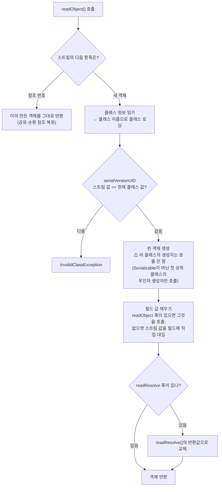

# 직렬화와 역직렬화

관련 문서: [예제](./직렬화-예제.md)

> 이 문서는 **Java 기본 직렬화**(`Serializable`, `ObjectOutputStream`)를 다룬다. JSON 직렬화(Jackson)는 동작 원리가 달라서 별도 주제로 다룬다.
>
> 연결되는 기존 학습 주제
> - **JWT + Spring Security**: 세션 기반 인증을 쓰면 `SecurityContext`가 HTTP 세션에 저장된다. 세션을 Redis 등에 저장하면 이 객체가 Java 직렬화된다 (8.1, 9장).
> - **JPA 엔티티 설계**: 복합 키 클래스(`@IdClass`, `@EmbeddedId`)는 JPA 스펙상 `Serializable`을 구현해야 한다 (9장).

---

## 1. 한 줄 요약

직렬화는 메모리에 있는 객체를 파일이나 네트워크로 보낼 수 있는 바이트로 바꾸는 것이고, 역직렬화는 그 바이트로 객체를 다시 만드는 것이다.
정확히는, Java 직렬화는 `ObjectOutputStream`이 `Serializable` 객체와 그 객체가 참조하는 객체 그래프 전체를 클래스 정보와 함께 바이트 스트림으로 기록하고, `ObjectInputStream`이 그 스트림에서 **생성자를 호출하지 않고** 동일한 구조의 새 객체 그래프를 재구성하는 JDK 내장 메커니즘이다.

---

## 2. 왜 필요한가

JVM 힙의 객체는 **메모리 주소로 서로 연결**되어 있다. 주소는 그 프로세스 안에서만 의미가 있으므로, 객체를 프로세스 밖으로 내보내려면 "주소 없는 표현"으로 바꿔야 한다.

- 파일에 저장했다가 나중에 다시 읽기
- 다른 서버로 전송하기 (원격 호출, 세션 복제)
- 외부 저장소에 넣기 (Redis 캐시, 세션 저장소)

Java 직렬화 이전에는 필드를 하나씩 꺼내 `DataOutputStream.writeInt(...)`, `writeUTF(...)`로 직접 쓰고, 읽을 때 같은 순서로 다시 조립해야 했다. 필드가 추가될 때마다 쓰기·읽기 코드를 같이 고쳐야 하고, 객체끼리 참조하거나 순환 참조가 있으면 직접 처리하기가 매우 어렵다.

JDK 1.1은 `implements Serializable` 한 줄로 이 작업을 자동화했다. 하지만 **너무 쉽게 켤 수 있다는 점이 문제**가 되었다. 클래스 내부 구조가 그대로 바이트 형식이 되어 버리므로, 클래스를 고치면 예전 데이터를 못 읽고(8.1), 생성자 검증이 무시되며(8.3), 외부 데이터를 역직렬화하는 것만으로 공격당할 수 있다(8.6). 그래서 이펙티브 자바는 "새 시스템에서는 Java 직렬화 대신 JSON 같은 대안을 쓰라"(아이템 85)고 권한다.

그럼에도 이 주제를 알아야 하는 이유는, **Spring 생태계의 여러 기본값이 여전히 Java 직렬화**이기 때문이다 (9장).

---

## 3. 최소 예제로 보기

```java
public class User implements Serializable {
    private final String name;
    private transient String password;   // 직렬화에서 제외

    public User(String name, String password) {
        System.out.println("생성자 호출: " + name);
        this.name = name;
        this.password = password;
    }
    // getter 생략
}

User original = new User("kim", "secret");

ByteArrayOutputStream bos = new ByteArrayOutputStream();
new ObjectOutputStream(bos).writeObject(original);           // 직렬화
byte[] bytes = bos.toByteArray();

User copy = (User) new ObjectInputStream(new ByteArrayInputStream(bytes)).readObject();  // 역직렬화

System.out.println(bytes.length + " bytes");
System.out.println(copy == original);                          // 다른 객체
System.out.println(copy.getName() + ", " + copy.getPassword());
```

예상 출력 (바이트 수는 패키지명 등에 따라 달라지며, 대략 100바이트 안팎이다):

```
생성자 호출: kim
1xx bytes
false
kim, null
```

이 네 줄에서 읽어낼 것:

1. **"생성자 호출"이 한 번만 찍혔다.** 역직렬화는 생성자를 부르지 않고 객체를 만든다 (5.2, 8.3).
2. `copy`는 원본과 **다른 객체**다. 값만 같은 복사본이다.
3. `transient` 필드 `password`는 저장되지 않아 `null`로 돌아왔다 (8.2).
4. 필드 두 개짜리 객체인데 100바이트가 넘는다. 값뿐 아니라 **클래스 이름, 필드 이름·타입, 버전 번호**까지 함께 기록되기 때문이다 (5.1).

---

## 4. 핵심 개념

| 용어 | 정의 |
|---|---|
| 직렬화 (Serialization) | 객체를 바이트 스트림으로 바꾸는 과정. `ObjectOutputStream#writeObject`. |
| 역직렬화 (Deserialization) | 바이트 스트림에서 객체를 다시 만드는 과정. `ObjectInputStream#readObject`. |
| `Serializable` | 메서드가 없는 표시 인터페이스(marker interface). "이 클래스는 직렬화해도 된다"는 허가 표시다. 구현하지 않은 객체를 쓰면 `NotSerializableException`. |
| 객체 그래프 (Object Graph) | 루트 객체에서 참조를 따라 도달할 수 있는 모든 객체. 직렬화는 루트 하나가 아니라 **그래프 전체**를 쓴다. |
| `serialVersionUID` | 클래스의 직렬화 버전 번호(`long`). 스트림에 기록된 값과 현재 클래스의 값이 다르면 역직렬화가 실패한다. |
| `transient` | 직렬화에서 제외할 필드에 붙이는 키워드. 역직렬화 후 기본값(`null`/`0`/`false`)이 된다. |
| 직렬화 형태 (Serialized Form) | 직렬화 결과 바이트의 구조. 기본값은 "클래스의 필드 구성 그대로"이며, 한번 저장·전송되면 **바꾸기 어려운 약속**이 된다. |
| 직렬화 훅 메서드 (Serialization Hook) | 클래스에 `private void readObject(...)`, `writeObject(...)`, `readResolve()` 같은 정해진 시그니처의 메서드를 두면 JDK가 직렬화 중에 대신 호출해주는 메서드들. |

---

## 5. 동작 원리와 흐름

### 5.1 직렬화 (쓰기)

1. `new ObjectOutputStream(out)` — 스트림 헤더(매직 넘버 `0xACED`, 버전)를 먼저 쓴다.
2. `writeObject(user)` 호출.
3. 이 스트림에서 **이미 쓴 객체인지** 확인한다. 이미 썼다면 객체 대신 "N번 객체와 같음"이라는 참조 번호만 쓴다. 그래서 같은 객체를 두 번 참조하거나 순환 참조(A → B → A)가 있어도 무한 루프 없이 구조가 그대로 보존된다.
4. 객체가 `Serializable`인지 확인한다. 아니면 `NotSerializableException`.
5. **클래스 정보**를 쓴다: 클래스 이름, `serialVersionUID`, 필드 이름과 타입. (같은 스트림에서 두 번째부터는 참조 번호만)
6. **필드 값**을 쓴다. 상위 클래스부터 하위 클래스 순으로, `static`과 `transient`를 제외한 필드. 해당 클래스에 `writeObject` 훅이 있으면 그 메서드가 대신 쓴다.
7. 필드가 다른 객체를 참조하면 그 객체에 대해 3번부터 **재귀**한다. 참조 객체 중 하나라도 `Serializable`이 아니면 전체가 실패한다.

### 5.2 역직렬화 (읽기)



1. 스트림에서 다음 항목을 읽는다. 이미 만든 객체에 대한 참조 번호면 그 객체를 돌려준다.
2. 클래스 정보를 읽고, **클래스 이름으로 클래스를 로딩**한다. 즉 스트림이 어떤 클래스를 만들지 결정한다 (8.6의 근원).
3. 스트림에 적힌 `serialVersionUID`와 현재 JVM에 로딩된 클래스의 값을 비교한다.
4. **빈 객체를 만든다.** 이때 `Serializable` 클래스 자신의 생성자는 호출되지 않는다. 대신 상속 계층을 거슬러 올라가 `Serializable`이 **아닌** 첫 상위 클래스(보통 `Object`)의 무인자 생성자만 실행된다.
5. 필드 값을 채운다. 생성자를 거치지 않았으므로 **필드 초기화 식(`= new ArrayList<>()`)도 실행되지 않는다.** 스트림에 있는 값은 그 값으로, `transient` 필드는 기본값으로 남는다.
6. `readResolve` 훅이 있으면 호출해서 반환값으로 객체를 바꿔치기한다.

### 5.3 무엇이 어디서 생기고 사라지나

| 객체 | 생성 | 소멸 |
|---|---|---|
| `ObjectOutputStream` / `ObjectInputStream` | 직렬화·역직렬화할 때마다 사용자가 생성 | `close()` 후. 스트림 안의 "이미 쓴/읽은 객체" 표도 함께 사라진다 |
| 클래스별 직렬화 메타데이터 (`ObjectStreamClass`) | 해당 클래스를 처음 직렬화할 때 계산 | JVM 전역 캐시에 남는다 |
| 역직렬화된 객체 | 5.2의 4번 단계 | 일반 객체와 같이 GC 대상 |
| 바이트 배열/파일 | `writeObject` 결과 | 사용자가 관리. **클래스가 바뀌어도 바이트는 그대로 남아 있다** (8.1) |

---

## 6. 내부 구현 (핵심만)

8장의 함정을 설명하는 데 필요한 다섯 가지만 본다. 소스 레벨 세부는 심화 문서 범위다.

| 클래스 / 메서드 | 하는 일 | 그래서 생기는 동작 |
|---|---|---|
| `ObjectStreamClass#getSerialVersionUID` | `serialVersionUID`가 선언되어 있으면 그 값을, 없으면 클래스 이름·필드·메서드·생성자 시그니처를 해시해서 **자동 계산**한다. | 선언하지 않으면 **메서드 하나만 추가해도 값이 바뀐다.** 배포 후 기존 데이터를 못 읽는다 (8.1). |
| `ObjectOutputStream#writeObject0` | 객체가 `Serializable`인지 검사하고, 아니면 `NotSerializableException`을 던진다. 필드를 재귀적으로 따라간다. | 루트가 아니라 **그래프 안의 어떤 필드 하나**만 `Serializable`이 아니어도 실패한다 (8.4). |
| `ObjectStreamClass#newInstance` | `Serializable`이 아닌 첫 상위 클래스의 무인자 생성자를 사용해 인스턴스를 만든다. | 생성자 검증과 필드 초기화 식이 **실행되지 않는다** (8.2, 8.3). |
| `ObjectInputStream#defaultReadObject` | 스트림의 필드 값을 리플렉션으로 필드에 직접 넣는다. `final` 필드도 가능하다. 클래스에 `readObject` 훅이 있으면 그 안에서 호출하는 용도로 쓴다. | `readObject` 훅 안에서 `defaultReadObject()` 후에 **검증·transient 필드 재생성**을 할 수 있다 (8.2, 8.3의 해결책). |
| `readResolve()` 훅 | 역직렬화가 끝난 객체를 이 메서드의 반환값으로 교체한다. | 싱글턴을 역직렬화하면 **새 인스턴스가 생기는 문제**를 막을 수 있다 (8.5). |

`enum`과 `record`(Java 16+)는 위 규칙의 예외다.

- **enum**: 상수 이름만 기록하고, 읽을 때 `Enum.valueOf`로 **기존 상수를 찾아서** 돌려준다. 새 인스턴스가 생기지 않는다.
- **record**: 필드 값을 모은 뒤 **정식 생성자(canonical constructor)를 호출**해서 객체를 만든다. 생성자의 검증이 동작한다.

---

## 7. 유사 개념과의 비교

### 7.1 직렬화 방식

| 기준 | Java 기본 직렬화 | JSON (Jackson 등) | Protocol Buffers |
|---|---|---|---|
| 읽을 수 있는 언어 | Java만 | 모든 언어 | 모든 언어 (스키마 컴파일) |
| 사람이 읽을 수 있음 | ✗ (바이너리) | ✓ (텍스트) | ✗ |
| 설정 비용 | `implements Serializable` 한 줄 | DTO 설계 | `.proto` 스키마 작성 |
| 클래스 변경에 대한 내성 | 약함 (`serialVersionUID` 관리 필요) | 강함 (모르는 필드 무시 가능) | 강함 (필드 번호 규칙) |
| 객체 생성 방식 | **생성자 우회** | 생성자 호출 | 생성된 빌더 사용 |
| 외부 입력 보안 | 위험 (8.6) | 비교적 안전 | 안전 |
| 크기 | 큼 (클래스 정보 포함) | 중간 | 작음 |

**판단 기준**
- 새로 설계하는 API, 프런트엔드(React)·Python(RAG) 등 다른 언어와 주고받는 데이터 → **JSON**.
- 내부 서비스 간 고성능 통신, 스키마 버전 관리가 중요 → **Protobuf**.
- **Java 직렬화는 신규 선택지가 아니다.** 프레임워크 기본값이나 레거시 호환 때문에 이미 쓰고 있는 곳을 **안전하게 유지**하는 것이 목표다.

### 7.2 `Serializable` vs `Externalizable`

| 기준 | `Serializable` | `Externalizable` |
|---|---|---|
| 필드 쓰기/읽기 | JDK가 자동 (훅으로 일부 조정) | `writeExternal`/`readExternal`을 직접 전부 구현 |
| 객체 생성 | 생성자 우회 | **public 무인자 생성자 호출** (없으면 실패) |
| 쓸 때 | 거의 모든 경우 | 직렬화 형태를 완전히 통제해야 하는 드문 경우 |

---

## 8. 함정과 안티패턴

### 8.1 `serialVersionUID`를 선언하지 않음 — 배포 후 세션·캐시 일괄 실패

- **증상**: 배포 직후 로그에 `java.io.InvalidClassException: com.myapp.LoginUser; local class incompatible: stream classdesc serialVersionUID = 4123..., local class serialVersionUID = -8812...`가 쏟아진다. 사용자 전원이 로그아웃되거나, Redis 캐시 조회가 전부 실패한다.
- **원인**: 선언하지 않으면 JDK가 클래스 구조로 값을 자동 계산한다 (6장). 필드 추가는 물론 **메서드 하나만 추가해도** 값이 바뀐다. Redis에는 이전 버전 클래스로 쓴 바이트가 그대로 남아 있고, 새 버전 클래스로 읽으려 하면 5.2의 3번 단계에서 실패한다.
- **해결**:
  - 직렬화되는 모든 클래스에 `private static final long serialVersionUID = 1L;`을 선언한다. (Java 14+는 `@Serial`을 붙이면 오타를 컴파일러가 잡아준다.)
  - 선언해두면 필드 추가는 호환된다(새 필드는 기본값). 필드 **타입 변경·삭제 후 의미 변경**처럼 호환이 깨지는 변경을 할 때만 값을 올리고, 그때는 저장된 데이터를 버리는 계획(캐시 키 버전 접두어 등)을 같이 세운다.

### 8.2 `transient` 필드가 역직렬화 후 `null` — NPE

- **증상**: 세션에서 꺼낸 객체의 메서드를 호출했더니 `NullPointerException`. 로컬 테스트에서는 한 번도 안 났다.
- **원인**: `private transient Map<String, X> cache = new HashMap<>();`처럼 선언과 동시에 초기화해도, 초기화 식은 생성자의 일부라 역직렬화 때 실행되지 않는다 (5.2의 5번). 로컬에서는 역직렬화가 일어나지 않으니 재현되지 않는다.
- **해결**: `readObject` 훅에서 `defaultReadObject()` 호출 후 transient 필드를 다시 만든다. 또는 사용 시점에 `null`이면 만드는 지연 초기화로 바꾼다.

### 8.3 생성자 검증이 우회됨 — 깨진 불변식

- **증상**: 생성자에서 `balance >= 0`을 검사하는 `Account`인데, 캐시에서 꺼낸 객체의 잔액이 음수다.
- **원인**: 역직렬화는 생성자를 호출하지 않는다 (5.2의 4번). 바이트 스트림을 조작하거나 예전 버전 데이터를 읽으면 **생성자가 절대 허락하지 않을 상태의 객체**가 만들어진다. 이펙티브 자바는 이를 "`readObject`는 숨은 생성자"라고 표현한다 (아이템 88).
- **해결**:
  - `readObject` 훅에서 `defaultReadObject()` 후 생성자와 **같은 검증**을 하고, 실패하면 `InvalidObjectException`을 던진다.
  - Java 16+라면 **record**로 만든다. record는 역직렬화 때 정식 생성자를 거치므로 검증이 자동으로 적용된다 (6장).
  - 가변 객체를 필드로 가졌다면 검증 전에 방어적 복사를 한다.

### 8.4 그래프 안에 `Serializable`이 아닌 필드 — `NotSerializableException`

- **증상**: 세션에 객체를 넣었더니 `java.io.NotSerializableException: com.myapp.PaymentClient`. 클래스 자체는 분명히 `Serializable`을 구현했다.
- **원인**: 직렬화는 객체 그래프 전체를 따라간다 (5.1의 7번). 필드에 들어 있는 Spring 빈, 커넥션, 로거, 외부 라이브러리 객체 중 하나라도 `Serializable`이 아니면 전체가 실패한다. 예외 메시지에는 **실패한 필드의 클래스 이름**이 나오므로, 그 클래스를 보면 원인을 찾을 수 있다.
- **해결**: 세션·캐시에 넣는 객체는 **데이터만 가진 작은 DTO**로 만든다. 서비스 객체·커넥션 같은 것을 필드로 들고 다니지 않는다. 꼭 필요하면 `transient`로 빼고 8.2처럼 복원한다.

### 8.5 싱글턴이 둘이 됨

- **증상**: `Settings.getInstance() == 역직렬화된 Settings`가 `false`. 설정 변경이 일부 경로에만 반영된다.
- **원인**: 역직렬화는 5.2의 4번 단계에서 **항상 새 객체를 만든다.** `private` 생성자로 막아둔 싱글턴도 예외가 아니다.
- **해결**: `readResolve()`에서 `return INSTANCE;`로 기존 인스턴스를 돌려준다. 가장 간단하고 확실한 방법은 **enum 싱글턴**이다. enum은 역직렬화 시 기존 상수를 찾아 돌려준다 (이펙티브 자바 아이템 3, 89).

### 8.6 신뢰할 수 없는 데이터를 역직렬화 — 원격 코드 실행

- **증상**: 보안 점검에서 "`ObjectInputStream`으로 외부 입력을 읽는다"는 지적을 받는다. 실제 사고 사례에서는 조작된 바이트를 보내는 것만으로 서버에서 임의 명령이 실행되었다.
- **원인**: 역직렬화는 **스트림이 지정한 클래스를 로딩하고 그 클래스의 훅 메서드를 실행**한다 (5.2의 2번). 공격자는 클래스패스에 이미 있는 라이브러리 클래스들의 `readObject` 등을 엮어서 결국 `Runtime.exec` 같은 호출에 도달하는 바이트를 만들 수 있다. 이를 **가젯 체인(gadget chain)** 이라고 한다. 2015년 Apache Commons Collections 사례가 대표적이다.
- **해결**:
  - 외부(클라이언트, 다른 조직)에서 온 바이트를 `ObjectInputStream`으로 읽지 않는다. JSON 등을 쓴다.
  - 불가피하면 Java 9+의 **역직렬화 필터(`ObjectInputFilter`, JEP 290)** 로 허용 클래스 목록을 지정한다. (Java 8은 8u121부터 백포트)
  - Redis처럼 내부 저장소라도 **외부에서 쓰기가 가능한 경로가 없는지** 확인한다.

---

## 9. 실무 적용 시나리오

직접 `ObjectOutputStream`을 쓸 일은 드물다. 대부분 **프레임워크가 뒤에서 Java 직렬화를 쓰고 있다**는 것을 알아채는 것이 중요하다.

| 지점 | Java 직렬화가 쓰이는 이유 | 챙길 것 |
|---|---|---|
| **Spring Session (Redis/JDBC)** | 기본 세션 직렬화 방식이 Java 직렬화. 로그인 시 `SecurityContext`가 세션에 들어간다. | 세션에 넣는 객체의 `serialVersionUID`(8.1), `Serializable`이 아닌 필드(8.4). 롤링 배포 중 구·신 버전 서버가 같은 세션을 읽는다. |
| **Spring Data Redis `RedisTemplate`** | 별도 설정이 없으면 키·값 직렬화기가 `JdkSerializationRedisSerializer`. | redis-cli로 보면 값이 `\xac\xed\x00\x05...`로 보인다. 신규 코드는 JSON 직렬화기로 교체를 검토한다. |
| **Spring Cache + Redis (`@Cacheable`)** | `RedisCacheConfiguration.defaultCacheConfig()`의 값 직렬화도 Java 직렬화. | 캐시 대상 DTO에 `Serializable` + `serialVersionUID`. 캐시 키에 버전 접두어를 두면 호환 깨지는 배포 때 자연스럽게 무효화된다. |
| **Tomcat 세션 저장/복제** | 서버 재시작 시 세션을 파일로 저장(`SESSIONS.ser`)하거나 클러스터 간 복제할 때. | 재시작 후 `NotSerializableException`/`InvalidClassException` 경고가 로그에 남는다. |
| **JPA 복합 키** | JPA 스펙이 `@IdClass`/`@EmbeddedId` 클래스에 `Serializable`을 요구한다. 실제로 바이트로 저장하지는 않는다. | `serialVersionUID` 선언, `equals`/`hashCode` 구현을 같이 한다. |
| **레거시 연동 (RMI, EJB, 파일 저장)** | 오래된 시스템과의 프로토콜 자체가 Java 직렬화. | 역직렬화 필터(8.6), 양쪽 클래스 버전 동기화. |

---

## 10. 버전 주의사항

코드를 고쳐야 하거나 쓸 수 있는 도구가 달라지는 변화만 적는다.

| 버전 | 변화 | 실무 영향 |
|---|---|---|
| Java 8u121 / Java 9 | 역직렬화 필터 (JEP 290). Java 9에서 `java.io.ObjectInputFilter`, 8u121에서 `sun.misc.ObjectInputFilter`로 백포트. | 외부 입력을 역직렬화하는 레거시 코드에 허용 목록 필터를 걸 수 있다 (8.6). |
| Java 14 | `@java.io.Serial` 어노테이션. | `serialVersionUID`, `readObject` 등의 이름·시그니처 오타를 컴파일러가 경고한다. 오타가 나면 JDK가 훅을 조용히 무시하기 때문에 유용하다. |
| Java 16 | record 정식 도입 (JEP 395). | record는 역직렬화 때 정식 생성자를 거친다. 새로 만드는 직렬화 DTO는 record가 안전하다 (8.3). |

---

## 11. 자가 점검 질문

1. 3장의 예제에서 "생성자 호출"이 한 번만 출력된 이유는? 역직렬화 때 실제로 호출되는 생성자는 무엇인가?

<details>
<summary>답</summary>

역직렬화는 `Serializable`을 구현한 클래스 자신의 생성자를 호출하지 않는다. 상속 계층에서 `Serializable`이 아닌 첫 상위 클래스의 무인자 생성자만 호출하는데, `User`는 `Object`를 바로 상속하므로 `Object()`만 실행된다. 필드 값은 스트림에서 읽은 값이 직접 대입된다.

</details>

2. `serialVersionUID`를 선언하지 않은 클래스에 `public String display() {...}` 메서드 하나만 추가해서 배포했다. Redis에 저장되어 있던 이전 데이터를 읽으면 어떻게 되는가? 선언해 두었다면?

<details>
<summary>답</summary>

선언하지 않았으면 JDK가 클래스 구조(메서드 포함)로 값을 자동 계산하므로 값이 바뀌고, `InvalidClassException`(local class incompatible)이 발생한다. 선언해 두었다면 값이 같으므로 정상적으로 읽힌다. 메서드 추가는 직렬화된 데이터(필드 값)에 영향을 주지 않는 호환 가능한 변경이기 때문이다.

</details>

3. 다음 클래스를 역직렬화한 뒤 `getTags().add("x")`를 호출하면 어떻게 되는가? 해결 방법 두 가지를 말하라.

```java
public class Post implements Serializable {
    private static final long serialVersionUID = 1L;
    private String title;
    private transient List<String> tags = new ArrayList<>();
    public List<String> getTags() { return tags; }
}
```

<details>
<summary>답</summary>

`NullPointerException`이 난다. `transient` 필드는 스트림에 기록되지 않고, `= new ArrayList<>()` 초기화 식은 생성자의 일부라 역직렬화 때 실행되지 않으므로 `tags`는 `null`이다. 해결: ① `private void readObject(ObjectInputStream in)`에서 `in.defaultReadObject()` 후 `tags = new ArrayList<>()` ② `getTags()`에서 `null`이면 생성하는 지연 초기화. (애초에 태그가 저장되어야 하는 데이터라면 `transient`를 떼는 것이 맞다.)

</details>

4. 세션에 저장하는 `LoginUser` 클래스는 `Serializable`을 구현했는데 `NotSerializableException: com.myapp.PointService`가 발생했다. 무엇을 확인해야 하고, 어떻게 고쳐야 하는가?

<details>
<summary>답</summary>

직렬화는 객체 그래프 전체를 따라가므로 `LoginUser`의 필드(또는 필드의 필드) 중 `PointService` 타입이 있는지 확인한다. 서비스 객체는 세션에 저장할 데이터가 아니므로 필드에서 제거하고, 세션에는 id·이름·권한 같은 데이터만 담은 DTO를 넣는다. 꼭 참조가 필요하면 `transient`로 빼고 사용할 때 다시 조회한다.

</details>

5. Java 직렬화로 싱글턴을 역직렬화하면 인스턴스가 두 개가 되는 이유는? enum 싱글턴은 왜 안전한가?

<details>
<summary>답</summary>

역직렬화는 생성자 대신 별도 경로로 항상 새 객체를 만들기 때문에 `private` 생성자로는 막을 수 없다. `readResolve()`에서 기존 `INSTANCE`를 반환하면 역직렬화 결과를 교체할 수 있다. enum은 직렬화 시 상수 이름만 기록하고 역직렬화 시 `Enum.valueOf`로 기존 상수를 찾아 반환하도록 JDK가 특별 취급하므로 새 인스턴스가 생기지 않는다.

</details>

---

## 12. 참고 자료

- Java Object Serialization Specification (Java SE 21) — 1장 "System Architecture", 3장 "Object Input Classes", 1.13 "Serialization of Records"
- `java.io.Serializable`, `java.io.ObjectInputStream`, `java.io.ObjectInputFilter`, `java.io.Serial` Javadoc
- JEP 290: Filter Incoming Serialization Data / JEP 395: Records
- Joshua Bloch, *Effective Java* 3판 — 아이템 3(싱글턴은 private 생성자나 열거 타입으로), 아이템 85~90(12장 직렬화 전체: 대안을 찾으라, Serializable 구현은 신중히, 커스텀 직렬화 형태, readObject는 방어적으로, readResolve보다 열거 타입, 직렬화 프록시)
- Spring Data Redis Reference — "Serializers"
- Spring Session Reference — "HttpSession with Redis" (세션 직렬화 설정)

---

## 부록: 용어 정리

| 용어 | 영문 | 설명 |
|---|---|---|
| 직렬화 | Serialization | 객체를 바이트 스트림으로 바꾸는 과정 |
| 역직렬화 | Deserialization | 바이트 스트림에서 객체를 다시 만드는 과정 |
| 객체 그래프 | Object Graph | 루트 객체에서 참조로 도달 가능한 모든 객체 |
| 순환 참조 | Circular Reference | A → B → A처럼 참조가 고리를 이루는 구조 |
| `transient` | Transient | 직렬화에서 제외되어 역직렬화 후 기본값이 되는 필드 키워드 |
| 표시 인터페이스 | Marker Interface | 메서드 없이 "허가" 의미만 가진 인터페이스, `Serializable`이 대표적 |
| `serialVersionUID` | Serial Version UID | 클래스의 직렬화 버전 번호, 스트림과 다르면 역직렬화 실패 |
| 직렬화 형태 | Serialized Form | 직렬화 결과 바이트의 구조, 저장·전송 후엔 바꾸기 어려운 약속 |
| 직렬화 훅 메서드 | Serialization Hook | `readObject`·`writeObject`·`readResolve`처럼 JDK가 직렬화 중 대신 호출하는 메서드 |
| 필드 초기화 식 | Field Initializer | 필드 선언과 함께 쓴 `= 값`, 생성자의 일부로 컴파일되어 역직렬화 때 실행 안 됨 |
| 싱글턴 | Singleton | 인스턴스가 하나만 존재하도록 보장한 클래스 |
| 정식 생성자 | Canonical Constructor | record의 모든 컴포넌트를 순서대로 받는 생성자 |
| 불변식 | Invariant | 객체가 항상 만족해야 하는 조건, 보통 생성자에서 검증 |
| 방어적 복사 | Defensive Copy | 외부에서 받은 가변 객체를 복사해 내부 상태 변조를 막는 기법 |
| 가젯 체인 | Gadget Chain | 역직렬화 중 실행되는 기존 클래스 메서드들을 엮어 임의 코드 실행에 이르는 공격 경로 |
| 역직렬화 필터 | Deserialization Filter (`ObjectInputFilter`) | 역직렬화할 클래스·크기·깊이를 검사해 거부하는 기능 |
| JEP | JDK Enhancement Proposal | JDK 기능 제안 문서 |
| RMI | Remote Method Invocation | Java 객체의 원격 메서드 호출 기술, 인자 전달에 Java 직렬화 사용 |
