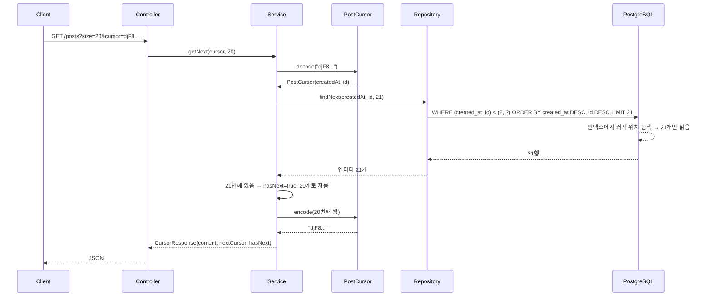
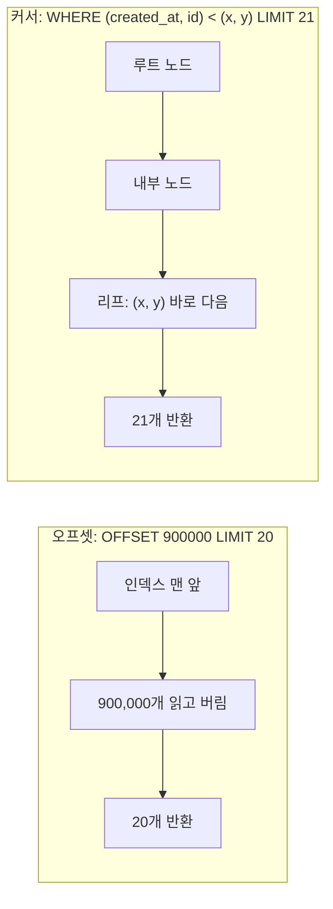

# 커서 페이징 — "몇 번째"가 아니라 "어떤 값 다음"부터

관련 문서: [예제](./커서페이징-예제.md)

> 연결되는 기존 학습 주제
> - **오프셋 페이징**: 이 문서는 오프셋 페이징의 두 가지 한계(깊은 페이지 성능, 데이터 변경 시 중복/누락)를 해결하는 방식이다. 결정적 정렬(tie-breaker)은 오프셋에서도 필요했지만 커서에서는 **정확성의 전제 조건**이 된다. → [오프셋 페이징 이론](../오프셋페이징/오프셋페이징-이론.md)

---

## 1. 한 줄 요약

커서 페이징은 마지막으로 받은 행의 정렬 키 값을 기억해 두었다가, 다음 요청에서 그 값보다 뒤에 있는 행만 가져오는 페이징 방식이다.
정확히는 유일한 정렬 키 조합 `(k1, …, kn)`에 대해 `WHERE (k1, …, kn) < (마지막 행의 값)`과 `ORDER BY k1, …, kn LIMIT size`로 **인덱스의 특정 위치부터 탐색(seek)**하는 키셋(Keyset) 기반 페이징이다.

---

## 2. 왜 필요한가

오프셋 페이징은 "N번째부터"를 기준으로 한다. 이 기준 때문에 두 가지 한계가 생긴다. ([오프셋 이론 8.2, 8.4](../오프셋페이징/오프셋페이징-이론.md#8-함정과-안티패턴))

| 오프셋의 한계 | 원인 |
|---|---|
| 뒤쪽 페이지일수록 느려짐 | DB가 건너뛸 offset개의 행을 실제로 읽고 버림. O(offset + size) |
| 페이지 사이 INSERT/DELETE로 중복·누락 | 순번은 조회 시점마다 다시 계산되므로 같은 순번이 다른 행을 가리킴 |

무한 스크롤 피드, 채팅 내역, 대량 배치 순회처럼 **깊이가 무제한이고 데이터가 계속 바뀌는** 목록에서는 두 한계가 모두 치명적이다.

커서 페이징은 기준을 **순번에서 값으로** 바꿔서 둘 다 해결한다.
- 값은 인덱스로 바로 찾아갈 수 있다 → 건너뛰기 비용이 없다.
- 값은 다른 행이 추가되거나 삭제돼도 바뀌지 않는다 → 다음 페이지의 시작점이 흔들리지 않는다.

대가로 **임의 페이지 점프와 총 페이지 수**를 포기한다.

---

## 3. 최소 예제로 보기

```sql
-- 첫 페이지: 커서 없음
SELECT id, created_at FROM post
ORDER BY created_at DESC, id DESC
LIMIT 4;                                   -- size 3 + 1
```

```text
  id  |      created_at
------+---------------------
 1000 | 2026-01-01 01:40:00
  999 | 2026-01-01 01:39:00
  998 | 2026-01-01 01:39:00     ← 3번째 행. 다음 커서 = (01:39:00, 998)
  997 | 2026-01-01 01:39:00     ← 4번째 행은 "다음 페이지가 있다"는 신호. 응답에서 제외
```

```sql
-- 다음 페이지: 커서 = 마지막 행 (01:39:00, 998)
SELECT id, created_at FROM post
WHERE (created_at, id) < ('2026-01-01 01:39:00', 998)
ORDER BY created_at DESC, id DESC
LIMIT 4;
```

```text
  id  |      created_at
------+---------------------
  997 | 2026-01-01 01:39:00     ← created_at이 같아도 id로 이어진다
  996 | 2026-01-01 01:39:00
  995 | 2026-01-01 01:39:00
  994 | 2026-01-01 01:39:00
```

API로 보면 이렇다.

```text
GET /posts?size=3                       → { content: [1000, 999, 998], nextCursor: "djF8MjAyNi0wMS0wMVQwMTozOXw5OTg", hasNext: true }
GET /posts?size=3&cursor=djF8MjAy...    → { content: [997, 996, 995], nextCursor: "...", hasNext: true }
```

여기서 봐야 할 세 가지:

1. 다음 페이지 쿼리에는 OFFSET이 없다. **WHERE 조건이 시작 위치를 정한다.**
2. 커서는 `created_at` 하나가 아니라 `(created_at, id)` 두 값이다. `created_at`만 쓰면 997~991이 통째로 빠진다 (8.1).
3. `size + 1`건을 조회해 남는 1건으로 다음 페이지 유무를 판단한다. count 쿼리가 없다.

---

## 4. 핵심 개념

| 용어 | 영문 | 의미 |
|---|---|---|
| 커서 | Cursor | 다음 조회의 시작 위치를 나타내는 값. 마지막으로 받은 행의 정렬 키 값으로 만든다 |
| 키셋 | Keyset | 정렬에 쓰는 컬럼 값의 조합. 커서의 실제 내용 |
| 시크 메서드 | Seek Method | 인덱스에서 키셋 값의 위치를 바로 찾아가 거기서부터 읽는 방식. 키셋 페이징의 다른 이름 |
| 유일 정렬 키 | Unique Sort Key | 정렬 컬럼 조합이 모든 행에서 유일한 상태. 보통 마지막에 PK를 tie-breaker로 붙여 만든다 |
| 행 값 비교 | Row Value Comparison | `(a, b) < (x, y)` 형태의 비교. `a < x OR (a = x AND b < y)`와 같은 의미 |
| 불투명 커서 | Opaque Cursor | 클라이언트가 내부 구조를 알 수 없게 인코딩한 커서 문자열 |
| 미리 읽기 | Look-ahead (size + 1) | 요청 크기보다 1건 더 조회해 다음 페이지 유무를 판단하는 기법 |
| 스크롤 방향 | Scroll Direction | 다음(forward) / 이전(backward) 페이지 방향. 방향에 따라 비교 연산자와 정렬을 뒤집는다 |

---

## 5. 동작 원리와 흐름

### 5.1 다음 페이지 요청 흐름

1. 클라이언트가 `GET /posts?size=20&cursor=<토큰>`을 보낸다. 첫 요청이면 커서가 없다.
2. 서버가 커서 토큰을 **디코딩해 `PostCursor(createdAt, id)` 값 객체를 생성**한다. 형식이 틀리면 400으로 거절한다.
3. 리포지토리가 `WHERE (created_at, id) < (?, ?) ORDER BY created_at DESC, id DESC LIMIT 21`을 실행한다.
4. DB는 B-Tree 인덱스 `(created_at DESC, id DESC)`에서 **커서 값의 위치를 루트→리프 탐색으로 찾는다** (O(log N)). 그 위치부터 리프를 순서대로 21개 읽고 멈춘다 (5.2).
5. 21개 행으로 **엔티티 21개가 생성**되어 영속성 컨텍스트에 등록된다.
6. 서비스가 21번째 행이 있으면 `hasNext = true`로 정하고 잘라낸다.
7. 20번째 행의 `(createdAt, id)`로 **다음 커서를 생성해 문자열로 인코딩**한다.
8. DTO로 변환해 `{ content, nextCursor, hasNext }`를 응답한다. 트랜잭션이 끝나면 엔티티는 준영속 상태가 된다.
9. 클라이언트는 `hasNext = false`가 될 때까지 받은 `nextCursor`를 그대로 다시 보낸다.



### 5.2 DB 내부: Seek vs Skip



실행 계획에서는 커서 조건이 **`Index Cond`**로 나타나야 한다.

```text
Limit (rows=21)
  -> Index Scan using idx_post_created_at_id on post (rows=21)
       Index Cond: (ROW(created_at, id) < ROW('2026-01-01 01:39:00', 998))
```

`Index Cond`는 인덱스 탐색의 **시작 위치**로 쓰인 조건이다. 조건이 `Filter`로만 나타나면 인덱스를 처음부터 읽으며 하나씩 거르는 것이므로 오프셋과 다를 바 없다 (8.2).

어느 깊이든 읽는 양은 `size + 1`로 일정하다. 비용은 **O(log N + size)**다.

### 5.3 데이터가 바뀌어도 흔들리지 않는 이유

```text
t1: 1페이지 → [100, 99, 98, 97, 96]   nextCursor = 96
t2: 새 글 101 INSERT, 글 98 DELETE
t3: 2페이지: WHERE id < 96 → [95, 94, 93, 92, 91]
```

- 101은 커서보다 **앞**에 있으므로 다음 페이지 범위에 들어오지 않는다. 중복이 없다.
- 98은 이미 본 행이므로 삭제돼도 다음 페이지의 시작점에 영향이 없다. 누락이 없다.
- 커서 행(96) 자체가 삭제돼도 상관없다. 커서는 행의 존재가 아니라 **값**이므로 `< 96` 조건은 그대로 성립한다.

### 5.4 이전 페이지 (역방향)

이전 페이지는 **비교 연산자와 정렬 방향을 모두 뒤집어** 조회한 뒤, 결과를 다시 뒤집어 화면 순서로 맞춘다.

1. 현재 페이지의 **첫 행** 값을 `prevCursor`로 만든다.
2. `WHERE (created_at, id) > (첫 행 값) ORDER BY created_at ASC, id ASC LIMIT 21`
3. 21번째 행 유무로 `hasPrev`를 정한다.
4. 20개를 **역순으로 뒤집어** 반환한다. 뒤집지 않으면 화면 순서가 거꾸로 나온다 (8.6).

---

## 6. 내부 구현 (핵심만)

| 구성 요소 | 하는 일 | 그래서 생기는 동작 |
|---|---|---|
| PostgreSQL 행 값 비교 `(a, b) < (x, y)` | SQL 표준 의미대로 사전순(lexicographic) 비교. B-Tree 인덱스의 선두 컬럼과 같은 순서·같은 방향이면 **하나의 `Index Cond`로 탐색 시작점**이 된다 | 인덱스 정렬 방향이 섞여 있으면(`created_at DESC, id ASC`) 행 값 비교의 의미 자체가 정렬과 맞지 않아 **틀린 결과**가 나온다 → 8.2 |
| 확장 OR 조건 `a < x OR (a = x AND b < y)` | 행 값 비교와 같은 의미. 방향이 섞인 정렬도 표현할 수 있다 | 옵티마이저가 단일 범위 탐색으로 못 바꾸는 경우가 있다. `a <= x AND (...)`처럼 범위를 한 번 더 걸어 주면 탐색 시작점이 생긴다 → 8.2 |
| NULL 비교 | `NULL < 값`의 결과는 `NULL`(unknown)이고 WHERE에서 거짓으로 처리된다 | 정렬 키에 NULL이 있으면 그 행들이 **조용히 사라진다** → 8.4 |
| Spring Data `Window<T>` + `ScrollPosition` (3.1+) | `ScrollPosition.keyset()`으로 시작하고 `window.positionAt(i)`로 i번째 행의 키셋을 담은 `KeysetScrollPosition`을 얻는다. 내부적으로 `limit + 1`건을 조회해 `hasNext()`를 판단 | 쿼리 메서드만으로 키셋 페이징이 된다. 단 커서를 HTTP로 주고받으려면 `getKeys()` 맵을 직접 인코딩해야 하고, 생성 SQL은 확장 OR 형태다 (생성 SQL 형태는 버전별로 로그 확인 필요) |
| 커서 인코딩 (애플리케이션 코드) | 키셋 값을 문자열로 직렬화한 뒤 Base64 URL-safe로 인코딩 | 직렬화할 때 **DB 정밀도(PostgreSQL `timestamp`는 마이크로초)를 그대로 보존**해야 한다. 밀리초로 잘리면 행이 누락된다 → 8.5 |

---

## 7. 유사 개념과의 비교

| 방식 | 기준 | 뒤쪽 페이지 비용 | 페이지 점프 | 총 개수 | 데이터 변경 시 | 정렬 변경 |
|---|---|---|---|---|---|---|
| 오프셋 + `Page` | 순번 | O(offset + size) | 가능 | 제공 | 중복/누락 | 자유로움 |
| 오프셋 + 지연 조인 | 순번 | O(offset), 인덱스만 | 가능 | 제공 | 중복/누락 | 인덱스 필요 |
| **커서 (키셋)** | 정렬 키 값 | **O(log N + size)** | 불가 | 없음 | **안정** | 정렬마다 인덱스·커서 형식 필요 |
| ID 범위 순회 (`WHERE id > ? ORDER BY id LIMIT n`) | PK 값 | O(log N + size) | 불가 | 없음 | 안정 | PK 순서 고정 |
| DB 서버 커서 (`DECLARE CURSOR`, JDBC fetchSize 스트리밍) | DB 세션의 읽기 위치 | 일정 | 불가 | 없음 | 하나의 스냅샷 | 자유로움 |

판단 기준:

1. **페이지 번호 UI나 총 개수가 필요한가?** → 필요하면 오프셋. 아니면 커서가 기본값이다.
2. **정렬이 PK 순서와 같은가?** → 같으면 커서 = ID 범위 순회로 단순해진다 (배치에서 가장 흔함).
3. **한 트랜잭션 안에서 끝까지 읽는가?** → 배치에서 한 번에 다 읽는다면 DB 서버 커서/스트리밍도 후보다. 하지만 HTTP 요청 사이에는 DB 커넥션을 유지할 수 없으므로, **API 페이징의 "커서"는 DB 서버 커서가 아니라 키셋 값**이다. 이름이 같아서 자주 헷갈린다.

---

## 8. 함정과 안티패턴

### 8.1 커서에 tie-breaker가 없음

- **증상**: 같은 시각에 등록된 글이 여러 개 있으면 다음 페이지에서 그중 일부가 통째로 빠진다. 반대로 `<=`로 바꾸면 같은 글이 반복된다.
- **원인**: 커서가 `created_at` 하나뿐이면 `WHERE created_at < :cursor`가 **커서와 같은 시각인 아직 안 본 행까지** 제외한다. `<=`로 바꾸면 이미 본 행이 다시 포함된다. 오프셋에서는 정렬이 흔들리는 수준이었지만 커서에서는 **확정적으로** 빠진다.
- **해결**: 정렬과 커서 모두에 유일 컬럼을 추가한다. `ORDER BY created_at DESC, id DESC` + `WHERE (created_at, id) < (:createdAt, :id)`.

### 8.2 인덱스와 커서 조건이 맞지 않아 Seek가 안 됨 (또는 결과가 틀림)

- **증상**: 커서 페이징으로 바꿨는데 뒤로 갈수록 여전히 느리다. 또는 정렬 방향이 섞인 목록에서 행이 엉뚱하게 빠진다.
- **원인**:
  1. 인덱스 컬럼 순서가 `(정렬 키, tie-breaker)`와 다르거나, 앞에 필터 컬럼(`board_id = ?`)이 있는데 인덱스에 없으면 커서 조건이 `Index Cond`가 되지 못한다 (5.2).
  2. 정렬이 `created_at DESC, id ASC`처럼 방향이 섞였는데 `(created_at, id) < (x, y)`를 쓰면, 행 값 비교는 **두 컬럼 모두 같은 방향**이라고 가정하므로 의미가 맞지 않는다 (6장).
  3. 확장 OR 조건만 쓰면 옵티마이저가 범위 탐색으로 만들지 못하는 경우가 있다.
- **해결**:
  1. 인덱스를 `(필터 컬럼, 정렬 키, tie-breaker)` 순서로, 정렬 방향까지 맞춰 만든다. 예: `(board_id, created_at DESC, id DESC)`.
  2. 정렬 방향은 가능하면 통일한다. 섞어야 하면 확장 OR 조건을 쓰고 `created_at <= :createdAt AND (created_at < :createdAt OR id > :id)`처럼 선두 컬럼 범위를 따로 건다.
  3. `EXPLAIN`에서 커서 조건이 `Index Cond`에 있는지 확인한다.

### 8.3 커서 정렬 키로 값이 바뀌는 컬럼을 씀

- **증상**: "좋아요순", "최근 수정순" 목록을 스크롤하면 같은 글이 또 나오거나 어떤 글은 끝까지 안 나온다.
- **원인**: 커서는 "이 값보다 뒤"라는 조건이다. `like_count`나 `updated_at`처럼 **조회 사이에 값이 바뀌는 컬럼**이면 행이 커서 앞뒤를 넘나든다. 커서는 데이터 변경에 강하지만, 그것은 **정렬 키 값이 불변**일 때만 성립한다 (5.3).
- **해결**:
  1. 정렬 키는 불변 컬럼(`created_at`, `id`)을 우선한다.
  2. 바뀌는 값으로 정렬해야 하면 첫 요청 시점의 스냅샷(랭킹 테이블, 캐시에 저장한 id 목록)을 기준으로 페이징하고, 그 스냅샷 id를 커서에 넣는다.
  3. 정렬 옵션이 여러 개라면 커서에 **정렬 종류를 함께 넣고** 요청의 정렬과 다르면 400으로 거절한다. 다른 정렬의 커서를 섞으면 의미 없는 위치에서 시작한다.

### 8.4 정렬 키에 NULL이 들어 있음

- **증상**: 특정 행들이 어떤 페이지에도 나오지 않는다. 대개 `published_at`, `due_date`처럼 선택 입력 컬럼으로 정렬할 때다.
- **원인**: `(NULL, 5) < (x, y)`는 unknown이 되어 WHERE에서 제외된다 (6장). 또 PostgreSQL은 `DESC`에서 NULL을 맨 앞에 두므로 첫 페이지에는 나오지만, 커서가 NULL 행이 되는 순간 다음 페이지가 비어 버린다. Spring Data 키셋 스크롤도 키셋 프로퍼티가 null이 아니라고 가정한다.
- **해결**: 정렬 키는 `NOT NULL`로 만든다. 불가능하면 `COALESCE(published_at, '-infinity')` 같은 식 인덱스와 같은 식으로 정렬·비교하거나, NULL 그룹을 별도 목록으로 분리한다.

### 8.5 커서 값의 정밀도가 깎임

- **증상**: 대부분 정상인데 가끔 한두 건이 빠진다. 같은 밀리초에 여러 건이 생성되는 트래픽 구간에서만 재현된다.
- **원인**: PostgreSQL `timestamp`는 **마이크로초** 정밀도다. 커서를 클라이언트가 응답의 `createdAt` 필드로 직접 만들거나(JavaScript `Date`는 밀리초), 서버에서 밀리초 포맷으로 직렬화하면 커서 값이 실제 값보다 작아진다. 그러면 `(created_at, id) < (잘린 값, id)` 조건이 잘린 값과 실제 값 사이의 아직 안 본 행을 제외한다.
- **해결**:
  1. 커서는 서버가 **DB 값 그대로** 인코딩한 불투명 토큰으로 주고, 클라이언트는 받은 그대로 돌려보내게 한다.
  2. 시각 대신 단조 증가하는 정수 키(`id`)만으로 정렬할 수 있으면 가장 안전하다.

### 8.6 이전 페이지 구현 실수

- **증상**: "이전" 버튼을 누르면 순서가 뒤집혀 나오거나, 이전 페이지가 아니라 맨 첫 페이지가 나온다.
- **원인**: 역방향은 `>`와 `ASC`로 **커서 바로 앞쪽부터** 읽어야 한다. 비교 연산자만 바꾸고 `DESC`를 그대로 두면 `LIMIT`이 커서에서 가장 먼 행(맨 처음)부터 잘라 온다. 정렬을 바꾼 뒤 결과를 뒤집지 않으면 화면 순서가 거꾸로 된다 (5.4).
- **해결**: 비교 연산자·정렬 방향을 함께 뒤집고, 조회 후 리스트를 역순으로 바꾼다. 무한 스크롤처럼 역방향이 필요 없으면 아예 구현하지 않는다.

---

## 9. 실무 적용 시나리오

| 시나리오 | 정렬 키 / 커서 | 포인트 |
|---|---|---|
| SNS 피드, 알림 목록 (무한 스크롤) | `(created_at DESC, id DESC)` | 데이터가 계속 쌓여도 중복 없음. count 쿼리 없음 |
| 채팅 메시지 (최신부터, 위로 스크롤하며 과거 로드) | `(id DESC)` 또는 `(sent_at, id)` | 새 메시지는 반대 방향 커서(`id > 마지막 id`)로 폴링 |
| 게시판별 목록 | 인덱스 `(board_id, created_at DESC, id DESC)` | 필터 컬럼을 인덱스 선두에 둬야 Seek가 됨 (8.2) |
| 외부 공개 REST API | 불투명 커서 토큰 | 내부 스키마를 노출하지 않고, 정렬·형식을 바꿔도 토큰 버전으로 호환 관리 |
| 배치: 전체 테이블 처리 (청크 단위) | `WHERE id > :lastId ORDER BY id LIMIT 1000` | 오프셋 순회의 O(N²) 문제가 없다. 처리 중 UPDATE/DELETE에도 누락 없음. 실패 시 `lastId`부터 재시작 가능 |
| 데이터 동기화 (변경분 추출) | `(updated_at, id)` + 처리 완료 지점 저장 | 단, 갱신이 커서 뒤로 밀리는 행은 다음 동기화 회차에서 잡힌다는 전제로 설계 (8.3) |

---

## 10. 버전 주의사항

| 대상 | 변화 | 코드에 미치는 영향 |
|---|---|---|
| Spring Data Commons/JPA 3.1 (Boot 3.1+) | Scroll API(`Window`, `ScrollPosition`, `KeysetScrollPosition`, `WindowIterator`) 도입 | Boot 3.0 이하, Java 8 코드베이스에서는 쓸 수 없다. 네이티브/JPQL 쿼리로 직접 구현한다 |
| Spring Data 3.2 | 쿼리 메서드에 `Limit` 파라미터 지원 (확인 필요) | 3.1에서는 `findFirst20By...`처럼 크기를 메서드 이름에 고정해야 한다 |
| Oracle | 행 값 비교의 `<`, `>`를 지원하지 않는다 (동등 비교만 지원) | Oracle에서는 확장 OR 조건으로 작성한다. PostgreSQL·MySQL 8은 `(a, b) < (x, y)` 지원 |

---

## 11. 자가 점검 질문

1. 커서를 `created_at` 하나로만 만들면 `<`를 쓸 때와 `<=`를 쓸 때 각각 무슨 문제가 생기는가?
<details><summary>답</summary>

`<`이면 커서와 같은 시각을 가진 아직 안 본 행이 제외되어 누락된다. `<=`이면 커서와 같은 시각의 이미 본 행이 다시 포함되어 중복된다. `(created_at, id)`처럼 유일한 조합으로 커서를 만들어야 둘 다 피할 수 있다.
</details>

2. 커서 페이징이 깊은 페이지에서도 성능이 일정한 이유를 실행 계획 관점에서 설명하라.
<details><summary>답</summary>

커서 조건 `(created_at, id) < (x, y)`가 인덱스의 `Index Cond`로 쓰여 B-Tree 탐색으로 시작 위치를 O(log N)에 찾는다. 그 위치부터 `size + 1`개만 읽고 Limit이 멈추므로 앞쪽 행을 읽고 버리는 과정이 없다. 비용은 O(log N + size)다.
</details>

3. 정렬이 `created_at DESC, id ASC`일 때 `(created_at, id) < (x, y)`를 쓰면 왜 틀린가? 어떻게 써야 하나?
<details><summary>답</summary>

행 값 비교는 `created_at < x OR (created_at = x AND id < y)`를 뜻한다. 하지만 정렬상 같은 `created_at` 안에서는 id가 오름차순이므로 "다음" 행은 `id > y`다. 의미가 맞지 않아 행이 잘못 걸러진다. `created_at < x OR (created_at = x AND id > y)` 확장 조건으로 쓰고, 탐색 범위를 위해 `created_at <= x`를 함께 건다. 인덱스도 `(created_at DESC, id ASC)`로 맞춘다.
</details>

4. 첫 페이지를 본 뒤 커서 행 자체가 삭제됐다. 다음 페이지 요청은 어떻게 되는가?
<details><summary>답</summary>

정상 동작한다. 커서는 행에 대한 참조가 아니라 값 `(createdAt, id)`이므로, 그 값보다 작은 행을 찾는 조건은 행이 없어도 그대로 성립한다. 삭제된 행 바로 다음 행부터 이어서 나온다.
</details>

5. 클라이언트가 응답 JSON의 `createdAt`(밀리초)과 `id`로 커서를 직접 만들어 보내면 어떤 문제가 생기는가?
<details><summary>답</summary>

PostgreSQL `timestamp`는 마이크로초 정밀도이므로 클라이언트가 만든 커서 값이 실제보다 작아질 수 있다. 그러면 잘린 값과 실제 값 사이에 있는 아직 안 본 행이 `<` 조건에서 제외되어 누락된다. 서버가 DB 값을 그대로 인코딩한 불투명 커서를 발급하고, 클라이언트는 그대로 돌려보내게 해야 한다.
</details>

---

## 12. 참고 자료

- PostgreSQL Documentation — 9.24.5 Row Constructor Comparison: https://www.postgresql.org/docs/current/functions-comparisons.html
- PostgreSQL Documentation — 11.4 Indexes and ORDER BY: https://www.postgresql.org/docs/current/indexes-ordering.html
- Spring Data JPA Reference — Scrolling: https://docs.spring.io/spring-data/jpa/reference/repositories/query-methods-details.html#repositories.scrolling
- Markus Winand, *Use The Index, Luke!* — Paging Through Results (Seek Method): https://use-the-index-luke.com/sql/partial-results/fetch-next-page
- Markus Winand, "We need tool support for keyset pagination" (no-offset): https://use-the-index-luke.com/no-offset

---

## 부록: 용어 정리

| 용어 | 영문 | 설명 |
|---|---|---|
| 커서 페이징 | Cursor-based Pagination | 마지막으로 본 행의 정렬 키 값 다음부터 조회하는 페이징 방식 |
| 키셋 | Keyset | 정렬에 쓰는 컬럼 값의 조합. 커서의 실제 내용 |
| 시크 | Seek | 인덱스에서 특정 값의 위치를 바로 찾아가는 동작 |
| 오프셋 페이징 | Offset-based Pagination | 앞쪽 N개를 건너뛰고 M개를 가져오는 페이징 방식 |
| 결정적 정렬 | Deterministic Ordering | 정렬 키 조합이 유일해 항상 같은 순서가 나오는 정렬 |
| 타이브레이커 | Tie-breaker | 정렬 값이 같을 때 순서를 정하려고 추가하는 유일 컬럼 |
| 미리 읽기 | Look-ahead (size + 1) | 1건을 더 조회해 다음 페이지 유무를 판단하는 기법 |
| 유일 정렬 키 | Unique Sort Key | 모든 행에서 값 조합이 유일한 정렬 컬럼 조합 |
| 행 값 비교 | Row Value Comparison | `(a, b) < (x, y)` 형태의 사전순 비교 |
| 불투명 커서 | Opaque Cursor | 내부 구조를 감추고 인코딩한 커서 문자열 |
| 스크롤 방향 | Scroll Direction | 다음/이전 페이지 방향. 방향에 따라 비교와 정렬을 뒤집음 |
| 영속성 컨텍스트 | Persistence Context | JPA가 조회한 엔티티를 관리하는 1차 캐시 |
| 인덱스 조건 | Index Cond | 실행 계획에서 인덱스 탐색 범위를 정하는 데 쓰인 조건 |
| 필터 | Filter | 실행 계획에서 읽은 뒤 하나씩 걸러내는 조건. 읽는 양을 줄이지 못함 |
| 사전순 비교 | Lexicographic Comparison | 첫 컬럼부터 비교하고 같으면 다음 컬럼을 비교하는 방식 |
| 확장 OR 조건 | Expanded OR Predicate | 행 값 비교를 `a < x OR (a = x AND b < y)`로 풀어 쓴 조건 |
| 윈도우 | Window | Spring Data Scroll API의 결과 타입. 내용과 다음 위치 정보를 가짐 |
| 스크롤 위치 | ScrollPosition | Spring Data에서 스크롤 시작 위치를 나타내는 타입 (오프셋/키셋) |
| ID 범위 순회 | ID Range Scan | PK 값 기준으로 `id > 마지막 id`를 반복하는 순회. 커서 페이징의 가장 단순한 형태 |
| DB 서버 커서 | Server-side Cursor | DB 세션 안에서 결과 집합의 읽기 위치를 유지하는 객체. API 페이징의 커서와 다름 |
| 식 인덱스 | Expression Index | 컬럼이 아니라 식(`COALESCE(...)` 등)의 결과로 만든 인덱스 |
