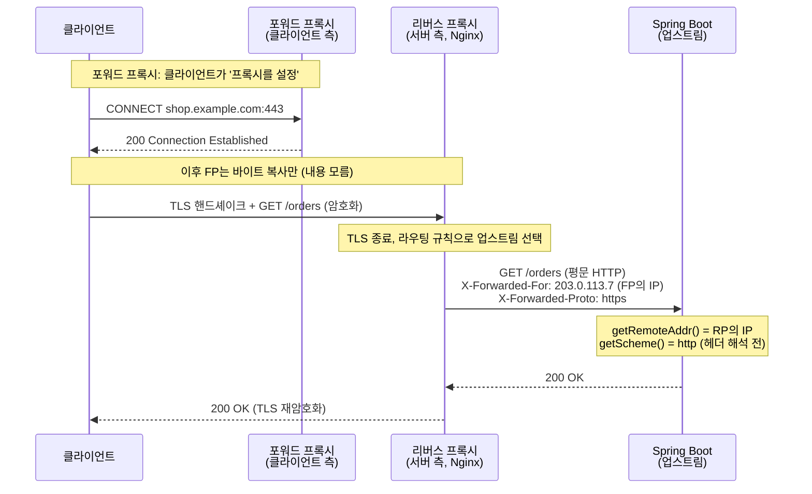

# 프록시와 리버스 프록시

관련 문서: [예제](./프록시-예제.md) · [NIO 셀렉터](../NIO셀렉터/NIO셀렉터-이론.md) · [HTTP](<../../../Network/네트워크 기초/05-HTTP-이론.md>) · [TLS](<../../../Network/네트워크 기초/06-TLS-이론.md>) · [TCP 소켓 vs HTTP](<../../../Network/네트워크 기초/05a-TCP소켓-vs-HTTP-이론.md>)

> 이 문서의 "프록시"는 **네트워크 중계 서버**다. Spring AOP의 프록시(`@Transactional`을 가능하게 하는 JDK 동적 프록시·CGLIB 객체)는 "대신 받아서 넘긴다"는 발상만 같고 전혀 다른 기술이다.

---

## 1. 한 줄 요약

클라이언트와 서버 사이에 끼어서 요청을 대신 받아 다른 쪽으로 넘겨주는 서버다.
**포워드 프록시**는 클라이언트 쪽에 속해 "클라이언트를 대신해" 임의의 외부 서버로 요청을 보내고, **리버스 프록시**는 서버 쪽에 속해 "서버를 대신해" 요청을 받은 뒤 뒤쪽의 정해진 서버(업스트림)로 전달한다.

---

## 2. 왜 필요한가

프록시가 없으면 클라이언트와 서버는 **TCP 연결을 직접** 맺는다. 이 구조에서 생기는 문제:

| 상황 | 직접 연결의 문제 | 프록시로 해결 |
|---|---|---|
| 사내망에서 외부 접속 | PC마다 인터넷 출구를 열어야 하고, 누가 어디 접속하는지 통제·기록할 지점이 없다 | **포워드 프록시** 한 곳만 외부로 열고 그곳에서 접근 제어·로깅·캐싱 |
| 서버 여러 대 운영 | 클라이언트가 서버 IP를 다 알아야 하고, 서버 증설·교체 시 클라이언트도 바뀐다 | **리버스 프록시** 하나의 주소 뒤에서 부하 분산 |
| HTTPS 적용 | Spring 애플리케이션마다 인증서를 넣고 갱신해야 한다 | 리버스 프록시에서 **TLS 종료**, 뒤쪽은 평문 HTTP |
| 정적 파일·압축·요청 크기 제한 | 애플리케이션 스레드가 이런 일까지 처리 | 리버스 프록시가 앞에서 처리 |

두 가지 모두 "중간에서 연결을 끊고 다시 맺는" 같은 원리를 쓴다. 차이는 **누구를 위해, 어디에 놓이느냐**다.

---

## 3. 최소 예제로 보기

같은 원본 서버(origin, `:9000`)를 세 가지 방식으로 호출하고, 원본 서버가 **무엇을 보는지** 출력한다. (전체 코드는 [예제 문서](./프록시-예제.md))

```java
HttpClient direct = HttpClient.newHttpClient();
HttpClient viaForward = HttpClient.newBuilder()
        .proxy(ProxySelector.of(new InetSocketAddress("127.0.0.1", 8888))) // 클라이언트가 프록시를 '설정'
        .build();

direct.send(get("http://127.0.0.1:9000/hello"), ofString());     // ① 직접
viaForward.send(get("http://127.0.0.1:9000/hello"), ofString()); // ② 포워드 프록시 경유
direct.send(get("http://127.0.0.1:8080/hello"), ofString());     // ③ 리버스 프록시 주소로 '직접' 호출
```

원본 서버 출력 (예상 출력, 포트 번호는 실행마다 다름):

```text
① remote=127.0.0.1:53011  X-Forwarded-For=null
② remote=127.0.0.1:53020  X-Forwarded-For=127.0.0.1   ← 연결은 포워드 프록시가 맺음
③ remote=127.0.0.1:53025  X-Forwarded-For=127.0.0.1   ← 연결은 리버스 프록시가 맺음
```

읽어야 할 점:

- ②: 클라이언트는 **원본 주소(:9000)를 알고 있고**, 프록시는 클라이언트 설정에만 있다.
- ③: 클라이언트는 **리버스 프록시 주소(:8080)만 안다.** 뒤에 :9000이 있다는 사실을 모른다.
- ②·③ 모두 원본 서버가 보는 `remote`(TCP 상대방)는 **프록시**다. 실제 클라이언트 정보는 프록시가 붙여준 `X-Forwarded-*` 헤더로만 알 수 있다. → 8장 함정 1·2·3의 출발점.

---

## 4. 핵심 개념

| 용어 | 영문 | 설명 |
|---|---|---|
| 포워드 프록시 | Forward Proxy | 클라이언트가 명시적으로 설정해서 쓰는 중계 서버. 목적지는 요청마다 다르다 |
| 리버스 프록시 | Reverse Proxy | 서버 앞에 놓여 클라이언트에게는 그 자체가 서버로 보이는 중계 서버 (Nginx, HAProxy, AWS ALB) |
| 원본 서버 / 업스트림 | Origin Server / Upstream | 실제 응답을 만드는 서버. 리버스 프록시 입장에서 뒤쪽 서버를 업스트림이라 부른다 |
| 절대 형식 요청 대상 | absolute-form request-target | 포워드 프록시에 보내는 요청줄 형식. `GET http://host:port/path HTTP/1.1` |
| CONNECT 터널 | CONNECT Tunnel | HTTPS를 포워드 프록시로 보낼 때, 프록시에게 TCP 연결만 이어달라고 하는 메서드 |
| TLS 종료 | TLS Termination | 리버스 프록시가 HTTPS를 풀고 뒤쪽엔 HTTP로 보내는 구성 |
| 전달 헤더 | X-Forwarded-For / -Proto / -Host, Forwarded | 프록시가 원래 클라이언트 IP·스킴·호스트를 뒤쪽에 알려주는 헤더. `Forwarded`는 RFC 7239 표준형 |
| 신뢰 프록시 | Trusted Proxy | 전달 헤더를 믿어도 되는, 내가 운영하는 프록시. 그 외가 붙인 헤더는 위조일 수 있다 |

---

## 5. 동작 원리와 흐름

### 5.1 공통 원리: 연결이 두 개다

프록시는 패킷을 그대로 흘려보내는 장치가 아니다. **클라이언트↔프록시 TCP 연결**과 **프록시↔서버 TCP 연결**을 각각 따로 맺고, 한쪽에서 읽은 HTTP 메시지를 해석한 뒤 다른 쪽에 **새로 쓴다**.
그래서 다음이 자동으로 따라온다.

- 서버가 보는 소스 IP(`getRemoteAddr()`)는 프록시 IP다.
- 프록시는 메시지를 해석하므로 헤더를 추가·삭제·변경할 수 있다 (전달 헤더, Host 재작성, hop-by-hop 헤더 제거).
- 각 연결은 **별도의 타임아웃·버퍼·크기 제한**을 가진다.

> `Connection`, `Keep-Alive`, `Upgrade`, `Transfer-Encoding` 같은 **hop-by-hop 헤더**는 연결 한 구간에만 의미가 있어서 프록시가 다음 구간으로 넘기지 않는다. WebSocket이 리버스 프록시에서 깨지는 이유가 이것이다(함정 5).

### 5.2 포워드 프록시 흐름 (HTTP)

1. 클라이언트에 프록시 주소가 **설정**되어 있다 (JVM 시스템 프로퍼티, `ProxySelector`, 브라우저/OS 설정).
2. 클라이언트는 원본이 아니라 **프록시에 TCP 연결**을 맺는다.
3. 요청줄을 **절대 형식**으로 보낸다: `GET http://api.example.com/hello HTTP/1.1`. 프록시는 이걸 보고 목적지를 안다.
4. 프록시가 접근 정책을 검사(차단 목록, 인증 `Proxy-Authorization`)하고 캐시를 확인한다.
5. 프록시가 원본에 **새 TCP 연결**을 맺고 일반 형식(`GET /hello`)으로 요청한다.
6. 응답을 받아 클라이언트 연결에 쓴다.

### 5.3 포워드 프록시 흐름 (HTTPS — CONNECT)

HTTPS는 암호화되어 있어 프록시가 내용을 볼 수 없다. 그래서 방식이 다르다.

1. 클라이언트 → 프록시: `CONNECT api.example.com:443 HTTP/1.1`
2. 프록시가 `api.example.com:443`에 TCP 연결 후 `200 Connection Established` 응답
3. 이후 프록시는 **바이트를 양방향으로 복사만** 한다. TLS 핸드셰이크는 클라이언트와 원본이 직접 한다.
4. 프록시가 아는 것은 목적지 호스트:포트뿐, URL 경로·헤더·본문은 모른다.

(사내 보안 장비가 HTTPS 내용까지 보는 경우는 CONNECT 대신 **자체 CA 인증서로 TLS를 가로채는** 방식이다. 이때 Java 애플리케이션은 그 CA를 truststore에 넣지 않으면 `PKIX path building failed`가 난다.)

### 5.4 리버스 프록시 흐름 (TLS 종료 + 부하 분산)

1. 클라이언트는 `https://shop.example.com`을 호출한다. DNS는 **리버스 프록시 IP**를 돌려준다. 클라이언트에 아무 설정도 없다.
2. 리버스 프록시가 TLS 핸드셰이크를 처리하고 복호화한다 (**TLS 종료**).
3. 요청줄은 일반 형식(`GET /orders`)이다. 프록시는 **자기 설정의 라우팅 규칙**(경로, Host)으로 업스트림을 고른다.
4. 업스트림 풀에서 한 대를 고른다 (라운드 로빈, 최소 연결 등). 헬스 체크에 실패한 서버는 제외.
5. 전달 헤더를 붙인다: `X-Forwarded-For: <클라이언트 IP>`, `X-Forwarded-Proto: https`, `X-Forwarded-Host: shop.example.com`.
6. 업스트림(Spring Boot, `http://10.0.1.12:8080`)에 **평문 HTTP**로 요청한다. 보통 업스트림 연결은 keep-alive 풀로 재사용한다.
7. Spring 쪽에서 전달 헤더를 해석하지 않으면 애플리케이션은 자신이 `http://10.0.1.12:8080`으로 호출됐다고 믿는다 (함정 1·2).



> 위 그림처럼 둘은 **동시에** 존재할 수 있다. 사내 PC → 사내 포워드 프록시 → 인터넷 → 서비스의 리버스 프록시 → Spring. 이 경우 Spring이 받는 `X-Forwarded-For`의 클라이언트 IP는 사용자 PC가 아니라 **포워드 프록시의 공인 IP**다.

### 5.5 어느 계층에서 무엇이 생기고 사라지는가

| 위치 | 생성 | 소멸 |
|---|---|---|
| 클라이언트 | 프록시로 가는 TCP 소켓 | 응답 후 (keep-alive면 재사용) |
| 프록시 | 클라이언트 측 연결 객체, 업스트림 측 연결 객체, 요청/응답 버퍼 | 각 연결의 타임아웃·종료 시 **독립적으로** |
| Spring (Tomcat) | `HttpServletRequest` — 상대 주소는 프록시 소켓 기준 | 요청 처리 후 |
| Spring (전달 헤더 처리 시) | 요청 래퍼(wrapper) 또는 Tomcat이 덮어쓴 remoteAddr/scheme | 요청 처리 후 |

---

## 6. 내부 구현 (핵심만)

### 6.1 Java 클라이언트가 포워드 프록시를 쓰는 방식

- **`ProxySelector`**: URI마다 "어느 프록시를 쓸지"를 결정한다. 기본 구현은 JVM 시스템 프로퍼티 `http.proxyHost/Port`, `https.proxyHost/Port`, `http.nonProxyHosts`를 읽는다.
  → **OS 환경변수 `HTTP_PROXY`/`HTTPS_PROXY`는 JVM이 읽지 않는다.** 리눅스 서버에서 `curl`은 되는데 Java만 안 되는 이유(함정 6).
- **`HttpURLConnection`** (Spring `SimpleClientHttpRequestFactory`가 사용): 기본 `ProxySelector`를 따른다.
- **`java.net.http.HttpClient`**: `.proxy(...)`로 지정한다. 지정하지 않았을 때 기본 셀렉터를 쓰는지는 JDK 버전별 동작 확인 필요 — 운영 코드는 **명시적으로 지정**하는 편이 안전하다.
- **Apache HttpClient 5** (`HttpClients.createDefault()`): 시스템 프로퍼티를 **무시**한다. `HttpClients.createSystem()` 또는 빌더의 `useSystemProperties()`를 써야 반영된다. Spring `RestTemplate`/`RestClient`가 내부에서 어떤 클라이언트를 쓰는지에 따라 결과가 갈린다.

### 6.2 Spring Boot가 전달 헤더를 반영하는 방식

`server.forward-headers-strategy` 값에 따라 처리 주체가 달라진다.

| 값 | 처리 주체 | 동작 |
|---|---|---|
| `none` (기본) | 없음 | `getRemoteAddr()`=프록시 IP, `getScheme()`=http. 전달 헤더는 그냥 일반 헤더 |
| `native` | 웹 서버 (Tomcat의 `RemoteIpValve`) | **연결 상대 IP가 내부 프록시 범위일 때만** 헤더를 신뢰해서 remoteAddr·scheme·secure를 덮어씀 |
| `framework` | Spring `ForwardedHeaderFilter` | 요청을 래퍼로 감싸 `getScheme/getServerName/getServerPort/getRequestURL/getRemoteAddr`이 헤더 값을 반환. **연결 상대를 검사하지 않고 무조건 신뢰** |

- Boot는 Cloud Foundry·Heroku·Kubernetes 등 클라우드 플랫폼을 감지하면 기본값이 `native`처럼 동작한다 (플랫폼별 세부는 확인 필요).
- `RemoteIpValve`의 신뢰 범위는 `server.tomcat.remoteip.internal-proxies`(기본값: 사설 IP 대역 정규식, 버전별 정확한 패턴은 확인 필요). 프록시가 공인 IP 대역에 있으면 헤더가 무시된다.
- 이 두 처리를 거친 값이 리다이렉트 URL(`sendRedirect`), `ServletUriComponentsBuilder`, Spring Security의 HTTPS 판단(`request.isSecure()`), OAuth2 `redirect_uri` 생성에 그대로 쓰인다.

### 6.3 X-Forwarded-For의 누적 규칙

각 프록시는 **자신에게 연결한 상대의 IP를 오른쪽에 덧붙인다.**

```text
클라이언트(1.1.1.1) → 프록시 A → 프록시 B → 앱
A가 보냄:  X-Forwarded-For: 1.1.1.1
B가 보냄:  X-Forwarded-For: 1.1.1.1, <A의 IP>
```

클라이언트가 처음부터 `X-Forwarded-For: 9.9.9.9`를 넣어 보내면 A는 `9.9.9.9, 1.1.1.1`을 보낸다. **맨 왼쪽 값은 클라이언트가 마음대로 쓸 수 있다.** 믿을 수 있는 건 **오른쪽부터 신뢰 프록시를 걷어내고 처음 만나는 값**이다. `RemoteIpValve`가 이렇게 동작한다.

---

## 7. 유사 개념과의 비교

| 구분 | 포워드 프록시 | 리버스 프록시 | API 게이트웨이 | L4 로드 밸런서 |
|---|---|---|---|---|
| 누구 편인가 | 클라이언트(조직) | 서버(서비스 운영자) | 서버 | 서버 |
| 설정하는 쪽 | **클라이언트**가 프록시를 설정 | **서버 운영자**가 DNS로 노출. 클라이언트는 모름 | 서버 운영자 | 서버 운영자 |
| 목적지 결정 | 요청에 담긴 URL(절대 형식/CONNECT) | 프록시 자신의 라우팅 설정 | 라우팅 + 인증·레이트 리밋 등 정책 | IP:포트 수준 분배 |
| 숨기는 대상 | 클라이언트의 존재·IP | 업스트림 서버 구성 | 업스트림 서비스 구성 | 업스트림 IP |
| HTTP 해석 | HTTP는 해석, HTTPS(CONNECT)는 바이트 복사 | 해석함 (보통 TLS 종료) | 해석함 | **해석 안 함** (TCP 수준) |
| 대표 | Squid, 사내 보안 프록시 | Nginx, HAProxy, AWS ALB, Cloudflare | Spring Cloud Gateway, Kong | AWS NLB, LVS |
| Spring 개발자가 신경 쓸 점 | 외부 API 호출 시 프록시 설정·nonProxyHosts·CA 인증서 | 전달 헤더 해석, 타임아웃·크기 제한 | 리버스 프록시와 동일 + 필터 체인 | 클라이언트 IP가 보존되는지(Proxy Protocol 여부) |

**판단 기준**

- "우리 서버가 **밖으로** 나갈 때 거치는가?" → 포워드 프록시.
- "사용자가 우리 서버로 **들어올** 때 거치는가?" → 리버스 프록시.
- 리버스 프록시에 인증·라우팅·레이트 리밋 같은 **비즈니스 정책**까지 넣으면 API 게이트웨이라고 부른다. 원리는 같다.

### 7.1 왜 나눠 쓰는가 — 합치면 안 되나?

Nginx·Envoy·Squid는 소프트웨어 하나로 두 역할을 모두 할 수 있다. 그래도 나누는 이유는 프로그램이 달라서가 아니라, **누가 운영하고 무엇을 지키느냐가 반대**이기 때문이다.

**① 보통은 주인이 다른 조직이다**

```text
[A회사 PC] → A회사 포워드 프록시 → 인터넷 → B서비스 리버스 프록시 → [B서비스 서버]
```

포워드 프록시는 **요청을 보내는 쪽**이 나가는 트래픽을 통제하려고 운영하고, 리버스 프록시는 **요청을 받는 쪽**이 들어오는 트래픽을 통제하려고 운영한다. 하나의 요청 경로 위에서 둘은 대개 소유자가 달라 애초에 합칠 대상이 아니다.

**② 정책이 정반대다**

| | 포워드 프록시 | 리버스 프록시 |
|---|---|---|
| 누구의 요청을 받나 | **내부 사용자만** | **인터넷 누구나** |
| 어디로 보내나 | **아무 곳**이나 (요청에 적힌 URL, 5.2·5.3) | **우리 업스트림으로만** (프록시 설정, 5.4) |
| 막으려는 것 | 유해 사이트 접속, 정보 유출 | 외부 공격, 과도한 트래픽 |

두 정책을 한 설정에 섞으면 "누구나 받는다 + 아무 곳으로나 보낸다"가 동시에 성립한다. 이것이 **오픈 프록시(Open Proxy)**다. 외부인이 우리 서버를 발판 삼아 다른 곳을 공격하거나, 목적지를 내부 주소로 지정해 사내 시스템에 접근(**SSRF**)할 수 있다 → 함정 7.

**③ 같은 조직 안이라면: 물리적으로는 합치고, 논리적으로는 분리한다**

- **같은 소프트웨어, 다른 리스너·설정**: 예) Nginx `:443`은 리버스 프록시로 외부에 공개하고, `:3128`은 포워드 프록시로 내부망에서만 접근 가능하게 한다.
- **쿠버네티스·서비스 메시**: 들어오는 쪽에는 **인그레스(Ingress) 게이트웨이**, 나가는 쪽에는 **이그레스(Egress) 게이트웨이**를 따로 둔다. Istio의 Envoy **사이드카(Sidecar)**는 한 프로세스가 양방향을 처리하지만 inbound/outbound 리스너를 분리해 정책을 따로 적용한다.
- **장애 격리**: 들어오는 트래픽이 폭주할 때 나가는 외부 API 호출(결제·인증 연동)까지 같은 프로세스의 자원 고갈로 함께 죽지 않게 하는 효과도 있다.

> 정리: **물리적으로는 합쳐도 되고, 정책과 노출 범위는 반드시 분리한다.** 분리하지 않으면 오픈 프록시가 된다는 것이 핵심 이유다.

---

## 8. 함정과 안티패턴

### 함정 1. 로그·레이트 리밋의 클라이언트 IP가 전부 같은 값

- **증상**: 접속 로그 IP가 모두 `10.0.0.5`(프록시). IP 기반 레이트 리밋에서 한 사용자 때문에 모든 사용자가 차단된다.
- **원인**: 프록시는 연결을 새로 맺으므로 `getRemoteAddr()`는 프록시 IP다 (5.1). `forward-headers-strategy` 기본값 `none`이라 전달 헤더가 해석되지 않는다 (6.2).
- **해결**: `server.forward-headers-strategy=native`(Tomcat 앞에 신뢰 프록시가 고정된 경우 권장). 리버스 프록시에서 `X-Forwarded-For`를 실제로 붙이는지도 확인한다 (Nginx는 `proxy_set_header`를 써야 붙는다).

### 함정 2. HTTPS로 들어왔는데 리다이렉트가 `http://`로 나감

- **증상**: 로그인 후 `http://...`로 리다이렉트되어 혼합 콘텐츠·무한 리다이렉트. OAuth2 로그인에서 `redirect_uri mismatch`. Swagger UI가 `http://` 서버 URL을 표시.
- **원인**: TLS 종료로 Spring은 평문 HTTP 요청만 받는다 (5.4의 7단계). `getScheme()`=http, `isSecure()`=false인 상태로 URL을 생성한다.
- **해결**: 프록시에서 `X-Forwarded-Proto`(+필요시 `X-Forwarded-Host`, `X-Forwarded-Port`)를 보내고 Spring에서 `forward-headers-strategy`를 켠다. 하드코딩한 `https://` 문자열로 덮는 것은 환경마다 깨지는 땜질이다.

### 함정 3. X-Forwarded-For 위조로 IP 화이트리스트 우회

- **증상**: 관리자 API를 "사내 IP만 허용"으로 막았는데 외부에서 접근된다.
- **원인**: 맨 왼쪽 XFF 값은 클라이언트가 임의로 넣을 수 있다 (6.3). 직접 `request.getHeader("X-Forwarded-For").split(",")[0]`을 쓰거나, `framework` 전략(`ForwardedHeaderFilter`, 무조건 신뢰)을 쓰면서 애플리케이션 포트가 프록시를 거치지 않고도 열려 있으면 위조 값이 그대로 들어온다.
- **해결**: 헤더를 직접 파싱하지 않는다. `native` + `internal-proxies`로 신뢰 프록시를 한정하거나, `framework`를 쓴다면 애플리케이션 포트를 **프록시에서만 접근 가능**하게 네트워크로 막는다. 최전방 프록시는 클라이언트가 보낸 XFF를 덮어쓰도록 설정한다.

### 함정 4. 오래 걸리는 요청만 504, 큰 업로드만 413

- **증상**: 엑셀 다운로드·리포트 API가 정확히 60초에 `504 Gateway Timeout`. 2MB 파일 업로드가 `413`인데 Spring 로그엔 아무것도 없음.
- **원인**: 연결이 두 개이고 각자 제한이 있다 (5.1). Nginx 기본값 `proxy_read_timeout 60s`, `client_max_body_size 1m`. 요청은 Spring에 도달하기 전에 프록시에서 끊긴다. 반대로 Spring은 504 이후에도 작업을 계속 수행한다(클라이언트는 실패로 알고 재시도 → **중복 처리**).
- **해결**: 타임아웃은 `클라이언트 < 리버스 프록시 < 애플리케이션 내부 작업` 순서가 아니라 **프록시 타임아웃 ≥ 애플리케이션 최대 처리 시간**으로 맞춘다. 정말 긴 작업은 비동기(작업 ID 반환 후 폴링)로 바꾼다. 업로드 한도는 프록시와 `spring.servlet.multipart.max-file-size`를 함께 맞춘다.

### 함정 5. WebSocket 연결 실패, SSE가 한꺼번에 도착

- **증상**: 로컬에선 되는 WebSocket이 운영에서 `400`/`426` 또는 연결 직후 끊김. SSE 이벤트가 실시간이 아니라 몇 초씩 뭉쳐서 도착.
- **원인**: `Upgrade`/`Connection`은 hop-by-hop 헤더라 프록시가 뒤로 전달하지 않는다 (5.1). Nginx는 업스트림에 기본 HTTP/1.0으로 요청한다. SSE는 Nginx의 응답 버퍼링(`proxy_buffering on` 기본)에 쌓였다가 버퍼 단위로 나간다.
- **해결**: WebSocket 경로에 `proxy_http_version 1.1; proxy_set_header Upgrade $http_upgrade; proxy_set_header Connection "upgrade";`. SSE는 해당 경로에 `proxy_buffering off;` 또는 응답 헤더 `X-Accel-Buffering: no`. 유휴 타임아웃도 함정 4처럼 늘린다.

### 함정 6. 사내망 서버에서 외부 API 호출만 타임아웃

- **증상**: 서버 셸에서 `curl https://api.partner.com`은 되는데 Spring의 `RestTemplate` 호출은 `ConnectTimeout`. 또는 반대로 **내부 API 호출까지 프록시로 가서** 실패.
- **원인**: `curl`은 환경변수 `HTTPS_PROXY`를 읽지만 JVM은 읽지 않는다 (6.1). Apache HttpClient 5 기본 생성은 시스템 프로퍼티도 무시한다. 프록시를 전역으로 걸면 `nonProxyHosts`에 없는 내부 호스트도 프록시로 보낸다.
- **해결**: `-Dhttps.proxyHost=... -Dhttps.proxyPort=... -Dhttp.nonProxyHosts="localhost|*.internal|10.*"` 를 지정하고, 사용하는 HTTP 클라이언트가 이를 따르는지 확인한다(따르지 않으면 클라이언트 빌더에 프록시를 명시). HTTPS 가로채기 장비라면 사내 CA를 truststore에 추가한다.

### 함정 7. 리버스 프록시가 오픈 프록시로 열려 있음

- **증상**: 리버스 프록시 액세스 로그에 우리 도메인이 아닌 `GET http://다른사이트/...`, `CONNECT 외부호스트:443` 요청이 쌓인다. 트래픽 비용이 늘고 우리 IP가 스팸·공격 출처로 블랙리스트에 오른다. 최악의 경우 `GET http://169.254.169.254/...`(클라우드 메타데이터)나 사내 관리 페이지가 외부로 노출된다.
- **원인**: 포워드 프록시는 **요청에 적힌 목적지**(absolute-form, CONNECT)로 보낸다 (5.2·5.3). 리버스 프록시 설정에 이 동작이 섞이면, "인터넷 누구나 받는다"는 리버스 프록시의 정책과 "아무 곳으로나 보낸다"는 포워드 프록시의 정책이 합쳐진다 (7.1). 흔한 예는 Nginx `proxy_pass http://$host$request_uri;`처럼 **요청 값으로 업스트림을 정하는** 설정과, 포워드 프록시 포트를 외부에 공개하는 경우다.
- **해결**: 리버스 프록시의 업스트림은 **설정에 고정된 목록**으로만 둔다(요청의 Host·URL로 목적지를 만들지 않는다). `server_name`을 명시하고 매칭되지 않는 Host는 기본 서버에서 `return 444;` 등으로 거부한다. 포워드 프록시가 필요하면 별도 리스너로 분리해 내부망에서만 접근하게 하고, 목적지 화이트리스트와 사설·메타데이터 대역 차단을 건다.

---

## 9. 실무 적용 시나리오

| 시나리오 | 구성 | 챙길 것 |
|---|---|---|
| Spring Boot REST API 운영 | Nginx/ALB(리버스 프록시, TLS 종료) → Boot 여러 대 | `forward-headers-strategy=native`, 헬스 체크 엔드포인트(Actuator), 타임아웃 정렬 |
| React SPA + API | Nginx가 `/`는 정적 파일, `/api/**`는 Boot로 라우팅 | 같은 오리진이 되어 **CORS 설정이 필요 없어짐**. 개발 중 Vite/CRA `proxy` 설정도 같은 원리의 리버스 프록시 |
| 외부 PG·공공 API 연동 (금융·공공 사내망) | Boot → 사내 포워드 프록시 → 외부 | JVM 프록시 프로퍼티, `nonProxyHosts`, 사내 CA, 상대측 IP 화이트리스트에는 **프록시의 공인 IP**를 등록 |
| RAG 파이프라인 (Python) | Python 앱 → 포워드 프록시 → LLM API | Python `requests`/`httpx`는 `HTTPS_PROXY` 환경변수를 기본으로 읽는다 (JVM과 반대) |
| 무중단 배포 | 리버스 프록시의 업스트림을 교체 (블루/그린) | 기존 연결 드레이닝, Boot `server.shutdown=graceful` |
| 감사·보안 로그 | 리버스 프록시 액세스 로그 + 애플리케이션 로그 | 둘의 클라이언트 IP가 일치하는지 (함정 1·3) |

---

## 10. 버전 주의사항

- **Spring Boot 2.2+**: `server.use-forward-headers`(boolean)가 `server.forward-headers-strategy`(none/native/framework)로 대체됐다. Boot 3.x로 올리면서 옛 프로퍼티를 그대로 두면 적용되지 않는다(제거 시점 확인 필요).
- **Spring Framework 5.3+**: `ForwardedHeaderFilter`가 `X-Forwarded-For`/`Forwarded: for=`로 `getRemoteAddr()`까지 바꾼다. 이전 버전은 스킴·호스트·포트만 바꿨다.
- **Apache HttpClient 4 → 5** (Spring Boot 3 / Framework 6에서 `HttpComponentsClientHttpRequestFactory`가 5 기반): 프록시·타임아웃 설정 API가 바뀌었다. 4용 프록시 설정 코드는 그대로 컴파일되지 않는다.

---

## 11. 자가 점검 질문

1. 포워드 프록시와 리버스 프록시를 "누가 프록시의 존재를 알고 설정하는가" 기준으로 구분해 보라.
<details><summary>답</summary>
포워드 프록시는 <b>클라이언트</b>가 프록시를 알고 설정한다(프록시 주소를 넣고 원본 URL을 그대로 요청). 리버스 프록시는 <b>서버 운영자</b>가 DNS로 프록시를 서버처럼 노출하고, 클라이언트는 뒤에 업스트림이 있다는 사실을 모른다.
</details>

2. 포워드 프록시는 HTTPS 요청의 URL 경로를 볼 수 있는가? 이유는?
<details><summary>답</summary>
일반적으로 볼 수 없다. HTTPS는 CONNECT로 TCP 터널만 열고 TLS 핸드셰이크는 클라이언트와 원본이 직접 하므로, 프록시는 목적지 호스트:포트만 안다. 경로까지 보려면 자체 CA로 TLS를 가로채야 하고, 이때 클라이언트가 그 CA를 신뢰해야 한다.
</details>

3. Nginx 뒤의 Spring Boot에서 `request.getRemoteAddr()`가 Nginx IP를 반환한다. 왜이며, 어떻게 고치는가?
<details><summary>답</summary>
프록시는 업스트림과 별도의 TCP 연결을 맺으므로 소켓 상대 주소가 Nginx다. Nginx에서 X-Forwarded-For를 붙이고, Spring에서 <code>server.forward-headers-strategy=native</code>(또는 framework)로 해석하게 한다.
</details>

4. `X-Forwarded-For: 9.9.9.9, 1.1.1.1, 10.0.0.5`가 들어왔고 10.0.0.5만 내 프록시다. 클라이언트 IP로 무엇을 써야 하며, 왜 9.9.9.9가 아닌가?
<details><summary>답</summary>
1.1.1.1. 오른쪽부터 신뢰 프록시(10.0.0.5)를 걷어낸 첫 값이 내 프록시가 실제로 연결을 받은 상대다. 맨 왼쪽 9.9.9.9는 클라이언트가 직접 써 넣었을 수 있는 값이라 믿을 수 없다.
</details>

5. `framework` 전략이 `native`보다 위험해질 수 있는 배포 조건은?
<details><summary>답</summary>
<code>ForwardedHeaderFilter</code>는 연결 상대가 신뢰 프록시인지 검사하지 않고 헤더를 무조건 신뢰한다. 따라서 애플리케이션 포트가 프록시를 거치지 않고 직접 접근 가능하면, 공격자가 X-Forwarded-For/Proto를 위조해 IP 제한 우회나 URL 생성 조작을 할 수 있다.
</details>

---

## 12. 참고 자료

- RFC 9110 HTTP Semantics — 9.3.6 CONNECT, 7.6.1 Connection(hop-by-hop)
- RFC 9112 HTTP/1.1 — 3.2.2 absolute-form
- RFC 7239 Forwarded HTTP Extension
- Spring Boot Reference — "Running Behind a Front-end Proxy Server" (`server.forward-headers-strategy`)
- Spring Framework Reference — Web MVC "Forwarded Headers" (`ForwardedHeaderFilter`)
- Apache Tomcat — `RemoteIpValve` 문서
- Oracle Java Networking Properties — `http.proxyHost`, `https.proxyHost`, `http.nonProxyHosts`
- Nginx `ngx_http_proxy_module` — `proxy_read_timeout`, `proxy_buffering`, `proxy_http_version`

---

## 부록: 용어 정리

| 용어 | 영문 | 설명 |
|---|---|---|
| 프록시 | Proxy | 클라이언트와 서버 사이에서 요청을 받아 다른 쪽으로 다시 보내는 중계 서버 |
| 포워드 프록시 | Forward Proxy | 클라이언트가 설정해서 쓰는, 클라이언트를 대신해 외부로 요청하는 프록시 |
| 리버스 프록시 | Reverse Proxy | 서버 앞에서 서버처럼 요청을 받아 뒤쪽 업스트림으로 넘기는 프록시 |
| 원본 서버 | Origin Server | 실제 응답을 생성하는 서버 |
| 업스트림 | Upstream | 리버스 프록시 뒤쪽에서 요청을 받는 서버(풀) |
| 부하 분산 | Load Balancing | 여러 업스트림에 요청을 나누어 보내는 것 |
| TLS 종료 | TLS Termination | 프록시에서 HTTPS를 복호화하고 뒤로는 평문으로 보내는 구성 |
| X-Forwarded-For / -Proto / -Host | X-Forwarded-* | 원래 클라이언트 IP·스킴·호스트를 뒤쪽에 알리는 사실상 표준 헤더 |
| 절대 형식 | absolute-form | `GET http://host/path` 처럼 전체 URL을 담은 요청줄, 포워드 프록시용 |
| CONNECT 터널 | CONNECT Tunnel | 프록시에게 TCP 연결만 이어 달라고 하여 HTTPS를 통과시키는 방식 |
| 신뢰 프록시 | Trusted Proxy | 전달 헤더를 믿어도 되는, 직접 운영하는 프록시 |
| 홉 바이 홉 헤더 | Hop-by-hop Header | 한 연결 구간에만 유효해 프록시가 다음 구간으로 넘기지 않는 헤더 |
| Forwarded | Forwarded (RFC 7239) | X-Forwarded-*를 하나로 표준화한 헤더 |
| 프록시 셀렉터 | ProxySelector | Java에서 URI별로 사용할 프록시를 결정하는 클래스 |
| 비프록시 호스트 | http.nonProxyHosts | 프록시를 거치지 않을 호스트 패턴을 지정하는 JVM 프로퍼티 |
| 전달 헤더 전략 | server.forward-headers-strategy | Spring Boot에서 전달 헤더를 누가(none/native/framework) 해석할지 정하는 설정 |
| RemoteIpValve | RemoteIpValve | 신뢰 프록시에서 온 요청만 전달 헤더로 remoteAddr·scheme을 바꾸는 Tomcat 구성요소 |
| ForwardedHeaderFilter | ForwardedHeaderFilter | 전달 헤더를 무조건 반영하도록 요청을 감싸는 Spring 필터 |
| API 게이트웨이 | API Gateway | 라우팅에 인증·레이트 리밋 등 정책을 더한 리버스 프록시 |
| L4 로드 밸런서 | Layer 4 Load Balancer | HTTP를 해석하지 않고 TCP 수준에서 분배하는 장비 |
| 오픈 프록시 | Open Proxy | 누구의 요청이든 받아 아무 목적지로나 중계해 주는, 잘못 열린 프록시 |
| SSRF | Server-Side Request Forgery | 서버가 공격자가 지정한 주소(주로 내부망)로 요청을 보내게 만드는 공격 |
| 인그레스 게이트웨이 | Ingress Gateway | 클러스터로 들어오는 트래픽을 받는 리버스 프록시 계층 |
| 이그레스 게이트웨이 | Egress Gateway | 클러스터에서 외부로 나가는 트래픽을 통제하는 포워드 프록시 계층 |
| 사이드카 | Sidecar | 애플리케이션 옆에 붙어 inbound/outbound 트래픽을 모두 중계하는 프록시 프로세스 (예: Envoy) |
| 게이트웨이 타임아웃 | 504 Gateway Timeout | 프록시가 업스트림 응답을 기다리다 시간 초과했을 때의 상태 코드 |
