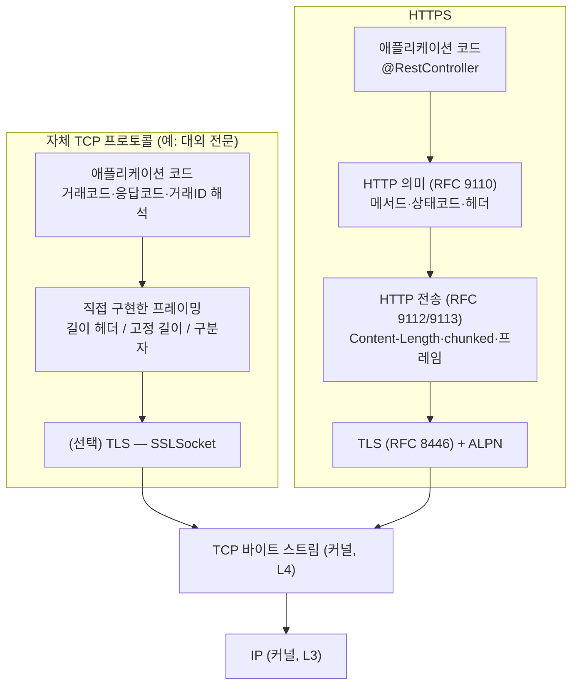
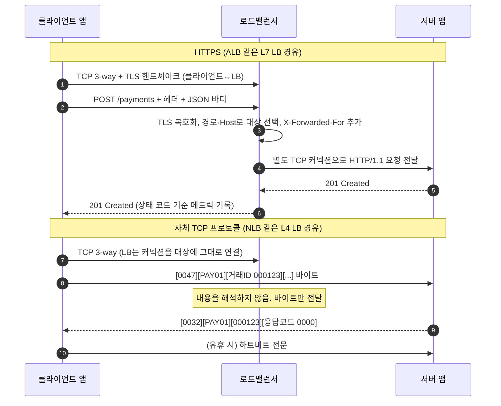

# 05a. TCP 소켓 직접 통신 vs HTTP(S)

> 관련 문서: [실습](./05a-TCP소켓-vs-HTTP-실습.md) · 선행 [03. TCP](./03-TCP-이론.md) · [05. HTTP](./05-HTTP-이론.md) · [06. TLS](./06-TLS-이론.md)

## 1. 한 줄 요약

"TCP 소켓 방식"은 TCP가 제공하는 **순서가 보장된 바이트 스트림** 위에서 메시지 경계·요청과 응답의 대응·오류 표현을 애플리케이션이 직접 정의해 쓰는 방식이고, HTTP(S)는 그 규칙을 표준으로 정해 둔 응용 계층 프로토콜(+TLS 암호화)이다. 둘은 경쟁 관계가 아니라 **HTTP가 TCP 소켓 위에서 동작하는 계층 관계**다.

## 2. 왜 필요한가

### "소켓 vs HTTP"라는 질문의 진짜 의미

HTTP 요청도 결국 `socket()` → `connect()` → `write()` → `read()`로 처리된다. Tomcat도 내부에서 `ServerSocketChannel.accept()`를 호출한다. 그래서 "소켓 통신과 HTTP 통신의 차이"는 정확히 말하면 다음 질문이다.

> TCP가 주는 바이트 스트림 위에 **우리가 직접 만든 규칙(자체 프로토콜)**을 올릴 것인가, **HTTP라는 표준 규칙**을 올릴 것인가?

### TCP가 해주는 것과 안 해주는 것

TCP는 바이트가 **빠짐없이, 순서대로, 중복 없이** 도착하도록 보장한다([3장](./03-TCP-이론.md)). 그러나 애플리케이션이 실제로 필요한 것 중 상당수는 해주지 않는다.

| 애플리케이션이 필요한 것 | TCP가 해주는가 | 자체 프로토콜이라면 | HTTP라면 |
|---|---|---|---|
| 메시지 하나가 어디서 끝나는지 | ❌ 바이트 스트림일 뿐 | 길이 헤더·구분자·고정 길이를 직접 정의 | `Content-Length`, `chunked`, HTTP/2 프레임 |
| 이 응답이 어느 요청의 것인지 | ❌ | 거래 ID를 직접 넣거나 커넥션을 독점 | HTTP/1.1은 커넥션 내 순서, HTTP/2는 스트림 ID |
| 성공/실패 표현 | ❌ | 응답 코드 필드를 직접 정의 | 상태 코드 (2xx/4xx/5xx) |
| 무엇을 요청하는지 | ❌ | 거래 코드(전문 종별 코드) 직접 정의 | 메서드 + URI |
| 메타데이터(인증, 압축, 콘텐츠 형식) | ❌ | 직접 정의 | 헤더 필드 |
| 중간 장비가 내용을 이해하고 라우팅·캐시 | ❌ | 불가능 (L4까지만) | 프록시·L7 LB·CDN·WAF가 이해함 |
| 암호화 | ❌ | TLS를 직접 붙여야 함 | HTTPS = HTTP + TLS |

### 자체 프로토콜이 쓰였던 이유, 지금도 쓰이는 곳

- **국내 금융·대외계 전문(電文) 통신**: 은행·카드사·VAN사 연동은 1990년대부터 "고정 길이 전문 + TCP 소켓"이 표준처럼 굳어졌다. HTTP가 지금처럼 범용이 아니던 시절, 헤더 오버헤드가 없고 장수명 커넥션 하나로 거래를 계속 흘려보내는 방식이 효율적이었다. 기관 간 규격이 이미 정해져 있어 지금도 신규 연동이 이 방식으로 들어온다.
- **우리가 매일 쓰는 자체 TCP 프로토콜**: JDBC가 PostgreSQL과 말하는 **PostgreSQL 와이어 프로토콜**(v3), Redis의 RESP, Kafka 프로토콜, MQTT. 모두 HTTP가 아닌 TCP 위의 자체 규칙이다. 즉 "TCP 소켓 방식"은 레거시 전용이 아니다. **성능과 상태 유지가 중요하고 양쪽 구현을 모두 통제할 수 있는 곳**에서 지금도 선택된다.

### HTTP가 기본값이 된 이유

자체 프로토콜은 **양 끝단 프로그램만** 그 규칙을 안다. 중간의 프록시, 로드밸런서, 방화벽, 모니터링 도구, 브라우저, curl은 모두 그냥 바이트로 본다. HTTP는 규칙이 표준이라 **경로 위의 모든 구성요소가 메시지를 이해**한다. 경로 기반 라우팅, 캐시, 인증 게이트웨이, 재시도, 상태 코드별 메트릭이 공짜로 따라온다. 이 생태계가 수십 바이트의 헤더 오버헤드보다 훨씬 비싸다.

## 3. 핵심 개념

| 용어 | 정의 |
|---|---|
| 소켓 (Socket) | 커널이 관리하는 통신 끝점. 애플리케이션은 파일 디스크립터로 다루며, TCP 소켓은 `(src IP, src port, dst IP, dst port)`로 식별된다. HTTP도 이 위에서 동작한다 |
| 바이트 스트림 (Byte Stream) | TCP가 제공하는 추상화. 송신 측 `write()` 경계가 수신 측 `read()` 경계로 보존되지 않는다 |
| 와이어 프로토콜 (Wire Protocol) | 네트워크 위에 실제로 흐르는 바이트의 형식 규칙. "자체 프로토콜"은 이것을 직접 정의한 것 |
| 메시지 프레이밍 (Message Framing) | 바이트 스트림에서 메시지 하나의 시작과 끝을 구분하는 규칙 |
| 고정 길이 (Fixed-length) | 모든 메시지 또는 필드의 길이를 미리 정한 프레이밍. 국내 전문의 전형 (예: 전문 전체 300바이트, 필드는 공백 패딩) |
| 길이 접두 (Length-prefix) | 본문 앞에 본문 길이를 적는 프레이밍. PostgreSQL, Kafka, HTTP/2 프레임이 이 방식 |
| 구분자 (Delimiter) | 특정 바이트열(`\r\n`, `0x03` ETX 등)로 끝을 표시하는 프레이밍. Redis RESP, SMTP, HTTP/1.1 헤더부 |
| 요청-응답 상관 (Correlation) | 응답이 어느 요청에 대한 것인지 대응시키는 방법. 순서 기반 또는 ID 기반 |
| 다중화 (Multiplexing) | 커넥션 하나에서 여러 요청을 동시에 진행하는 것. ID 기반 상관이 있어야 가능 |
| 하트비트 (Heartbeat) | 유휴 커넥션이 살아 있는지 확인하고 중간 장비의 idle timeout을 막기 위해 주기적으로 보내는 애플리케이션 메시지. 전문에서는 "폴링 전문", "링크 체크"로 부른다 |
| 반열림 커넥션 (Half-open Connection) | 한쪽은 커넥션이 살아 있다고 믿지만 상대나 중간 장비에서는 이미 사라진 상태 |
| 의미 (Semantics) | 메시지가 뜻하는 바(메서드, 상태 코드, 헤더). HTTP는 RFC 9110에서 이를 표준화했다 |
| 중개자 (Intermediary) | 클라이언트와 서버 사이에서 메시지를 받아 전달하는 구성요소. 프록시, 게이트웨이, L7 LB |
| 바이트 순서 (Byte Order / Endianness) | 여러 바이트 정수를 저장하는 순서. 네트워크 표준은 빅 엔디언(Big-endian) |

## 4. 동작 원리와 흐름

### 4-1. 같은 TCP 연결 위에 무엇이 더 올라가는가



왼쪽에서 개발자가 직접 짜야 하는 칸이 오른쪽에서는 Tomcat·Spring MVC·JSSE가 대신 처리하는 칸이다. 그리고 **TLS는 HTTP 전용이 아니다.** 자체 프로토콜에도 `SSLSocket`으로 똑같이 붙일 수 있다. "HTTPS는 안전하고 소켓은 위험하다"는 비교는 틀렸다. 평문 HTTP와 평문 소켓은 똑같이 위험하다.

### 4-2. 요청 하나가 거치는 경로 비교



| 단계 | HTTPS 경로 | 자체 TCP 경로 |
|---|---|---|
| 연결 수립 | 커널(L4) 3-way → JSSE/LB(L5~6) TLS 핸드셰이크 | 커널(L4) 3-way. TLS는 선택 |
| 메시지 경계 판단 | Tomcat `Http11Processor`가 헤더의 `\r\n\r\n`과 `Content-Length`/`chunked`로 판단 | 개발자 코드가 길이 헤더 등으로 판단 |
| 라우팅 | L7 LB·Nginx가 URI·Host·헤더로 결정 | L4 LB가 5-튜플로 결정. 내용 기반 라우팅 불가 |
| 요청-응답 대응 | HTTP/1.1: 커넥션 내 순서. HTTP/2: 스트림 ID | 개발자가 정의 (거래 ID 또는 커넥션 독점) |
| 오류 표현 | 상태 코드 → Spring 예외로 자동 변환 | 응답 코드 필드를 직접 해석 |
| 커넥션 수명 | 짧거나 keep-alive 풀. 프록시가 중간에서 끊고 다시 맺음 | 대개 장수명. 하루 종일 커넥션 하나를 유지하는 경우도 흔함 |

### 4-3. 수신 측에서 메시지 경계가 사라지는 과정

1. **송신 앱(L7)**: `write("msg-1")`, `write("msg-2")`, `write("msg-3")`를 연달아 호출한다.
2. **송신 커널(L4)**: 바이트를 송신 버퍼에 넣는다. Nagle 알고리즘이 켜져 있으면 작은 조각을 모아 한 세그먼트로 보낼 수 있다. 꺼져 있어도 MSS를 넘는 데이터는 여러 세그먼트로 나뉜다.
3. **네트워크(L3)**: 세그먼트가 MTU에 맞게 이동한다. 경로 중간에서 재전송이 생기면 수신 측 도착 시점이 몰린다.
4. **수신 커널(L4)**: 세그먼트를 순서대로 재조립해 **수신 버퍼에 이어 붙인다.** 이 시점에 원래의 `write()` 경계 정보는 존재하지 않는다.
5. **수신 앱(L7)**: `read(buf)`는 "지금 수신 버퍼에 있는 만큼(최대 buf 크기)"을 돌려준다. 앱이 잠시 바빴다면 `"msg-1msg-2msg-3"`이 한 번에 나오고, 데이터가 덜 왔으면 `"ms"`만 나온다.

그래서 **"read() 한 번 = 메시지 하나"는 로컬 테스트에서만 우연히 맞는다.** 같은 머신의 루프백(loopback)은 지연이 거의 없어 경계가 보존된 것처럼 보이다가, 운영 환경의 지연·부하에서 깨진다. HTTP를 쓰면 이 문제를 Tomcat이 처리하므로 개발자가 볼 일이 없다.

### 4-4. 상태는 어디에 생기는가

| 상태 | 자체 TCP 프로토콜 | HTTP(S) |
|---|---|---|
| TCP 커넥션 (커널 소켓, fd) | 서버·클라이언트 커널. 장수명이므로 개수는 적고 오래 산다 | 클라이언트↔LB, LB↔서버가 **별개의 커넥션**. keep-alive 풀에서 재사용 |
| 수신 버퍼의 미완성 메시지 | 앱이 직접 관리 (부분 수신 바이트를 들고 있어야 함) | Tomcat 내부 버퍼가 관리 |
| 세션/로그인 상태 | 커넥션 자체가 세션인 경우가 많음 (접속 후 로그온 전문 → 이후 거래). **커넥션이 끊기면 상태도 소멸** | 무상태(Stateless)가 원칙. 쿠키·토큰으로 요청마다 다시 증명 |
| 진행 중인 요청 목록 | 다중화 시 `거래ID → 대기 중 Future` 맵을 앱이 유지 | HTTP/2 스트림 테이블은 서버·클라이언트 라이브러리가 유지 |
| 하트비트 타이머 | 앱이 유지 | 보통 없음. 풀의 유휴 커넥션 정리 타이머로 대체 |

"커넥션 = 세션"이라는 점이 운영에서 결정적이다. 서버를 재배포하면 모든 클라이언트가 재접속·재로그온을 해야 하고, 로드밸런서는 이미 붙은 커넥션을 다른 서버로 옮길 수 없다(9-7).

## 5. 구현 레벨 들여다보기

### TCP는 경계를 보존하지 않는다 (RFC 9293)

TCP 헤더에는 "메시지 끝" 필드가 없다. **PSH 플래그도 경계가 아니다.** PSH는 수신 커널에게 "버퍼링하지 말고 앱에 바로 넘겨라"라는 힌트일 뿐이고, 수신 측은 여러 PSH 세그먼트를 합쳐 한 번의 `read()`로 줄 수 있다. 경계를 보존하는 전송 계층 프로토콜이 필요하면 UDP(데이터그램 단위)나 SCTP를 써야 하는데, 각각 신뢰성 또는 범용성의 대가가 있다.

### 프레이밍 방식 세 가지와 실제 사례

| 방식 | 형식 예시 | 실제 사례 | 수신 측 처리 |
|---|---|---|---|
| 고정 길이 | `PAY01` + 거래ID 10바이트 + 금액 15바이트(0 패딩) … 총 300바이트 | 국내 대외계 전문 | 정확히 N바이트를 모은다 (`readFully`) |
| 길이 접두 | `[00 00 00 2F][본문 47바이트]` 또는 ASCII `"0047"` + 본문 | PostgreSQL: 타입 1바이트 + **자기 자신을 포함한** Int32 길이 / Kafka: Int32 크기 / HTTP/2: 24비트 길이 + 9바이트 프레임 헤더 / 전문: 앞 4~6자리 ASCII 길이 | 헤더를 읽고 → 길이만큼 모은다 |
| 구분자 | `SET k v\r\n`, `STX…ETX` | Redis RESP, SMTP, HTTP/1.1 헤더부(`\r\n\r\n`) | 구분자를 찾을 때까지 스캔. 본문에 구분자가 나오면 이스케이프 필요 |

길이 헤더에서 자주 갈리는 규칙들. 규격서에 반드시 명시되어야 하며, 빠져 있으면 상대 기관에 확인해야 한다.

- **길이가 무엇을 포함하는가**: 본문만? 길이 필드 자신까지? (PostgreSQL은 자기 포함, Kafka는 미포함)
- **표현 방식**: 바이너리 정수인가, ASCII 숫자 문자열(`"0047"`)인가
- **바이트 순서**: 바이너리라면 빅 엔디언인가. Java `DataOutputStream.writeInt`와 `ByteBuffer`(기본값)는 빅 엔디언이다. C#의 `BitConverter`나 x86 C 구조체를 그대로 보내면 리틀 엔디언이 되어 `0x2F000000`(약 7.9억)으로 해석된다
- **길이 단위**: 바이트 수다. **문자 수가 아니다** (9-2)

### HTTP/1.1은 어떻게 메시지 끝을 아는가 (RFC 9112 6.3절)

HTTP도 같은 문제를 풀어야 했고, 다음 우선순위로 정했다.

1. 헤더부는 빈 줄(`\r\n\r\n`)까지 — 구분자 방식
2. `Transfer-Encoding: chunked`가 있으면 청크마다 `16진수 길이\r\n데이터\r\n`, 길이 `0` 청크가 끝 — 길이 접두 방식의 반복
3. 없으면 `Content-Length` 바이트만큼 — 길이 접두 방식
4. 둘 다 없는 응답은 서버가 커넥션을 닫을 때까지 — 이 경우 커넥션 재사용 불가

즉 HTTP는 **프레이밍 방식 세 가지를 모두 조합해 표준화한 것**이다. 2번과 3번이 동시에 오거나 서로 다르게 해석될 때 생기는 문제가 요청 스머글링이다([5장 9-4](./05-HTTP-이론.md)).

### 소켓 옵션 (자체 프로토콜에서 직접 챙겨야 하는 것)

| 옵션 | Java API | 기본값 | 자체 프로토콜에서 의미 |
|---|---|---|---|
| 읽기 타임아웃 | `Socket.setSoTimeout(ms)` | `0` = 무한 대기 | 반드시 설정. 안 하면 응답 없는 상대 때문에 스레드가 영원히 멈춤([3장 9-4](./03-TCP-이론.md)) |
| 연결 타임아웃 | `socket.connect(addr, ms)` | `new Socket(host, port)`는 타임아웃 없이 OS 재시도(Linux 약 127초) | 반드시 2-인자 `connect` 사용 |
| `TCP_NODELAY` | `setTcpNoDelay(true)` | `false` (Nagle 켜짐) | 작은 전문을 주고받는 요청-응답형이면 켜는 것이 일반적([3장 9-6](./03-TCP-이론.md)) |
| `SO_KEEPALIVE` | `setKeepAlive(true)` | `false` | 켜도 Linux 기본 `net.ipv4.tcp_keepalive_time = 7200`(2시간)이라 중간 장비 idle timeout(수 분)보다 길다. 소켓별 조정은 JDK 11+ `ExtendedSocketOptions.TCP_KEEPIDLE` (OS 지원 범위 확인 필요) |
| 수신 버퍼 | `setReceiveBufferSize` | 커널 `net.ipv4.tcp_rmem` 자동 조절 | 보통 건드리지 않음 |

HTTP 클라이언트·서버를 쓰면 이 값들이 `server.tomcat.connection-timeout`, `RestClient`의 `readTimeout` 같은 이름으로 감싸져 있다.

### 프레이밍을 대신 해주는 라이브러리

| 라이브러리 | 클래스 | 비고 |
|---|---|---|
| Netty | `LengthFieldBasedFrameDecoder(maxFrameLength, lengthFieldOffset, lengthFieldLength, lengthAdjustment, initialBytesToStrip)` | `maxFrameLength` 초과 시 `TooLongFrameException`. `lengthAdjustment`로 "길이가 자기 자신을 포함" 같은 규칙을 맞춤 |
| Netty | `FixedLengthFrameDecoder`, `LineBasedFrameDecoder`, `DelimiterBasedFrameDecoder` | 고정 길이·줄바꿈·임의 구분자 |
| Spring Integration IP | `ByteArrayLengthHeaderSerializer`, `ByteArrayCrLfSerializer`(커넥션 팩토리 기본값), `ByteArrayStxEtxSerializer`, `ByteArrayRawSerializer` | `maxMessageSize` 기본 2048바이트(확인 필요). 큰 전문이 오면 예외 |
| JDK | `DataInputStream.readFully`, `readInt` | 가장 기본. 부족한 바이트를 루프로 채워 줌 |

### L4 프록시 설정 (Nginx `stream` 모듈)

자체 프로토콜은 Nginx의 `http {}` 블록으로 프록시할 수 없다. `stream {}` 블록(L4)을 써야 한다.

```nginx
stream {
    upstream bank_gw {
        server 10.0.1.10:9000;
        server 10.0.1.11:9000;
    }
    server {
        listen 9000;
        proxy_pass bank_gw;
        proxy_connect_timeout 5s;   # 기본 60s
        proxy_timeout 30m;          # 기본 10m. 양방향 무활동 시간. 하트비트 주기보다 길어야 한다
    }
}
```

`proxy_timeout`이 하트비트 주기보다 짧으면 Nginx가 조용히 커넥션을 닫는다(9-5). AWS에서는 ALB가 HTTP/HTTPS/gRPC만 이해하므로 자체 TCP는 **NLB**(TCP 리스너)를 쓴다. NLB의 TCP idle timeout은 오랫동안 350초 고정이었고 이후 조정 가능해졌다(설정 범위는 확인 필요, [AWS 문서](https://docs.aws.amazon.com/elasticloadbalancing/latest/network/network-load-balancers.html)).

## 6. 백엔드 코드와 만나는 지점

### 6-1. 우리는 이미 자체 TCP 프로토콜을 쓰고 있다 — JDBC와 Redis

이 장의 개념이 가장 직접 드러나는 곳은 의외로 DB 커넥션이다.

| 클라이언트 | 프로토콜 | 요청-응답 상관 방식 | 그래서 생긴 구조 |
|---|---|---|---|
| pgJDBC → PostgreSQL | PostgreSQL 와이어 프로토콜 v3 (길이 접두) | **요청 ID 없음.** 한 커넥션에서 한 번에 한 질의, 응답은 순서대로 | 커넥션을 스레드가 독점해야 함 → **HikariCP 커넥션 풀**이 필요 |
| Lettuce → Redis | RESP (구분자 + 길이) | 요청 ID 없음. 대신 응답이 **보낸 순서대로** 온다는 보장 | Lettuce는 커넥션 하나를 여러 스레드가 공유. 보낸 순서대로 `Future`를 큐에 넣고 응답을 차례로 매칭 |
| `RestClient` → HTTP/1.1 서버 | HTTP/1.1 | 커넥션 내 순서 (파이프라이닝은 사실상 안 씀) | 커넥션 풀 필요 (Apache HttpClient `PoolingHttpClientConnectionManager`) |
| `WebClient`/gRPC → HTTP/2 서버 | HTTP/2 | **스트림 ID** | 커넥션 하나에 동시 요청 다중화 |

자체 전문 프로토콜을 설계하거나 연동할 때 "거래 ID로 응답을 매칭하는가, 커넥션을 독점하는가"가 이 표의 어느 줄에 해당하는지를 결정한다. 거래 ID가 없는 전문인데 커넥션 하나를 여러 스레드가 공유하면 9-4의 사고가 난다.

HikariCP의 `keepaliveTime`(기본 2분)과 `maxLifetime`(기본 30분)도 자체 TCP 프로토콜의 하트비트·재연결 정책과 같은 문제를 푸는 것이다. 중간 장비가 유휴 커넥션을 지우기 전에 살아 있음을 확인하고, 오래된 커넥션은 먼저 버린다([3장 6-2](./03-TCP-이론.md)).

### 6-2. Spring Boot에서 TCP 서버를 만들 때

Spring Boot의 내장 Tomcat은 HTTP 전용이다. 자체 프로토콜 서버는 별도로 띄운다. 선택지는 세 가지다.

| 방법 | 적합한 경우 | 주의 |
|---|---|---|
| `ServerSocket` + 스레드 (또는 가상 스레드) | 학습, 매우 단순한 내부 도구 | 프레이밍·타임아웃·종료 처리를 모두 직접 |
| Spring Integration IP (`spring-integration-ip`) | 전문 연동처럼 "받아서 변환해서 넘기는" 흐름 | 직렬화기 기본값(CRLF)과 `maxMessageSize` 확인 |
| Netty / Reactor Netty `TcpServer` | 커넥션 수가 많거나 성능이 중요한 게이트웨이 | 이벤트 루프 스레드에서 블로킹 금지 |

Spring Integration으로 4바이트 길이 헤더 서버를 만드는 예 (Spring Boot 3.x / Spring Integration 6.x):

```java
package com.example.tcp;

import org.springframework.context.annotation.Bean;
import org.springframework.context.annotation.Configuration;
import org.springframework.integration.config.EnableIntegration;
import org.springframework.integration.dsl.IntegrationFlow;
import org.springframework.integration.dsl.Transformers;
import org.springframework.integration.ip.dsl.Tcp;
import org.springframework.integration.ip.tcp.connection.AbstractServerConnectionFactory;
import org.springframework.integration.ip.tcp.connection.TcpNetServerConnectionFactory;
import org.springframework.integration.ip.tcp.serializer.ByteArrayLengthHeaderSerializer;

@Configuration
@EnableIntegration
public class TcpServerConfig {

    @Bean
    public AbstractServerConnectionFactory tcpServerConnectionFactory() {
        TcpNetServerConnectionFactory cf = new TcpNetServerConnectionFactory(9000);

        // 기본 직렬화기는 ByteArrayCrLfSerializer(\r\n 구분자). 길이 헤더 규격이면 반드시 교체한다
        ByteArrayLengthHeaderSerializer serializer = new ByteArrayLengthHeaderSerializer(); // 4바이트 빅 엔디언 길이
        serializer.setMaxMessageSize(64 * 1024); // 기본 2048. 규격상 최대 전문 크기에 맞춘다 (9-3)
        cf.setSerializer(serializer);
        cf.setDeserializer(serializer);

        cf.setSoTimeout(60_000); // 무활동 커넥션 정리. 상대의 하트비트 주기보다 길게
        return cf;
    }

    @Bean
    public IntegrationFlow tcpInboundFlow(AbstractServerConnectionFactory tcpServerConnectionFactory) {
        return IntegrationFlow.from(Tcp.inboundGateway(tcpServerConnectionFactory))
                .transform(Transformers.objectToString())            // byte[] → String (UTF-8)
                .<String, String>transform(payload -> "ACK:" + payload) // 실제로는 전문 파싱 → 서비스 호출
                .get();
    }
}
```

HTTP API가 하나도 없더라도 `spring.main.web-application-type: none`으로 Tomcat을 끄기 전에 생각할 것이 있다. **로드밸런서 헬스체크와 쿠버네티스 Probe는 대부분 HTTP를 기대한다.** TCP 포트 9000이 열려 있다는 것은 "프로세스가 살아 있다"일 뿐 "거래를 처리할 수 있다"가 아니다. Actuator를 별도 관리 포트로 열어 두는 구성이 일반적이다.

```yaml
server:
  port: 8081                  # Actuator 전용으로만 사용
management:
  endpoints:
    web:
      exposure:
        include: health,prometheus
  endpoint:
    health:
      probes:
        enabled: true         # /actuator/health/liveness, /readiness (24장)
```

### 6-3. 대외 전문 클라이언트 — 예외와 원인

TCP 소켓 클라이언트에서 보게 되는 예외는 [3장 6-1의 표](./03-TCP-이론.md)와 같다. 여기에 **자체 프로토콜이기 때문에** 추가로 생기는 것들이 있다.

| 증상 / 예외 | 자체 프로토콜에서의 의미 |
|---|---|
| `java.io.EOFException` (`DataInputStream.readInt`/`readFully` 중) | 메시지 중간에 상대가 FIN을 보냄. 상대가 우리 전문을 해석하지 못해 끊었을 가능성(길이·인코딩 불일치) |
| `read()`가 기대보다 적은 바이트 반환 (예외 없음) | 정상 동작. 부분 수신이다. `readFully` 또는 루프로 채워야 함 (9-1) |
| 응답 코드는 정상인데 금액·이름 필드가 한 칸씩 밀림 | 길이 계산이나 문자 인코딩 불일치 (9-2) |
| `OutOfMemoryError: Java heap space` (수신 스레드) | 길이 헤더를 검증 없이 믿고 배열 할당 (9-3) |
| `SocketTimeoutException: Read timed out`이 **유휴 후 첫 거래**에서만 | 중간 장비가 유휴 커넥션을 지움 (9-5) |
| `javax.net.ssl.SSLException: Unsupported or unrecognized SSL message` | TLS 클라이언트가 평문 포트에 접속했거나 그 반대 (9-8) |

HTTP 클라이언트라면 이 중 대부분이 라이브러리 안에서 처리되고, 남는 것은 `HttpClientErrorException`(4xx), `HttpServerErrorException`(5xx), `ResourceAccessException`(I/O 계열을 감쌈)처럼 **의미가 붙은 예외**다.

### 6-4. 문자 인코딩 — Java 18에서 바뀐 기본값

국내 전문은 EUC-KR/MS949(CP949) 고정 길이가 많다. 한글 1자는 EUC-KR에서 2바이트, UTF-8에서 3바이트다.

```java
String name = "홍길동";
name.length();                                   // 3 (문자 수, UTF-16 코드 유닛 수)
name.getBytes(Charset.forName("MS949")).length;  // 6
name.getBytes(StandardCharsets.UTF_8).length;    // 9
name.getBytes().length;                          // 플랫폼 기본 인코딩에 따라 6 또는 9
```

`getBytes()`를 인자 없이 호출하면 JVM 기본 인코딩을 쓴다. **JDK 18(JEP 400)부터 기본값이 OS와 무관하게 UTF-8**로 바뀌었다. 그 전에는 한국어 Windows에서 MS949, Linux에서 대개 UTF-8이었다. 그래서 다음 사고가 실제로 난다.

- Windows 개발 PC(Java 17, MS949)에서는 전문이 맞았는데 Linux 서버에서는 한글 필드가 깨짐
- Java 17 → 21 업그레이드 후 같은 코드가 한글 전문에서 길이 불일치를 냄

HTTP에서는 `Content-Type: application/json; charset=UTF-8`로 인코딩이 메시지에 명시되고, JSON은 사실상 UTF-8로 고정(RFC 8259)이라 이 문제가 거의 없다. 자체 프로토콜에서는 **인코딩을 코드에 명시적으로 박아야 한다.**

### 6-5. 관측성 — HTTP가 공짜로 주는 것

| 항목 | HTTP (Spring Boot) | 자체 TCP 프로토콜 |
|---|---|---|
| 요청 수·지연 메트릭 | `http.server.requests` (URI·상태 코드별) 자동 | 직접 `Timer`/`Counter` 등록 |
| 분산 트레이싱 | `traceparent` 헤더로 자동 전파 (Micrometer Tracing) | 전문에 추적 ID 필드가 없으면 끊김 |
| 접근 로그 | Tomcat/Nginx access log | 직접 로깅 (전문 원문 로깅 시 개인정보 마스킹 필요) |
| 디버깅 도구 | curl, 브라우저 개발자 도구, Postman | 전용 시뮬레이터, `nc`, `tcpdump` + 규격서 |
| 패킷 해석 | Wireshark가 HTTP를 해석 | Wireshark는 바이트만 보여줌 (Lua 디섹터를 직접 작성해야 함) |

### 6-6. 가상 스레드와 장수명 소켓

장수명 TCP 커넥션마다 수신 스레드 하나를 두는 구조는 커넥션 수만큼 플랫폼 스레드를 소모했다. Java 21 가상 스레드에서 블로킹 소켓 `read()`는 캐리어 스레드를 놓아주므로(unmount) 이 구조의 비용이 크게 줄었다. 다만 Java 21~23에서는 `synchronized` 블록 안에서 블로킹하면 캐리어가 고정(pinning)되므로, 소켓 쓰기를 `synchronized`로 보호하던 레거시 코드는 `ReentrantLock`으로 바꾸는 것이 안전하다(JDK 24, JEP 491에서 해소).

## 7. 유사 개념과의 비교

| 기준 | 자체 TCP 프로토콜 | HTTP/1.1 | HTTP/2 | WebSocket | gRPC |
|---|---|---|---|---|---|
| 프레이밍 | 직접 정의 | 텍스트 헤더 + Content-Length/chunked | 바이너리 프레임 | 바이너리 프레임 (RFC 6455) | HTTP/2 프레임 + 5바이트 메시지 접두 |
| 통신 방향 | 양방향 자유 (서버가 먼저 보내도 됨) | 클라이언트 요청 → 서버 응답 | 요청-응답 (+ 서버 푸시는 사실상 폐기) | 양방향 자유 | 단방향·서버 스트림·양방향 스트림 |
| 요청-응답 상관 | 직접 (거래 ID 또는 독점) | 커넥션 내 순서 | 스트림 ID | 없음 (직접 정의) | 스트림 ID |
| 중개자 이해도 | L4만 | L7 프록시·LB·CDN·WAF 모두 | 대부분 | Upgrade 이후는 L4처럼 통과 | HTTP/2를 끝까지 지원하는 프록시 필요 |
| 오버헤드 | 최소 (수 바이트) | 수백 바이트 헤더 | HPACK으로 압축 | 프레임당 2~14바이트 | 작음 (Protobuf) |
| 스키마/계약 | 규격서 문서 | OpenAPI (선택) | OpenAPI (선택) | 직접 정의 | `.proto` 필수 |
| 브라우저 지원 | 불가 | 가능 | 가능 | 가능 | gRPC-Web 프록시 필요 |
| 구현·운영 비용 | 높음 | 낮음 | 낮음 | 중간 | 중간 |

**판단 기준**

1. 상대가 규격을 정해 왔다(대외기관 전문) → 선택권 없음. 자체 TCP를 **제대로** 구현하는 것이 목표다.
2. 브라우저·외부 개발자가 호출한다 → HTTP(REST). 실시간 서버 푸시가 필요하면 SSE 또는 WebSocket.
3. 사내 서비스 간 호출 → 기본은 HTTP. 호출량이 매우 많고 스키마 계약이 중요하면 gRPC.
4. 자체 TCP 프로토콜을 새로 설계하고 싶다 → 거의 항상 WebSocket이나 gRPC로 대체 가능하다. 둘 다 프레이밍·다중화·TLS·프록시 호환성 문제를 이미 풀었다. 자체 설계는 수 바이트의 오버헤드가 실제 병목으로 측정된 경우에만 정당화된다.

## 8. 표준·버전별 변천

| 시점 | 변화 | 실무 영향 |
|---|---|---|
| 1990년대 | 금융·VAN 고정 길이 전문 + TCP 소켓 정착 | 지금도 대외계 연동 규격의 기본 |
| 2000년대 | 전문을 XML/SOAP over HTTP로 감싸는 시도 | 일부 기관 연동이 HTTP 기반 전문으로 이동. 내부 구조는 여전히 전문 필드 |
| 2011 | WebSocket 표준화 (RFC 6455) | "브라우저와 서버의 양방향 TCP"를 HTTP 호환 방식으로 해결. 직접 소켓 서버를 만들 이유 감소 |
| 2015~2016 | HTTP/2 (RFC 7540 → 2022년 RFC 9113), gRPC 공개 | ID 기반 다중화가 표준으로 들어오며 사내 RPC용 자체 바이너리 프로토콜의 필요성 감소 |
| 2022 (JDK 18) | JEP 400: 기본 문자셋 UTF-8 | 인자 없는 `getBytes()`/`new String(bytes)`를 쓰던 전문 코드가 업그레이드 시 깨짐 (6-4) |
| 2024 (PostgreSQL 17) | `sslnegotiation=direct`: 평문 `SSLRequest` 왕복 없이 바로 TLS 시작, ALPN `postgresql` 사용 | 자체 TCP 프로토콜도 HTTPS처럼 "접속 즉시 TLS + ALPN" 방향으로 수렴. TLS 종료 프록시와의 호환성 향상 |

## 9. 함정과 장애 패턴

### 9-1. 메시지가 붙어서 오거나 잘려서 온다

- **증상**: 로컬 테스트는 완벽했는데 운영에서 간헐적으로 "전문 형식 오류", 파싱 예외, 한 요청에 두 거래가 처리되거나 거래가 사라진다. 트래픽이 몰리는 시간대에 집중된다.
- **원인**: `int n = in.read(buf)`의 결과를 메시지 하나로 취급했다(4-3). 부하가 걸리면 수신 버퍼에 여러 메시지가 쌓여 한 번에 읽히고(붙음), 큰 메시지나 지연이 있으면 일부만 읽힌다(잘림).
- **확인 방법**: 수신 코드에 `read()` 반환 바이트 수를 로그로 찍는다. 규격상 길이(예: 300)와 다른 값(600, 147 등)이 보이면 확정. 패킷 수준에서는 `tcpdump -i any -nn 'tcp port 9000' -X`로 한 세그먼트에 전문 두 개가 들어 있거나 전문 하나가 세그먼트 두 개로 나뉜 것을 볼 수 있다. 다만 세그먼트 경계와 `read()` 경계도 일치하지 않으므로 **앱 로그가 1차 근거**다.
- **해결**: 규격의 프레이밍대로 정확히 모아서 읽는다. `DataInputStream.readFully`, Netty `LengthFieldBasedFrameDecoder`/`FixedLengthFrameDecoder`, Spring Integration 직렬화기. "read 후 sleep으로 기다리기"는 해결이 아니다.

### 9-2. 길이를 문자 수로 계산했다 — 한글 전문만 깨진다

- **증상**: 영문·숫자만 있는 거래는 정상인데 고객명에 한글이 들어간 거래만 실패. 상대 기관 로그에 "길이 불일치". 또는 응답의 뒤쪽 필드가 몇 바이트씩 밀려 금액이 엉뚱하게 파싱된다.
- **원인**: 길이 헤더나 고정 길이 패딩을 `String.length()`(문자 수)로 계산했다. 또는 인코딩을 명시하지 않아 EUC-KR 규격에 UTF-8 바이트를 보냈다(6-4).
- **확인 방법**: 실제 보낸 바이트를 16진수로 덤프한다(`tcpdump -X` 또는 코드에서 hex 로그). 한글 1자가 `EA B0 80`처럼 3바이트면 UTF-8, `B0 A1`처럼 2바이트면 EUC-KR/MS949다. 길이 헤더 값과 실제 본문 바이트 수를 비교한다. JVM 기본값은 `java -XshowSettings:properties -version 2>&1 | grep file.encoding`으로 확인한다.
- **해결**: 길이는 항상 `getBytes(charset).length`로, `charset`은 규격에 맞춰 `Charset.forName("MS949")`처럼 명시한다. 고정 길이 필드는 **바이트 단위로** 자르고 패딩하며, 한글이 2바이트 경계에서 잘리지 않게 처리한다. 인자 없는 `getBytes()`, `new String(bytes)`, `InputStreamReader(in)`을 코드베이스에서 검색해 모두 없앤다.

### 9-3. 이상한 바이트가 길이로 해석되어 OOM 또는 무한 대기

- **증상**: 전문 서버가 갑자기 `OutOfMemoryError: Java heap space`로 죽거나, 특정 커넥션의 수신 스레드가 영원히 `readFully`에서 멈춘다. 보안 스캐너가 돈 직후, 또는 누군가 브라우저로 그 포트에 접속한 직후에 발생한다.
- **원인**: 프로토콜을 모르는 클라이언트가 보낸 바이트를 길이로 믿었다. 예를 들어 HTTP 요청 `"GET "`의 4바이트 `47 45 54 20`을 빅 엔디언 정수로 읽으면 **1,195,725,856**(약 1.1GB)이다. 그만큼 `new byte[len]`을 하면 OOM, 힙이 충분하면 1.1GB가 올 때까지 대기한다. 로드밸런서의 HTTP 헬스체크를 TCP 포트에 잘못 건 경우도 같다.
- **확인 방법**: 수신 직후 길이 헤더 값을 로그로 남긴다(`len=1195725856 (0x47455420)`처럼 16진수 병기). 16진수를 ASCII로 바꿔 보면 `GET `, `\x16\x03\x01`(TLS ClientHello), `SSH-` 같은 정체가 바로 드러난다. 힙 덤프에서 거대한 `byte[]` 하나가 보이는 것도 근거다.
- **해결**: 규격상 최대 길이로 상한을 두고, 범위를 벗어나면 즉시 커넥션을 닫는다(Netty `maxFrameLength`, Spring Integration `maxMessageSize`). 길이 필드가 ASCII 숫자라면 숫자가 아닌 문자가 오면 거부한다. 첫 메시지에 매직 바이트나 로그온 전문을 요구하는 것도 방어가 된다. LB 헬스체크는 TCP 연결 확인 또는 별도 HTTP 관리 포트(6-2)로 바꾼다.

### 9-4. 공유 커넥션에서 응답이 다른 요청자에게 간다

- **증상**: 동시 거래가 많을 때 A 고객 요청의 응답이 B 고객 화면에 표시된다. 또는 응답의 거래 ID가 요청과 달라 "불일치" 오류가 간헐적으로 난다. 개발 환경(동시성 1)에서는 재현되지 않는다.
- **원인**: 거래 ID 같은 상관 수단이 없거나 무시하면서, 커넥션 하나를 여러 스레드가 공유했다. 스레드 1이 보내고 스레드 2가 보낸 뒤, 먼저 `read()`한 스레드가 먼저 온 응답을 가져간다. 쓰기를 동기화하지 않았다면 두 전문의 바이트가 섞여 나가기도 한다.
- **확인 방법**: 요청·응답 로그에 거래 ID, 스레드 이름, 커넥션 로컬 포트를 함께 남기고 대조한다. 같은 로컬 포트에서 요청 두 개가 응답보다 먼저 나간 기록이 있으면 확정.
- **해결**: 둘 중 하나를 고른다. ① 거래 ID가 없는 규격이면 **커넥션을 독점**한다. 커넥션 풀(Apache Commons Pool 등)에서 빌려 쓰고 돌려준다(JDBC + HikariCP와 같은 구조, 6-1). ② 거래 ID가 있으면 전용 수신 스레드 하나가 응답을 읽어 `ConcurrentHashMap<거래ID, CompletableFuture>`로 배분하고, 쓰기는 락으로 직렬화한다(HTTP/2 스트림과 같은 구조). 응답이 오지 않은 항목의 타임아웃 정리도 구현해야 한다.

### 9-5. 유휴 시간 뒤 첫 거래만 타임아웃 — 중간 장비가 커넥션을 지웠다

- **증상**: 새벽이나 점심 이후 첫 거래만 `SocketTimeoutException: Read timed out` 또는 `Connection reset`. 재시도하면 정상. 서버 쪽 `ss`에는 커넥션이 ESTABLISHED로 남아 있다.
- **원인**: 방화벽, NAT 게이트웨이, L4 LB는 커넥션 추적 테이블에 유휴 시간 제한이 있다(예: AWS NAT 게이트웨이·NLB 350초, Nginx `stream`의 `proxy_timeout` 기본 10분). 제한이 지나면 장비가 **양쪽에 알리지 않고** 엔트리를 지운다. 이후 보낸 패킷은 버려지거나(DROP → 타임아웃) RST를 받는다. 양 끝은 반열림 상태다. HTTP 클라이언트 풀에서도 같은 일이 생기지만 유휴 커넥션 정리(`evictIdleConnections`)와 재시도가 라이브러리에 있어 덜 드러난다.
- **확인 방법**: 실패 직전 마지막 거래와의 간격을 로그에서 계산한다. 실패가 항상 "N분 이상 유휴 후"에만 나면 중간 장비 idle timeout이 유력하다. 네트워크 팀에 경로상 장비의 세션 타임아웃을 확인하고, 양쪽에서 `tcpdump`를 떠 송신 측에는 패킷이 나갔는데 수신 측에 도착하지 않는지 본다.
- **해결**: 규격에 하트비트(폴링) 전문이 있으면 **중간 장비 타임아웃의 1/2 이하 주기**로 보낸다. 없으면 TCP keepalive를 켜고 `TCP_KEEPIDLE`을 그보다 짧게 잡는다(5절 표). 일정 시간 이상 유휴인 커넥션은 사용 전에 버리고 새로 맺는 정책도 함께 둔다. 첫 거래 실패 시 재시도할 때는 **멱등하지 않은 거래(출금, 결제)의 중복 처리 위험**을 반드시 따진다. 요청이 상대에게 도달했는지 알 수 없기 때문이다.

### 9-6. TCP 서비스를 L7 장비 뒤에 두었다

- **증상**: 전문 서버를 ALB나 Nginx `http {}` 뒤에 두었더니 클라이언트 접속 직후 끊김. Nginx 로그에 `400`과 함께 요청 줄이 깨진 바이트로 찍힘. 또는 대상 그룹이 계속 Unhealthy.
- **원인**: L7 장비는 들어온 바이트를 HTTP로 파싱하려 한다. 전문은 HTTP가 아니므로 400으로 거부한다. 반대로 LB의 HTTP 헬스체크가 TCP 포트에 `GET /` 를 보내면 서버는 9-3 상황을 겪고 응답하지 않아 Unhealthy가 된다.
- **확인 방법**: Nginx `error.log`/`access.log`에서 해당 포트의 400과 원문 바이트를 확인. AWS는 대상 그룹의 헬스체크 프로토콜과 실패 사유(`Target.FailedHealthChecks`, `Target.ResponseCodeMismatch` 등)를 확인.
- **해결**: L4로 전달한다. Nginx `stream {}`(5절), AWS NLB TCP 리스너. 헬스체크는 TCP 연결 확인이나 별도 HTTP 관리 포트로. TLS를 LB에서 종료하고 싶다면 NLB의 TLS 리스너나 Nginx `stream`의 `ssl_preread`/`listen ... ssl`처럼 **L4에서 TLS만 벗기는** 방식이어야 한다.

### 9-7. 장수명 커넥션의 부하 불균형과 배포 시 재접속 폭주

- **증상**: 서버를 4대로 늘렸는데 새 서버로는 트래픽이 거의 가지 않는다. 롤링 배포를 하면 대외기관 쪽에서 "연결 끊김" 알람이 오고, 배포 직후 한 서버에 커넥션이 몰린다.
- **원인**: L4 LB는 **커넥션을 맺을 때 한 번만** 대상을 고른다. 장수명 커넥션은 이미 붙은 서버에 계속 머문다. HTTP keep-alive도 비슷하지만 커넥션이 비교적 자주 교체되고, HTTP/1.1은 요청 단위로 다른 커넥션을 쓰므로 덜 두드러진다. 배포로 커넥션이 끊기면 모든 클라이언트가 동시에 재접속해 남은 서버로 몰린다.
- **확인 방법**: 서버별 ESTABLISHED 커넥션 수를 비교한다. `ss -tn state established '( sport = :9000 )' | wc -l`. 커넥션 수는 비슷한데 거래량이 다르면 클라이언트별 거래량 편차를 의심한다.
- **해결**: 클라이언트가 커넥션을 주기적으로(예: 수 시간) 재연결하게 하거나 서버가 오래된 커넥션을 우아하게 닫는다(종료 전문 → 응답 대기 → close). 배포 시에는 새 커넥션 수신을 먼저 멈추고 진행 중 거래를 마친 뒤 종료한다(드레이닝). 대외기관과 커넥션 수·재접속 간격(백오프)을 협의한다.

### 9-8. 평문/TLS 불일치 — 서로 알아듣지 못하는 첫 바이트

- **증상**: Java 클라이언트에서 `javax.net.ssl.SSLException: Unsupported or unrecognized SSL message`. 또는 Nginx가 `400 The plain HTTP request was sent to HTTPS port`. 자체 프로토콜 서버는 길이 오류(9-3)로 끊는다.
- **원인**: TLS 클라이언트가 평문 서버에, 혹은 평문 클라이언트가 TLS 서버에 접속했다. TLS ClientHello는 `16 03 01 ...`로 시작하고, 평문 서버는 이를 자기 프로토콜로 해석하려다 실패한다. HTTP는 이 상황에 대해 Nginx처럼 친절한 오류를 줄 수 있지만, 자체 프로토콜은 대개 그냥 끊는다.
- **확인 방법**: `openssl s_client -connect host:port`로 TLS 핸드셰이크가 되는지 본다. 되면 TLS 포트, 즉시 실패하면 평문 포트다. 서버 쪽에서 첫 수신 바이트를 16진수로 로그에 남기면 `16 03`(TLS)인지 바로 보인다.
- **해결**: 규격서에 포트별 TLS 여부와 TLS 버전·암호군을 명시하고 양측 설정을 맞춘다. 사설 인증서를 쓰는 대외기관이면 TrustStore 설정이 필요하다([6장 6-2](./06-TLS-이론.md)).

## 10. 실무 적용 시나리오

| 상황 | 이 장의 내용을 적용하는 지점 |
|---|---|
| **대외기관 전문 연동 신규 구축** | 규격서에서 프레이밍(길이 포함 범위, ASCII/바이너리, 바이트 순서), 인코딩, 거래 ID 유무, 하트비트 주기, TLS 여부, 동시 커넥션 수를 먼저 확정. 하나라도 비어 있으면 상대 기관에 질의한다. 상대 시뮬레이터 없이 개발해야 하면 `nc -l`로 받은 바이트를 hex 덤프해 규격과 대조 |
| **레거시 소켓 서버를 사내에서 HTTP로 쓰고 싶다** | 소켓 서버를 고치지 않고 앞에 **어댑터(게이트웨이) 서비스**를 둔다. 사내 서비스는 HTTP로 호출, 어댑터가 커넥션 풀·프레이밍·인코딩·하트비트를 전담. 소켓 관련 장애가 한 곳에 모인다 |
| **신규 사내 서비스 간 통신 방식 결정** | 기본값은 HTTP. 자체 TCP를 제안받으면 "WebSocket이나 gRPC로 안 되는 이유"를 먼저 묻는다 (7절 판단 기준) |
| **간헐적 전문 오류 장애 대응** | 9-1(붙음/잘림), 9-2(인코딩), 9-4(공유 커넥션), 9-5(유휴) 순으로 로그 근거를 확인. 공통적으로 필요한 로그: 커넥션 로컬 포트, 거래 ID, 길이 헤더 값, 수신 바이트 수, 마지막 거래 이후 경과 시간 |
| **쿠버네티스 이전** | 자체 TCP 서비스는 Ingress(L7)로 노출할 수 없다. `Service type: LoadBalancer`(NLB)나 Ingress 컨트롤러의 TCP 패스스루 설정이 필요. 파드 재시작 = 커넥션 끊김이므로 `preStop` 훅에서 드레이닝 (9-7, 23장) |

## 11. 보안·비용 고려사항

- **평문 전문 금지**: 전용선이라도 계좌번호·주민번호가 담긴 전문은 TLS를 쓰는 추세다. 자체 프로토콜에도 `SSLSocketFactory`로 TLS를 그대로 적용할 수 있고, 대외계에서는 양방향 인증(mTLS)이나 IP 화이트리스트를 함께 쓴다.
- **WAF가 보호하지 못한다**: WAF는 HTTP를 이해해서 공격 패턴을 막는다. 자체 프로토콜 포트는 WAF의 보호 범위 밖이므로 입력 검증(길이 상한 9-3, 필드 형식, 로그온 전문 인증)을 서버가 전부 책임진다.
- **포트 노출 최소화**: 보안 그룹·방화벽에서 TCP 포트를 상대 기관 IP 대역으로만 연다. 인터넷 전체에 열린 자체 프로토콜 포트는 스캐너의 쓰레기 바이트를 상시 받는다(9-3).
- **로그의 개인정보**: 디버깅을 위해 전문 원문을 로그로 남기기 쉽다. 필드 위치 기반 마스킹을 프레이밍 계층에서 일괄 적용한다.
- **비용**: 장수명 커넥션은 NAT 게이트웨이·NLB의 데이터 처리 비용은 비슷하지만 하트비트 트래픽이 상시 발생한다. 규모가 작아 비용 영향은 대개 무시할 수준이나, 하트비트 주기를 과도하게 짧게(수 초) 잡으면 커넥션 수 × 주기만큼 로그·처리량이 늘어난다.

## 12. 자가 점검 질문

1. "HTTP는 TCP 소켓을 쓰지 않는다"는 말이 왜 틀렸는지, 그렇다면 "소켓 방식 vs HTTP 방식"이라는 비교가 실제로 비교하는 대상은 무엇인지 설명하라.

<details><summary>답</summary>

HTTP 클라이언트와 서버도 `connect()`/`accept()`로 TCP 소켓을 만들고 그 위에서 `write()`/`read()`한다. 차이는 그 바이트 스트림 위에 올리는 **규칙**이다. "소켓 방식"은 메시지 경계·요청 종류·응답 코드·상관 방식을 직접 정의한 자체 프로토콜이고, HTTP는 이를 표준화했기 때문에 프록시·LB·도구가 이해할 수 있다는 것이 본질적 차이다.
</details>

2. 송신 측이 `write()`를 3번 호출해 30바이트씩 보냈다. 수신 측 `read()`가 몇 번, 각각 몇 바이트를 돌려줄 수 있는가? 그리고 왜 로컬 테스트에서는 항상 3번 × 30바이트처럼 보였는가?

<details><summary>답</summary>

1번에 90바이트, 2번에 45+45, 4번에 20+10+30+30 등 어떤 조합도 가능하다. TCP는 바이트 순서만 보장하고 `write()` 경계를 보존하지 않으며, `read()`는 그 시점 수신 버퍼에 있는 만큼을 돌려준다. 로컬 루프백은 지연이 거의 없고, 수신 앱이 바로 읽고 있었기 때문에 우연히 경계가 맞았다. 수신 앱이 바쁘거나 네트워크 지연이 있으면 깨진다.
</details>

3. 전문 서버의 대상 그룹이 계속 Unhealthy이고, 서버 로그에는 `len=1195725856`이 주기적으로 찍힌 뒤 커넥션이 닫힌다. 무슨 일이고 어떻게 고치는가?

<details><summary>답</summary>

1195725856 = `0x47455420` = ASCII `"GET "`. 로드밸런서가 HTTP 헬스체크를 TCP 전문 포트에 보내고 있다. 서버가 길이 상한 검사로 거부하고 있어 OOM은 피했지만 헬스체크는 실패한다. 헬스체크를 TCP 연결 확인으로 바꾸거나, Actuator를 별도 HTTP 관리 포트로 열고 그쪽으로 헬스체크를 보낸다. 길이 상한 검사가 없었다면 OOM이나 무한 대기로 이어졌을 것이다.
</details>

4. (상황) 대외기관 연동에서 "매일 오전 9시 첫 거래만 Read timed out, 재시도하면 성공"이라는 장애가 보고됐다. 어디부터 무엇을 보겠는가?

<details><summary>답</summary>

① 로그에서 실패 거래 직전의 마지막 거래(또는 하트비트) 시각을 확인해 유휴 시간을 계산한다. 밤새 거래가 없었다면 유휴 시간이 길다. ② 서버의 해당 커넥션이 `ss`에서 ESTABLISHED로 남아 있었는지 본다(반열림의 근거). ③ 경로상 방화벽·NAT·L4 LB의 idle timeout을 확인한다. ④ 하트비트가 규격에 있는데 보내지 않고 있거나 주기가 타임아웃보다 긴지 확인한다. 해결은 하트비트 주기를 타임아웃의 절반 이하로, 또는 TCP keepalive 조정, 유휴 커넥션 사전 폐기. 재시도는 해당 거래가 멱등한지 확인한 뒤에만 자동화한다.
</details>

5. HikariCP가 커넥션 풀을 쓰고 Lettuce는 커넥션 하나를 여러 스레드가 공유하는 이유를, 이 장의 "요청-응답 상관" 개념으로 설명하라. 거래 ID가 없는 대외 전문 연동은 어느 쪽 구조를 따라야 하는가?

<details><summary>답</summary>

PostgreSQL 와이어 프로토콜은 한 커넥션에서 한 질의를 처리하는 동안 다른 질의를 끼워 넣을 수 없고(트랜잭션 상태도 커넥션에 묶임), 응답에 요청 ID가 없다. 그래서 스레드가 커넥션을 독점해야 하고 풀이 필요하다. Redis는 응답이 보낸 순서대로 온다는 보장이 있어서 Lettuce가 보낸 순서대로 `Future`를 큐에 넣고 응답을 차례로 매칭하며, 상태를 가진 명령(트랜잭션·블로킹 명령)만 별도 커넥션을 쓴다. 거래 ID가 없는 전문은 응답 순서 보장조차 규격에 명시되지 않은 경우가 많으므로 HikariCP처럼 **커넥션을 독점하는 풀 구조**가 안전하다.
</details>

## 13. 참고 자료

- RFC 9293 — Transmission Control Protocol (3.1절 헤더, 3.9절 사용자 인터페이스의 PUSH 의미)
- RFC 9110 — HTTP Semantics / RFC 9112 — HTTP/1.1 (6.3절 Message Body Length) / RFC 9113 — HTTP/2 (4.1절 프레임 형식)
- RFC 6455 — The WebSocket Protocol (5.2절 Base Framing Protocol)
- RFC 8446 — TLS 1.3 / RFC 7301 — ALPN
- PostgreSQL 문서 — Frontend/Backend Protocol, "Message Formats", "SSL Session Encryption"(`sslnegotiation`): https://www.postgresql.org/docs/current/protocol.html
- Redis 문서 — RESP protocol specification: https://redis.io/docs/latest/develop/reference/protocol-spec/
- JEP 400 — UTF-8 by Default: https://openjdk.org/jeps/400
- JEP 491 — Synchronize Virtual Threads without Pinning: https://openjdk.org/jeps/491
- Spring Integration Reference — TCP and UDP Support (Serializers and Deserializers): https://docs.spring.io/spring-integration/reference/ip.html
- Netty API — `LengthFieldBasedFrameDecoder`: https://netty.io/4.1/api/io/netty/handler/codec/LengthFieldBasedFrameDecoder.html
- Nginx — `ngx_stream_proxy_module`: https://nginx.org/en/docs/stream/ngx_stream_proxy_module.html
- AWS — Network Load Balancer 리스너와 idle timeout: https://docs.aws.amazon.com/elasticloadbalancing/latest/network/network-load-balancers.html
- W. Richard Stevens, 『UNIX Network Programming, Vol. 1』 3판 — 3장(소켓 소개, `readn`/`writen`), 7장(소켓 옵션)

## 부록: 용어 정리

| 용어 | 영문 | 설명 |
|---|---|---|
| 바이트 스트림 | Byte Stream | 순서는 보장하지만 메시지 경계는 없는 TCP의 데이터 전달 방식 |
| 자체 프로토콜 | Custom Protocol | 바이트 스트림 위의 메시지 형식·의미를 애플리케이션이 직접 정의한 규칙 |
| 전문 | Message (Telegram) | 국내 금융·대외계에서 쓰는 정해진 형식의 거래 메시지 |
| 소켓 | Socket | 커널이 관리하는 통신 끝점. TCP 소켓은 4-튜플로 식별되며 HTTP도 이 위에서 동작 |
| 와이어 프로토콜 | Wire Protocol | 네트워크 위에 실제로 흐르는 바이트의 형식 규칙 |
| 메시지 프레이밍 | Message Framing | 바이트 스트림에서 메시지 하나의 시작과 끝을 구분하는 규칙 |
| 고정 길이 | Fixed-length | 메시지·필드 길이를 미리 정해 두는 프레이밍 방식 |
| 길이 접두 | Length-prefix | 본문 앞에 본문 길이를 적는 프레이밍 방식 |
| 구분자 | Delimiter | 특정 바이트열로 메시지 끝을 표시하는 프레이밍 방식 |
| 요청-응답 상관 | Correlation | 응답이 어느 요청에 대한 것인지 대응시키는 방법 (순서 기반 또는 ID 기반) |
| 다중화 | Multiplexing | 커넥션 하나에서 여러 요청을 동시에 진행하는 것 |
| 하트비트 | Heartbeat | 유휴 커넥션 생존 확인과 idle timeout 방지를 위한 주기적 애플리케이션 메시지 |
| 반열림 커넥션 | Half-open Connection | 한쪽은 살아 있다고 믿지만 상대나 중간 장비에서는 이미 사라진 커넥션 |
| 의미 | Semantics | 메서드·상태 코드·헤더처럼 메시지가 뜻하는 바. HTTP는 RFC 9110이 정의 |
| 중개자 | Intermediary | 프록시·게이트웨이·L7 LB처럼 메시지를 받아 전달하는 구성요소 |
| 바이트 순서 | Byte Order (Endianness) | 다중 바이트 정수의 저장 순서. 네트워크 표준은 빅 엔디언 |
| ALPN | Application-Layer Protocol Negotiation | TLS 핸드셰이크 중 상위 프로토콜(h2, postgresql 등)을 협상하는 확장 |
| PSH 플래그 | Push Flag | 수신 커널에 즉시 앱으로 넘기라는 TCP 힌트. 메시지 경계가 아님 |
| Nagle 알고리즘 | Nagle's Algorithm | 작은 세그먼트를 모아 보내는 TCP 송신 최적화. `TCP_NODELAY`로 끔 |
| MSS | Maximum Segment Size | TCP 세그먼트 하나에 담을 수 있는 최대 데이터 크기 |
| 루프백 | Loopback | 같은 호스트 내부 통신용 가상 인터페이스(127.0.0.1). 지연이 거의 없음 |
| 무상태 | Stateless | 서버가 요청 사이에 클라이언트 상태를 유지하지 않는 설계 원칙 |
| 청크 전송 인코딩 | Chunked Transfer Encoding | 본문을 길이 접두 청크로 나눠 보내는 HTTP/1.1 프레이밍 |
| 요청 스머글링 | Request Smuggling | `Content-Length`와 `Transfer-Encoding` 해석 차이로 메시지 경계를 속이는 공격 |
| 소켓 읽기 타임아웃 | SO_TIMEOUT | `read()`가 데이터를 기다리는 최대 시간. 기본 0(무한) |
| TCP keepalive | TCP Keepalive | 커널이 유휴 커넥션에 탐침 세그먼트를 보내 생존을 확인하는 기능. Linux 기본 2시간 |
| L4 프록시 | Layer 4 Proxy | 내용을 해석하지 않고 TCP 바이트만 전달하는 프록시 (Nginx `stream`, NLB) |
| NLB | Network Load Balancer | AWS의 L4 로드밸런서. 자체 TCP 프로토콜 서비스에 사용 |
| ALB | Application Load Balancer | AWS의 L7 로드밸런서. HTTP/HTTPS/gRPC만 이해 |
| 헬스체크 | Health Check | LB가 대상 서버의 처리 가능 여부를 주기적으로 확인하는 요청 |
| 가상 스레드 | Virtual Thread | JDK 21 경량 스레드. 블로킹 I/O 시 캐리어 스레드에서 분리됨 |
| 고정(피닝) | Pinning | 가상 스레드가 `synchronized` 안에서 블로킹해 캐리어를 놓지 못하는 현상 |
| JEP 400 | JDK Enhancement Proposal 400 | JDK 18부터 기본 문자셋을 UTF-8로 고정한 변경 |
| 멱등성 | Idempotency | 같은 요청을 여러 번 처리해도 결과가 한 번 처리한 것과 같은 성질 |
| 드레이닝 | Draining | 새 커넥션을 받지 않고 진행 중 작업을 마친 뒤 종료하는 절차 |
| WebSocket | WebSocket | HTTP Upgrade로 시작해 양방향 프레임 통신을 하는 프로토콜 (RFC 6455) |
| gRPC | gRPC Remote Procedure Call | HTTP/2와 Protobuf 기반 RPC 프레임워크 |
| WAF | Web Application Firewall | HTTP 요청 내용을 검사해 공격을 차단하는 방화벽 |
| mTLS | Mutual TLS | 서버와 클라이언트가 서로 인증서를 검증하는 TLS |
